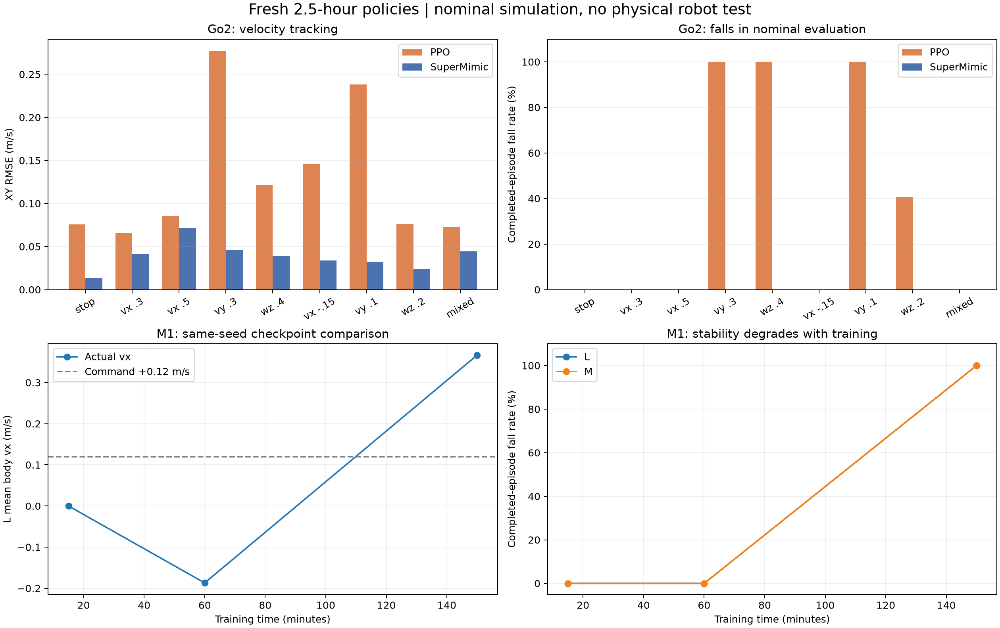

# 正式策略评估与 Go2 部署交付（2026-11-04）

本次完成 Go2 PPO、Go2 SuperMimic、M1-Piper reward-only SuperMimic 的独立真实仿真评估，以及两份 Go2 正式策略的重新导出、C++ 一致性和原生 MuJoCo 闭环检查。未运行实机控制，未重新训练。

本次文档提交包含本报告和下方对比图。文中的 `/home/yifeiy/...`、`logs/...`、checkpoint 和部署包均为实验主机上的本地路径，未随报告上传 GitHub。

**结论：Go2 SuperMimic 在本轮九条指令上均未跌倒，PPO 前进可用但纯侧移/原地转向失败；M1 最终策略发生明显退化，不能作为可部署结果。**

## 训练预算和比较口径

| 项目 | Go2 PPO | Go2 SuperMimic | M1-Piper SuperMimic |
|---|---:|---:|---:|
| 环境数 | 3072 | 3072 | 2048（1024 L + 1024 M） |
| 从头训练/seed | 是 / 2026 | 是 / 2026 | 是 / 2026，无 motion prior |
| 实际墙钟时间 | 9004.077 s | 9004.034 s | 9038.099 s（含初始化） |
| 每环境真实步数 | 24288 | 18600 | 5400 |
| 真实转移数 | 74,612,736 | 57,139,200 | 11,059,200 |
| 学习更新 | 759 PPO updates | 7424 WM 事件、7224 Actor updates | 2144 WM 事件、1844 Actor updates |
| 最终 Go2 课程 | B（stage 1） | C（stage 2） | 不适用 |

两份 Go2 共用奖励、3072 envs、seed、控制频率、Actor 和任务配置，足部抬高奖励关闭、对角/滑脚开启；资源/接口合同测试 7 项通过。主对比控制约 2.5 h 墙钟时间，不能同时声称迭代、优化次数或实际 command 分布相同：PPO 与 SuperMimic 的算法更新含义不同，且自适应课程最终分别停在 B/C。PPO 数据量约为 SuperMimic 的 1.306 倍。B 的侧向范围为 ±0.15 m/s，原五条指令中的 0.3 m/s 侧移超出其最终课程范围；新增 0.1 m/s 纯侧移仍然失败。

## Go2 独立评估

统一 seed=2026，每条指令 64 环境、取 64 个完成 episode，最长 10 s/episode，使用确定性 Actor；关闭 DR、执行噪声、观测噪声和 reset 噪声，固定命令并关闭命令课程。包含起步瞬态，终止状态取自动 reset 前的 Replay 记录。64 环境使用相同名义初态，主要是重复名义场景检查，不能当作 64 个独立随机扰动或多 seed 鲁棒性样本。

表中 RMSE 为 XY 误差向量模的均方根与 yaw-rate RMSE（各 episode 先算再平均），不能以提前跌倒后的短轨迹均值替代稳定跟随结论。

| 指令 (vx,vy,wz) | PPO 实际 (vx,vy,wz) | SM 实际 (vx,vy,wz) | PPO XY/yaw RMSE | SM XY/yaw RMSE | 跌倒率 PPO / SM |
|---|---|---|---|---|---|
| (0, 0, 0) | (0.038, -0.006, -0.022) | (0.000, 0.001, 0.004) | 0.076 / 0.037 | 0.014 / 0.014 | 0.0% / 0.0% |
| (0.3, 0, 0) | (0.343, -0.004, -0.014) | (0.282, 0.003, -0.009) | 0.066 / 0.037 | 0.041 / 0.018 | 0.0% / 0.0% |
| (0.5, 0, 0) | (0.545, -0.020, -0.001) | (0.458, -0.001, -0.019) | 0.086 / 0.041 | 0.071 / 0.028 | 0.0% / 0.0% |
| (0, 0.3, 0) | (0.136, 0.350, -0.029) | (-0.024, 0.310, -0.008) | 0.277 / 0.172 | 0.046 / 0.018 | 100.0% / 0.0% |
| (0, 0, 0.4) | (0.029, -0.030, 0.118) | (-0.035, 0.006, 0.392) | 0.121 / 0.347 | 0.039 / 0.042 | 100.0% / 0.0% |
| (-0.15, 0, 0) | (-0.010, 0.003, -0.031) | (-0.168, 0.003, 0.000) | 0.146 / 0.059 | 0.034 / 0.026 | 0.0% / 0.0% |
| (0, 0.1, 0) | (0.082, 0.147, -0.042) | (-0.021, 0.100, -0.010) | 0.238 / 0.129 | 0.032 / 0.021 | 100.0% / 0.0% |
| (0, 0, 0.2) | (0.026, -0.004, 0.091) | (-0.011, 0.009, 0.182) | 0.076 / 0.157 | 0.024 / 0.041 | 40.6% / 0.0% |
| (0.3, 0.1, 0.2) | (0.344, 0.090, 0.186) | (0.278, 0.104, 0.197) | 0.073 / 0.068 | 0.045 / 0.025 | 0.0% / 0.0% |

PPO 在零指令下仍有约 0.038 m/s 前漂；−0.15 m/s 指令下实际约 −0.010 m/s，基本没有倒退跟随。它对带前进的混合指令比纯侧移/纯旋转更好。SuperMimic 本轮表现较好，但 0.5 m/s 时仍有约 0.042 m/s 的欠速；九个固定指令成功不等于速度突变、扰动、地形或实机已经通过。

足滑、对角支撑和四足峰值离地高度也在原始 JSON 中；足滑用 FK 高度阈值识别 stance，是几何代理指标，不应直接当成接触传感器测量。PPO 跌倒时的峰值抬脚不能解释为优良步态。

## M1-Piper 评估及退化定位

主评估 seed=123，每组 64 环境、30 s；使用 checkpoint 保存的 v3 动作定义和 high-carry 姿态，无 motion prior、无 DR/执行噪声。balanced 按 L/M 各半，L-only 固定 `(0.12,0,0)`，M-only 按训练目标分布采样世界点。未结束的 episode 不计入终点/跌倒率统计；过程中误差仍覆盖全部 step。成功要求距离 <0.08 m、非跌倒并持续保持 0.5 s。跌倒终止是根部高度 <0.2 m 或倾角超过 70°。

| 评估 | L XY RMSE | L yaw RMSE | L 跌倒率（完成数） | M 终点距离 | M 跌倒率（完成数） | M 保持成功率 |
|---|---:|---:|---:|---:|---:|---:|
| balanced | 0.599 | 1.288 | 99.6% (226) | 1.771 m | 99.6% (263) | 0.0% |
| L 固定前进 | 0.580 | 1.421 | 97.9% (422) | — m | — (0) | — |
| M 目标点 | — | — | — (0) | 1.811 m | 99.0% (510) | 0.0% |

为区分“没有学会”和“后续学坏”，另外对正式运行的三个 checkpoint 使用完全相同的 seed=123、16 envs、20 s、balanced、L 指令 `(0.12,0,0)`：

| checkpoint | Actor updates | L 实际 vx | L XY RMSE | L 明显倒退比例（vx<−0.02） | L/M 跌倒率 | M 终点距离 | M 保持成功率 |
|---|---:|---:|---:|---:|---:|---:|---:|
| 015m | 40 | 0.000 | 0.120 | 0.0% | 0.0% / 0.0% | 0.303 m | 0.0% |
| 060m | 644 | -0.187 | 0.443 | 81.5% | 0.0% / 0.0% | 0.577 m | 0.0% |
| final | 1844 | 0.367 | 0.595 | 19.6% | 100.0% / 100.0% | 1.825 m | 0.0% |

15 分钟策略基本静止而不是成功跟随；60 分钟开始明显反向，最终失稳。因此更长训练没有带来持续改善。三份 checkpoint 的 actuator contract 和 robot_model_sha256 相同，评测复用保存的动作/姿态定义；这一组对比没有更换机器人模型或目标接口。

### 当前证据支持什么

训练 it1000 的 WM NSE1/NSE8 约 0.0012/0.0036，it2500 已升至 0.1543/0.3976，最后为 0.1476/0.5329；真实训练回报也明显下降。早期低 NSE 是在近静止分布上取得的，不能证明接触切换、轮子响应或 Actor 梯度已经正确。最终日志的 imagined survival 约 0.931 与独立真实仿真频繁跌倒并存；这是约 8×0.02=0.16 s 的短时预测统计，不能解释为完整 episode 的存活率。

这些结果支持“Actor 更新过程中稳定性退化且 WM 在变化分布上不够可靠”，但不能据此唯一归因于 WM、奖励、探索或数据接口。旧 motion-prior 训练的问题也不能用这次无 prior 结果直接解释。

### 建议下一轮优先处理

1. 先加入定期真实 L/M 分项评估和最佳 checkpoint 保留；依据跌倒率、正向指令的倒退比例、终点距离限制 Actor 更新。early stopping 可防止把最终模型默认为最佳模型，但15分钟模型仍只会静止。
2. 在真实仿真上对相同状态做正负轮速/关节动作扰动，比较 WM 与真实动力学在 1/4/8 步的响应方向及有限差分梯度；先验证梯度符号，再扩大 BPTT 更新。不能只根据全局 NSE 调整学习率。
3. 验证集覆盖动作变化、接触切换与失稳边缘；保留稳定姿态 replay，并根据 held-out 多步误差门控 Actor，降低 Actor 更新幅度/频率。当前固定 300 次预热不足以保证分布变化后模型一直可信。
4. 分别做 L-only 与 M-only 短实验，区分多任务冲突与共同的动力学/探索问题。奖励调整先做逐项量级审计：真实进度、稳定性、动作饱和和终端失败成本；在校准 WM 后再比较稀疏终点项、稠密过程项和更长 horizon。

本轮没有改奖励、算法或训练权重，以保留这次正式基线。

## Go2 导出和部署检查

两份正式策略已重新导出到 `/home/yifeiy/rl_sar/policy/go2/{ppo_velocity,supermimic_velocity}/`。每个目录均有 TorchScript `policy.pt`、`config.yaml`、`manifest.json`、Python 推理包 `policy_inference.pt`；manifest 的 source checkpoint/SHA 指向本轮最终模型。

| 检查 | PPO | SuperMimic |
|---|---:|---:|
| Python 导出动作最大误差 | 0 | 0 |
| C++ 历史→推理→PD 目标最大误差 | 3.87e-07 | 9.83e-07 |
| 原生 MuJoCo 5 指令 | 侧移/转向跌倒，与 Python 一致 | 全部未跌倒，与 Python 一致 |

已核对 5×45 时序历史、训练时 term-major 转换、最新命令、一次缩放、首帧填充、SDK 关节映射、默认姿态、0.25 动作幅度、Kp40/Kd1、50 Hz/200 Hz 频率。`rl_real_go2` 和 `rl_sim` 构建成功，依赖库解析正常，7 项合同测试通过。Go2 实际源 checkpoint SHA 与导出 manifest 已逐份重新比对。

完整部署操作保存在实验主机的 `/home/yifeiy/rl_sar/docs/GO2_PPO_SUPERMIMIC_DEPLOY_20261104.md`。新增的辅助脚本只校验文件、选择策略并调用已有可执行文件：

```bash
cd /home/yifeiy/rl_sar
bash scripts/run_go2_comparison_policy.sh --check supermimic
bash scripts/run_go2_comparison_policy.sh --check ppo
# 实机终端中，替换实际网卡；本机 ROS1 构建需已有 ROS master：
GO2_IFACE=实际连接Go2的网卡名
bash scripts/run_go2_comparison_policy.sh supermimic "$GO2_IFACE"
# 退出后选择 PPO：
bash scripts/run_go2_comparison_policy.sh ppo "$GO2_IFACE"
```

实机尚未验证；现有起立姿态衔接、硬件时延和电机侧限幅仍是实际边界。特别是 RLControl 下发 q/Kp/Kd，训练的 torque_limits 不代表已在电机侧实施同样软件饱和。PPO 已观察到的纯侧移/转向失败会随模型一起部署，不能因为接口测试通过就声称策略已具备这些能力。未向 Orin 自动传输文件。

## 结果文件、图和复现



- 原始 Go2 指标：`logs/final_evaluation_20261104/{ppo_velocity,supermimic_velocity}_{evaluation,extra}.json`。
- 完整 C++/sim2sim：同目录 `deploy_{ppo_velocity,supermimic_velocity}/validation.json`，含输入 fixture 与实际输出。
- M1 最终：`m1_{balanced,forward,manipulation}.json`；退化对比：`m1_matched_{015m,060m,final}.json`。
- `training_summary.json` 保存课程和中间 checkpoint 元数据；`contract_tests.log`、`rl_sar_build.log` 保存检查结果。
- 复现参数可查同目录 `run_evaluations.py`、`run_followup.py`、`go2_extra.py`；重跑前先确认 GPU 空闲，仍使用 Conda supermimic 和现有资源保护器。
- 可迁移包：`logs/final_evaluation_20261104/go2_deploy_bundle_20261104.tar.gz`，含两份策略、rl_sar 所需源码修改、启动脚本、部署说明及校验文件；不含 x86 可执行文件或依赖库。目标机按其 rl_sar 环境构建。
