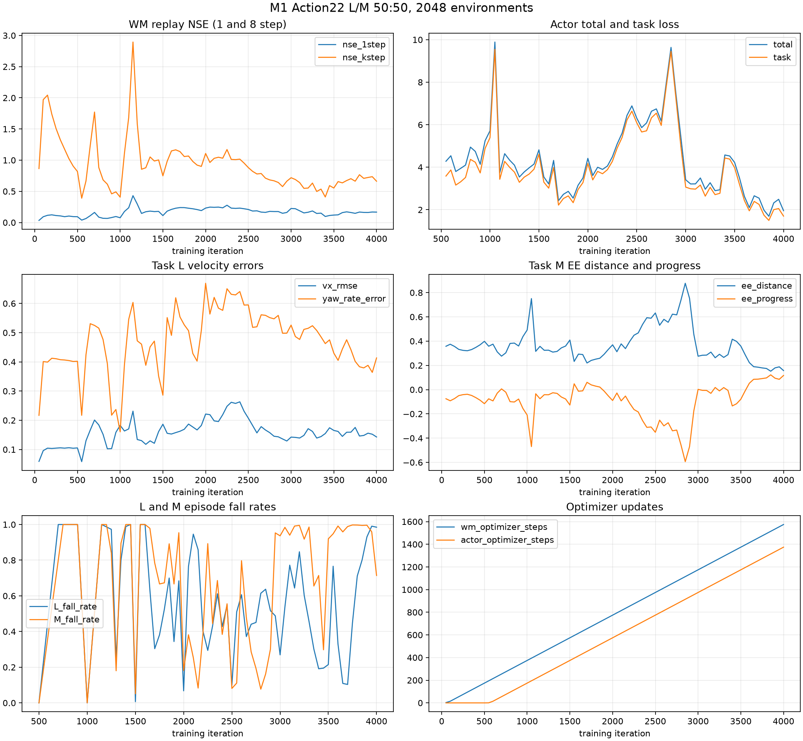

# M1 Action22 L/M 50:50 2048 环境训练结果与误差审计

日期：2026-11-03
运行：`m1_action22_v1_LM50_2048_1h_20261103`
训练代码基线：`f7858a6cf327e668de84341681292beeb061293e`

## 结论摘要

2048 个 MuJoCo 环境完成了约 1 小时训练，固定配额为 L 1024、M 1024；Replay 优化批次也各取 16 个 L/M 窗口。训练未发生 CUDA OOM、NaN/Inf 或仿真崩溃。训练产生了 15/30/45/60 分钟和最终 Checkpoint。四种最终 Actor/Prior Direct 评估及六份快照 Actor 评估均完成。

这轮结果**没有达到可用的 L/M 控制性能**：最终 L Actor 对 ID 前进命令的跌倒率为 1.0，实际速度反向比例为 0.561；M Actor 在前向和组合目标上有少量末端进展，但跌倒率分别为 0.844 和 0.353，所有 M 目标的 0.5 秒稳定保持成功率均为 0。Prior Direct 在 L 前进上明显比 Actor 稳定，但反向跟踪很差；M Prior Direct 保持稳定，却没有朝目标推进。

Prior 在整个训练中冻结，实际更新数为 0。`actor_ready=0`，Prior Calibration Gate 未通过；因此本次没有 Prior 校准、也没有可供比较的“训练后 Prior”。不得把冻结 Prior 描述为已被联合训练改善。

## 训练设置与数据

| 项目 | 实际设置/结果 |
|---|---|
| 环境 | M1 + Piper，2048 个并行 MuJoCo 环境，Task `balanced` |
| 任务配额 | 固定 1024 L + 1024 M；LM 未采样 |
| Replay 优化 Batch | 每批 L 16 + M 16；日志和 Checkpoint 配额均为 50:50 |
| 运行时长/迭代 | 1.00 小时，4000 iterations |
| 优化器更新 | WM 1584、Actor 1384、Prior 0；前 200 个 WM-only 阶段迭代 |
| Replay | 容量 32 个状态窗口/环境，约 65,536 行；训练采集约 8,192,000 个并行环境转移 |
| Prior | V3.3 CVAE `checkpoint_best_val.pt`，SHA256 `05a858520790d474f6c1c3dd1f791507c3da91f68899ca88f00348ea4bbff10c` |
| Prior 输入 | `legacy_v1`；q6/qd6 使用真实状态，无均值投影；Projected condition indices 为空 |
| Prior 架构 | History `[4,53]` + Goal `[8]` → Future `[10,31]`；latent 32、hidden 256、3 层；训练来源 `3272` motions |
| Actor | `m1_action_reference_actor_v1`，history 5，Action22；从头训练，没有载入旧 Future31 Actor |
| WM | State57 / Action22，hidden `[2048,2048,2048]`，Replay open-loop 窗口 8 帧，Batch32/Microbatch8 |
| 动作与姿态 | `m1_mixed_action_v3`；非对称绝对位置范围；V3.3 `dataset_v3_3_l_high_carry` 统一 Reset，Root z=0.470m |
| 任务命令 | L：vx `[-0.09,0.145]`、vy `[-0.05,0.055]`、wz `[-0.17,0.18]`；Stop/Reverse/Forward 比例 15/35/50%。M 目标偏移 x `[0.12,0.36]`、y `[-0.20,0.20]`、z `[-0.15,0.15]` m |
| 探索/随机化 | 25% 环境采用有界高斯探索：leg 0.02、arm 0.015、wheel 0.05；观测/动作/reset 噪声与 Domain Randomization 关闭 |
| 固定评估 | seed `20261103`，64 env，最多 500 steps，DR/噪声关闭；独立评估 L/M × Actor/Prior Direct |

Reset 使用统一的 L 高站姿，确保 L 对齐 V3.3。M 的 `dataset_carry` 原始 Root 高度约低 0.0807m，腿部髋/膝也有姿态差异；本轮未实现任务条件 Reset。M 目标在物理 Reset 后相对 TCP 生成，并固定为 episode 世界坐标。M 训练因此存在初始状态分布错配，影响其 Prior 条件与训练结论。

训练速度约 1.1 iterations/s。GPU 监控 752 个样本：显存使用峰值 9078 MiB、均值 4535 MiB；GPU 利用率均值 76.4%、峰值 94%；温度峰值 57°C。日志中 PyTorch 进程自身峰值分配约 0.29 GiB；它不包含其他 GPU 使用量，应以 `nvidia-smi` 监控 CSV 为准。无自动重启或异常恢复。

运行时 Git `HEAD` 是上表提交，但工作树当时有未提交代码。训练启动后又修正了训练日志聚合分母和正向命令反向速度比例的筛选条件；正在运行的 Python 进程不会热加载这些更改。因此，代码修复通过了当前全套测试，但这两项日志修正没有在本次训练过程中生效；相应的最终比例以独立固定评估为准，不把训练 TensorBoard 的这些分项当作精确统计。此次提交只包含 M1 相关文件，原有 Go2/G1 工作保留在工作树并未一并提交。

完整配置摘要、Checkpoint SHA256、GPU 采样和评估指标见 [`summary.json`](../results/m1_action22_v1_LM50_2048_1h_20261103/summary.json)；TensorBoard 全部 226 个 scalar tag 已导出到 [`training_scalars.csv`](../results/m1_action22_v1_LM50_2048_1h_20261103/training_scalars.csv)。

## WM 误差：不是 Actor 想象 rollout 太短

这里的 WM `NSE8` 是对真实 Replay 窗口进行 8 帧 open-loop 预测，时间跨度约 `8 × 20 ms = 0.16 s`。它不是 Actor imagination rollout 的长度指标。把 Actor imagination 拉长不会修复 WM；如果 WM 有偏差，更长的规划反而会累计更多模型误差。若要判断更长的 WM rollout 是否必要，应先保证动作覆盖、终止数据和多步预测训练稳定，再另做 horizon 消融。

| 指标 | 一步 Replay 预测 | 八步 Replay 预测 | 解释 |
|---|---:|---:|---|
| 综合 normalized NSE | 约 0.159 | 约 0.628 | 多步误差明显累积；训练中曾更高且有明显波动 |
| Root position RMSE | 0.0029 m | 0.0271 m | 单帧较小，八帧已到厘米级 |
| Root velocity RMSE | 0.113 m/s | 0.297 m/s | 已与本轮最大 ID 命令同量级或更大 |
| Arm position RMSE | 0.0189 rad | 0.0667 rad | 多步误差扩大 |
| Wheel velocity RMSE | 1.83 rad/s | 2.32 rad/s | 一步就有较明显误差，且多步仍高 |

训练最后记录的 WM 1/8 步 NSE 为 `0.159/0.628`；中段 8-step 指标达到约 `1.74` 后下降，曲线整体并非单调收敛。终止标签在末尾 Replay Batch 的比例约 `0.00039`，样本稀疏会限制终止头校准。Replay 诊断没有独立 held-out 集，因此这些值只说明 Replay 窗口上的预测误差，不能据此声称未见状态泛化通过。

迭代数也高估了 WM 学习量：4000 环境迭代实际只有 1584 次 WM optimizer update，而非每轮一次。每次 WM Batch 只有 32 个 8 帧窗口，且 2048 环境下 L/M 任务各占一半、接触和目标状态多样。产生 819 万环境转移不等于优化器遍历了 819 万条独立样本，Replay 有界且窗口高度重叠。

因此现有证据更支持“**多步误差累积 + 单步动作/轮速响应误差 + 有效优化次数/数据覆盖有限**”，不能简单归因于 rollout 太短。无法仅凭本轮实验判定架构容量不足或 Replay 过拟合；应补做动作条件分层的 held-out 响应测试，再判断是否需要增加多步训练 horizon。

## 最终真实 MuJoCo 评估

### Task L

主要 ID 命令：停止 `0`、正向 `+0.12 m/s`、反向 `-0.06 m/s`。OOD 命令单独标记，不用于成功判断。每组是多个 episode 汇总；`signed dx` 为评估 episode 的平均有符号前向位移。

| 控制器 | 命令 | OOD | vx RMSE (m/s) | 负向实际 vx 占正向命令 | Signed dx (m) | Fall rate | Wheel ref RMSE (rad/s) |
|---|---|---:|---:|---:|---:|---:|---:|
| Actor | Stop | 否 | 0.131 | — | -0.031 | 0.667 | 3.36 |
| Prior Direct | Stop | 否 | 0.085 | — | +0.082 | 0.000 | 2.52 |
| Actor | Forward +0.12 | 否 | 0.178 | 0.561 | +0.029 | 1.000 | 2.97 |
| Prior Direct | Forward +0.12 | 否 | 0.088 | 0.134 | +0.410 | 0.000 | 2.28 |
| Actor | Backward -0.06 | 否 | 0.134 | — | -0.031 | 0.941 | 3.19 |
| Prior Direct | Backward -0.06 | 否 | 0.111 | — | -0.000 | 0.000 | 2.45 |

正向 ID 结果表明：同一个 Action22 和执行器映射下，Prior Direct 能驱动机器人向前且不跌倒；训练后的 Actor 却多数时间反向并全部跌倒。因而这不是“电机映射必然反号”，而是 Actor 学出的动作/状态反馈明显不可靠。另一方面，Prior Direct 的反向位移约为零、Prior 参考动作的反向方向错误率约 0.488，说明 Prior 也没有解决完整 L 速度任务。控制器差异是配对评估证据，不等价于单一因素因果消融。

### Task M

| 控制器 | 固定目标 | EE 平均进展 (m) | 结束窗口距离 (m) | Fall rate | Base 位移 (m) | 稳定保持 0.5s |
|---|---|---:|---:|---:|---:|---:|
| Actor | 前方 | +0.035 | 0.201 | 0.844 | 0.328 | 0.000 |
| Prior Direct | 前方 | -0.119 | 0.349 | 0.000 | 0.137 | 0.000 |
| Actor | 侧向* | +0.041 | 0.190 | 0.789 | 0.228 | 0.000 |
| Prior Direct | 侧向* | -0.267 | 0.665 | 0.000 | 0.269 | 0.000 |
| Actor | 向上 | -0.099 | 0.390 | 1.000 | 0.194 | 0.000 |
| Prior Direct | 向上 | -0.154 | 0.390 | 0.000 | 0.139 | 0.000 |
| Actor | 前方+侧向 | +0.068 | 0.194 | 0.353 | 0.414 | 0.000 |
| Prior Direct | 前方+侧向 | -0.138 | 0.488 | 0.000 | 0.192 | 0.000 |

`*` 侧向目标 x 偏移 0.10m，低于训练目标 x 的 0.12m 下限，按 OOD 单列。Actor 在前方/组合目标上比 Prior Direct 更接近目标，但仍未稳定保持，且跌倒明显；向上目标没有取得进展。Prior Direct 稳定但目标方向/幅度不正确。

四份完整最终评估 JSON 与六份快照评估 JSON 位于 [`results/...`](../results/m1_action22_v1_LM50_2048_1h_20261103/)。评估使用相同 seed、初始 Reset 契约、环境数量、步数、无 DR/noise。测试时 episode 会因跌倒而提前结束，episode 数在组间不同。

## 15/30/45 分钟快照趋势

| 时间点 | Checkpoint iter | L 正向 vx RMSE | L 正向 fall | L signed dx | L 正命令反向比例 | M 组合 EE 进展 | M 组合 fall | M hold success |
|---|---:|---:|---:|---:|---:|---:|---:|---:|
| Initial | — | N/A | N/A | N/A | N/A | N/A | N/A | N/A |
| 15 min | 1077 | 0.157 | 0.100 | +0.364 m | 0.274 | -0.603 m* | 0.000* | 0.000 |
| 30 min | 2034 | 0.200 | 0.950 | -0.139 m | 0.627 | -0.327 m* | 0.188* | 0.000 |
| 45 min | 3010 | 0.133 | 0.846 | +0.193 m | 0.271 | -0.176 m* | 0.000* | 0.000 |
| 60 min snapshot | 3982 | N/A | N/A | N/A | N/A | N/A | N/A | N/A |
| Final | 4000 | 0.178 | 1.000 | +0.029 m | 0.561 | +0.068 m | 0.353 | 0.000 |

`*` 快照 M 使用同样预先定义的组合目标，但实际记录 `mean_ee_progress_m`/fall 以各 checkpoint 的 episode 批次汇总；侧向单独目标仍是 OOD。60 分钟文件存在，但固定评估只跑在 4000 iteration 最终状态；不将 3982 的结果插值成已测表现。初始未保存 Actor Checkpoint，因此为 N/A。

性能波动大且没有随训练单调改善。15 分钟时 L 前进表现最好；之后跌倒和反向比例大幅上升。最终 M 有前向与组合目标进展，但 hold 仍为零。训练 Loss 下降不能替代真实 MuJoCo 指标。

## Actor、Prior、WM 的故障归属

| 子系统 | 实验证据 | 判断 |
|---|---|---|
| Motion Prior 参考 | L 正向 Prior Direct 正常前进；L 反向 Prior 参考方向错误率 0.488；M Prior Direct 四类目标都为负 EE 进展 | L 前向参考可用但不完整；反向和 M 参考质量是已观察到的瓶颈 |
| Actor 梯度 | Actor 梯度范数非零；新增单元测试检查动作损失梯度回传。训练最终 Actor 在 L 正向反向比例 0.561、跌倒 1.0 | “梯度没有到 Actor”不符合证据；Actor 收到梯度但学习结果差。不能由此证明 WM action gradient 数值准确 |
| Action/执行器映射 | 正向同契约的 Prior Direct 实际前进，Actor 初始 residual 为零并由 Prior 初始化；Actor 训练后失效 | 全局 wheel 反号不是主要解释；Actor 动作更新/目标优化或模型梯度可能造成退化。仍需 action-conditioned WM 对真实 MuJoCo 的 held-out 对照 |
| World Model | Replay 一步 root velocity RMSE 0.113m/s，八步 0.297m/s；wheel velocity RMSE 1.83/2.32rad/s；NSE8 约 0.63 且波动 | 足以影响想象优化的可信度；但单凭 Replay NSE 无法证明它是 Actor 失败的唯一原因 |
| 终止头 | 末期 Replay Batch 终止标签比例约 0.00039；平均终止预测概率约 0.0023 | 终止正样本很稀疏；新失败损失代码有显式测试，但低预测概率仍可能使生存惩罚较弱 |
| L/M 竞争与 Reset | 固定各半成立，但高站姿统一 Reset 与 M 较低 carry 分布相差约 8.1cm Root 高度 | M 参考条件存在分布偏移；本轮没有消融任务比例或 Reset 的因果贡献 |
| Task M 目标可达性 | M Actor 有部分进展但未保持，向上失败；M Prior Direct 稳定而不进展 | 可达性、Prior 条件质量和底盘策略皆可能相关，现有结果不足以分离 |

### 对“WM 迭代很多，误差为什么还是大”的直接回答

这轮的 4000 是环境迭代，不是 4000 次 WM 更新。Checkpoint 计数是 1584 次 WM update、每次 Batch32；Replay 只有 8-step 窗口，终止正样本极少。并且模型的一步轮速和根部速度误差已经不小，反馈到八步 open-loop 后自然积累。**目前优先补的是动作覆盖和可验证的多步/动作条件预测能力，而不是简单增加 Actor rollout 长度。**

本轮没有证明是模型结构本身写错，也没有证明只需把 WM rollout 从 8 加长即可解决。建议先做固定初态、单独扫正/反 wheel 与 leg/arm action 的 MuJoCo-vs-WM 响应审计，按 L/M 和接触状态分桶，报告 1/2/4/8 步偏差；再针对误差最大的动作桶补 Replay/WM 更新。确保梯度方向有真实物理对应后，才做 8 vs 16/32 horizon 对照。

## Gate 与 Prior Calibration

- Prior Gate：blocked，`prior_gate_pass=0`。
- Actor readiness：未达标，arm tracking 与 wheel tracking 项失败，且任务真实安全表现不足。
- Prior updates：0；Prior SHA 在所有 Checkpoint 中一致。
- 没有通过更改 Gate 阈值或用 Replay NSE 替代真实动作校准来解冻 Prior。
- 当前**不具备**开展 Prior Calibration 的条件：先修复 L/M Actor 的真实稳定性和方向响应，再生成与冻结 WM 快照、Action Contract 完全匹配的真实物理响应证据。

## 下一轮优先级（最多三项）

1. **先建立 action-conditioned WM 响应审计集。** 对同一物理初态与固定接触，分别测正负 wheel、腿姿态和 Piper 目标的 MuJoCo 真值与 WM 1/2/4/8-step；重点追踪本轮 0.113m/s 一步 root velocity、1.83rad/s 一步 wheel velocity 误差及反向指令错误。它能直接区分 WM 梯度误导与 Actor 优化失稳。
2. **拆开 L 与 M 的 Actor 诊断，再恢复共享训练。** L 正向 Prior Direct 成功而 Actor 失败；M 中 Actor 有进展但不稳定，Prior 稳但无进展。先用固定 Reset 分别做 Actor action residual/BC/Task 梯度方向对照；同时为 M 实施经过物理验证的任务条件 Reset，避免把 M carry 状态错配归因于优化器。
3. **补充安全、可复现的数据与终止样本后重训 WM。** 末期终止标签率仅约 0.00039，轮速预测误差高；增加覆盖受控 wheel/action 范围和安全接触转换的数据，并用独立 held-out 动作响应集验收，再决定是否增加 WM open-loop 训练 horizon。先不要解冻 Prior。

## 可复核文件

验证：`pytest -q` 在 CUDA 可见环境中通过，`145 passed, 65 warnings`；覆盖 M1 终止损失、梯度、配额、Replay、Gate/rollback 和真实 MuJoCo smoke tests。`compileall`、`git diff --check` 和启动脚本 `bash -n` 也通过。

- 训练标量 CSV：[`training_scalars.csv`](../results/m1_action22_v1_LM50_2048_1h_20261103/training_scalars.csv)
- 固定评估指标 CSV：[`evaluation_metrics.csv`](../results/m1_action22_v1_LM50_2048_1h_20261103/evaluation_metrics.csv)
- 训练曲线：[`training_curves.png`](../results/m1_action22_v1_LM50_2048_1h_20261103/training_curves.png)
- GPU 监控：[`gpu_monitor.csv`](../results/m1_action22_v1_LM50_2048_1h_20261103/gpu_monitor.csv)
- 结构化汇总及 Checkpoint 哈希：[`summary.json`](../results/m1_action22_v1_LM50_2048_1h_20261103/summary.json)
- V3.3 CVAE SHA256：`05a858520790d474f6c1c3dd1f791507c3da91f68899ca88f00348ea4bbff10c`
- Checkpoint 二进制约 115 MB，不提交到 Git；本地保存在被忽略的 `logs/m1_prior_actor/m1_action22_v1_LM50_2048_1h_20261103/`，SHA256 列在 `summary.json`。
