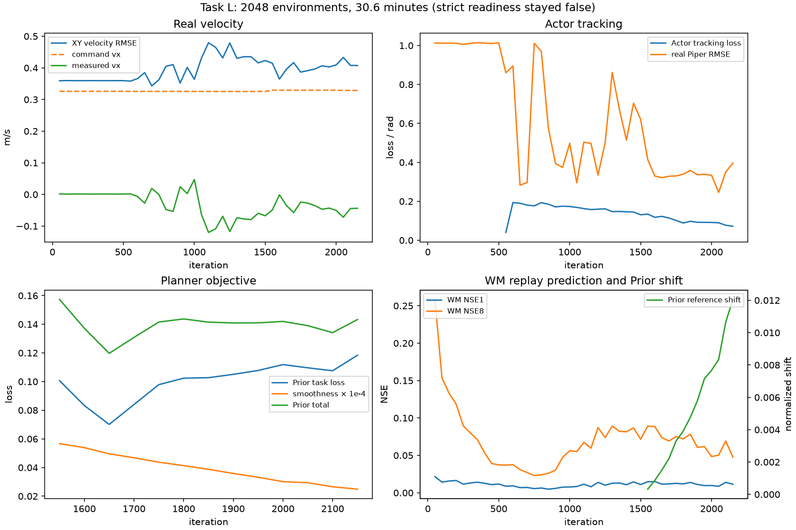
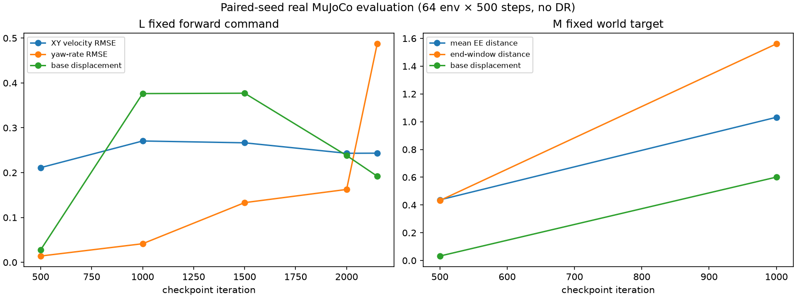

# M1 Task L: 2048-Environment Training Results

Date: 2026-11-02
Base Git revision: `0bda727aaf5b422af792017ac3afb3190db92ee1`
Run: `logs/m1_prior_actor/m1_prior_L_2048_30min_ctrl_v2_20261102`

## Run and stage history

The run used 2048 M1-Piper environments, privileged velocity state for the Prior, 10-step imagination, no observation/reset/action noise, domain randomization enabled, replay capacity 1000, logical/microbatch `32/8`, one WM optimizer step per event, `updates_per_env_step=0.4`, and a 0.5-hour wall-clock limit. The controlled research mode used `prior_lr=1e-6`, `actor_lr=2e-4`, 200 WM events, 384 Actor warmup steps, 100 real readiness samples, and explicit survival/height/tilt/saturation conditions.

The run ended normally at iteration 2150 after 0.51 hours (about 30.6 minutes): approximately 4,403,200 vector-environment steps, 844 WM optimizer steps, 644 Actor steps, and 260 Prior steps. The stages were WM warmup → controlled Actor warmup → controlled research joint updates. The Prior began updating at iteration 1550. The strict quality flags remained `wm_ready=0` and `actor_ready=0`; the controlled safety/warmup gate passed. This is therefore a research-mode joint run, not a strict-readiness run.

The regular Checkpoints are iterations 500, 1000, 1500 and 2000, plus final `ckpt_latest.pt` at 2150. The latest checkpoint confirms Action contract `m1_mixed_action_v2`, Prior optimizer LR `1e-6`, Actor LR `2e-4`, and 844/260/644 optimizer steps. Replay state is not stored, so resuming must recollect transitions. The exact command, TensorBoard events, console log, and checkpoints remain locally under `logs/m1_prior_actor/m1_prior_L_2048_30min_ctrl_v2_20261102/`; these run artifacts are intentionally not stored in Git.

Average throughput was approximately 1.17 iterations/s or 2,400 environment steps/s; the final interval slowed to about 1.0 iteration/s after Prior BPTT started. Trainer-reported peak PyTorch allocation was 1.40 GiB. Concurrent `nvidia-smi` samples peaked around 9.2 GiB total GPU use; there was no OOM or NaN.

## Training curves and final metrics

At iteration 2150:

| Metric | Result |
|---|---:|
| Mean commanded `vx` | 0.329 m/s |
| Real body-frame `vx` | −0.044 m/s |
| Real XY velocity RMSE | 0.407 m/s |
| Real yaw-rate error | 0.326 rad/s |
| Mean wheel angular-rate magnitude | 0.700 rad/s |
| Mean base height | 0.334 m |
| Survival | 1.0 |
| Action saturation | 0.04% |
| WM replay NSE1 / NSE8 | 0.011 / 0.048 |
| Actor tracking loss | 0.072 |
| Real Piper tracking RMSE | 0.396 rad |
| Prior task loss | 0.118 |
| Prior raw smoothness diagnostic | 249.1 |
| Prior grad norm | 0.735 |
| Prior normalized reference shift | 0.0121 |
| Prior goal sensitivity | `2.48e-5` |

The configured smoothness weight was `1e-4`, so the final raw smoothness diagnostic contributed about `0.025` before other coefficients. It fell from about 567 at the first Prior update to 249. The Planner task loss fell briefly from 0.101 to 0.070, then rose to 0.118. Reference shift grew, but the Prior's measured response to changing the goal stayed near zero.

The real command-compliance curve did not improve: velocity RMSE was about 0.360 m/s before Actor updates and 0.407 m/s at the end. The mean measured forward velocity was slightly backward despite a positive forward command. Survival stayed high, so stability was not the limiting metric.

## Fixed-seed real-MuJoCo checkpoint evaluation

Checkpoints were evaluated with the same seed, 64 environments, 500 control steps, zero noise and no domain randomization. The forward group uses `[0.30, 0, 0]`; lateral/yaw-only commands are separate out-of-training-distribution diagnostics. Values below are for the forward group.

| Checkpoint | XY velocity RMSE (m/s) | Yaw RMSE (rad/s) | Mean base displacement (m) | Piper tracking RMSE (rad) | Falls |
|---:|---:|---:|---:|---:|---:|
| 500 | 0.211 | 0.014 | 0.028 | 1.234 | 0% |
| 1000 | 0.271 | 0.041 | 0.376 | 0.245 | 0% |
| 1500 | 0.267 | 0.133 | 0.377 | 0.378 | 0% |
| 2000 | 0.243 | 0.163 | 0.238 | 0.342 | 0% |
| 2150 | 0.243 | 0.487 | 0.192 | 0.491 | 0% |

The Actor learned to track some joint references better than at iteration 500, but the fixed command evaluation shows no reliable velocity improvement. The last checkpoint has materially worse yaw tracking than the early checkpoint. Higher base displacement at iterations 1000–1500 did not correspond to good velocity tracking; it was mostly uncontrolled drift.

Evaluation JSON and logs are in the local, Git-ignored directory `logs/m1_prior_actor/fixed_eval_20261102/`. The fixed-evaluation runner is [evaluate_m1_prior_joint.py](../scripts/evaluate_m1_prior_joint.py).

## Conclusion

The training system updated all three optimizers without numerical failure, but 30 minutes did not produce useful Task L locomotion. The prior did not become meaningfully goal-sensitive, and imagined loss changes did not transfer to real command compliance. Do not treat this run as evidence of a successful deployable controller. The Prior state source was privileged, so this experiment is not a proprioception-only deployment result.
