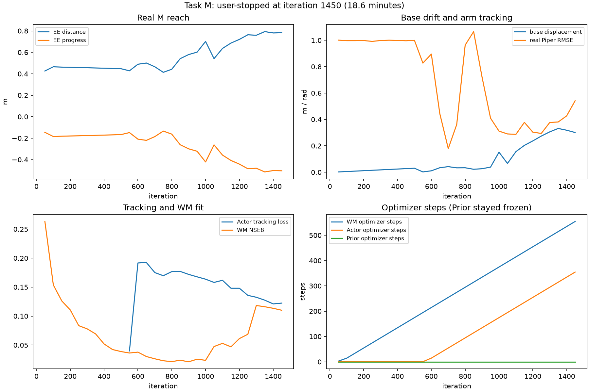

# M1 Task M: Interrupted 2048-Environment Training Results

Date: 2026-11-02
Base Git revision: `0bda727aaf5b422af792017ac3afb3190db92ee1`
Run: `logs/m1_prior_actor/m1_prior_M_2048_30min_ctrl_v2_20261102`

## Stop status and saved artifacts

This run was stopped on the user's instruction after 1450 iterations, about 0.31 hours (18.6 minutes). It did not run for 30 minutes. It used the same independent 2048-environment configuration as L, but sampled only fixed-world EE Reach goals. No L checkpoint or Replay was resumed.

The console and TensorBoard logs preserve metrics through iteration 1450. Regular Checkpoints exist at iterations 500 and 1000; `ckpt_latest.pt` is iteration 1000 because the user-requested SIGINT interrupted the loop before its final save. The latest saved Checkpoint has WM/Actor/Prior optimizer counts 384/184/0. The live interrupted run had reached 564/364/0, so 180 Actor updates and 180 WM updates after iteration 1000 are present in logs but are not recoverable from a Checkpoint. No Prior update occurred. Logs and checkpoints remain locally under `logs/m1_prior_actor/m1_prior_M_2048_30min_ctrl_v2_20261102/`; these run artifacts are intentionally not stored in Git.

The run remained in `controlled_joint_warmup`, with 142 real safety samples. Survival, base-height, base-tilt and action-saturation checks passed, as did the finite-metric and WM-event checks. The controlled Actor-pretrain gate did not pass: it required 384 Actor updates and had 364 at the stop. The stricter Actor Gate also remained false because arm and wheel tracking exceeded their thresholds. Strict WM readiness remained false because task-specific held-out NSE thresholds are not calibrated. This run must be reported as **frozen-Prior Actor training**, not joint Prior/Actor training.

The requested signal interrupted MuJoCo Warp's current simulation step, so the process exited with `KeyboardInterrupt` before its final save. This was user-directed stopping, not an OOM or training crash. No other process was stopped. The GPU returned to its idle memory use. The exact command is [command.sh](../logs/m1_prior_actor/m1_prior_M_2048_30min_ctrl_v2_20261102/command.sh).

## Training observations

At the last logged point, iteration 1450:

| Metric | Result |
|---|---:|
| Real mean EE distance | 0.783 m |
| Real mean EE progress | −0.504 m |
| Real base displacement diagnostic | 0.301 m |
| Real base height / tilt | 0.356 m / 0.070 rad |
| Survival / action saturation | 1.0 / 0.19% |
| Real arm tracking RMSE | 0.542 rad |
| Real wheel tracking RMSE | 0.790 rad/s |
| Actor tracking loss | 0.122 |
| WM replay NSE1 / NSE8 | 0.0186 / 0.1101 |
| WM optimizer steps / Actor steps / Prior steps | 564 / 364 / 0 |

EE distance rose from about 0.447 m at iteration 500 to 0.783 m at iteration 1450, with negative progress. Actor tracking loss fell, but the task metric did not. Replay NSE8 was initially around 0.26, reached about 0.02 during early Actor warmup, and rose above 0.11 as the Actor action distribution changed. This is evidence that the early fitted WM did not remain equally accurate on the emerging policy distribution.

## Fixed-seed real-MuJoCo checkpoint evaluation

The saved iterations 500 and 1000 were evaluated with the same seed, 64 environments, 500 steps, no noise and no domain randomization. M targets are fixed in environment-local world coordinates relative to the initial TCP; the four target groups use forward, side, up and combined offsets.

| Checkpoint | Mean EE distance (m) | Mean progress (m) | End-window distance (m) | Mean base displacement (m) | Piper tracking RMSE (rad) | Stable hold success |
|---:|---:|---:|---:|---:|---:|---:|
| 500 | 0.437 | −0.231 | 0.432 | 0.032 | 1.207 | 0% |
| 1000 | 1.032 | −0.826 | 1.561 | 0.601 | 0.314 | 0% |

The Actor tracked the reference better at iteration 1000, but real EE distance and base drift were much worse. Tracking loss alone therefore gave a misleading signal for M reach. The later uncheckpointed training log still showed negative Reach progress.

Evaluation JSON and console logs are under the local, Git-ignored directory `logs/m1_prior_actor/fixed_eval_20261102/`. The full interrupted training log is under the local M run directory above.

## Conclusion

Task M did not improve in the available run. More importantly, the Prior never received a gradient update, so this run says nothing about whether a task-trained Prior can improve Reach. The immediate issue was insufficient Actor warmup plus arm/wheel tracking Gate failure; the next issue is WM error growth under Actor actions. The fixed-seed evaluation shows that better reference tracking did not imply better world-target Reach.
