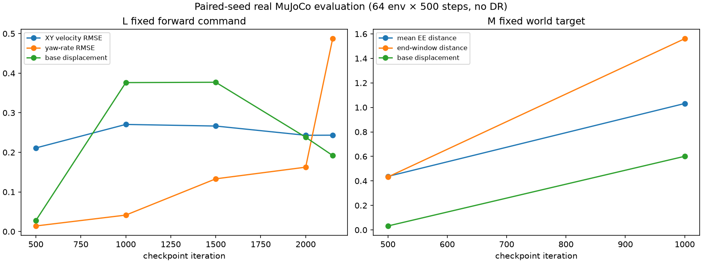

# M1 Next-Stage Recommendations After 2048-Environment Runs

## Decision

| Item | Status | Evidence |
|---|---|---|
| Task L: useful locomotion | **NOT READY** | 30.6-minute run, 260 Prior updates; final real XY velocity RMSE 0.407 m/s and measured forward velocity −0.044 m/s for mean +0.329 m/s command. Fixed-seed forward evaluation stayed around 0.24–0.27 m/s RMSE after iteration 1000. |
| Task M: useful Reach | **NOT READY** | Stopped at 18.6 minutes before any Prior update. Real distance/progress worsened; fixed-eval iteration 1000 had mean EE distance 1.032 m, end-window 1.561 m, base drift 0.601 m and 0% stable hold. |
| Motion Prior update validated | **NOT READY** | L updated 260 times but reference shift was only 0.012 and goal sensitivity stayed around `2.5e-5`; real Task L did not improve. M Prior updates were zero. |
| Strict WM/Actor readiness | **NOT READY** | Both runs logged `wm_ready=0` and `actor_ready=0`; task-calibrated held-out NSE limits are absent, and Piper/wheel tracking Gate failures persisted. |
| RTX 4070 SUPER at 2048 env | **READY for measured runs** | L completed 2150 iterations and M ran to 1450 before user stop; no OOM/NaN. Trainer peak allocation was 1.40 GiB, sampled total GPU use peaked below 10 GiB. This is a resource result, not an algorithm-readiness result. |
| 2-hour training | **NOT READY** | More time would extend known failure modes before the Actor/WM task gaps are fixed. |

## What the experiments say

The gross Mixed Action interface is now consistent and the diagnosed Piper position-reference overflow is fixed. The exact inverse-action MuJoCo replay tracks the 10-frame references, so current failures cannot be explained by the prior targets being universally outside actuator range. Checkpoints store Action contract v2 and reject old joint checkpoints that encode the previous Piper scales.

The Actor learns some reference tracking: L tracking loss fell from about 0.19 to 0.072 and M from roughly 0.18 to 0.12. That did not translate into task performance. In M, fixed-seed evaluation showed a large increase in EE distance and base displacement as the Actor learned the reference. In L, the wheels rotated but body velocity stayed near zero or moved backward. The current prior references had near-zero wheel rates in tested windows, and Prior goal sensitivity was extremely small.

WM NSE8 improved on early replay, then rose under the changed Actor data distribution (M reached 0.11 by iteration 1450). A replay NSE without a held-out, policy-distribution validation set is not enough evidence that BPTT gradients are useful for the real robot.

The training-mode change behaved as designed: `actor_only` cannot release the Prior; `auto_joint` keeps the strict gates; `controlled_joint_experiment` records a separate research Gate. In L, the research Gate released the Prior while strict readiness stayed false. In M, Actor pretraining had only reached 364/384 at stop, so the Prior remained frozen.

## Next changes before another long run

1. **Make the Actor pass a measured tracking Gate before planner updates.** Collect real-MuJoCo reference rollouts and compare actual root/leg/Piper/wheel physical-unit errors and saturation. The strict Gate's arm threshold is 0.25 rad and wheel threshold is 0.75 rad/s; both runs failed at least one. Improve Actor reference tracking through targeted supervised/inverse-action teacher data or a longer actor-only stage, and require sustained held-out success rather than only an optimizer-step count.
2. **Add fixed held-out WM validation for both tasks.** Keep a seeded L set and M set with real transitions from the current policy distribution. Log 1/8/10-step errors in root pose/velocity, joints and TCP in physical units. Pause Prior updates when these errors or imagined-versus-real task progress diverge; do not let finite replay loss alone release it.
3. **Audit the L wheel/leg propulsion reference.** Current frozen CVAE wheel-rate outputs were near zero, while L body velocity remained almost zero and wheel motion did not create translation. Compare feasible Motion Bank windows, inverse action, wheel-only action and coordinated gait under MuJoCo. Establish attainable command limits before increasing command ranges.
4. **Audit M planner gradients against the fixed world TCP target.** Use a fixed target and compare finite differences in MuJoCo with predicted WM gradients. Track arm contribution and base-motion contribution separately. In M evaluation, reject improvements that reduce tracking loss while increasing EE distance or base drift.
5. **Calibrate Prior optimization amplitude.** L used `prior_lr=1e-6`; after 260 updates its normalized reference shift was 0.012. The task loss fluctuated and goal sensitivity remained near zero. Only after WM/Actor gradient directions pass held-out tests, compare `1e-6`, `3e-6`, `1e-5` with the same replay batches and anchor weight. Do not infer a useful planner from gradient norm alone.
6. **Keep separate L and M runs and evaluation sets.** Continue using fixed seeds and the four command/goal groups in `scripts/evaluate_m1_prior_joint.py`. Preserve early, middle and final checkpoints and compare real task metrics, not imagined returns alone.

## Resume and artifact notes

L completed normally and has a final iteration-2150 Checkpoint. M was interrupted by explicit user request at iteration 1450; its latest resumable Checkpoint is iteration1000 and Replay is not saved. Training console and TensorBoard records are local under `logs/m1_prior_actor/`; these binary artifacts were not added to Git. The report and evaluation runner are tracked in the repository.
