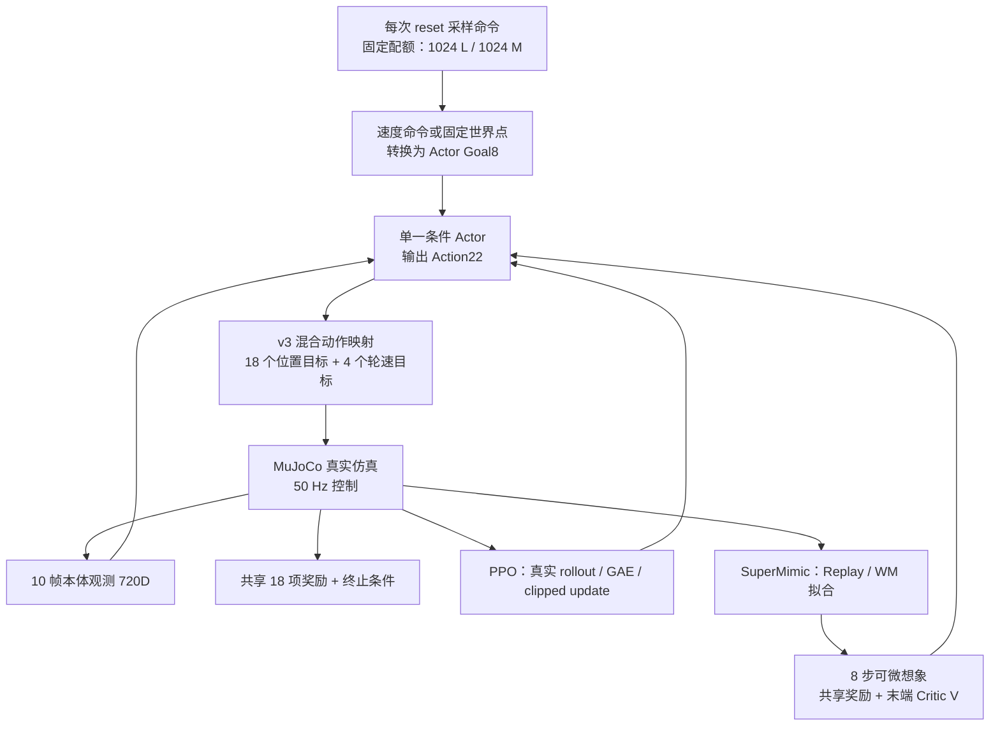

# M1-Piper 当前训练设计审计：任务、奖励、PPO 与 SuperMimic

> 历史范围：本文分析 2026-11-05 的 v1 / H8 / 近距离目标。之后按用户要求改为 v2 / H32 / 3m 圆盘目标；不要把下文“当前”误当成 11-06 新一轮设置。新配置见 [v2 设计](M1_V2_AND_SEQUENTIAL_TRAINING_20261105.md)，新结果见 [v2 评测](M1_V2_RESULTS_AND_FAILURE_ANALYSIS_20261106.md)。

本文依据两轮正式训练保存的配置、当前源码、TensorBoard 以及独立评测结果分析；本轮只补充 play 可视化，没有更改奖励、采样分布、动作映射或训练权重，也没有重新训练。它分析的是 `m1_reward` 纯 reward 基线，不代表旧 `m1_prior_joint` 的 motion-prior 联合训练实现。

**判断：当前实现适合做“平地低速行驶 + 近距离末端位置到达”的算法基线，PPO 已证明该基础任务可学；它还不是完整的轮足操作或 MPC/planner 任务。SuperMimic 的失败更值得优先检查模型/价值梯度可靠性、探索和更新机制，不能由此判定奖励完全不可用，也不能唯一归因于 WM。**

## 1. 实际系统在优化什么



两条分支属于两次独立训练，没有在同一次训练中混用 PPO 和 SuperMimic。当前没有 Motion Prior、reference trajectory、离线运动模仿或在线 MPC 求解；SuperMimic 的 imagined rollout 是训练 Actor 的手段，并不在部署时为每个控制周期在线求一段最优轨迹。部署/评测直接执行已训练 Actor。

这回答了一个较小但有价值的问题：同一个基础任务，在直接真实交互优化和 WM/BPTT 优化下，能否学会跟随指令。它还没有直接验证“Prior 规划 → Actor 跟踪 → RL 联合修正 Prior”的完整设想。

## 2. 任务分工：一半 L，一半 M，但并非同时做 LM

每个环境的任务类别固定，reset 后仍保留类别。一个共享 Actor 通过标志位识别任务；不是两个独立网络。

| 项目 | L locomotion | M manipulation |
|---|---|---|
| 输入目标 | 机体坐标 `[vx,vy,wz]` | episode 内固定的世界坐标位置 `[x,y,z]` |
| 主目标 | 跟随水平速度和机体 z 轴角速度 | TCP 到达并低速停留在目标位置附近 |
| 非激活目标 | 世界点部分不输入有效值 | 速度目标部分置零 |
| 对另一部分的要求 | 臂保持默认 carry 姿态的弱正则 | 底盘运动的弱惩罚，仍允许移动 |
| 是否要求同步行驶操作 | 否 | 否 |

命令保存为 7D：`[task_type, vx, vy, wz, target_x, target_y, target_z]`，其中 0=L、1=M。

Actor Goal8 为 `[vx,vy,wz, heading_relative_target_xyz, is_L,is_M]`。M 的相对目标是 **目标点减当前根部位置，再旋转到当前 heading 坐标系**，不是“目标减 TCP”的直接误差；TCP 位置由关节状态与 FK 隐含决定。目标在世界系不动，但 Actor 输入中的相对向量会随底盘位置/朝向变化，这一设计是合理的。

因此“L/M 各半”保证了任务曝光的配额，却不等于已经学会“边行驶边操作”。如果后续目标是同步 LM，需要明确新的组合命令、任务奖励与成功标准；不能只把当前结果改名为全身协同操作。

### L 命令的实际分布

- `vx∈[-0.09,0.145] m/s`；按 15% 取 `vx=0`、35% 在负区间均匀采样、50% 在正区间均匀采样。
- `vy∈[-0.05,0.055] m/s`，`wz∈[-0.17,0.18] rad/s`，分别均匀采样。
- 15% 的“stop”只将 vx 设零，**没有同时将 vy 和 wz 清零**，所以不能把它称为 15% 完全静止命令。
- 每次 reset 采样，episode 内不改变命令。当前没有速度阶跃、连续转向切换或目标切换训练。

速度范围较低，适合起步基线。横向速度对固定轮朝向的非完整约束底盘可能比前进/转向更困难，也可能需要腿部重排；应做可行性/独立指令检查，不能只看混合 RMSE。这里不是已证明“vy 指令不可实现”，而是当前没有分项证据。

## 3. M 目标到底位于哪里

采样发生在 reset 物理姿态 forward 之后。源码以 `piper_x_link7` 原点为锚点，按 reset 时根部 yaw 定义偏移：

\[
\Delta x\sim U(0.12,0.36),\quad
\Delta y\sim U(-0.20,0.20),\quad
\Delta z\sim U(-0.15,0.15)\ \mathrm{m}
\]

\[
p_{goal}^{local-world}=p_{link7}^{global}+R_z(\psi_{reset})\Delta p-o_{env}
\]

随后将目标 z 限制到 `[0.10,1.20] m`。`o_env` 是并行环境在大场景中的平铺原点，减去它以后各环境的任务坐标一致。可视化时再加回 `o_env`，不能将 local-world 点直接画在全局场景原点附近。

**这些范围是初始末端附近的偏移盒，不是绝对世界坐标盒，也不是从机体根部开始偏移。** 目标采样后固定到该 episode 结束；机器人靠近时不会继续“从新的末端再向前挪 12–36 cm”。手工指定 `--m1-target-world` 时则直接使用给定 local-world 坐标，不再采样此偏移。

### 当前默认姿态下的数值

用正式 PPO checkpoint、关闭噪声/DR 的真实环境 reset 实测：high-carry 初始根部默认高度 0.47 m，link7/TCP 约为 `(0.432833,0.000002,0.805579) m`，初始 yaw 为零。因此采样目标约为：

| 坐标 | local-world 范围（m） |
|---|---:|
| X | `[0.552833,0.792833]` |
| Y | `[-0.199998,0.200002]` |
| Z | `[0.655579,0.955579]` |

该名义范围没有触发 `[0.10,1.20]` 高度裁剪。机器人初态/朝向改变时绝对范围也会改变；不能把这一张名义表推广为任意 reset 的固定全局范围。

当前名义初态的初始目标距离约在12–44cm范围，最小x偏移12cm大于8cm成功阈值，因此这组M成功并不是“采样时目标已经在成功半径内”。但该任务仍是近距离reach。

奖励和正式评测使用 `link7/link8` 原点的中点作为 TCP。当前模型实测这两个原点重合，位置差为 0；暂未造成采样锚点与评分点的偏移。但这是模型内代理，不等于经过实机标定的指尖、夹爪中心或工具中心。换工具/模型后应统一成一个显式 site。

### 当前 M 的能力边界

目标集中在初始末端前方 12–36 cm、侧向 ±20 cm、高度 ±15 cm 的区域，没有背后、很远或移动目标；没有对目标做 IK/碰撞/可达性过滤。PPO 通过这组分布不代表所有任意给定世界点可达。

M 不指定末端姿态，不执行夹爪开合，不接触/抓取物体，不包含负载或接触力目标。底盘允许运动，但这套近距离目标不保证必须移动底盘才能完成。因此当前最准确的任务名是“近距离世界点的末端位置到达与短时保持”，还不能叫抓取成功或完整移动操作成功。

保存配置中虽然有 `m1_target_curriculum=True`、`m1_near_target_fraction=.95` 和 `m1_far_*`，**`m1_reward` 走的是 `M1PriorJointCommand`，没有使用旧 `WorldPointCommand` 的 near/far 课程**。同样，保存的 Go2 gait/velocity curriculum 字段不意味着 M1 激活了它们。这些是配置树复用留下的非激活字段，应在运行摘要里明确列出有效参数。

## 4. 观测和动作：哪些信息/能力真正交给了 Actor

每帧 72D：关节相对位置22、关节速度22、机体角速度3、投影重力3、上次原始动作22。10 帧按 term-major 展开为 720D，再接 Goal8。轮子位置观测做掩码，避免连续旋转角的无意义漂移；轮速保留。

Actor 不直接输入真实机体线速度；Critic 有 canonical state57、Goal8、归一化 xi26 和 root-error4。历史可帮助推断速度，但仍是部分可观测问题；当前前进超速可能涉及这一点、奖励宽度、探索和训练收敛，不能直接下单一归因结论。

真实训练的随机化包括轮接触摩擦0.3–1.2（reset采样）、根部COM各轴±2.5cm（startup采样）和编码器偏置±.01rad（reset采样）；执行噪声std .03，观测额外噪声/reset姿态噪声关闭。三项正式评测关闭这些随机化。这是部分参数鲁棒性训练，尚没有延迟、掉帧、观测滤波差异、完整电机/负载扰动等部署验收。

M Goal8 的生成使用仿真真实根部 pose 将世界目标变成 heading-relative 向量。实机若要使用这个 Actor，仍需要一致的定位/里程计和目标坐标系；“Actor 输入没有完整 state57”不等于 M 不依赖外部位姿估计。目前没有给目标定位/heading 误差做单独随机化。

Action22 是 12 腿位置 + 4 轮速度 + 6 臂位置，沿用 interleaved 顺序：四组腿关节各带一个轮子，最后是机械臂。v3 的位置映射不是所有关节统一 `q0+0.25a`：

\[
q^{target}=\begin{cases}
q_0+a(q_{upper}-q_0), & a\geq0\\
q_0+a(q_0-q_{lower}), & a<0
\end{cases}
\]

`a=-1/0/+1` 分别到 lower/default/upper，再做软限位；轮子为 `ω_target=5a rad/s`。动作经过执行层裁剪，物理位置由 PD 跟踪。默认腿 Kp/Kd 为 250/9，臂为 32/1，轮为 0/0.5；这不是直接力矩策略。

值得明确：v3 位置边界来自先前运动数据统计 P1/P99 + margin，再与模型/SDK 限位相交；high-carry 也来自既有数据 profile。因此本实验是“无运动数据预训练、无 Prior/模仿损失”的 reward-only 基线，**不是动作空间、默认姿态也完全没有数据先验**的实验。

归一化动作惩罚在各关节上相同，但同样的 `Δa` 可对应不同的物理位置变化或轮速变化；尤其大范围臂关节与小范围关节并不等价。未来若要评价平滑性/能耗，应增加物理目标速度、加速度、实际 actuator 力矩或功率记录，而不是只比较 action 正则。

## 5. 全部奖励：公式、用途和局限

以下列的是每秒 reward rate。真实 RewardManager 和想象任务各只乘一次 `dt=.02`，正式 PPO 验证最大积分误差约 `3.73e-8`。讨论权重前必须统一单位。

记 `e_v=v_body,xy-c_xy`，`e_w=wz-cwz`，`d=||p_TCP-p_goal||`，`u_TCP=(p_TCP,t+1-p_TCP,t)/dt`。任务项由 L/M 标签显式门控；不是哪个误差小就切换任务。

| 项 | 公式 / 权重 | 作用与注意点 |
|---|---|---|
| L 平移跟踪 | `3 exp(-||e_v||²/.15²)` | 连续速度核；不是速度误差的无界负惩罚 |
| L yaw 跟踪 | `exp(-e_w²/.25²)` | 按机体 z 轴角速度，不是竖直速度，也不是严格的欧拉 yaw 导数 |
| M 粗距离 | `2 exp(-d²/.50²)` | 远离细目标时仍有接近方向信号 |
| M 细距离 | `exp(-d²/.08²)` | 接近后提高精度 |
| M 进度 | `.25 tanh((d_prev-d_next)/(dt*.5))` | 接近为正、远离为负；有饱和，不是严格的 potential-based shaping |
| M 近点低速 | `exp(-d²/.08²) exp(-||u_TCP||²/.10²)` | 鼓励到点后减速，但没有直接奖励“连续 0.5s”这一事件 |
| 直立 | `.5 exp(-(1+g_body,z)/.1)` | 平滑姿态核，实际姿态稳定的重要公共奖励 |
| 高度 | `.5 exp(-((h-.47)/.10)²)` | 偏好默认机体高度，也会抑制某些有用的下蹲/抬身到达 |
| 竖直速度 | `-.2 vz_body²` | 抑制跳动 |
| roll/pitch 角速度 | `-.05 ||w_body,xy||²` | 抑制晃动 |
| 腿默认姿态 | `-.02 Σ(q_leg-q0_leg)²` | 两类任务都偏好默认腿姿；不直接规定步态 |
| L 臂 carry | `-.01 Σ(q_arm-q0_arm)²` | 只在 L 启用，不妨碍 M 偏离默认臂姿 |
| 动作变化 | `-.01 mean((a-a_prev)²)` | 每步动作变化，无除以 dt；按原始策略动作，不是执行后的目标变化 |
| 软关节限位 | `-Σ violation(q)²` | 排除轮角位置；已经有目标限位，实际状态仍可越界 |
| 关节速度 | `-1e-5 mean(qd²)` | 包含轮速，小权重 |
| 关节加速度 | `-1e-7 mean(((qd_next-qd_prev)/dt)²)` | 用控制周期有限差分，较易受抖动影响 |
| 控制量 | `-.005 mean(a²)` | 控制幅度 surrogate，不是实际力矩、能量或功率 |
| M 底盘运动 | `-.1 (||v_body,xy||²+wz²)` | M 目标速度为零，因此就是底盘低速偏好；是软约束，不能理解为锁定底盘 |

没有针对 M1 开启 Go2 的抬脚、对角步态或足滑奖励。轮式接触不能直接套静态支撑脚的“零速度接触”奖励，否则可能惩罚正确滚动。

### 5.1 稠密 / 稀疏 / 终端目标的关系

当前主要由稠密奖励驱动，不存在独立的“episode 最后一步必须到目标”的硬约束、稀疏成功 bonus 或 MPC terminal-set 约束。0.5 s 保持是评测成功标准，不会作为一次性的 0/1 奖励输入训练。

举例，d=.30 m 时粗奖励约 `1.395/s`，细奖励约 `7.8e-7/s`，所以初期主要靠粗距离和进度接近；d=.08 m 时细奖励为 `e^-1≈.368/s`。目标附近、TCP 静止时 M 任务项约 4/s，再加公共直立/高度项约 1/s。将进度项上界简单相加可得到 4.25/s 的代数上界，但到点静止时进度为零，不能把 4.25/s 当作可同时达到的稳定最优值。

当前设计确实能鼓励“尽早到点并停留”，PPO 结果支持它在当前目标分布上有效。但它不保证有限时域轨迹终点一定最优；停在目标附近、缓慢运动或较早得到回报都由折扣累计收益权衡。如果后续需要明确时限到达/连续保持，应定义任务时间、剩余时间观测和 success/terminal objective，再分别校验真实和想象端。

### 5.2 速度核相对宽，允许静止/偏差解仍获较多奖励

只考虑纯前进 c=.12 m/s、其他速度为零：静止的线速度奖励仍约 `3 exp(-.12²/.15²)=1.582/s`；实际 .1647 m/s 时约 `2.745/s`，理想跟随为 3/s。加上 yaw、直立、高度项，低误差偏差解和静止都能拿到正回报。

因此这套核有利于训练早期稳定，却不代表 4.5 cm/s 的超速是可接受精度。可先评测固定速度网格并画实际速度对命令的拟合，再决定缩小核宽、加入温和 L1 误差或改进速度状态估计。直接加大所有惩罚可能反而强化静止。

### 5.3 正则存在，不等于动力学最优或约束已经满足

多数正则是弱权重 soft penalty。M 底盘 .2 m/s 的平移惩罚仅约 .004/s，不能保证机体原地；action rate 和 effort 也不是能耗上限。没有单独的自碰撞/非轮碰撞、末端力、力矩变化、负载、支撑/倾倒裕度或可操作度目标。

高度/腿姿偏好有助于稳定，但对更大工作空间会约束可用的全身姿态；默认姿态不是所有目标最优姿态。未来要区分“底盘必须不动”“尽量少动”“允许全身协同”三种任务，不应只靠一个很小的底盘速度权重隐含表达。

### 5.4 失败终止不是显式摔倒成本

真实端高度 <.2 m 或倾角 >70° 即失败 reset；时间上限 10 s。奖励中没有额外 terminal fall penalty，主要通过丢失未来正回报/价值体现失败代价。PPO 正确处理真实终止和 time-out bootstrap；SuperMimic 则通过预测状态上的平滑 survival 折减未来回报。

这不能据此认定必须加一个很大的摔倒惩罚。更合理的是先检查失败前状态/动作分布、短 horizon survival 与真实跌倒的校准，以及终止后价值处理，再在共同任务版本里做小规模消融。

## 6. SuperMimic 实际训练链路

物理 200 Hz、控制 50 Hz；从零初始化 Actor/Critic/WM。每采集一个 2048 环境的真实控制步，按 0.4 的 UTD 累计触发更新事件；不是每条 transition 都更新 0.4 次。

| 参数 | 本轮实际值 |
|---|---|
| Replay | 每环境 capacity256，约 5.12s 控制时间；真实转移含 executed action 和固定命令 |
| WM | 2048/2048/2048 dynamics MLP，state57、action22、xi26；多步 window8 |
| WM 更新 | logical batch128 / micro32，每事件 4 次 optimizer steps，LR2e-4 |
| 最初真实 warmup | 40 env steps |
| WM-only | 300 个更新事件，之后才能更新 Actor |
| Actor | imagined horizon8，即 .16s；logical128 / micro32 |
| Actor LR | 2e-4，前 500 次 Actor 更新 ramp；之后 constant |
| Critic | 256/128，LR2e-4，5 epochs × 4 minibatches |
| 折扣/GAE | gamma .99、lambda .95 |
| 编译 | 为避免本机 RAM/编译 worker 过载，WM/Actor compile 关闭 |

WM 用实际执行 action 拟合 8 步自回归状态误差，并训练 termination head。M1RewardTask 的 Actor 想象使用解析的高度/倾角平滑终止概率，而不是该 learned termination head；不能把 termination head 的准确率当作 Actor survival 已校准的证明。

Actor 更新时冻结 WM 和 Critic 参数，但允许梯度穿过预测动力学、解析 FK/reward 和终端 Critic 对状态的导数。目标为：

\[
J=\mathbb E\left[\sum_{t=0}^{H-1}\gamma^t c_t r_{t+1}+\gamma^H c_H V(s_H,g_H,\xi)\right],\quad H=8
\]

Critic 的 GAE targets 也来自这些想象轨迹。与真实 rollout 上的 PPO Critic 不同，它会同时承受动力学偏差和自举偏差。

### 6.1 H=8 保守，但没有解决长时价值和梯度可靠性

H8 只覆盖 .16s，比实际机械臂到达/机体稳定过程短，故严重依赖终端价值。`gamma^8≈.923`，`gamma^500≈.00657`；gamma .99 在50Hz下的折扣半衰期约1.38s，并不是10s后终点与当前同权。

举例，若每步回报 .1、长期价值近10，8步直接回报约 .773，bootstrap 约9.227；这只是稳态量级示例，不是对实际梯度占比的测量，但说明“horizon很短”不等于“远期价值误差影响很小”。Critic 输出数值拟合良好也不保证对状态的梯度方向可靠。

不能把 `V(s_H)` 叫作显式终点误差约束。它是可学习的未来价值估计，需要真实任务评测验证。

### 6.2 早期静止 Replay 的低 NSE 不能证明动作响应正确

SuperMimic 实际采集是确定性 Actor + 执行噪声 .03。近零初始化和300个WM-only事件容易首先积累近静止数据；小噪声覆盖不了随后 Actor 明显改变动作的状态/接触分布。

正式结果从15分钟近静止、60分钟明显倒退，发展到最终失稳；8步在线诊断 NSE 最终约 .533，fit-batch `wm/nse_kstep` 约 .435，两者采样口径不同，不应混为一个数。最终 imagined survival≈.931 只属于 .16s 轨迹，和10s真实episode约99.6%跌倒并不矛盾。

当前没有按真实动作扰动验证 WM Jacobian，也没有按 held-out/contact/action-transition 质量决定是否允许 Actor 更新。旧 motion-prior 分支的专属质量门控不能自动视为 `m1_reward` 已启用。更新 Actor 后如果模型误差增加，固定学习日程仍继续推进，是目前应优先修正的机制风险。

## 7. PPO 实际训练链路，以及为什么样本量是 2.24 倍

复用已安装 mjlab1.6.0 / RSL-RL5.5.1，源码参考仓库为 `giangdao1402/go2_velocity` 的既有 PPO 设置。每32个真实控制步收集 `2048×32=65,536` transitions；64个minibatches，每个1024，5epochs；clipped PPO、GAE .99/.95、clip .2、entropy .01、max grad norm1、adaptive KL .01、初始LR2e-4。

Actor 的确定性均值与 SuperMimic 相同，外加上游 Gaussian distribution，初始std .3。真实执行还保留公共环境噪声 .03，因此 PPO 的探索远大于 SuperMimic 的 .03。末期日志 std≈.3016，未自动衰减到很小；自适应 LR 则降到约1e-5。配置中的“初始LR2e-4”不表示整段训练固定在该值。

高斯样本可超出[-1,1]，执行层裁剪；PPO 在原始采样动作上计算概率和训练，确定性评测只执行 tanh 均值。历史/部分正则也按原始动作，而非最终裁剪目标计量。这是两种训练探索过程的一项真实差异，不应声称仅替换算法名而所有数据分布都相同。

| 计数 | PPO | SuperMimic |
|---|---:|---:|
| 预算 | 2.5h | 2.5h |
| 真实 steps/env | 12,096=378×32 | 5,400 |
| 真实 transitions | 24,772,608 | 11,059,200 |
| 已记录更新 | 378 PPO | 2144 WM events / 1844 Actor |

`12096/5400=2.24`，是等墙钟下的真实采样差异。PPO 将更新摊在32步之后；SuperMimic 不仅拟合WM，还要通过FK/WM做多步BPTT并拟合Critic，且本机关闭compile。末期10个日志窗口的平均时间：SuperMimic每个真实向量步约sim .724s + WM .241s + policy .924s；PPO每32步约collection23.006s + learning1.320s，即约 .760s/真实向量步。两者计时不覆盖完全相同的日志/IO/初始化范围，且策略接触复杂度不同，但足以支持“WM/BPTT额外开销降低采样吞吐”的解释。

这轮是计算预算表现比较，不是等样本效率比较。增加一个PPO约169次更新（5,408步/env）的对照可接近SuperMimic真实样本量；同时保留2.5h结果作为主机预算对照。两种口径都值得报告，不能通过单一时间/样本指标宣布一般算法优劣。

## 8. 现有结果支持什么，不支持什么

正式独立评测：64env、30s、seed123、确定性Actor，关闭噪声/DR。详细表格和原始JSON见 [已发布评测报告](M1_PPO_SUPERMIMIC_EVALUATION_20261105.md)。

| 关键指标 | PPO | SuperMimic最终 |
|---|---:|---:|
| balanced L XY RMSE | .0581m/s | .5990m/s |
| balanced L/M跌倒率 | 0% / 0% | 99.6% / 99.6% |
| balanced M终点距离 | .0179m | 1.7707m |
| balanced M保持成功率 | 100% | 0% |
| 固定vx=.12时实际vx | .1647m/s | .3437m/s，且频繁跌倒 |

PPO 的 M 成功说明：当前几何定义、控制接口和奖励至少共同允许一个有效的近距离位置到达解；不是必须有Prior才能完成这个任务。但它不说明MPC/planner或复杂移动操作已经解决，也不能证明所有目标与实机工具坐标完全正确。

本轮 SuperMimic 的失败应优先检查WM/值函数梯度、探索覆盖、状态分布漂移及更新门控，因为退化发生在Actor逐步更新后；这仍然是有证据支持的排查顺序，不是排他性的因果证明。2.24倍数据、更强探索、学习日程和batch差异都可能参与结果差异。

PPO仍有超速、混合指令误差，且只评估了一个训练seed和评测seed。不能把100%理解为全工作空间成功率、直到episode结束都不离开目标，或跨扰动/实机的可靠性证明。评测成功只要求完成episode内曾连续稳定进入8cm范围0.5s。

## 9. 日志有一个容易误读的口径问题

SuperMimic的`m1/reward_real/*`通常是全环境均值的每step积分回报；mjlab `Episode_Reward/*`则是reset子集累计回报均值再除以**最大episode秒数10**，上游logger再聚合。因此不能将两张TensorBoard曲线的原始高度直接比较，也不能把早摔episode按10s归一化后的数值理解为实际存活期间每秒回报。

本轮PPO末期某些更新的`m_reach_coarse/m_hold=0`，同一窗口`task_m_sample=0`，而少数窗口M值非零；这里反映的是当前窗口结束的episode子集/聚合口径，不等于1024个M环境消失了，或确定性M评测突然失效。当前记录不足以从这些reset子集标量重建严格按episode数加权的L/M训练均值。

另外PPO评测去掉了std≈.3的采样噪声，因此训练时M近点低速项很小，也不能直接否定确定性Actor已经能稳住末端。建议增加独立、按L/M掩码的真实每步误差、执行动作/目标/力矩统计和完整episode计数，统一dt/归一化口径；将随机训练表现和确定性评测同时报告。

## 10. 按优先级改进，而不是立即叠加更多奖励

| 优先级 | 建议 | 想排除的问题 / 验收 |
|---|---|---|
| P0 | 定期独立真实L/M评测、保留best checkpoint、明显退化时暂停Actor更新 | 不再默认最后一个checkpoint最好；速度方向、跌倒、到点分别设门槛 |
| P0 | 固定真实状态，施加正负轮速/腿/臂扰动，核对真实与WM的1/4/8步响应和有限差分方向 | 数据预测误差低但动作梯度错误；按状态/动作组报告符号和量级 |
| P0 | held-out接触切换/动作变化/近跌倒验证集及WM质量门控 | 避免只在Actor当前近静止分布上自我验证 |
| P1 | L-only/M-only，以及较少Actor步数/较小LR/稳定Replay占比消融 | 区分多任务冲突、模型追不上策略和共同接口问题 |
| P1 | 固定速度网格、正/负/零/转向/横向及阶跃测试 | 量化速度偏置；不让低速混合均值掩盖反向或转向失败 |
| P1 | 等真实样本量PPO对照 + 多seed；保留等墙钟结果 | 区分数据效率、计算成本和一次训练偶然性 |
| P1 | 显式TCP site及实机标定、可达性与碰撞过滤、pose/target误差测试 | 统一工具定义，避免只在理想真值坐标下成功 |
| P2 | 逐步扩大目标距离/方向、加入需要底盘移动的分层目标 | 验证全身协同，不只验证局部reach；先报告每个距离/可达性分箱 |
| P2 | 姿态跟踪、负载、接触/抓取、同步LM | 每加一种任务就明确命令、奖励和成功条件，单独保留已通过baseline |
| P2 | 改进真实平滑/功率/力矩和终端目标记录，再做奖励消融 | 区分动作幅度正则和真正动力学质量；避免用任意大罚项取代测量 |

如果未来接入Motion Prior，建议先保留这个PPO/无Prior任务作为控制基线；先让Prior在相同TCP、关节顺序、位置/轮速动作语义下预测轨迹，再分开验证可达性、动力学可执行性和Actor跟踪能力。在线优化Prior之前，需证明用于反传的WM对相关动作响应可信，否则只是把同一个模型偏差同时传给Actor和Planner。

## 11. 本轮 play 可视化修复与验证

此前M1Reward复用了命令采样器，却没有实现其目标点debug绘制，环境配置也没有将debug_vis传入该命令。现在补上：

- 红球：episode内固定的M世界目标；蓝球：奖励/评测所用TCP；黄箭头：TCP到目标误差。
- terminal每仿真秒、以及新episode打印一次目标XYZ、TCP XYZ和距离，坐标为env-local world、单位m；多环境时打印第一个M环境。
- 默认开启，native和viser走同一个mjlab DebugVisualizer接口；`--no-m1-debug-vis`关闭。L环境不画无效M目标。
- 保留目标采样/训练奖励和评测定义；修复只影响播放显示和命令终端诊断。

两环境真实仿真/离屏渲染已验证：非零env origin下标记坐标正确、目标不随机器人移动、reset后目标与标记更新、手工指定目标一致、L标记隐藏。PPO两环境3s后的TCP误差约1.67cm/1.48cm；这是显示验收短测，不替代正式评测。

证据保存在本机 `logs/m1_ppo/play_target_visualization_20261105/`：`validation.json`、`initial_target.png`、`tracked_target.png`、`probe.log`和`training_scalar_audit.json`。CLI help与`git diff --check`通过。

### 直接看固定目标

```bash
cd /home/yifeiy/ws_supermimic
PYTHONPATH=src /home/yifeiy/miniconda3/envs/supermimic/bin/python scripts/play.py \
  --ckpt logs/m1_ppo/lm50_2048_2p5h_seed2026/policy_inference.pt \
  --num-envs 1 --viewer native --m1-task M \
  --m1-target-world 0.65 0.00 0.80
```

去掉最后一行即使用原训练分布，每10s episode重新采样。手工坐标不会被限定到训练采样盒或通过IK验证，建议先用上述盒内点观察。已有窗口需要退出后重新启动才会加载新代码。

## 12. 可定位的实现来源

| 作用 | 文件 |
|---|---|
| 任务采样、世界点、debug绘制 | [commands.py](../src/supermimic/envs/mdp/commands.py)，`M1PriorJointCommand` |
| 真环境、动作/事件/奖励绑定 | [multirobot_env_cfg.py](../src/supermimic/envs/multirobot_env_cfg.py) |
| 唯一共享奖励公式 | [m1_reward.py](../src/supermimic/tasks/m1_reward.py) |
| 混合动作映射和边界 | [action_contract.py](../src/supermimic/tasks/action_contract.py)、[spec.py](../src/supermimic/robots/spec.py) |
| 无Prior训练配置 | [training/m1_reward.py](../src/supermimic/training/m1_reward.py) |
| SuperMimic采样和更新日程 | [loop.py](../src/supermimic/training/loop.py) |
| 想象/Actor/Critic目标 | [policy_trainer.py](../src/supermimic/imagination/policy_trainer.py)、[objective.py](../src/supermimic/imagination/objective.py) |
| WM拟合 | [wm_trainer.py](../src/supermimic/world_model/wm_trainer.py) |
| PPO适配与参数 | [m1_ppo.py](../src/supermimic/baselines/m1_ppo.py) |
| 正式真实评测 | [evaluate_m1_reward.py](../scripts/evaluate_m1_reward.py) |
| 播放 | [play.py](../scripts/play.py) |

部分训练实现仍是本机未提交文件；本文是当前工作区审计，不意味着单独clone已发布报告即可重跑完整实验。本文未发起新的训练或实机控制。
