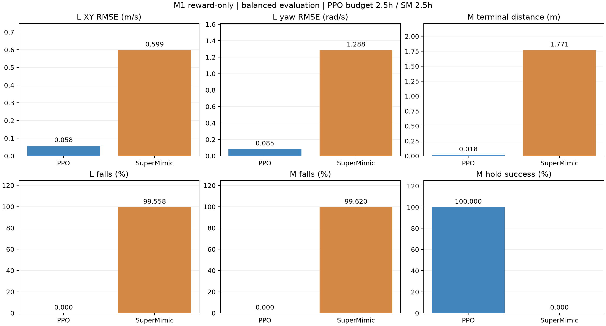

# M1-Piper 纯 Reward：PPO / SuperMimic 正式评测（2026-11-05）

**本轮 PPO 在三项名义仿真评测中均未跌倒，M 到点保持成功率为 100%，相比此前 SuperMimic 最终策略有明显改善。速度跟随仍有偏差：固定前进指令 0.12 m/s，PPO 实际平均约 0.165 m/s。**

PPO 已完成正式训练和全部自动评测，launcher 为 `completed`。本提交包含报告、对比图、两种算法的六份原始评测 JSON 和实验参数/哈希记录；模型权重、完整训练日志及训练实现未随本次结果提交上传。文中 `logs/...` 和 JSON 中绝对路径均指实验主机本地文件。

## 相同任务与预算口径

| 项目 | PPO | SuperMimic |
|---|---:|---:|
| 训练环境数 | 2048，固定 1024 L + 1024 M | 相同 |
| 训练 seed / 初始化 | 2026 / 从零 | 相同 |
| Motion Prior | 无 | 无 |
| 墙钟预算 | 2.5 h | 2.5 h |
| 已记录实际耗时 | 9002.74 s（训练），9005.62 s（含初始化） | 9038.10 s（worker，含初始化） |
| 真实 steps/env | 12,096 | 5,400 |
| 真实 transitions | 24,772,608 | 11,059,200 |
| 更新次数 | 378 PPO updates | 2144 WM 事件 / 1844 Actor updates |
| 最终 checkpoint（本地） | `logs/m1_ppo/lm50_2048_2p5h_seed2026/model_377.pt` | `logs/m1_reward/lm50_2048_2p5h_seed2026/ckpt_latest.pt` |

PPO 复用原 Go2 的 mjlab / RSL-RL PPO 链路：上游负责 rollout、GAE、PPO 和优化；没有重写算法。PPO 读取 SuperMimic checkpoint 的配置，从零初始化，不使用其训练权重或 WM。两者的 M1 奖励 18 项、权重、物理模型 SHA、high-carry 姿态、v3 混合动作映射、50 Hz 控制、10 s episode、命令范围、观测和随机化配置保持一致。

Actor 共用 10 帧 720D proprioception + Goal8、固定缩放、2048/1024/512/256 网络和 22D tanh 确定性均值。动作保持 18 个位置目标和 4 个轮速目标。PPO 保留 Recorder 的 pre-reset 状态/命令，但将未用于 WM 学习的 Replay capacity 从 256 缩为 2；对规范化后的已保存环境参数核对，只有这一存储容量发生变化。

PPO 每次 rollout 32 steps/env、logical minibatch 1024、5 epochs，初始 LR 2e-4、adaptive KL、gamma .99、lambda .95、clip .2、entropy .01、初始 Gaussian std .3。环境执行噪声 0.03 保持不变；PPO 高斯探索和优化过程与 SuperMimic 不同。等墙钟实验中，PPO 实际获得 **2.24 倍**真实 transitions，不能声称同时控制了样本量或更新次数。相同 seed 也不表示两种算法经历相同轨迹；跌倒后 reset 频率不同还会改变后续目标序列。

接口验证：1024 L / 1024 M；真实奖励 dt 积分最大误差 `3.73e-8`；训练 Actor 与推理 checkpoint / TorchScript 的最大动作误差均为 0。当前推理导出为 `policy_inference.pt`，可直接复用本机原有 play/evaluate 接口。

## 评测设置与结果

复用此前 SuperMimic 同一评测脚本：64 envs、30 s、seed123、确定性 Actor，关闭 DR、观测/reset/执行噪声。balanced 为 32 L + 32 M 的训练命令分布；forward 为 64 个 L、固定 `(vx,vy,wz)=(0.12,0,0)`；manipulation 为 64 个 M、沿用训练分布采样的固定世界坐标目标点。

L 指标为全过程水平速度误差向量的 RMSE 和 yaw-rate RMSE。M 终点为 reset 前 TCP 到目标距离，成功定义为稳定且距离 <0.08 m 连续保持 0.5 s，在该完成 episode 内至少达到一次；并非要求直到 episode 结束一直保持。跌倒条件为根部高度 <0.2 m 或倾角 >70°。终点、成功和跌倒率只统计完成的 episode，未完成样本不冒充成功；全过程误差覆盖全部 step。

| case | algorithm | L XY RMSE (m/s) | L yaw RMSE (rad/s) | M terminal distance (m) | L falls (%) | M falls (%) | M hold success (%) |
|---|---|---:|---:|---:|---:|---:|---:|
| balanced | PPO | 0.0581 | 0.0846 | 0.0179 | 0.0000 | 0.0000 | 100.0000 |
| balanced | SuperMimic | 0.5990 | 1.2877 | 1.7707 | 99.5575 | 99.6198 | 0.0000 |
| forward | PPO | 0.0509 | 0.0044 | — | 0.0000 | — | — |
| forward | SuperMimic | 0.5796 | 1.4208 | — | 97.8673 | — | — |
| manipulation | PPO | — | — | 0.0177 | — | 0.0000 | 100.0000 |
| manipulation | SuperMimic | — | — | 1.8113 | — | 99.0196 | 0.0000 |

| case | PPO 完成 L / M episodes | SuperMimic 完成 L / M episodes |
|---|---:|---:|
| balanced | 96 / 96 | 226 / 263 |
| forward | 192 / 0 | 422 / 0 |
| manipulation | 0 / 192 | 0 / 510 |



图仅展示 balanced 结果，表覆盖三项评测。跌倒较多的策略会产生更多、也更短的 episode，完成数差异不代表独立随机试验数相同；不能用这些样本声称跨种子统计显著性。

## 结果如何解释

- **操作任务已出现有效解。** PPO balanced 的全过程平均距离约 2.28 cm，终点约 1.79 cm；M-only 平均距离约 2.30 cm，终点约 1.77 cm。两组 96 / 192 个完成 M episodes 都达到一次 0.5 s 保持成功，且没有跌倒。全过程处于阈值内的稳定 step 比例约为 97.1% / 97.0%，包含起步接近过程。
- **前进学会了，精度仍有不足。** 固定 0.12 m/s 时实际平均 0.1647 m/s，约超速 0.0447 m/s；XY RMSE 为 0.0509 m/s，yaw RMSE 为 0.0044 rad/s。正向命令下没有明显倒退（vx < −0.02 m/s），但不能称为精确速度跟随。balanced 下命令含正、负、停止和转向，只用平均 vx 无法判断逐条跟随效果，需结合分项误差。
- **相同基础任务对 PPO 可学。** 这削弱了“奖励/动作/目标定义使所有算法都无法完成任务”的解释，但不能证明每个定义都正确，也不能唯一确认 SuperMimic 失败来自 WM 梯度。先前 SuperMimic 的早期 checkpoint 能稳定静止、后期反向并失稳；PPO 本次成功提供了更有用的诊断基线。
- **这是单训练 seed、单评测 seed 的名义平地对比。** 没有验证随机扰动、地形、更多目标范围、实机或多种子稳定性。M 的目标局限于当前近距离分布，不能直接推广为任意世界目标可达；已有汇总也没有逐条倒退/侧移/转向跟随评测。

后续建议先以此 PPO 为对照校准 SuperMimic：对相同状态施加正负轮速/关节动作扰动，比较真实 MuJoCo 和 WM 的 1/4/8 步响应与梯度符号；引入定期真实 L/M 分项评估、最佳 checkpoint 和 WM 质量门控，再做 L-only / M-only 消融。速度跟随方面应先补充固定前进、倒退、yaw/横向指令分项评测，再决定是否调整奖励或探索；不要仅为降低总 RMSE 而接受静止解。本轮没有根据结果更改奖励或重训。

## 已上传证据

全部位于 [原始结果目录](results/m1_ppo_comparison_20261105/)：

| case | PPO | SuperMimic |
|---|---|---|
| balanced | [JSON](results/m1_ppo_comparison_20261105/ppo_balanced.json) | [JSON](results/m1_ppo_comparison_20261105/supermimic_balanced.json) |
| forward | [JSON](results/m1_ppo_comparison_20261105/ppo_forward.json) | [JSON](results/m1_ppo_comparison_20261105/supermimic_forward.json) |
| manipulation | [JSON](results/m1_ppo_comparison_20261105/ppo_manipulation.json) | [JSON](results/m1_ppo_comparison_20261105/supermimic_manipulation.json) |

[实验参数和 SHA256 记录](results/m1_ppo_comparison_20261105/provenance.json) 包含训练完成记录、接口验证、共享 Actor/动作定义、PPO 配置、环境参数及六份原始结果哈希。安装版本为 PyTorch 2.11.0+cu126、mjlab 1.6.0、rsl-rl-lib 5.5.1；复用参考仓库 [giangdao1402/go2_velocity](https://github.com/giangdao1402/go2_velocity)，SHA `23a364b1aafc454b5c281b9f115de434e6db2280`。

此前 Go2 和 SuperMimic M1 的详细评测、退化分析参见 [上一份报告](FINAL_POLICY_EVALUATION_20261104.md)。此文补充 M1 PPO 最终结果，不覆盖此前 Go2 实验结论。

## 本机播放命令

以下依赖实验主机现有未上传训练实现和本地 checkpoint，单独克隆此次报告提交不足以运行。

```bash
cd /home/yifeiy/ws_supermimic
PYTHONPATH=src /home/yifeiy/miniconda3/envs/supermimic/bin/python scripts/play.py \
  --ckpt logs/m1_ppo/lm50_2048_2p5h_seed2026/policy_inference.pt \
  --num-envs 1 --m1-task L --vx 0.12 --vy 0 --yaw-rate 0
```

操作任务将最后一行改为 `--num-envs 1 --m1-task M`，按原有分布采样世界目标。未进行 M1 实机部署。
