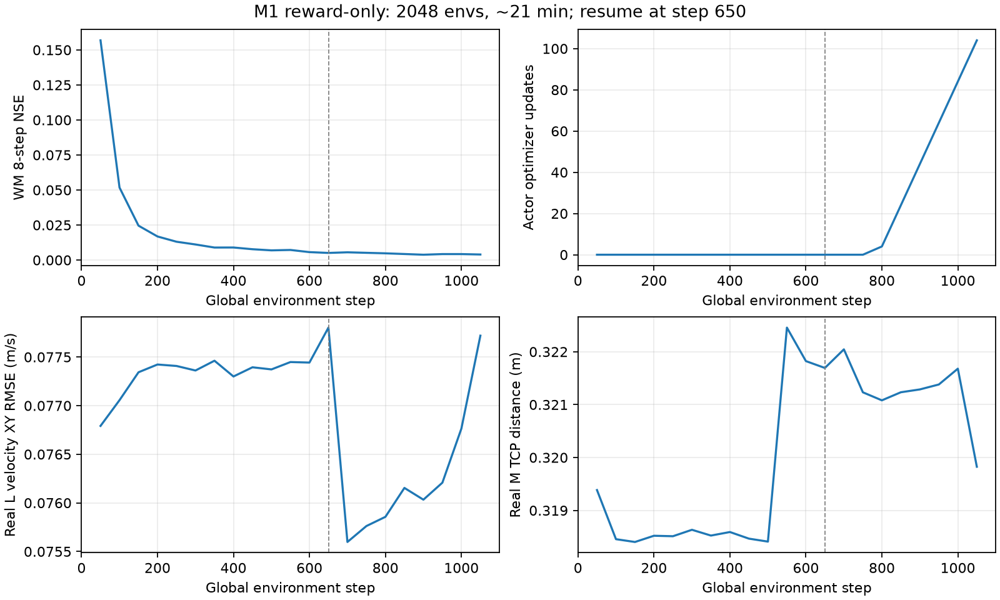

# M1 纯 Reward：2048 环境短长训验收

配置与研究参考见 [基线说明](M1_REWARD_ONLY_BASELINE_20261104.md)。用户授权稍长测试后，完成两段各 10 分钟预算的训练；按日志间隔检查时间，实际 worker 总耗时 **20.98 分钟**。用户要求收尾后，未追加训练或仿真。

## 训练与资源

| 项 | 结果 |
|---|---|
| 环境 / 任务配额 | 2048；固定 1024 L + 1024 M |
| Motion Prior / 动作数据 | 未加载 |
| 第一段 | 650 steps、1,331,200 transitions；WM 244 次事件，Actor 0 次 |
| 第二段 | 恢复第一段，新增 400 steps、819,200 transitions |
| 累计 | 1050 steps、2,150,400 transitions、WM 404 次事件、Actor 104 次更新 |
| WM optimizer | 每事件 4 次，共 1616 次拟合；包含 300 个 WM-only 事件 |
| Actor ramp | 104/500，最后 LR 约 `4.16e-5`；尚未进入完整 LR 阶段 |
| WM 8-step NSE | 第一段早期约 0.157，最后约 0.004 |
| imagined survival | 连续 Actor 更新区间约 1.0 |
| 数值与退出 | 无非有限梯度错误、OOM 或 watchdog 终止；两段正常按预算保存退出 |
| 资源观测 | 训练进程 RSS 约 4.1–4.3 GiB；主机可用内存约 5.7–6.7 GiB |

第二段报告的 PyTorch peak allocated 为 614 MiB、reserved 为 666 MiB，**不包含 MuJoCo Warp 的全部显存**。`nvidia-smi` 的运行观测曾约 7.1 GiB，不能把 PyTorch 数字当成整个任务的 GPU 峰值。测试未影响 ToDesk 远程桌面；资源检查现已识别该视频会话，继续拦截其他计算任务。

第一段尚未完成 300 次 WM 预热，所以没有 Actor 更新。这正好提供一个相同初始化 Actor 的对照。第二段完整恢复模型、优化器和计数，Replay/episode 重新开始。

## 真实仿真对照

两份 checkpoint 均采用 seed=123、16 环境、20 秒、关闭噪声和 DR；L 向 Actor 输入 `vx=0.12, vy=0, wz=0`，M 使用相同的 reset 目标分布。每份完成 16 个 L、16 个 M episode。

| 指标 | 初始 Actor | 104 次更新后 |
|---|---:|---:|
| L 实际平均 vx（m/s） | 0.00013 | 0.00459 |
| L 速度 XY RMSE（m/s，见下方快照说明） | 0.11981 | 0.11537 |
| L 正向命令时 `abs(vx)<0.02` 比例 | 100% | 100% |
| L 明显倒退 `vx<-0.02` 比例 | 0% | 0% |
| L 跌倒率 | 0% | 0% |
| M 全过程平均距离（m） | 0.30277 | 0.28123 |
| M 终点平均距离（m） | 0.30282 | 0.26569 |
| M 0.5 秒保持成功率 | 0% | 0% |
| M 跌倒率 | 0% | 0% |

M 终点距离约下降 **12.3%**，说明这轮更新改变了实际行为；仍远未到达 8cm 成功阈值。L 虽有很小的正向速度变化，整体仍接近静止，不能称为已学会速度跟随。本轮证明了 2048 环境收集、WM 拟合、Actor/Critic 梯度更新、checkpoint 恢复和评测链路能运行；不证明奖励已调优或 2.5 小时必然成功。

评测末尾检查发现：外部固定命令在 reset 后安装，Replay 首帧上下文仍保留刚采样的命令，导致日志中 L 的平均命令为 `0.11977`，而不是恰好 `0.12`；Actor 本身一直使用显式固定命令。所以上表 XY RMSE 仍有首帧记账误差；实际 vx、M 终点距离和稳定性结论不受这个命令误差影响。已在播放/评测适配器中同步外部命令与 Replay 快照，后续评测不再保留该首帧误差。按用户收尾要求，本轮未再追加仿真来重算这些数字。

另有一个日志分母问题：step800 区间混入 16 次 WM-only 事件和 4 次 Actor 更新，旧汇总将 `imag_survival_H` 显示成 0.2。该步逐帧 diagnostic 的实际 survival 接近 1。已修正新任务按实际 Actor 更新次数汇总；正在运行的进程没有热替换代码，原始日志仍保留，step850 之后不存在这个预热边界问题。这只影响统计显示，不改变学习目标或梯度。

## 文件与后续使用

- 初始 Actor：`logs/m1_reward/lm50_2048_10min_probe_20261104/ckpt_latest.pt`。
- 本轮最终模型：`logs/m1_reward/lm50_2048_20min_probe_20261104/ckpt_latest.pt`。
- 原始评测：最终目录中的 `eval_initial.json`、`eval_trained.json`；训练日志、`completion.json`、`history.csv` 同目录。
- 39 项 CPU 语义/回归检查通过：`logs/m1_reward/contract_tests.log`。
- 本轮训练和评测进程均已退出，没有启动正式 2.5 小时训练。



默认正式从零训练 2.5 小时的入口：

```bash
cd /home/yifeiy/ws_supermimic
/home/yifeiy/miniconda3/envs/supermimic/bin/python scripts/run_m1_reward.py --launch
```

直接查看本轮模型：

```bash
PYTHONPATH=src /home/yifeiy/miniconda3/envs/supermimic/bin/python scripts/play.py \
  --ckpt logs/m1_reward/lm50_2048_20min_probe_20261104/ckpt_latest.pt \
  --num-envs 1 --m1-task L --vx 0.12 --vy 0 --yaw-rate 0
```

M 模式用 `--m1-task M`，去掉速度参数；可额外指定 `--m1-target-world X Y Z`。这只是短训模型的查看入口，不代表部署验收。

建议下一轮保持任务定义先完成 2.5 小时基线，再按相同 seed 分别评估 L/M。若仍接近静止，优先检查探索覆盖和真实/WM 动作梯度方向，再考虑 task-only 消融、延长 horizon 或分阶段学习；不要仅根据 WM NSE 小就放大 BPTT 的任务梯度。
