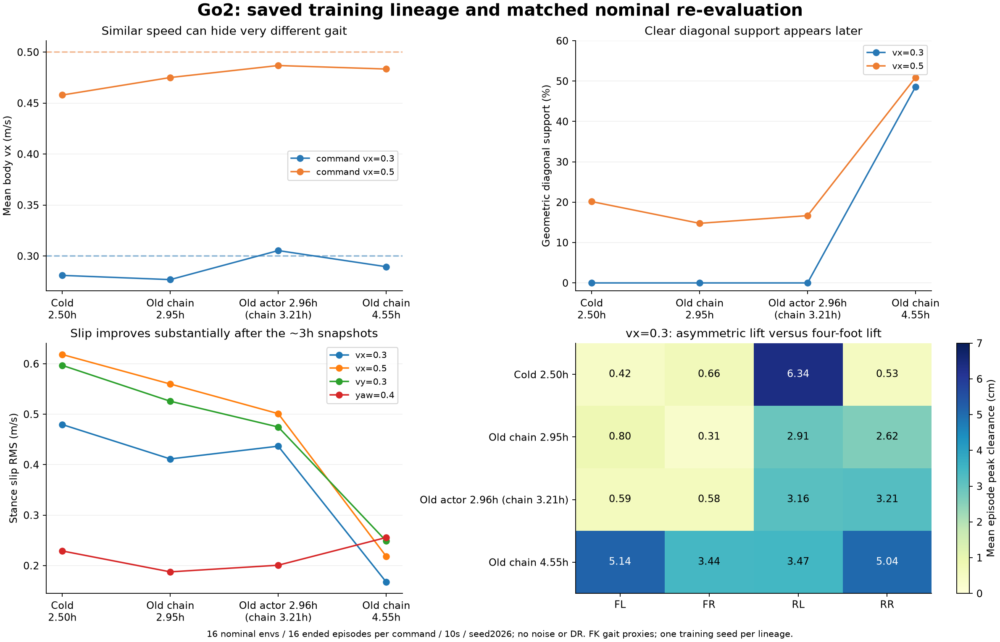
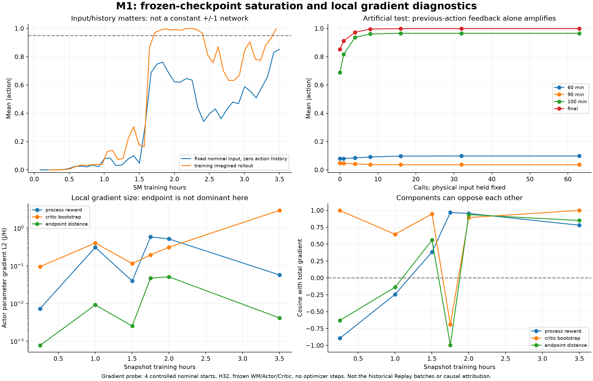

# M1 动作饱和与 Go2 累计训练时间审计

2026-11-06。承接 [M1 昨晚结果](M1_V2_RESULTS_AND_FAILURE_ANALYSIS_20261106.md) 和 [Go2 策略来源核对](GO2_POLICY_PROVENANCE_AND_GAIT_20261106.md)。本次追溯 checkpoint、TensorBoard 时钟和初始化来源，追加冻结策略评测及梯度诊断；没有重新训练、优化器更新或替换部署策略。

**结论：M1 的饱和不是参数 NaN，也不能简单归因于终点奖励过大；已发现上一动作历史会把策略输出放大到饱和，局部 Actor 梯度又常受 Critic 主导。Go2 旧模型的漂亮步态对应约 4.55 小时完整训练链路，而非从零 2.5 小时；约 3 小时的旧中间模型低速时也还在拖地，不能据此证明中断续训本身优于连续训练。**



## 1. Go2 究竟累计训练了多久

使用 `time/hours`，不是文件夹名字、iteration 换算或 checkpoint 文件修改时间。老 checkpoint 没有 `training_wall_seconds`，所以对应 iteration 的 TensorBoard 标量是本轮采用的依据。误差边界：计时不包含 Trainer 时钟开始前的初始化，不包含评测、机器空闲和没有流入这条权重链路的其他试验。

### 1.1 权重传承链

| 阶段 | 保存的进度 | 实测训练时间 | 保留了什么 |
|---|---:|---:|---|
| `go2_velocity_phase1_3072_b1024_20261027` | it1800 | **0.25182 h** | 这一轮产生 WM；后续仅导入 WM，Actor/Critic/优化器不导入 |
| `go2_velocity_deployable_v2_20261102` | it17000 | **2.00437 h** | 新 Actor/Critic + 导入的 WM；这一阶段原先没有对角/滑脚新增项 |
| `go2_velocity_diagonal_slip_3072_2p5h_20261103` | 最后保存 it34000 | **额外 2.28973 h** | 完整恢复 Actor/Critic/WM/优化器/课程，新增对角和滑脚项，Replay 重新采集 |

因此，**最后保存并被评测的旧模型**：

- 保留 Actor 的训练链：`2.00437 + 2.28973 = 4.29410 h`。
- 加上导入 WM 的来源训练：`0.25182 + 4.29410 = 4.54592 h`。
- 对应真实交互预算：Actor 两段共 `34000×3072 = 104,448,000` 条；加上 WM 来源 `1800×3072`，完整链路约 **109,977,600** 条。这是累计采集成本，不表示这些数据都同时保存在 Replay。

进程实际运行到 it34600 后被用户叫停，第二段运行了 2.37217 h；若统计已经消耗的全部时间，则 Actor 链约 4.37654 h，连 WM 来源约 **4.62836 h**。但 it34000 之后约 600 步未保存，**不能把 4.63 h 都记到目前这份权重上**。

当前部署目录的比较模型来自 `supermimic_2p5h_seed2026`：从头约 **2.50112 h**、it18600、57,139,200 条真实转移，没有导入旧 WM/Actor。部署包与源 Actor 逐张量相等。因此这里确实是两份不同训练历史的模型，未发现导出把步态破坏。

### 1.2 “约 3 小时”有两种合理口径，均检查

| 检查点 | Actor 链累计 | 含 WM 来源累计 | 相对初始 it17000 的新增步数 |
|---|---:|---:|---:|
| it22000 | **2.69972 h** | **2.95154 h** | 5000 |
| it24000 | **2.96039 h** | **3.21221 h** | 7000 |
| it34000 | 4.29410 h | 4.54592 h | 17000 |

没有保存正好 3.00000 h 的权重。it22000 最接近完整链路 3 小时，it24000 最接近 Actor 链 3 小时。避免把这两种口径混为一谈。

## 2. 约 3 小时的 Go2 策略实际上怎么样

今天用同一现有 `evaluate_command`，顺序复测上述三份旧模型和新从头模型。每模型 4 条命令，每条 **16 env / 16 个完成 episode / 最长 10 s / seed2026**，确定性策略，无 DR、执行/观测/reset 噪声。共 256 个名义 episode。初态相同，不能称作 256 个独立随机扰动样本；没有置信区间或多 seed 算法胜负结论。

### 2.1 前进 0.3 m/s

| 模型 | 实测 vx | 足滑 RMS (m/s) | 几何对角支撑 | FL/FR/RL/RR 峰值离地高度均值 (cm) |
|---|---:|---:|---:|---|
| 新从头 2.50h | 0.281 | 0.4795 | **0%** | 0.42 / 0.66 / 6.34 / 0.53 |
| 旧完整链 2.95h，it22000 | 0.277 | 0.4114 | **0%** | 0.80 / 0.31 / 2.91 / 2.62 |
| 旧 Actor 链 2.96h，it24000 | 0.305 | 0.4367 | **0%** | 0.59 / 0.58 / 3.16 / 3.21 |
| 旧完整链 4.55h，it34000 | 0.289 | **0.1674** | **48.6%** | **5.14 / 3.44 / 3.47 / 5.04** |

约 3 小时的旧模型仍存在前脚贴地和前后不均衡；低速没有形成最终明显的对角支撑。这修正了“只要续训就马上好很多”的直觉。

### 2.2 前进 0.5 m/s

| 模型 | 实测 vx | 足滑 RMS | 对角支撑 |
|---|---:|---:|---:|
| 新从头 2.50h | 0.458 | 0.6183 | 20.2% |
| 旧完整链 2.95h | 0.475 | 0.5599 | 14.8% |
| 旧 Actor 链 2.96h | 0.487 | 0.5011 | 16.7% |
| 旧完整链 4.55h | 0.483 | **0.2183** | **50.9%** |

早期旧模型在某些指标更好，但不全面优于新模型。侧移 0.3 m/s 的足滑依次约为 0.597 / 0.526 / 0.475 / 0.249，对角支撑前三者都是 0%，最后约 41.1%。纯转向四份都没有明显几何对角支撑，旧最终策略的转向足滑约 0.256，反而高于约 3 小时旧模型的 0.188/0.201。四份模型在本轮四个命令中均没有跌倒。

足滑和支撑由足底高度阈值构造，是几何代理，不是接触力真值；离地高度为排除起始 1 秒后每 episode 峰值的均值，不是每一步平均抬脚高度。

### 2.3 能得出什么，不能得出什么

**支持：额外训练量及稳定行为积累，是旧最终策略比新 2.5h 策略步态更好的重要混杂因素。约 3h 也不够复现旧最终低速步态。**

**不支持：中断/恢复这个动作本身会让算法变好。** 要检验它，需要同一初始权重、同一总预算下，连续训练与中断恢复的配对实验。本次没有该实验。

还有其他未控制变量：旧链 seed=0，新链 seed=2026；旧前 2h 没有新增步态奖励，随后塑形；新链从头就有这些项；旧链有预训练 WM；两者课程晋级时间不同；旧想象观测噪声开启，新比较链关闭。因此不能把最终差异全部归因于时间、阶段训练或某个噪声开关。

同样，对角软约束没有规定时序交替或步频；抬脚奖励按照用户要求关闭。只优化速度且给较小软惩罚，确实可能保留不对称、低抬脚局部解。新策略速度可用、零跌倒，不代表步态质量验收通过。

## 3. M1：饱和首先是什么，不是什么

昨晚 H32 的完整结果见 [前一份报告](M1_V2_RESULTS_AND_FAILURE_ANALYSIS_20261106.md)。本轮继续区分网络数值、输入反馈、动力学梯度和目标分量。

### 3.1 所有保存的 Actor 快照均为有限值

检查 42 份五分钟快照及最终权重，未发现 Actor 参数 NaN/Inf。初始 Actor 末层 Frobenius 范数约 **0.0469**，最终约 **0.8837**，增加约 **18.8 倍**；末层 bias 的最终绝对值均值只有约 0.0117。不是简单的巨大输出 bias 将所有关节固定在 ±1。

在相同合成正常观测下（相对关节角/速度为零、直立重力、上一动作历史为零，四组 L/M 命令），最终网络的平均动作绝对值约 **0.8522**，只有 **38.6%** 的动作超过 0.95。此前真实运行在低位姿态的统计则为平均约 **0.9999**、**100%** 超过 0.95。

所以“最终策略动作全饱和”是特定运行状态及历史下的事实，不是对所有输入都恒定输出 ±1。这一点关系到定位：不能只检查最后一层 bias，必须连输入历史和闭环分布一起看。

### 3.2 冻结物理观测，仅回填上一动作，就能放大饱和

Actor 的输入含 10 帧上一动作，虽然网络是 MLP，整个控制器仍有显式时序反馈。追加 CPU 人工输入实验：固定关节/速度/姿态和命令，只把每次输出滑入上一动作历史，再调用下一次，连续 64 次。不运行动力学、不更新网络。

| 快照 | 初始上一动作全零时的平均动作幅度 | 64 次反馈后的平均幅度 | 最后超过 0.95 的比例 |
|---|---:|---:|---:|
| 60min | 0.07885 | 0.09808 | 0% |
| 90min | 0.04757 | 0.03664 | 0% |
| 100min | 0.68792 | **0.96562** | **95.5%** |
| 120min | 0.62255 | **0.98202** | **87.5%** |
| 最终 | 0.85224 | **0.99848** | **100%** |

最终网络在这个测试中，L 正反命令的动作差约 2.52e-5，M 左右目标差约 2.01e-5，也随反馈变小。结合真实低位姿态测试的约 1e-6 指令响应，支持“网络更新形成了容易吸向饱和的上一动作反馈，真实状态分布再放大”的机制。

**边界：这是人工冻结物理输入的局部反事实测试，并非真实机器人动力学，也没有证明原始训练先由哪个环节触发。** 它证明了最终 Actor 中存在这一放大机制，不证明删除上一动作输入一定能修好。直接删历史会改变部署合同，也丢失执行器时序信息，不建议未经消融就改。



## 4. M1：哪一部分目标在推动 Actor

### 4.1 目标分解及方法

当前最大化目标是：

\[
J/H=\{\sum_{t=0}^{H-1}\gamma^t c_t r_{t+1}
+\gamma^H c_H V(s_H,g_H,\xi)
+\gamma^H R_{endpoint}(s_{0:H},g_0)\}/H.
\]

其中三部分分别为过程奖励、Critic bootstrap、显式 M 终点距离。WM/Critic 参数冻结，但保留它们对状态/动作的导数，反传到 Actor；最小化的是 `-J/H`。从式子和代码核对，未发现把整体 Actor ascent 符号写反的证据。

为了判断分量规模，从无噪声真实仿真零动作稳定 1 秒后取同一组 **4 个正常姿态起点**，构造 L `vx=±0.12` 与 M `x=±1.5m,z=0.8m`，对六份保存快照各做 H32 冻结想象。分别计算三部分对全部 Actor 参数的欧氏梯度范数，并额外分离 survival 的导数。**没有 optimizer step。**

这些起点不是原训练 Replay 的原始 batch。结果用于局部诊断，不能当作历史每一次更新的精确归因；不同分量还可能相互抵消，范数之比不等于全训练的因果贡献。

### 4.2 局部参数梯度范数

| 快照 | 过程奖励 | Critic bootstrap | 显式终点 | 总梯度 |
|---|---:|---:|---:|---:|
| 15min，14 次 Actor 更新 | 0.00732 | **0.09548** | 0.000775 | 0.08838 |
| 60min，213 次更新 | 0.31044 | **0.40325** | 0.00920 | 0.18402 |
| 90min，346 次更新 | 0.03970 | **0.11519** | 0.00253 | 0.12579 |
| 105min，412 次更新 | **0.58603** | 0.19535 | 0.04729 | 0.38621 |
| 120min，478 次更新 | **0.51929** | 0.31244 | 0.05116 | 0.82351 |
| 最终，876 次更新 | 0.05749 | **2.96609** | 0.00416 | 3.01452 |

关键解释：

1. **不能把饱和简单归因于新增终点距离权重 1 太大。** 本组起点中它的梯度明显较小；最终只约 Critic 的 1/713。105min 时其方向甚至与总梯度接近相反（cos≈−0.995），局部是在抵消其他分量。
2. **Critic 的状态梯度需要与 WM 一起审计。** 15min 时 Critic 与总梯度 cos≈0.999，过程奖励与总梯度 cos≈−0.895；90min 时 Critic cos≈0.948，最终约 1.000。某些正常起点的更新主要由值函数外推指导，并非直接的到点进度。
3. **不能说全程都是 Critic 单独导致。** 105min 本组起点反而是过程项主导，总梯度与 Critic cos≈−0.689。120min survival 导数对总梯度方向的投影约 25%；其他多数快照该贡献很小。存在状态/时间依赖。
4. **小 Critic loss 不保证正确的值函数导数。** 当前 Critic 用想象轨迹的 GAE targets 拟合，bootstrap 来自当前值函数；没有真实任务梯度校准或独立目标网络来证明这些斜率可靠。它可能与 WM 误差共同强化不可靠的优化方向，但本次没有真实价值梯度真值，不能宣称已证明 Critic 梯度反号。

因梯度相消，总梯度不等于三个范数相加；投影比可超过 100% 或为负，不应标成“多少百分比根因”。本表为裁剪前梯度，原训练还会裁剪和使用 Adam，不可将其直接当作参数更新量。

## 5. 为什么现有正则和裁剪没有阻止饱和

### 5.1 梯度裁剪并不限制策略累计漂移

实现有 norm clip=1、value clip=0.1，不是完全没裁剪；但这些限制单次梯度，既不是策略输出变化约束，也不是 logit 边界或真实性能门槛。Adam 连续数百次更新仍可以将网络增益推高。M1 采用基础 LR=2e-4、500 次 ramp 后保持常数，没有基于真实任务性能的回滚。

上一动作历史提供了一个低成本的反馈通道；在 WM/BPTT 和共享网络更新下形成高增益后，Actor 可在闭环中进入接近固定符号的饱和状态。此时 tanh 局部导数 `1-a²` 很小，命令变化和恢复正则都更难生效。上述反事实实验直接展示了放大，但还没有 Jacobian 全谱/所有状态的稳定性证明。

### 5.2 很多正则对“持续极限动作、低速低位”并不强

- `action_rate` 惩罚变化而非幅度；若动作持续等于同一 ±1，变化成本接近零。最终真实日志该项约 −3.17e-10/step。
- `control_effort=-0.005 mean(a²)` 是归一化动作成本，不是实测力矩/能耗。全部动作饱和也仅约 −0.0001/step；最终日志约 −9.96e-5。
- 关节速度、加速度成本主要针对运动；处于低位停滞后它们可以很小。软关节限位不等于“不允许归一化动作达到 ±1”。
- 高度项是正 Gaussian 奖励。远离默认约 0.47m 后，奖励及恢复梯度都衰减；root≈0.219m 时高度奖励率约 0.0009，远低于最高 0.5。最终真实日志该项约 2.0e-5/step。
- 低位仍高于 0.20m 终止线；不触发硬失败不代表站姿、任务或能耗合格。

因此“有动作正则/有 grad clip”不能代替真实的策略输出稳定性验收。加大正则可以实验，但不是修复 WM/值函数梯度的替代品。

### 5.3 终点项存在需要明确的失败语义

显式终点距离不乘 survival，是有意避免负成本因“提前死掉”而被擦除。但目前 WM 仍展开到 H，终点成本可能作用在预测失败后的状态；在动力学已经不可信的区间，它可能继续传回不合物理的几何梯度。

不能简单给负距离乘 survival，否则可能重新鼓励通过终止逃避负成本。更合理的候选是明确吸收失败状态：在首次失败处记录终态、加失败成本，停止使用失败后任意几何状态；成功换点、超时和跌倒分别建模，并验证梯度语义。

另外，显式终点是 Actor 额外辅助目标；Critic 的 GAE targets 目前只有过程环境奖励，没有这个额外项。这不自动构成实现 bug（终端 heuristic 可以独立于环境 return），但它不是同一回报的完全一致估计。应明确选择：将其作为独立 planner 辅助损失并单独调权，或采用一致的 potential shaping / return 定义；不能只比较奖励打印出的数值大小来判断梯度平衡。

## 6. 合并已有证据后的解释

直接证据包括：

- 真实 M 到点 0%、L 基本停滞、低位姿态、全动作饱和和目标响应下降。
- 训练快照出现网络增益漂移；固定物理观测、只反馈上一动作也会趋向饱和。
- 局部冻结梯度检查显示 Critic 常明显大于显式终点项，且不同目标分量存在冲突。
- 之前同一名义姿态的 WM 检查显示 H32 TCP/base 误差约 0.3m；在两种扰动幅度下有真实动作响应与 WM 偏导符号相反的例子。
- H8 拟合 / H32 Actor 的跨度、短 Replay、弱探索与大范围目标带来数据覆盖风险；稀疏成功布尔事件不直接提供有效路径梯度。

最符合这些证据的工作假设是：**真实探索/覆盖不足 → WM 与值函数在相关方向不可靠 → Actor 更新使网络/上一动作反馈增益增加 → 饱和与低位状态改变数据分布 → Replay 与模型继续适应该分布，tanh 又使目标响应和恢复变弱。**

这是机制性假设，不是完成了因果消融的结论。尚不能断言第一个触发点只在 WM、Critic、奖励或多任务共享中的某一处；也没有证明 reward-only SuperMimic 必然不能解决 M1。

## 7. 下一轮改进优先级

1. **先加真实状态与梯度验收，再长训。** 保持 H32；验证 WM 的 1/8/16/32 步误差、动作正负响应，覆盖启动、轮速、臂运动、正常与低位姿态。保留独立校准集，不把训练 NSE 当充分条件。
2. **把 Critic 纳入同等优先级。** 分别记录过程/值函数/终点的梯度规模、方向、冲突和按关节组的作用；做短程 `use_critic` 开关、bootstrap 缩放/目标网络等现成稳定机制的控制实验。关闭 Critic 会削弱长程目标，不能未经评测永久去掉。
3. **控制 Actor 增益和累计漂移。** 记录 pre-tanh logits、动作饱和、命令敏感性、上一动作反馈测试；降低更新强度或引入现成信赖域/动作变化约束，保留真实评测最佳模型并触发回滚。不要把 norm clip 当信赖域。
4. **改善真实数据与 Replay。** 使用分层/保留数据覆盖正常姿态、成功接近和接触切换；探索按腿/轮/臂分别设计。若复用 PPO 轨迹预训练 WM，要标成使用额外数据的新实验，单列比较口径。
5. **再处理奖励与任务难度。** 协调终端/失败/成功换点语义；检验距离缩放时间成本和到点保持项；对低位目标加入稳定性/碰撞与可达性诊断。先分项 L/M 定位，再联合，不静默将 H32 改回 H8。
6. **Go2 预算比较先纠正标签。** 旧漂亮步态标注完整链 4.55h，不再称从零 2.5h。同预算约 3h 对比只报告中间模型结果。若要比较阶段训练和从头训练，安排相同 seed/总真实交互/计算预算的控制实验，而不是拿最终旧模型替代新模型来宣称胜负。

以上为建议，本次没有修改训练算法或启动新训练。

## 8. Play 与材料

约完整链 3 小时：

```bash
cd /home/yifeiy/ws_supermimic
PYTHONPATH=src OMP_NUM_THREADS=1 /home/yifeiy/miniconda3/envs/supermimic/bin/python scripts/play.py \
  --ckpt logs/phase3_training/go2_velocity_diagonal_slip_3072_2p5h_20261103/ckpt_0022000.pt \
  --num-envs 1 --viewer native --vx 0.3 --vy 0 --yaw-rate 0 \
  --velocity-arrow --actual-velocity-arrow
```

若按 Actor 链约 3 小时，将文件名换为 `ckpt_0024000.pt`；要看旧最终较好步态，换为 `ckpt_0034000.pt`。三份权重都仍在本机。四个主要任务的其他 play 命令见 [昨晚结果报告](M1_V2_RESULTS_AND_FAILURE_ANALYSIS_20261106.md#7-play-命令)。

- [本次新增评测、时钟、梯度、快照、脚本和源码节选](results/training_audit_20261106/)。
- [前次 M1 正式评测与物理响应诊断](results/m1_v2_20261106/)。
- [审计源码 SHA256 与环境版本](results/training_audit_20261106/provenance.json)。训练工作区存在未提交实现，脚本依赖该工作区；本次上传的是分析材料，不是完整可重现训练代码发行版。关键公式的实际工作区文本已保存，避免把 GitHub HEAD 误当成运行源码。
- checkpoint、大型训练日志和部署包保留在实验主机，没有随报告上传；JSON 中保留来源路径、计时和 checkpoint SHA256。
