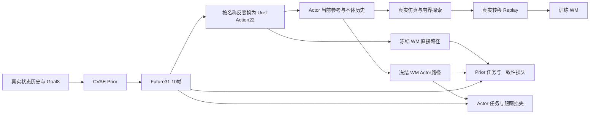

# M1 系统框架、数据协议与训练退化审计

日期：2026-11-03。范围：系统设计、当前代码、AMP 数据与模型来源、已有真实仿真评估、公开论文与实现。**本次不修改训练实现，不启动训练，不运行新的物理 rollout。** 离线检查使用 `supermimic` Conda 环境，未使用 venv。

## 1. 核心判断

**“运动学 Prior 提议轨迹，反馈 Actor 执行，真实转移训练 WM，再用可信 WM 梯度改进控制和规划”是合理的研究方向；当前系统尚未具备可靠联合优化的条件。最需要修复的是优化目标、模型梯度的使用条件和任务分布，而非先增加数据量或延长同一套训练。**

最新实验比旧实验更有诊断价值：Prior 全程冻结，Actor 从近似参考直通的初始化学习后，却比同一 Prior 的直接执行明显更容易跌倒。这说明此次失败发生在 **Actor 学习及其依赖的目标/WM 环节**；不能再归因于“Prior 和 Actor 同时更新、互相迁就”。同时，Prior Direct 的 M 任务仍失败，说明仅修 Actor 也不够。

本次新增、可复核的重要发现：

1. **Actor 没有真实动作响应准入门槛。** 200 个 WM 预热事件后即可开始 BPTT；严格的物理响应 Gate 只保护 Prior。
2. **M 的终点项与 progress 项重复强化同一个终点距离。** 默认全有效 10 步时，目标为 `20*d_H + mean(d_t) - 10*d_0`。最后一帧距离的局部系数是任一前面帧的 201 倍；L/M 的环境比例相等不等于优化贡献相等。
3. **终止屏蔽仍存在“失败更便宜”的目标漏洞。** 合成反例中，距离目标 30 cm 的安全静止状态总损失 3.3；预测第一步终止后，任务被清零，总损失变为 1。现有测试只检查失败损失非零，没有检查优劣排序。
4. **参考内部平滑没有完整约束与当前真实速度的衔接。** 从实际 `vx=0` 切换至参考 `vx=1 m/s`，隐含首步加速度 `50 m/s²`，现有全部参考平滑项仍可为零。
5. **当前双路径把“期望达到的关节状态”和“驱动它的 PD 目标”绑定在同一输出上。** 这是一项额外的建模假设，不是动力学一致性的普遍条件；它可能惩罚合理的跟踪滞后和前馈补偿。
6. **数据协议的主要问题已从排列/单位错误，转为任务语义和条件分布不一致。** M/LM 在预训练中共用 Reach 标志；在线 M 要求底盘稳定；混合训练却统一用 L 高站姿。

这些结论有不同证据强度。下文将代码事实、离线反例和物理因果假设分开；没有将一个静态问题直接宣布为所有跌倒的唯一原因。

## 2. 审计版本与证据范围

| 对象 | 本次依据 |
|---|---|
| 用户设计文档 | `/home/yifeiy/下载/SuperMimic_M1_最终系统框架_V1_2026-11-03.md`，SHA256 见证据 JSON |
| SuperMimic | HEAD `fed03f98d2c5b6df27ee72dbed95dddc52d19625`；工作树有既存 Go2 修改，本次保留 |
| 最近 M1 实验 | `m1_action22_v1_LM50_2048_1h_20261103`，启动基线 `f7858a6` 加当时工作树 |
| AMP 仓库 | 初读 HEAD `083cc7b`；审计期间外部新增 P4 提交，证据采集时 HEAD 为 `d3dcb3d9735d28cb5d0f774b379336022ddf7fcf`；本次没有修改 AMP |
| 实际使用 Prior | `cvae_v1_v3_3_mixed_3272_goal_l_holdout_20261103/checkpoint_best_val.pt` |
| Prior SHA256 | `05a858520790d474f6c1c3dd1f791507c3da91f68899ca88f00348ea4bbff10c` |
| 物理效果证据 | 仓库已有固定种子 Actor / Prior Direct 和快照评估；未在本次重跑 |
| 新执行检查 | 8 项已有 CPU 接口/推理/梯度测试；合成损失反例；实际 Prior 的静态 reset 输入推理 |

设计文档第 9、10 节含“尚未实施”的时间快照，而当前代码已经实现 Action22、新 Actor、双路径、探索、配额和 Prior Gate。不能把文档中的旧 Actor 状态当成当前实现。

旧审计中 q6/qd6 极小标准差、旧动作范围排除新姿态、没有精确 50:50 配额等问题，已有版本化修复。此次使用的 V3.3 q6 标准差约 0.37 rad，qd6 约 0.27 rad/s，未启用常量投影；不应继续把这些历史故障列为当前已知根因。

## 3. 当前系统实际在做什么



实现中有几项正确且应保留的选择：

- 用关节名连接 AMP 非轮关节顺序与物理交错顺序；轮通道是 rad/s 速度目标，不是角度。
- WM 用真实执行的裁剪/加噪动作配对真实下一状态，未用生成轨迹伪造动力学监督。
- Actor/Prior 更新时固定 WM 参数，但保留状态、动作梯度；两条想象路径共享真实初态与物理上下文。
- Actor 的参考在 Actor 更新时 detach；Prior 更新时冻结 Actor 参数。计算图拥有权有测试覆盖。
- Prior 采用来源哈希和匹配 WM 快照的准入检查；实际最近实验没有绕过 Gate 解冻。
- 在线重新规划用真实历史反馈，而不是永久延长一个离线运动片段。

但是，它目前是**任务条件的短轨迹生成器＋反馈控制器**，还不是通常意义上的在线 MPC。CVAE 默认用 `prior_mean` 一次生成，未在每次执行前用 WM 搜索/优化多个候选，也没有对“最佳轨迹”的最优性保证。每 10 步重生成一次是闭环重规划，但不等于做了模型预测优化。若“像 MPC 一样选更好的轨迹”是核心目标，需要另加候选评价/局部优化，或明确将其定位为摊销规划器。

另外，当前 M 是 TCP 位置 Reach。State57、Goal8、Action22 中没有物体状态、抓持状态、末端姿态目标或独立夹爪控制。它可以验证移动机械臂的到达与保持，尚不能代表抓取、搬运、放置等完整 manipulation。

## 4. 最新失败实验告诉了我们什么

详细原始结果见 [一小时训练报告](M1_ACTION22_LM50_2048_1H_RESULTS.md) 和 [实验汇总](../results/m1_action22_v1_LM50_2048_1h_20261103/summary.json)。

| 同种子真实评估 | Actor | Prior Direct |
|---|---:|---:|
| L，`vx=+0.12`，vx RMSE | 0.178 m/s | 0.088 m/s |
| L，`vx=+0.12`，跌倒率 | 1.000 | 0.000 |
| L，`vx=+0.12`，实际反向比例 | 0.561 | 0.134 |
| L，`vx=+0.12`，平均 episode signed dx | +0.029 m | +0.410 m |
| M，前方目标，末端进展 | +0.035 m | −0.119 m |
| M，前方目标，跌倒率 | 0.844 | 0.000 |
| M，前方目标，稳定保持 0.5 s | 0 | 0 |

这里的平均位移受 episode 提前终止影响，不是固定时长积分速度。不同组 episode 数不同，不能把位移比值直接解释为速度比值。

本轮 4000 环境迭代，WM 1584 次更新、Actor 1384 次、**Prior 0 次**。15 分钟快照 L 前进跌倒率 0.1，30 分钟上升到 0.95，最终 1.0。这种退化不支持“只要继续训就会更好”。

“轮子向后退”应拆成四层观察：命令方向 → Prior 轮速参考 → Actor 执行动作 → 实际轮速与机体速度。现有同映射直通前进证据，不支持整体电机符号必然反了。本次实际 Prior 的静态 reset 推理也给出：

| L 命令 | 预测 0.2 s root dx | 四轮参考时间均值范围 |
|---|---:|---:|
| +0.12 m/s | +0.01550 m | +0.850～+0.865 rad/s |
| −0.06 m/s | −0.00755 m | −0.419～−0.403 rad/s |

这只能证明该初态下符号正确；不能证明闭环全过程正确。已有物理评估中反向 Prior Direct 仍几乎没有净后退，提示**真实状态离开离线分布后的重规划响应**也必须检查。

最符合证据的机制是：WM 局部动作响应不够可靠、任务尺度/终止/短视目标存在风险、Actor 缺少行为变化约束，训练逐渐离开可用的参考动作附近。具体各占多少，需要消融，不能仅凭此表定量归因。

## 5. 数据库与接口协议审计

### 5.1 核心转换已基本正确

| 字段 | AMP / CVAE 约定 | 当前接入判断 |
|---|---|---|
| 原始 Frames | 79 维，root quaternion 为 xyzw；轮速来自侧车标签 | 不能直接当 State57 使用 |
| 物理 State57 | root position3、quaternion wxyz4、q22、world v3、body angular v3、qd22 | 当前偏移为 q `7:29`、v `29:32`、ω `32:35`、qd `35:57` |
| History `[4,53]` | 高度、相对最新 yaw 的 rot6d、body v/ω、非轮 q18/qd18、轮速4 | 当前显式转换和名字索引正确；最新 heading 结构零分量有数值处理 |
| rot6d | 第一列3维接第二列3维 | 当前没有错误地行优先展平 |
| Goal8 | `[vx,vy,wz, ee_heading_xyz, velocity_valid, ee_valid]` | wz 是角速度，不是 vz；M 位移是 target−root 的 yaw 坐标表达，**不是 target−TCP** |
| Future31 | heading root displacement3、rotation6d6、leg q12、arm q6、wheel qd4 | 未来索引从 t+1 开始，20 ms/帧；当前适配测试通过 |
| Action22 | 每腿 ABAD/HIP/KNEE/FOOT 交错，最后 Piper6 | v3 位置非对称映射，轮速±5 rad/s；有裁剪前越界诊断 |
| TCP | AMP 标签 `piper_x_link7` | 当前模型中 link7/link8 位置重合，已有 CPU FK 测试复核；不能把旧文档“名称不同”继续当作已证实偏移 |

此次 8 项检查通过，包括两仓库同 State53/Goal8 的 V3.3 `prior_mean` 一致性。**这些检查支持接口实现正确，不代表完整资产的质量/惯量/摩擦一致，也不证明动力学可执行性。** 本次没有重新对所有原始运动逐帧重算两仓库 FK 与碰撞。

相关实现：[features.py](../src/supermimic/motion_prior/features.py)、[reference.py](../src/supermimic/motion_prior/reference.py)、AMP 的 `motion_prior/cvae_features.py`、`cvae_data.py`、`strict_fcl_adapter.py`。

AMP 仍保留旧 `motion_prior/bridge.py`：它使用 Goal14 和 canonical feature 风格的 57 维布局，不能当当前物理 State57/Goal8 的通用桥接。当前 SuperMimic 不调用它，因此不是本轮已发生故障；但建议显式标为 legacy，防止后续集成误用。AMP 总体协议文档仍有旧 TCP 未对齐等描述，也应以版本化可执行契约更新。

### 5.2 训练到 checkpoint 的数据，与最新生成器不是一回事

当前 Prior 来自 V3.3：3272 motions，其中 L999、M1000、LM1273；881356 个滑窗。训练/验证/测试是 motion/goal 分组划分，归一化只使用训练集。这比随机划分相邻窗口更可靠，但窗口高度相关，不能把 88 万窗口视为 88 万独立意图。

数据 assurance 是 **1548 条 full-FCL＋1724 条 quick-screen**，没有完整动力学执行验证。FCL 表示几何碰撞检查，不证明支撑、摩擦、关节扭矩、轮地无滑移、执行器带宽或跟踪可行。CVAE 预测也不会自动继承训练样本的 FCL 保证。

当前 AMP 的 V4/P1/P2/P3/P4 在改善目标优先、可达性与 M/LM 路由；但本次控制实验的 Prior 哈希仍指向 V3.3。**生成器刚改好，不等于已经训练进当前模型。** 应把 dataset/split/normalization/checkpoint/robot/action-contract 哈希绑定为一次发布记录。

### 5.3 M 与 LM 共用 Reach 条件，语义仍不充分

`encode_task_goal()` 明确将 M 和 LM 都编码成 `[0,0,0,ee_xyz,0,1]`，丢弃 LM 的底盘速度意图。它是有意设计，不是数组错位。但在线 M 又用底盘漂移约束要求稳定 Reach。

若同一附近历史与目标既对应“底盘保持、手臂伸出”，又对应“底盘协同移动”，网络必须从历史推断或用 latent 表达模式。V3.3 报告显示：正确 Reach Goal 的预测进展 0.02175 m，打乱后 0.01830 m；reference MSE 0.00452 vs 0.00459，区分不强。固定条件的 latent 采样 TCP 端点平均间距只有 2.46 mm，不能认为已形成可靠的 M/LM 多模式路由。

最小方案：当前阶段对 M-only 数据做任务定向校准、按起步/reach/hold/困难目标平衡抽样，先把 M 定义固定下来。长期方案：显式增加 `base_motion_allowed` 或 M/LM 模式/底盘意图，升级 Goal schema 和归一化并重训相应条件层。不能只在旧 Goal8 中悄悄改 mask 语义。

### 5.4 Reset 与闭环历史分布

最近 1024 L＋1024 M 全部使用 L 的高站姿 root z=0.470 m；M 原始 carry 高度约 0.3893 m，差约 8.1 cm，腿姿态也不同。

本次静态 CPU 推理，以当前 TCP 前方 0.30 m 为 M 目标、重复 4 帧静止历史：

- L 高站姿输入：预测 TCP 进展 **−6.10 mm**。
- M carry 输入：预测 TCP 进展 **+0.84 mm**。
- 两者最大绝对输入 z-score 均约 1.33，没有出现旧 q6 的归一化爆炸。

这是一对名义初态的运动学预测，不是 settled 物理初态、不是全分布评估。它说明：**没有数值异常不等于目标响应正确，改 Reset 也不能单独让 M 变成强 Planner。** 全局 z-score 还会被混合分布掩盖，应报告按任务/phase 条件化的 OOD 程度。

物理执行产生的轮滑、姿态偏差、接触冲击和恢复动作，在纯运动学数据中覆盖不足。应优先补起步、减速、反向切换、受扰恢复和 near-goal 停止的闭环数据，而不是只增加相似平滑轨迹。

## 6. 优化目标的确定性问题

### 6.1 稠密项与终端项：有终端距离，但没有合理覆盖整个任务

代码位置：[losses.py:110](../src/supermimic/motion_prior/losses.py#L110)。全有效时默认 M 项为：

\[
L_M=\frac{d_H}{0.1}+0.1\frac{\bar d}{0.1}-\frac{d_0-d_H}{0.1}
=20d_H+\bar d-10d_0.
\]

`d0` 是同一 replay 初态决定的常数。因此 progress 项没有引入独立的过程偏好，它再次增加了终点距离的系数。H=10 时，各前面帧距离系数 0.1，最后一帧 20.1；离线 autograd 得到确切的 **201:1**。这是对各时刻距离的局部系数比，**不是**通过耦合动力学后每个动作/参数的最终梯度比。

它不是“没有稠密奖励”，而是短时间内强烈追求终点接近。终点仅是 0.2 s 后，既不是 episode 的最终目标完成，也不包含之后能否刹住、站稳、保持 0.5 s 的回报。代码没有 M1 task critic 或 terminal value；hold success 目前用于统计，不构成等价的可微保持目标。

建议首先明确统一的每步任务目标，再选择以下组合：

- 连续过程：距离/误差、姿态与底盘稳定、动作变化、末端/关节速度；near-goal 时增强停止和保持。
- 终端：一次明确权重的距离项，加入终端 TCP 速度与稳定性；不要重复堆同义距离项。
- 长期：有可靠真实回报后训练任务条件 terminal value，在短 BPTT 末端 bootstrap；或者先用经过验证的子目标/分阶段完成价值。
- 稀疏成功：真实环境用“到达并保持”的硬判据；训练可用平滑近目标保持 surrogate。单加硬布尔成功项，不能指望常规路径梯度自动穿过去。

若采用 potential shaping，需明确折扣和每步 potential 定义；简单把 `d0-dH` 加回终点距离，仍只是终端权重重分配。

### 6.2 L/M 的 50:50 不是损失或梯度平衡

默认小误差区间，L 近似 `0.5*(ex²+ey²)+0.25*ew²`。静止时 `vx_goal=0.12`，L task=0.0072；M 距离 0.30 m 无进展时 task=3.3，约 **458 倍**。

这不是共享 Actor 参数梯度比；实际梯度还取决于 FK、WM Jacobian、网络和接触状态。但它足以否定“两个任务权重都是 1、环境各一半，所以已经平衡”的判断。实现是分别求 L/M 均值再相加，也不是简单所有样本平均。

与此同时，跟踪采用 root 0.5 m、关节 2 rad、轮速 10 rad/s 的较宽归一化尺度；对于本任务几厘米、低速的控制需求，跟踪可能远弱于 M 任务项。Actor 默认 `task=1, BC=0.05`，不能仅凭 BC 名称认为它会保留直通行为。

建议用物理容差定义无量纲 L/M 误差，记录每任务、每损失项对共享 Actor/Planner 参数的梯度范数和夹角，再调权重。先分别确认 L-only/M-only 学习方向，再恢复用户希望的 1024＋1024。必要时共享干线、任务独立头，或使用梯度冲突处理；不应把改环境比例当作唯一手段。

### 6.3 终止损失存在排序漏洞

位置：[rollout.py:126](../src/supermimic/motion_prior/rollout.py#L126)、[losses.py:93](../src/supermimic/motion_prior/losses.py#L93)。

当前 `p_fail>=0.5` 后，hard alive mask 会去掉任务/跟踪项；第一帧失败状态保留 safety 项。额外 failure cost 为 `mean(1-survival)`，上限 1，默认权重 1。

离线合成反例：安全几何、参考一致、无动作代价、目标距 TCP 0.30 m，安全静止 total=3.3；仅设 WM 预测立即失败，mask 全零，total=1.0。即使将失败状态的 root 高度降至 0.21 m，低于 0.22 m 边界，保留第一帧 safety 后 total 也只有约 1.04。它证明目标函数**不保证失败比安全未达成更差**。合成 FK 把 root 当 TCP，是为了隔离损失算术，不是机器人运动预测，也未证明该状态能被一步真实动作到达。

已有 `test_immediate_failure_is_costly...` 检查 `total>=1`，因此仍通过。测试名中的“costly”不等价于相对策略排序正确。也不能据此断言实际 Actor 已利用该捷径：当前终止头预测通常偏低，真实发挥多大作用需测。

建议修为明确的 absorbing failure/固定时域成本：失败分支继承剩余任务失败代价，不允许删掉任务就得益；结合解析几何安全边界和经过校准的终止模型。若用 soft survival 加权成本，也必须补失败分支的代价，单把 hard mask 换为 soft mask 仍可能激励减少 survival。增加“安全未达标 vs 更早失败”的排序测试，以及真实 rollout 回归。

### 6.4 平滑项漏了真实初速度边界

位置：[losses.py:225](../src/supermimic/motion_prior/losses.py#L225)。root/joint acceleration 来自 `[当前位置, 未来位置]` 差分后的速度再差分，没有把当前真实 `v/qd` 接到速度序列前。轮速分支已经接当前轮速，问题不是所有通道均漏掉。

本次反例：真实 root 静止，未来参考沿 x 每 20 ms 增加 2 cm。参考内部速度恒为 1 m/s，计算出的全部平滑项为零，但首段相对于真实速度隐含 `50 m/s²` 加速度。

应约束当前实际速度到首个参考速度的跳变，并检验重规划交接处的位置、速度、加速度与动作连续性。不要仅提高已有 smoothness 权重；漏掉的量乘再大权重仍为零。当前 Prior 没有更新，因此此项主要是后续 Prior 优化的缺口，不能直接解释最近全部 Actor 退化。

### 6.5 M 的底盘漂移锚点会随 rollout 移动

`_task_planner_terms()` 用 `states[0]` 的 XY/yaw 为基准；每个 replay 起点、每次短规划都更新这个锚点。它罚的是短窗内移动，不能严格约束相对 episode 开始的累计漂移。

若希望 M 真正是“底盘固定”，应在 replay 保存 episode 的 base anchor，加入 base 速度/累计位置与 yaw 约束。LM 应采用不同约束，允许为 Reach 服务的底盘运动。否则连续很小的短窗移动可以累积为明显漂移，和目前 M 评估中较大 base 位移相容；但仍需消融确认贡献。

## 7. WM：预测误差、动作梯度与学习预算

### 7.1 模型误差足以干扰当前任务

最近一步/八步 root velocity RMSE 为 **0.113/0.297 m/s**，轮速 RMSE 为 **1.83/2.32 rad/s**。L 正向命令只有 0.12 m/s；本次初态 Prior 轮速参考约 0.86 rad/s。任务尺度与误差相比，并不具备安全使用精细动作梯度的充足证据。

训练 replay NSE1/8≈0.159/0.628，不是独立 held-out 指标。一步状态拟合好也不等于 `∂s_next/∂a` 正确：动作分布太窄时，WM 可用状态/惯性解释观测，而动作 Jacobian 仍不可辨识。内部 autograd 与自身有限差分一致，只能验证计算图，不能验证真实物理梯度。

因此应区分：**模型值误差、反事实动作响应误差、用于任务下降的梯度有效性**，不能只看一个 NSE。

### 7.2 当前 Gate 不保护 Actor，且物理响应覆盖不够

`training/loop.py` 的 `policy_enabled` 由预热计数决定；[trainer.py:597](../src/supermimic/motion_prior/trainer.py#L597) 在 policy_allowed 后始终可更新 Actor。`finite_wm` 是诊断量，不是质量门槛；配置里的若干 readiness 名称也不应被误认为实际控制了该分支。

现有 [真实响应审计脚本](../scripts/audit_m1_action22_real_response.py) 是有用基础：配对初态/xi、正负轮速、髋关节扰动、1/5/10 步；但它目前只构造 L reset 状态，最终通过条件主要检查正负轮速对 root dx 的方向/相对误差。髋扰动虽采集，不进入主要 pass 判据；没有 Piper/TCP 动作响应，没有 M/LM 运行状态覆盖，也不是全部任务损失的方向导数验收。128 个 reset 状态不等于128种有代表性的动态接触状态。

建议 Actor 也采用分布分桶的准入/降级机制。对每个桶固定完整物理初态和上下文，围绕真实采集动作做 `a±εv` 配对实验；比较 root velocity、wheel rate、TCP、tilt、任务变化在 1/2/4/8/10 步的响应方向和幅度。小动作近零信号需剔除或单独标记；在接触非光滑区域用多 ε、多方向及置信区间，不把某一个有限差分当精确梯度真值。

最直接的策略级验证是：沿 WM 给出的下降方向做很小的受限动作/参数变化，在真实仿真中配对评估是否同样改善。失败就暂停该桶的 BPTT、补真实数据，而不是继续累积更新。

### 7.3 2048 个环境没有转化为同量级优化数据

本轮 1584×32×8≈405504 个训练转移使用次数，相对采集的8192000约4.95%；还有窗口重叠和重复抽样，不能视为唯一数据利用率。Replay 32 行/环境只保留约0.64 s 的最近数据，难以长期保留成功、起步、困难目标和跌倒前状态。

SuperMimic 原文 Table A.6 为 WM 每次调度更新 10 个2048窗口 batch、Actor4096 imagined rollouts、Replay1000步/环境。当前用同类2048³ MLP，却把 batch/历史保留大幅缩小。**UTD 同为0.4不代表相同优化预算。** 不应机械照搬论文大数值，但应明确更新事件、optimizer step、有效样本与显存之间的差别。

建议逐级扩充有效 batch（可梯度累积）、增加 WM 独立拟合预算、保留按任务/方向/接触/失败分桶的长期 replay。先在固定数据集上达到可验证的动作响应，再恢复在线迭代。不要一开始扩大想象 horizon 来掩盖一步动作误差。

终止正标签末尾约0.00039，平均预测概率约0.0023；accuracy 很容易被负样本主导。需要失败前片段抽样、分桶 precision/recall 与概率校准，并用解析 root/tilt 边界提供稳定安全约束。

探索现在确实存在，并保留非零下限；不能再沿用“没有探索”的旧结论。但白噪声幅度小、作用短、覆盖25%环境，不保证给出识别低频轮速/手臂响应所需的持续激励。可增加安全的分组脉冲、斜坡、保持动作，检查执行后实际激励大小与裁剪比例。

## 8. 设计本身还需澄清的假设

### 8.1 Future31 的状态与控制目标不宜长期强绑定

当前同一个 `q_ref[k+1]` 同时作为：

1. 要跟踪的下一帧实际关节状态；
2. 经 inverse v3 映射得到的 PD 位置设定点。

真实控制常满足近似 `τ=Kp(q_des−q)−Kd*qdot`，还需惯性、重力和接触力。为使下一时刻达到 `q_ref`，通常需要与它不同的设定点/前馈补偿。直接路径一致性要求 `F(s, q_des=q_ref)≈s_ref`，是比“存在某个控制能跟踪参考”更强的条件。

因此，将它当作初始化或低权重启发式合理；把它当唯一动力学可行性标准，可能使 Planner 偏好静止、慢运动或改写参考以适应执行滞后。双路径还可能冲突：一条追求无需 Actor 即好用，另一条追求经过 Actor 后好用；当前 direct task 权重1、Actor task0.25，部署却实际使用 Actor。

推荐分两步：

- **最小 V1 修正：** 保留已有 Future31 和 Action22 适配器，将 direct 路径作为诊断/辅助；给可执行性定义明确的软容差，允许 Actor 合理补偿。用真实效果选择双路径权重，不能仅把一致性残差变小当成功。
- **长期更清晰的 V2：** Planner 输出期望状态 `R`，另有轻量 inverse-control/补偿 head 输出候选 `U`，两者用 `F(s,U)≈R` 连接。保留预训练 CVAE 初始化，不必从零重训全模型。先冻结主干，只训练小的控制/轨迹修正模块，再按证据逐步释放参数。

Future31 的 root9没有直接进入 Action22，只通过一致性/anchor等间接约束；因此 root 预测变得更“好看”不等于轮地动作完成了目标。必须同时报告实际 task、root参考与轮速/关节控制的一致性。

### 8.2 只给当前参考的 Actor 可行，但有信息代价

当前 Actor 看到当前 `Uref`、Goal8、本体历史，不能显式区分相同姿态设定点接下来是加速还是刹车，也没有期望 root pose/velocity 的完整提示。相同可观测输入可能对应不同的最佳跟踪动作。这不证明系统不可学：Goal、历史和动力学可能提供足够线索，但数据容量与任务复杂度增加时会形成上限。

尊重当前“只用当前 Action22”的设计，可以先做短、慢、稳定任务，明确把 Actor 定位为 setpoint feedback controller。若要支持更快的全身操作，建议做单独版本的消融：增加参考速度/下一帧差分、少量 lookahead 或 recurrent reference history。不能静默更改输入后继续使用旧 checkpoint。

当前形式 `tanh(atanh(clamp(Uref))+0.5*fθ(o,g,Uref))` 的 **0.5 不是实际动作残差上限**，网络残差无界，最终动作可远离参考。在参考接近边界时初始残差梯度又很小。建议明确限制物理位置/轮速上的修正幅度，记录各关节 residual 与饱和，并对策略行为变化做 trust-region/真实回滚。

### 8.3 分阶段更新已有基础，但尚未形成完整闭环验收

Prior Gate 匹配已审计 WM 快照是好的。当前源码中 `set_validation_result()` 有回滚实现，测试也覆盖；但生产训练路径没有找到调用它的自动周期验收。Gate 通过后，每个事件可以更新 Prior 再更新 Actor，而不是明确的“校准 N 步→停止→真实评估→接受/回滚”的事务。回滚保存的是 Prior 及其 optimizer，Actor 适应后的整体控制器也需要一致的恢复策略。

建议加入校准次数预算、证据失效条件、真实 L/M 双任务验收与整组快照。冻结 WM 权重并不保证在新 Prior 输出分布上依然可信；冻结的错误模型同样能被利用。近期应继续冻结 Prior，先让 Actor 的真实效果优于直通基线。

### 8.4 重规划与部署

训练从 replay 随机初态重新生成一段新计划；在线则大部分步骤使用数帧前生成的计划。想象中有 phase推进，但真实旧计划/phase的条件分布并未完整重放。应检查 plan age 分桶的性能，必要时记录缓存参考与phase，或评估更短重规划周期及跨计划连续性。

`_material_goal_change()` 的 M 判断比较的是 heading-relative Goal 差，并非重建后的 world target。底盘运动也会触发阈值；小于8 cm的真实目标变化可能不会立即触发。当前 episode固定目标时影响有限，扩展在线命令前应按真实目标身份/时间戳判断。

部署带 Prior 时仍需估计 root 速度、高度和固定目标相对位姿；纯关节/IMU历史不能无条件提供无漂移全局定位。最终若删掉 Prior，应另做 command-only student 蒸馏与扰动恢复训练。设计文档对此的两阶段划分是正确的，应保留。

## 9. 相关工作的具体启示

以下为本次实际读取的一手论文/项目和固定 commit 源码；第三方复现的性能是作者自报，未在此复现。获取记录见 [web_sources.json](audits/m1_framework_20261103/web_sources.json)。

| 工作 | 已核实机制 | 对当前系统的启示与边界 |
|---|---|---|
| [SuperMimic 原文](https://arxiv.org/abs/2610.28480)，§3.3/§4.3/Table A.6 | 冻结 WM 的 BPTT，H=32，survival加权回报＋terminal critic；原文有 horizon/critic 消融 | 支持学习 WM 的控制方向，但不证明当前 H10无critic、生成Prior联合训练同样有效；其G1结果不是M1验证 |
| [CLoSD](https://arxiv.org/abs/2410.03441)，[官方代码](https://github.com/GuyTevet/CLoSD) | DiP运动生成器作为在线 Planner，物理跟踪器执行，并把环境反馈闭环送回生成 | 与“生成规划＋物理控制”最接近；重点是可恢复跟踪与真实反馈，不是只比较离线生成MSE；不能据此声称其验证了本方案的WM联合微调 |
| [SHAC](https://short-horizon-actor-critic.github.io/)，[官方代码](https://github.com/NVlabs/DiffRL) | 截断可微rollout，critic处理长时回报与局部优化困难 | 短BPTT需要考虑视野之外的稳定/恢复价值；不能只缩短时域而丢掉配套结构 |
| [TD-MPC2](https://www.tdmpc2.com/)，[官方 planner](https://github.com/nicklashansen/tdmpc2/blob/332f19e4aba4bffe2dc736f45ea7f7bdc585903a/tdmpc2/tdmpc2.py) | policy提议动作序列，模型评价候选，elite迭代更新，短轨迹回报加terminal Q | 真正“像MPC”的部分是在线候选优化与终端价值，不是单次CVAE输出；可先局部优化latent/低维控制残差，而非立即全网微调 |
| [DiffMimic](https://diffmimic.github.io/)，[官方代码](https://github.com/jiawei-ren/diffmimic/blob/d0db48a4af12d8c73924d88973db69a4d104595c/diffmimic/mimic_envs/humanoid_mimic_train.py) | 可微物理跟踪、随机参考初始化、误差触发/随机 demonstration replay | 可借鉴失败恢复与状态分布控制；它直接使用物理梯度，不能替代WM误差验收。运动学M1参考也不能未经接触验证任意reset |

SuperMimic 原文报告：其 LAFAN1 消融中 H≤16 的无critic配置失败，critic使更短时域可用，并显著改善推扰恢复。**这是该实验的结果，不是所有机器人 H10必然失败的定理。** 对我们而言，它足以使“10步且无终端价值”的选择成为必须验证的关键偏离。

值得借鉴的公开实现：

- [CuboiLeo/SuperMimic-Reproduced](https://github.com/CuboiLeo/SuperMimic-Reproduced/tree/ba6105349069bf040f1fdad60873d13138d505a2)：独立复现，有实验记录、固定评估、源码。实际检查的 `imagination/objective.py` 包含 `sum γ^t c_t r_t + γ^H c_H V_H`。其长片段漂移与补充anchor观测的报告，对当前Actor观测充分性很有参考意义。
- [zita-ch/supermimic_vibed](https://github.com/zita-ch/supermimic_vibed/tree/0525a23a2dcfa61f8543f98b84c075fe66d9d286)：独立复现，提供固定LAFAN1评估和训练实现；README明确声明快速、未充分审查的实现。应借鉴可复核的机制与评估，不能因宣传训练快就作为无条件正确模板。
- [Motphys/Uni-SuperMimic](https://github.com/Motphys/Uni-SuperMimic/tree/92e361d9e4ad077bc93df636b87bf73bf891cb09)：独立下游实现；本次阅读README，适合参考tensor契约、sim2sim和固定整库评估组织方式，没有审计其全部算法源码。

这些都应标为独立复现，不能当原作者官方代码。本次没有把其自报回报、NSE与M1不同归一化指标直接横向排名。

## 10. 针对性的修正顺序

### P0：继续训练前先修目标与诊断

1. 修复终止分支的任务成本排序；增加“失败不能凭mask获利”的反例验收。
2. 去掉M终端距离的意外重复，补 near-goal 停止/保持；按物理容差归一化L/M并记录参数梯度贡献。
3. 给Actor增加动作响应准入和真实性能回退；保存初始直通Actor与最佳真实checkpoint，不能只留最后一个。
4. 区分L/M reset与任务语义；明确M底盘约束、episode anchor和目标可达性。

### P1：建立可信的 WM 与可恢复 Actor

5. 固定一份真实 held-out 动作响应集，覆盖正/反/停止、arm/TCP、接触变化和失败前状态；补长期分层Replay与WM拟合预算。
6. 分别跑L-only和M-only诊断，限制Actor真实动作修正；测reference直通、仅BC/跟踪、加Task、再加WM梯度的变化。
7. 在WM可信范围内评估 terminal value、短时域加价值与稍长时域的差异；物理保持/扰动恢复要进入选择标准。
8. 修补初速度与重规划边界平滑；把几何安全、速度限制与动态可行性报告分开。

### P2：最后再校准 Prior

9. 首先尝试冻结CVAE主干的小残差/控制补偿head或低维latent优化，限制输出偏移；保留原始Prior与离线数据回放，防止遗忘。
10. 严格执行少量校准→Actor适应→固定L/M真实验收→接受或整组回滚。任何真实安全退化都不能被较低想象loss抵消。
11. 若M/LM路由仍混淆，再升级显式模式条件与训练数据；不要把这一结构性缺口交给更大的平滑奖励处理。

可先保持当前Future31、Action22和Actor输入不变完成P0/P1。V2的状态/控制分离及lookahead是有取舍的架构建议，不是本次偷偷实施的变更。

## 11. 最小可辨别因果的实验矩阵

以下是下一轮建议，**本次未启动**。每组固定模型来源、物理参数、seed集合与优化器更新预算；同时报告墙钟时间，避免用相同环境迭代数冒充相同学习量。

| 阶段 | 对照 | 能回答的问题 | 验收重点 |
|---|---|---|---|
| A 接口/参考 | 原始Prior Direct；L/M各自reset；正反停止和near/far Reach | 参考与目标是否本来就有效 | signed velocity、TCP进展、方向、越界、可达性、无跌倒 |
| B 固定WM数据 | 原小Replay/预算 vs 分层长期数据＋增加拟合 | WM问题来自覆盖还是优化不足 | 独立1/2/4/8/10步物理误差；动作响应方向/幅度 |
| C Actor单任务 | 直通、受限残差BC/跟踪、再加归一化Task | 是目标竞争还是反馈学习退化 | 真实任务相对直通改善，fall不恶化 |
| D 多任务 | L-only、M-only、50:50共享；必要时独立head | 是否共享梯度冲突 | L/M各自指标与梯度夹角，禁止只报混合均值 |
| E 长期目标 | H10无value、H10有value、可信范围较长H | 短视是否导致冲过目标/失稳 | 0.5s保持、episode成功、扰动恢复，除即时距离外的指标 |
| F Prior校准 | 冻结、仅Actor路径、双路径、状态/控制分离小head | 双路径是否真实有益 | original/updated Prior Direct＋Actor全套对照；anchor与物理效果同时报告 |

响应阈值应依据任务容差和信号幅度校准。例如L误差目标应明显小于0.12m/s命令，而不能容许0.3m/s的模型误差仍算合格；近零响应不能用符号准确率蒙混通过。优先设相对当前可用直通基线的真实不退化标准，再定义绝对部署标准。

成功判据至少包含：L的正负方向与速度误差、M终点距离及0.5s稳定保持、base drift、跌倒率、动作饱和、关节/轮速限制、接触/滑移诊断。稀有跌倒要给episode数和置信区间；不得只报告成功幸存片段。

## 12. 本次交付与限制

- [离线审计脚本](audits/m1_framework_20261103/offline_probes.py)：损失反例、任务局部系数、初速度边界、实际V3.3 Prior静态输入推理、源码哈希。
- [结构化结果](audits/m1_framework_20261103/offline_probes.json)：所有新增数值及版本身份。
- [CPU检查记录](audits/m1_framework_20261103/contract_checks.txt)：8 passed；35条既有TorchScript弃用警告。
- [网络来源清单](audits/m1_framework_20261103/web_sources.json)：论文、公开实现commit、读取文件哈希与阅读范围。

复现离线probe：

```bash
cd /home/yifeiy/ws_supermimic
CUDA_VISIBLE_DEVICES='' /home/yifeiy/miniconda3/envs/supermimic/bin/python \
  docs/audits/m1_framework_20261103/offline_probes.py
```

这份审计确认了目标函数与设计缺口，也缩小了现有物理退化的排查范围；没有通过静态分析声称已经证明每个因素的因果占比。没有新的训练、物理仿真或硬件执行，没有修改既存Go2/M1实现，也没有执行Git提交或推送。
