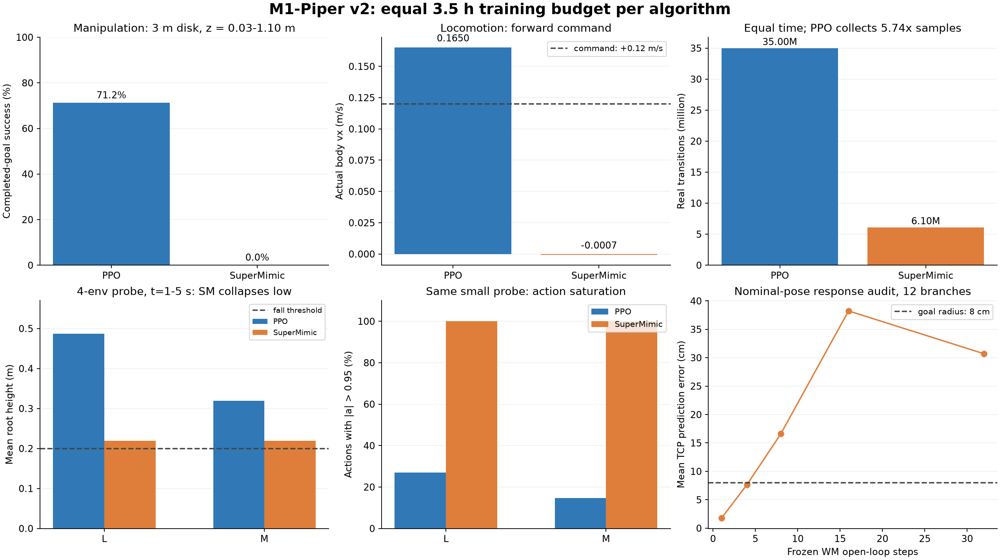
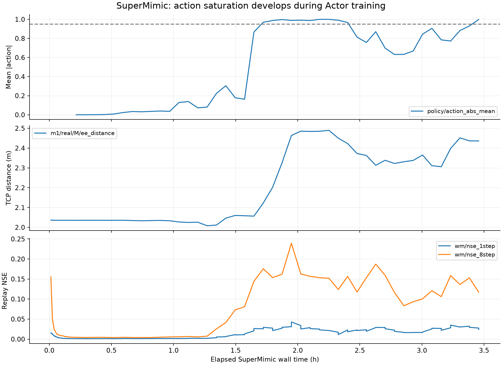

# M1-Piper 昨晚训练结果与失败分析（2026-11-06）

本报告检查 `v2_lm50_2048_3p5h_seed2026`，包括昨晚 PPO / SuperMimic 各 3.5 小时训练、双方 6 组自动评测，以及今天新增的有限物理响应和策略姿态诊断。今天没有更新策略或重新训练。

后续补充：[M1 饱和机制、Critic/终点梯度分解与 Go2 累计约 3 小时对比](M1_SATURATION_AND_GO2_TRAINING_HISTORY_20261106.md)。

**结论：队列正常完成。PPO 已学会一部分大范围全身到点，但低位目标和操作稳定性仍有明显问题；SuperMimic 最终策略退化为动作饱和、低位停滞、几乎不响应目标的控制器。现有证据将 world model 的物理响应误差和 Actor 饱和列为优先问题。**



## 1. 训练与评测是否正常完成

北京时间：PPO 于 **01:49:25** 完成；SuperMimic 于 **05:19:35** 完成；双方 6 组评测和比较报告于 **05:41:59** 全部完成。队列状态 `completed=true`，本次检查时没有遗留训练进程。

| 项目 | PPO | SuperMimic |
|---|---:|---:|
| 环境 | 2048，固定 1024 L / 1024 M | 相同 |
| 训练预算 | 12601.32 s（约 3.5h） | 约 3.5h，worker 含初始化 12605.42 s |
| 每环境真实步数 | 17088 | 2979 |
| 真实转移数 | 34,996,224 | 6,100,992 |
| 更新 | 534 次完整 PPO rollout/update | 1176 个 WM 事件、876 次 Actor 更新 |
| WM 每事件 fit | 不适用 | 4 次，共 4704 次 WM optimizer steps |
| 最终 checkpoint | `model_533.pt`，推理包 `policy_inference.pt` | `ckpt_latest.pt` |

PPO / SM 的更新定义不同，表中 534 与 876 不能直接比较。PPO 一次 update 内还包含多个 epoch / minibatch。

已逐字段比较保存的真实环境配置：除 Replay 存储等辅助字段外，共同字段没有差异；两者均为 v3/high-carry 动作定义、30 s episode、相同噪声/DR、3 m 圆盘和 0.03–1.10 m 高度、相同共享奖励。SM checkpoint 的想象长度确为 **32**，终点距离权重确为 **1.0**，相关日志存在且非零。PPO 推理包与训练 Actor 的动作最大误差为 0。

这轮是同计算时间的系统比较；SM 多了显式想象终点目标，PPO 又有自身随机探索，不能称为只更换算法其余优化条件完全相同的严格消融。

## 2. 正式评测结果

每组 64 env、60 s、seed=123；确定性 Actor，无训练噪声或 DR。M 任务到达即换点；成功是稳定进入 8 cm 内，不要求保持 0.5 s。

| 指标 | PPO | SuperMimic |
|---|---:|---:|
| 混合 L/M：M 已结束 goal 成功率 | 71.07%（172/242） | 0%（0/64） |
| 纯 M：已结束 goal 成功率 | **71.22%（334/469）** | **0%（0/128）** |
| 纯 M：每 M 环境每分钟成功数 | 5.219 | 0 |
| 纯 M：成功 goal 平均耗时 | 2.967 s | 无成功样本 |
| 纯 M：成功耗时中位数 / P90 | 2.880 / 5.220 s | 无成功样本 |
| 纯 M：时间平均 TCP 剩余距离 | 0.583 m | 2.022 m |
| 纯 M：跌倒 episode / 已结束 episode | **34/135 = 25.19%** | 0/128 |
| L 固定 vx=0.12：实际平均 vx | **0.16499 m/s** | **-0.000658 m/s** |
| L 固定前进：XY RMSE | 0.05047 m/s | 0.13675 m/s |
| L 固定前进：yaw-rate RMSE | 0.07939 rad/s | 0.08621 rad/s |
| L 固定前进：跌倒 episode | 0/128 | 0/128 |
| 正向指令时 \|vx\|<0.02 的时间比例 | 0% | **96.18%** |

口径限制：

- PPO 纯 M 共结束 469 个 goal：334 成功、34 在跌倒时结束、101 在 episode 超时时结束；另有 **27 个截止时仍活跃的 goal**，作为 censored 保留，没有并入成功率分母。SM 的 128 个 goal 全部超时，没有成功。
- 一个 episode 可以完成多个 goal，goal 成功率与 episode 跌倒率是两种分母。
- SM 的负 vx 很小，主体表现是停滞。符号统计“vx<0”达到约 96.9%，但实际低于 -0.02 m/s 的比例只有约 1.96%；不能把浮点/物理抖动描述成持续大幅后退。
- 每次成功后重新采样目标，双方之后经历的随机轨迹会不同。它们共用 seed 和分布，不是全程逐目标配对评测。
- 这是单训练 seed、名义平地场景。不能据此宣称实机鲁棒性或所有目标都可达。

### PPO 哪些目标仍然困难

以下仅统计纯 M 已结束 goal，按目标高度分组，存在结束样本选择偏差：

| 目标高度 | 成功 / 已结束 goal | 成功率 |
|---|---:|---:|
| 0.03–0.30 m | 40/121 | **33.1%** |
| 0.30–0.80 m | 183/224 | 81.7% |
| 0.80–1.10 m | 111/124 | 89.5% |

按初始 TCP 到目标距离分组，>2.5 m 的已结束 goal 仍成功 107/155≈69.0%，说明 PPO 并非只解决了贴近机械臂的小目标。低位目标更难的原因可能包括腿/臂协同、碰撞与动作包络，但本轮没有逐目标 IK/碰撞可达性审计，不能将所有失败直接标成“不可达”。

PPO 的 L 速度仍偏快，0.12 指令实际约 0.165。混合 L 的平均实际 vx≈0.0815，而平均命令≈0.0111，也提示正向偏置；应补充固定负向、侧向和转向测试来确定边界。

## 3. 已验证的问题一：SM 动作饱和，并停在低位姿态

今天追加了 4-env、5 s、balanced 的无噪声真实仿真；L 固定 vx=0.12。下表统计第 1–5 s，不是替代上面的 64-env 正式评测。

| 小规模姿态诊断 | PPO L | PPO M | SM L | SM M |
|---|---:|---:|---:|---:|
| 平均 root 高度 | 0.4868 m | 0.3191 m | **0.2193 m** | **0.2194 m** |
| 平均 \|action\| | 0.6996 | 0.4845 | **0.99988** | **0.99990** |
| \|action\|>0.95 的比例 | 26.9% | 14.7% | **100%** | **100%** |
| tanh 局部导数均值 1-a² | 0.4270 | 0.6583 | **0.000247** | **0.000202** |

SM 的 root 高度距 0.20 m 终止线只有约 2 cm，明显低于约 0.47 m 默认高度；仅用“root<0.20 m / 倾斜>70°”判失败，会把这种低位停滞计成未跌倒。**正式评测的 0% 跌倒不能解释为正常稳定行走。** 本次没有通过接触传感器判定机身是否接地，因此报告只称低位姿态，不把接地当成已测事实。

在保持观测历史不变时，将 L 的 vx 从 +0.12 改为 -0.12，SM 平均动作改变量只有 **1.76e-6**；将 M 的诊断目标左右切换，只有 **7.76e-7**。PPO 在相同诊断方法下分别约 0.119 / 0.522。SM 在这个姿态附近已经几乎失去指令响应。

`tanh` 饱和还会压低传到网络前层的局部导数。存在 Actor 梯度并不保证它能从这种动作边界有效恢复。

训练曲线记录到：首次平均动作幅度超过 0.95 在 **03:32、it1800**；超过 0.99 在 **03:41、it1900**；最后约 0.998。退化发生在训练过程中，并非最终导出突然换了策略。



## 4. 已验证的问题二：WM 在相关动作区域失准，存在错误的动作响应方向

### 测试方法

使用最终 WM 和最终 Actor，不更新参数。12 个无 DR/噪声的名义初态环境，构成 6 对正负扰动：轮子共同、轮子交替、轮子前后差分、两个臂关节、小腿共同动作。围绕初态下最终 Actor 的动作施加归一化扰动 ±0.03，再用 ±0.01 复核。各分支执行常动作 32 步；WM 从相同真实状态和物理 context 出发，重放相同执行动作。

这是**一个名义姿态附近的局部反事实检查**，不是整个训练分布的误差估计，也不是闭环 Actor 的 32 步性能。接触有限差分会有非光滑性；因此同时报告了两个幅度，并避免对接近零的符号变化做强结论。所有 12 条真实分支在检查窗口内均未终止。

### 轨迹预测误差（±0.03）

| horizon | 时间 | 底盘 XY 误差均值 | TCP 误差均值 | 速度 vx RMSE | 全状态 NSE |
|---|---:|---:|---:|---:|---:|
| 1 | 0.02 s | 0.0080 m | 0.0177 m | 0.133 m/s | 2.35 |
| 8 | 0.16 s | 0.0496 m | 0.1659 m | 0.669 m/s | 2.95 |
| 16 | 0.32 s | 0.1575 m | 0.3824 m | 0.945 m/s | 4.75 |
| 32 | 0.64 s | **0.3192 m** | **0.3069 m** | 0.300 m/s | **10.35** |

±0.01 的 32 步 TCP 误差约 0.3072 m，结论一致。8 cm 成功半径下，约 31 cm 的 TCP 预测偏差足以严重干扰终点成本。

### 动作偏导有符号错误的实测例子

α 是沿指定归一化动作方向的扰动，真实值为中心有限差分，WM 值为 autograd：

| 方向 / horizon | 真实响应（±0.01） | WM 梯度 | 意义 |
|---|---:|---:|---|
| 四小腿同向，8 步，∂vx/∂α | **-0.455** | **+0.467** | 预测的速度变化方向相反 |
| 四小腿同向，8 步，∂目标距离/∂α | **+0.0369** | **-0.0322** | WM 认为更接近，真实更远 |
| 四轮前后差分 `[+,+,-,-]`，32 步，∂目标距离/∂α | **-0.0194** | **+0.0898** | WM 的到点更新方向可能与真实改善相反 |

±0.03 也保留上述三个例子的相反符号。距离诊断点固定为本环境世界点 `[1.5,0,0.8]`。

WM 自身有限差分大体接近其 autograd，说明这组测试里的主要问题是**学出的物理偏导与真实系统不一致**。不能据此宣称全系统所有梯度正确，也不能把局部错误简化成某根轮轴永久反号。

### 为什么训练日志的 NSE 看起来没那么差

训练 WM 窗口只有 **8 步**，Actor 却反传 **32 步**；常规监控主要是 Replay 上 1/8 步，未校验 32 步或动作扰动方向。Actor 开始时 it800 的 NSE8≈0.0045，最后≈0.1171。初期近静止数据容易取得小误差；之后 Actor 使状态/动作分布变化，固定预热次数并不能保证 WM 持续可靠。

Replay 容量 256 控制步，每 env 只保留约 **5.12 s**，短于 30 s episode。低位饱和分布可能逐渐挤掉正常高位/启动/接近成功的样本；这是一种有依据的覆盖风险，但还没有做整库状态分布追溯来证明其贡献比例。

先前短测覆盖运行、接口、FK、奖励一致性和有限梯度；本次物理响应审计补上了关键验证。恢复 H32 没有自动提升动力学模型精度。

## 5. 奖励、探索与更新设计如何放大这些问题

### 5.1 +12 成功奖励对 PPO / 路径梯度的作用不同

实现中的成功项来自 `distance<0.08` 和稳定性的布尔判断。PPO 可以用随机动作是否得到成功奖励来改变动作概率；SM 对模拟状态做路径反传时，这个布尔事件的直接导数几乎处处为零。Critic 仍可通过拟合成功回报间接提供信号，但前提是 Replay/想象中有足够的成功数据，并且值函数梯度可靠。

SM 的成功样本极少，因此 +12 的数值较大，并不能自动提供强的可微到点引导。显式终点距离和粗距离/进度是其主要可微引导，而它们依赖上述失准的 WM。

### 5.2 时间成本已经启用，但不是任意距离下都强的过程梯度

`r_time=-0.5d/(d+0.5)`，导数幅度为 `0.25/(d+0.5)^2`。d=2 m 时约 0.04 reward/(s·m)，远处梯度较弱。它能鼓励减少距离/时间，但不足以补偿错误的物理动作梯度。

SM 真实训练后段，近点精奖励、hold 几乎为零；进度均值接近零或为负；M 距离从早期约 2.04 m 变到最后日志约 2.44 m。终点奖励日志也从约 -1.02 变到 -1.23（混合 batch 平均，尚未乘 γ³²）。这些信号说明终点项确实在算，但没有带来接近目标的真实改善。

直立、高度、动作幅度等正则仍有作用，不过动作幅度成本 `-0.005 mean(a²)` 在完全饱和时每步仅 -0.0001。观察到全饱和表明目前的整体目标/梯度约束未能防止这一退化；不能只看正则项名字存在就认定约束足够。

`m_hold` 来源于上一版“到点保持”任务；本轮到达立即换点，hold 的作用窗口变得很短。后续应重新审视这项与快速到达任务的兼容性。

### 5.3 探索强度差别很大

两者环境噪声都是 0.03，但 PPO 另有 Gaussian policy 采样：记录到的平均 std 从 **0.301** 增长到最终 **0.479**；SM 是确定性 Actor 加环境噪声 0.03。初期归一化探索幅度约差 10 倍，后期更大。

3 m 圆盘面积均匀采样意味着，75% 的目标水平半径超过 1.5 m，半径 ≤0.5 m 的点只有约 2.8%。SM 的小幅扰动很难产生持续接近远点的丰富数据。建议按动作类型使用有时间关联的有界探索，并检查真实执行分布，不直接把所有关节统一改成大噪声。

### 5.4 相同时间内，PPO 的真实样本是 5.74 倍

SM 3.5 小时只有约 6.10M 真实转移，PPO 约 35.00M。SM 要消耗计算拟合 WM、做 32 步 FK/Actor BPTT。样本覆盖差距会影响学习，**但它无法解释实测动作偏导反号，也不能成为忽略该问题的理由**。延长 SM 训练前应先修复模型可信度和动作饱和。

SM 使用 2e-4 常数基础 LR，加 500 次 Actor 更新 ramp；PPO 的自适应 LR 最后降到约 1e-5。没有 WM 可信度门控或最佳 checkpoint 回滚时，持续更新容易在错误模型上走向动作边界。

### 5.5 多任务梯度冲突与运动学接口的证据边界

L/M 共享 Actor，存在梯度冲突的可能，但本次没有 L-only / M-only 重新训练，不能把多任务作为已证实根因。本次两类目标在低位姿态下都几乎不影响动作，优先应处理共同的模型/更新问题。

本轮是 reward-only，没有 motion prior 或离线运动学预训练数据。PPO 在同一真实接口上学到了到点，且前次 FK/Goal8 契约测试通过，因此旧运动学数据库约定不是本轮最先支持的解释。仍需对物理动力学、控制尺度和梯度做校准，不能将“PPO 能学会”当作 SM 全链路实现无误的证明。

## 6. 建议下一轮按什么顺序处理

1. **先做 WM / 梯度校准门槛。** 保持 Actor H32；WM 验证同时报告 1/8/16/32 步、base/TCP/轮速分项误差、动作正负扰动方向，覆盖正常高位、启动、转向、臂运动与低位状态。Actor 的放行条件采用物理相关误差和响应方向，不能只有固定 300 次预热计数或全状态 NSE。
2. **阻止 Actor 进入全饱和后继续恶化。** 记录每组动作饱和率、logit/tanh 梯度、root 高度与 goal 响应；加入真实分项评测与最佳 checkpoint 保留/回滚。可在后续小规模实验中降低 Actor LR、收紧更新幅度、采用现成的稳定更新约束，并明确失败/机身异常接触定义。
3. **补真实数据覆盖和 Replay 保留。** 正常高位、轮速正负、接近成功、接触切换等数据要保留；扩大/分层 Replay 或保留固定校准集。可以复用现有 PPO 轨迹给 WM 做诊断/预训练，若这样做，必须标成使用额外策略数据的新实验，不能与这次从零训练混报。
4. **再调整过程与终点奖励。** 保留可微距离/进度，引入目标边界一致的 shaping，评估 hold 项；把硬事件奖励作为结果信号，而不是 SM 唯一到点引导。优化低位目标时要同时看成功和跌倒/异常接触，不能只加大到达奖励。
5. **最后扩大训练和比较。** 先做 L-only / M-only 定位共享问题，再做 balanced；既报告同时间结果，也可补相同真实转移预算的比较。只有模型与策略更新稳定后，更多训练才有解释价值。

这些是针对下一轮的方案，本次保留昨晚训练代码与权重，今天只做分析和有限诊断。现有证据支持“局部模型物理响应失准、策略饱和、探索/数据覆盖不足相互放大”的解释，尚没有消融实验量化每个因素的因果贡献。

## 7. Play 命令

在训练主机有图形桌面的终端里逐条运行；关闭一个窗口后再启动下一个。统一使用 Conda `supermimic`。

M1 默认演示昨晚的 **M 随机目标任务**，红球=目标、青球=TCP、黄色线=误差；到达后自动换目标。要看 L，把 `--m1-task M` 替换成 `--m1-task L --vx 0.12 --vy 0 --yaw-rate 0`。要用同一个固定点比较两者，可都加 `--m1-target-world 1.5 0 0.8`；固定点演示关闭自动换点。

### M1-Piper PPO，昨晚 v2

```bash
cd /home/yifeiy/ws_supermimic
PYTHONPATH=src OMP_NUM_THREADS=1 /home/yifeiy/miniconda3/envs/supermimic/bin/python scripts/play.py \
  --ckpt logs/m1_ppo/v2_lm50_2048_3p5h_seed2026/policy_inference.pt \
  --num-envs 1 --viewer native --m1-task M
```

### M1-Piper SuperMimic，昨晚 v2 / H32

```bash
cd /home/yifeiy/ws_supermimic
PYTHONPATH=src OMP_NUM_THREADS=1 /home/yifeiy/miniconda3/envs/supermimic/bin/python scripts/play.py \
  --ckpt logs/m1_reward/v2_lm50_2048_3p5h_seed2026/ckpt_latest.pt \
  --num-envs 1 --viewer native --m1-task M
```

Go2 使用此前已完成正式评测和 rl_sar 导出的两份 2.5h 策略。昨晚这轮队列只包含 M1；这里没有把 smoke 的 Go2 策略作为正式结果。两条命令均前进 0.3 m/s，可调 vx/vy/yaw-rate。

注意：这里的 Go2 SuperMimic 是**从头训练的比较模型**，不是之前对角步态较好的续训权重。两者步态差距及旧模型命令见 [来源核对](GO2_POLICY_PROVENANCE_AND_GAIT_20261106.md)；旧最终模型含 WM 来源累计约 4.55h，时间口径见 [累计训练审计](M1_SATURATION_AND_GO2_TRAINING_HISTORY_20261106.md)。

### Go2 PPO

```bash
cd /home/yifeiy/ws_supermimic
PYTHONPATH=src OMP_NUM_THREADS=1 /home/yifeiy/miniconda3/envs/supermimic/bin/python scripts/play.py \
  --ckpt /home/yifeiy/rl_sar/policy/go2/ppo_velocity/policy_inference.pt \
  --num-envs 1 --viewer native --vx 0.3 --vy 0 --yaw-rate 0 \
  --velocity-arrow --actual-velocity-arrow
```

### Go2 SuperMimic

```bash
cd /home/yifeiy/ws_supermimic
PYTHONPATH=src OMP_NUM_THREADS=1 /home/yifeiy/miniconda3/envs/supermimic/bin/python scripts/play.py \
  --ckpt /home/yifeiy/rl_sar/policy/go2/supermimic_velocity/policy_inference.pt \
  --num-envs 1 --viewer native --vx 0.3 --vy 0 --yaw-rate 0 \
  --velocity-arrow --actual-velocity-arrow
```

无桌面的远程终端可将 `--viewer native` 改为 `--viewer viser`，使用输出的浏览器地址。

## 8. 可复核材料

- [全部正式评测、训练完成信息及诊断 JSON](results/m1_v2_20261106/)。
- [策略路径与 SHA256、诊断范围](results/m1_v2_20261106/provenance.json)。
- 原始队列：`logs/m1_comparison/v2_lm50_2048_3p5h_seed2026/`。
- 局部物理响应与姿态诊断脚本及日志：上述目录 `diagnostics/`，没有 optimizer 更新。
- [本轮任务/奖励设计](M1_V2_AND_SEQUENTIAL_TRAINING_20261105.md)。
- [Go2 此前正式评测](FINAL_POLICY_EVALUATION_20261104.md)。
