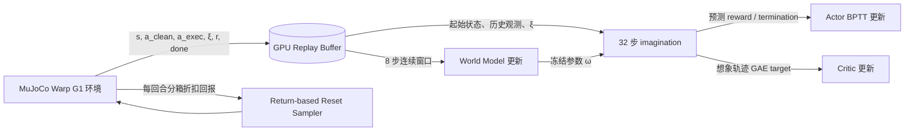

# SuperMimic 代码与算法对照

本文按当前 checkout `d9be385b3eeb13a638fb33fb200d3bfd9be9839f` 的实现整理。论文中未完全规定的实现细节以仓库代码为准；本文不改变算法。

## Figure 2 / Algorithm A.1：训练闭环

每个训练迭代按“真实仿真采集 → 拟合一个可微世界模型 → 冻结模型并做策略想象优化”执行：



对应入口为 `src/supermimic/training/loop.py::Trainer.run`。每次循环只调用一次 `env.step`，因此 iteration 是**一次向量化仿真步**：默认 `num_envs=4096` 时每次迭代同时产生最多 4096 条真实 transition。`schedule.total_iterations=320000` 是向量化迭代数，不能读成总共只有 320000 条单环境 transition。

## World Model

实现位于 `src/supermimic/world_model/{state_spec.py,dynamics.py,world_model.py,wm_trainer.py,heads.py}`。

### 状态、动作与仿真上下文

每个状态是 `s ∈ R^71`，顺序沿用 MuJoCo 的 `qpos | qvel`：

| 切片 | 内容 | 维数 |
|---|---|---:|
| `0:3` | 根部位置（相对当前环境原点，世界系） | 3 |
| `3:7` | 根部四元数（wxyz） | 4 |
| `7:36` | 29 个关节位置 | 29 |
| `36:39` | 根部线速度（世界系） | 3 |
| `39:42` | 根部角速度（根部/机体系） | 3 |
| `42:71` | 29 个关节速度 | 29 |

策略动作 `a ∈ R^29` 是归一化关节设定点。采集时环境执行带探索噪声的 `a_exec`，Replay Buffer 同时保存干净动作和实际执行动作；世界模型用 `a_exec` 拟合真实动力学。仿真上下文 `ξ ∈ R^33` 为足底摩擦 1 维、关节编码器偏置 29 维、躯干质心偏移 3 维；每回合固定。输入用 `StateSpec.normalize_xi` 中的偏置/尺度归一化。

### Heading Canonicalization 与动力学积分

动力学网络不是直接读完整世界坐标状态。`StateSpec.canonical(s)` 构造 71 维特征：根部高度 1、去 yaw 后的根部旋转 6D 表示 6、heading 系根部线速度 3、机体系根部角速度 3、关节位置 29、关节速度 29。根部世界 x/y 与整体 yaw 不进入特征，让动力学预测对全局平移和航向变化共享；状态本身仍保留根部世界位姿用于后续积分和奖励。

Dynamics MLP 的拼接输入为 `71 + 29 + 33 = 133` 维，结构是 Linear/SiLU × 3（隐藏宽度 `(2048, 2048, 2048)`），最后输出 70 维。输出是**速度增量与积分修正**，不是完整下一状态：

```text
delta(70) = [Δv_heading(3), Δω_body(3), Δqdot(29), Δp_heading(3), Δθ_body(3), Δq(29)]
v'    = v + R_heading Δv_heading
ω'    = ω + Δω_body
qdot' = qdot + Δqdot
p'    = p + 0.02 v' + R_heading Δp_heading
q'    = normalize(q ⊗ exp(0.02 ω' + Δθ_body))
qj'   = qj + 0.02 qdot' + Δq
```

最后一层零初始化，初始模型等于常速度外推这一物理先验。输入状态/误差尺度、输出尺度见 `StateSpecCfg`。归一化状态误差向量是 70 维 `[位置误差3, 旋转向量误差3, 线速度差3, 角速度差3, 关节位置差29, 关节速度差29] / σ`。

### 8 步损失与解析头

`WorldModel.window_loss` 从 Replay Buffer 抽取 `(k+1,N,71)` 状态、`(k,N,29)` 执行动作、`(N,33)` 上下文和逐步终止标签，默认 `k=8`。它从记录状态 `s0` 开始，把模型自己的预测递归喂给下一步；每一步用记录的 `a_exec[j]`。损失是 8 步平均的状态平方误差（70 维求和）加终止 BCE：

```text
L = (1/8) Σ_j mean_batch Σ_70 e_j²
  + term_loss_weight · (1/8) Σ_j mean_batch BCEWithLogits(d_logit_j, done_j)
```

本实现没有单独学习 reward 或 observation head：奖励经可微 G1 FK 和 `tracking_reward_terms` 解析算出；无噪声本体观测由状态直接拼出（93 维）。Replay Buffer 虽然记录仿真 reward，但它不进入 `window_loss`。Termination head 则是学习头：输入 pelvis 相对目标的高度/倾斜误差及其绝对值，共 4 维；两层隐藏宽度 `(64,64)`，输出一个 logit。真实环境以高度阈值 0.25 m、倾斜阈值 0.8 做硬终止标签，想象中用 sigmoid 概率形成软存活率。

`AnalyticHeads` 用 Torch FK 计算 14 个追踪刚体，支持通过奖励对预测状态求导。主体位置/朝向奖励将参考轨迹按机器人 torso anchor 的 xy/yaw 重锚定；根位置/朝向仍是全局误差。各项乘控制周期 0.02 s。奖励项为 4 个刚体跟踪项（位置、姿态、线速度、角速度）、根位置与姿态、动作变化惩罚、关节限位惩罚；权重/尺度见 `envs/mdp/rewards.py::TrackingRewardCfg`。

## Imagination、Actor 与 BPTT

实现位于 `src/supermimic/imagination/{rollout.py,compiled.py,objective.py,policy_trainer.py}`。

### Actor 网络

代码中的 motion Actor 是“未来动作片段编码器 + 共享解码器”：10 帧未来目标 `(N,680)` 经 MotionEncoder MLP `680 → 2048 → 1024 → 512 → 256 → 32`，再经过 `tanh` 得到 32 维 latent；10 帧本体历史 `(N,930)` 按观测项做固定尺度归一化，与 latent 拼成 962 维，送入 Decoder MLP `962 → 2048 → 1024 → 512 → 256 → 29`。最终 29 维为归一化关节设定点，Decoder 输出层 gain 为 0.01。定义见 `policy/nets.py::MotionEncoder/Decoder/Policy`。

### 张量和每步计算

默认从 Replay Buffer 取 `N=4096` 个非终止起始状态，并回填每个状态所需的 10 帧 episode 内观测历史。目标条件是未来 `K=10` 帧，每帧 68 维，合计 `680` 维；单帧由关节位置 29、关节速度 29、投影重力 3、机体系角速度 3、heading 系线速度 3、根高度 1 构成。策略本体观测每帧 93 维，10 帧历史展平成 `930` 维，按观测项分组展平。

每步循环中 Actor 根据当前历史观测和未来目标输出 29 维动作；冻结的动力学模型预测 `s_next`；解析 FK/奖励与终止头基于 `s_next` 计算 reward 和 `dhat=sigmoid(logit)`；解析观测头生成下一帧无噪声观测，训练噪声按论文表格重新采样；目标帧索引每步加 1 并在 clip 末帧钳位。默认循环 `H=32` 次，记录的 rollout shape 为状态 `(H+1,N,71)`、动作 `(H,N,29)`、奖励 `(H,N)`、目标 `(H+1,N,680)`、存活率 `(H+1,N)`。

Figure 2 的可微链路在实现中是：

```mermaid
flowchart LR
  O[历史观测 930 + 目标 680] --> A[Actor πθ]
  A -->|a_t, 29| F[冻结参数的 Dynamics fω]
  F -->|s_{t+1}, 71| S[显式积分]
  S -->|预测状态| FK[可微 G1 Torch FK]
  FK --> R[解析跟踪 reward]
  R --> J[折扣回报 + soft survival]
  J -. loss.backward 的梯度 .-> A
  S -->|analytic observation| O2[下一步历史观测]
  O2 --> A
  S -->|termination logits| D[sigmoid + c←c(1-dhat)]
  D --> J
```

Actor 更新前，代码执行 `wm.requires_grad_(False)` 和 `critic.requires_grad_(False)`，但**没有**把 imagination 放进 `torch.no_grad()`。所以模型权重不接收梯度，`s_next` 对动作的导数仍然存在；reward、soft survival、后续 observation/state 均在计算图中，梯度通过 H 步返回 Actor。这是核心 BPTT 路径。

论文 Eq. 2 在代码中对应 `policy_objective`：

```text
J = mean_n [ Σ_(t=0..H-1) γ^t c_t r_(t+1) + γ^H c_H Vψ(s_H,g_H,ξ) ]
c_0=1,  c_(t+1)=c_t(1-dhat_(t+1))
L_actor = -J / H
```

训练日志中的 `imag_return_undisc` 是未加 γ 的诊断量，不能等同真实仿真 episode return。

## Critic 与 Eq. 3

Critic 输入是 canonical state 71、目标 680、归一化 `ξ` 33、特权根误差 4，合计 788 维；两层 MLP `(256,128)` 输出标量价值。根误差是参考 heading 下根位置差 3 维和 yaw 差 1 维，不输入 Actor。本仓库用**想象轨迹**训练 Critic，不用真实仿真轨迹直接回归价值。

Actor 更新结束后，代码对已生成 rollout 中 `s_0..s_H` 计算价值；用想象 reward 和下一状态终止概率反向算固定 Lambda-return target：

```text
R_H = V_H
R_t = r_(t+1) + γ(1-dhat_(t+1))[(1-λ)V_(t+1) + λR_(t+1)]
L_critic = mean_(t,n)(V_t - stopgrad(R_t))²
```

目标由 `@torch.no_grad()` 计算并在 critic minibatch/epoch 中固定。默认 `λ=0.95`、5 个 epoch × 4 个 minibatch，即每次 policy update 做 20 次 critic optimizer step。Actor 更新时 Critic 参数冻结，但 terminal bootstrap 对 `s_H` 保留导数，梯度可由 `V_H(s_H)` 返回 Actor；Critic 更新使用 detach 后的状态特征、目标、根误差。

## 训练调度与样本量

默认配置可在 `src/supermimic/config.py`、`training/loop.py`、各 trainer cfg 中核对：

| 量 | 默认值 | 代码含义 |
|---|---:|---|
| 向量环境数 | 4096 | 每次 `env.step` 的并行仿真数 |
| 控制周期 | 0.02 s / 50 Hz | MuJoCo timestep 0.005 s × decimation 4 |
| Replay capacity | 每环境 1000 行 | GPU ring buffer，按 env/time 存状态和 transition |
| 预热 | 40 iterations | 等待可采样的 8 步窗口 |
| 更新比 UTD | 0.4 次更新/向量迭代 | 累积小数计数器，平均 5 个向量迭代进行 2 次更新 |
| 每次 WM 更新 | 10 个 batch × 2048 个窗口 × 8 步 | 20480 个窗口，含 autoregressive rollout 训练 |
| 每次 Actor 更新 | batch 4096 × H=32 | 131072 个想象 transition |
| Actor/WM 更新比 | 1:1 | 每次 WM 更新后做 1 次策略更新 |
| Critic | 5 epoch × 4 minibatch | 每次 Actor 更新 20 次 Critic optimizer step |

因此一次默认 WM optimizer step 使用 2048 个**连续的 8 步窗口**；一次默认策略更新构造 4096 条长度 32 的想象轨迹。以 0.4 UTD 计算，每个真实向量化迭代平均带来 0.4 次 WM 更新和 0.4 次策略更新。它们与每次 `env.step` 的 4096 条真实 transition、以及每次 imagination 的 131072 个预测 transition 是不同计数口径。

Replay Buffer 额外存 episode id、clip/frame、终止/episode-start 标志。WM 窗口采样掩码确保窗口属于同一 episode 且不跨终止；策略起点从有效非终止行采样，历史若越过 episode 开头则用本 episode 首行回填。

Return-based reset sampler 将参考轨迹按 50 帧（1 秒）分箱；用每回合折扣 return-to-go 更新分箱 EMA（`ema_alpha=0.05`），按低回报 softmax 权重 `softmax(-25·bin_return/10)` 形成 hard distribution，并以 `0.5 uniform + 0.4 hard + 0.1 memory` 混合采样概率；memory 的 EMA 系数为 0.01。遇到未终止的 time-limit 截断且没有 critic bootstrap 时，采样器丢弃截断前 100 步附近的数据，避免将不完整回报当成完整回报。

## 本地复现需要核对的偏离

源码默认 `anchor_obs=False`，与论文 93 维本体观测及 680 维目标相符。仓库 README 记录过启用 anchor-relative 9 维观测的实验偏离；本机正式对照实验应保持默认 false。硬件适配只应修改 batch、并行环境、更新频率等实验配置；World Model、Actor、Critic、Reward、Termination 和 BPTT 代码应保持仓库版本。
