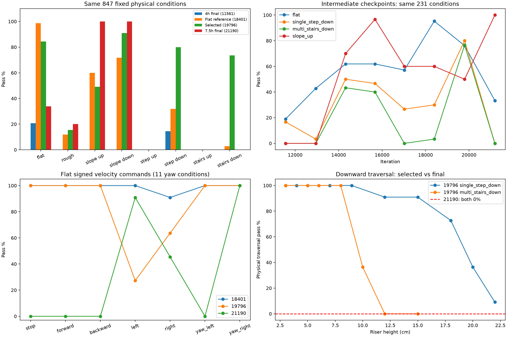

# Go2W 累计7.5小时训练：物理评测复核

结论：**续训学到了更好的平地和下台阶/下楼能力，但最后约30分钟出现明显退化。最终last.pt不能代表本次训练的较好能力；上台阶和连续上楼仍未学会。**

本次按相同协议复测自动选中的`best.pt`（第19796轮）和第18401轮检查点，并与四小时最终模型及7.5小时最终模型对照。所有检查点各847条真实MuJoCo物理episode，冻结单Actor，无WM想象评测、无探索噪声。未修改模型、奖励、课程或训练配置，也未再次启动训练。

各项奖励的实际公式/权重、21项物理贡献、训练窗口变化、退化关联及可复现play命令，见[21项reward分析与播放说明](go2w_h8_reward_analysis.md)。四个模型均增加了逐项reward复测，847条物理结果与原评测逐项一致，重算reward与环境返回值逐步误差为0。

## 训练完成情况

额外有效循环12601.150秒（预算12600秒），累计27001.999秒；北京时间2026-11-17 08:29:07至12:03:47（含前后评测）。最终iteration21190，新增9629次Actor、96290次WM、192580次Critic更新；新增98,603,008条真实转移。4096env、buffer1024、WM/Actor batch2048、H8/window8保持不变。GPU峰值4062.03MiB；CPU RSS峰值4833.30MiB。

## 同条件物理成功率

|任务|四小时最终11561|平地对照18401|自动选中19796|最终21190|
|---|---:|---:|---:|---:|
|平地全向（含停止）|16/77（20.8%）|76/77（98.7%）|65/77（84.4%）|26/77（33.8%）|
|粗糙地形|0/110（0.0%）|13/110（11.8%）|17/110（15.5%）|22/110（20.0%）|
|上坡|0/110（0.0%）|66/110（60.0%）|54/110（49.1%）|110/110（100.0%）|
|下坡|0/110（0.0%）|79/110（71.8%）|100/110（90.9%）|110/110（100.0%）|
|单级上台阶|0/110（0.0%）|0/110（0.0%）|0/110（0.0%）|0/110（0.0%）|
|单级下台阶|16/110（14.5%）|35/110（31.8%）|88/110（80.0%）|0/110（0.0%）|
|连续上楼|0/110（0.0%）|0/110（0.0%）|0/110（0.0%）|0/110（0.0%）|
|连续下楼|0/110（0.0%）|3/110（2.7%）|81/110（73.6%）|0/110（0.0%）|

第19796轮在已有自动选择准则下被保存为best：平地至少70%，并提高平地与四个台阶分支平均成功率；它不是每项任务的最优模型。第18401轮平地76/77（98.7%）更好，但连续下楼仅3/110（2.7%）。最终模型坡地更好，但平地和下台阶明显退化。

|任务|19796跌倒率|最终21190跌倒率|
|---|---:|---:|
|平地全向（含停止）|1.3%|48.1%|
|粗糙地形|19.1%|11.8%|
|上坡|0.0%|0.0%|
|下坡|0.0%|0.0%|
|单级上台阶|7.3%|100.0%|
|单级下台阶|20.0%|100.0%|
|连续上楼|21.8%|99.1%|
|连续下楼|26.4%|99.1%|

## 全向速度跟踪分轴

|命令(vx,vy,wz)|18401通过/11|19796通过/11|21190通过/11|19796实际均值|21190实际均值|
|---|---:|---:|---:|---|---|
|停止 (0.000, 0.000, 0.000)|11|11|0|-0.003, 0.010, 0.002|0.064, -0.003, 0.110|
|前进 (0.300, 0.000, 0.000)|11|11|0|0.255, -0.002, 0.005|0.278, -0.023, 0.086|
|后退 (-0.200, 0.000, 0.000)|11|11|0|-0.208, 0.039, -0.009|0.042, -0.053, -0.152|
|左移 (0.000, 0.200, 0.000)|11|3|10|0.055, 0.278, 0.035|0.026, 0.076, 0.024|
|右移 (0.000, -0.200, 0.000)|10|7|5|-0.054, -0.106, -0.014|-0.013, -0.135, -0.031|
|左旋 (0.000, 0.000, 0.350)|11|11|0|-0.016, 0.031, 0.396|0.184, -0.045, 0.138|
|右旋 (0.000, 0.000, -0.350)|11|11|11|-0.026, 0.037, -0.410|0.034, 0.014, -0.409|

实际均值先在每条episode存活时段内计算，再在11个朝向条件间平均，包含初始瞬态，不是稳态速度。各轴RMSE和逐条终止原因保存在JSON。第19796轮前后与旋转均11/11，主要短板仍是侧移：左移3/11、右移7/11。最终模型停止和前进均11/11跌倒，左旋7/11跌倒；整体平地跌倒率从1.3%升至48.1%。

## 台阶高度和楼梯难度

|单级高度|19796上台阶通过/11|19796下台阶通过/11|最终上/下通过/11|
|---:|---:|---:|---:|
|3cm|0|11|0 / 0|
|4cm|0|11|0 / 0|
|5cm|0|11|0 / 0|
|7cm|0|11|0 / 0|
|9cm|0|11|0 / 0|
|12cm|0|10|0 / 0|
|15cm|0|10|0 / 0|
|18cm|0|8|0 / 0|
|20cm|0|4|0 / 0|
|22cm|0|1|0 / 0|

|连续四级楼梯单级高度|19796上楼通过/条件数|19796下楼通过/条件数|最终上/下通过|
|---:|---:|---:|---:|
|3cm|0/44|44/44|0 / 0|
|5cm|0/11|11/11|0 / 0|
|6cm|0/11|11/11|0 / 0|
|8cm|0/11|11/11|0 / 0|
|10cm|0/11|4/11|0 / 0|
|12cm|0/11|0/11|0 / 0|
|15cm|0/11|0/11|0 / 0|

20cm、22cm单级下台阶在19796轮分别4/11、1/11，仍不稳健；对应上台阶均0/11。连续下楼在3–8cm各条件全部通过，10cm为4/11，12/15cm为0/11。上楼及上单级在此次复测的两个中途模型和最终模型中全部0/110。十级地形生成不等同于十级能力达标。

## 退化证据与解释边界

19796轮有效循环25204.285秒，最终27001.999秒，相隔1797.714秒（约30分钟）。在同样847条物理条件下，平地84.4%→33.8%，单级下台阶80.0%→0%，连续下楼73.6%→0%；同时坡地变好，说明出现了任务间不均衡和能力遗忘。现有结果不能单独证明是某个奖励项、WM导数或优化器引起。

同一独立物理holdout（240个domain/level/phase条件，从未进入Replay）的WM误差如下；按有效样本数对分组MSE加权后开方：

|模型|H1线速度RMSE (m/s)|H8线速度RMSE (m/s)|H8角速度RMSE (rad/s)|H16线速度RMSE (m/s)|
|---|---:|---:|---:|---:|
|续训起点11561|0.0211|0.4766|4.2419|0.7896|
|18401|0.0244|0.7907|6.4392|0.8657|
|19796|0.0259|0.9428|7.3011|0.8429|
|21190|0.0246|0.8830|6.7136|0.8832|

H1/H8/H16分别只有239/217/43个未跨episode边界的有效条件；尤其H16有严重幸存者偏差。H8 holdout误差从续训起点到最终变差，而训练WM loss下降，不能以训练loss判断真实策略质量。该holdout使用固定小幅随机动作，覆盖有限，不直接等同于策略动作下的方向检查，也不能单独解释最后30分钟的退化。

最终课程等级为[10, 1, 1, 1, 1, 1, 2, 1, 1, 1, 1, 6, 1, 1]，顺序为停止、±vx、±vy、±yaw、rough、上坡、下坡、上单级、下单级、上楼、下楼。停止Level10、右旋Level2、下单级Level6，其余Level1。课程等级是历史窗口状态，最终下台阶Level6与独立评测0%并存，不能作为最终能力证书。
仅统计本次新增的Actor起点：平地90.9%，其余域分布和等级见review_summary.json。尚无证据支持直接宣称全向和上楼目标已达成。

## 后续使用建议

保留第19796轮作为下台阶/下楼与全向综合对照，保留18401作为平地对照；二者均不是全任务达标模型。完整续训必须使用包含优化器/Replay的完整检查点，best.pt仅用于推理评测，不能冒充完整续训状态。下一项实验应先定位最后约30分钟的能力遗忘，并单独验证上台阶/上楼的实际改进；本次没有擅自修改或续训。

## 在本机播放当前能力

以下命令打开MuJoCo桌面窗口，依次演示7种平地命令和代表性单级/连续楼梯。推荐先看已保存的综合对照模型19796轮：

```bash
cd /home/yifeiy/ws_go2_unilab/Uni-SuperMimic-unified
PYTHONPATH=src MUJOCO_GL=glfw /home/yifeiy/miniconda3/envs/go2_unilab/bin/python tools/play_go2w.py \
  --checkpoint /home/yifeiy/ws_go2_unilab/runs/go2w_unified_h8_resume_3p5h_20261117/best.pt \
  --demo
```

看最终21190轮时，将checkpoint换成同一run下`evaluation/final.pt`；看平地对照18401轮换成`evaluation/iteration_018401.pt`。单环境play在两个独立进程的13个演示场景中逐项复现，但与847环境批量评测的数值轨迹有差别；一次播放结果不能代替上表通过率。完整地形/速度/等级参数、无窗口命令及模型SHA见[播放说明](go2w_h8_reward_analysis.md#5-可复现play直接观看当前能力)。

## 验证、图表和视频

全部模型使用11个固定初始yaw（±0.025rad），每条从t=0运行最多500步/10秒；这是确定性条件敏感性测试，不是独立随机种子统计。平地覆盖停止和六个有符号单轴命令，粗糙/坡地/台阶固定命令为(vx,vy,wz)=(0.3,0,0)，因此坡地100%仅代表本矩阵内的前进跟踪。平地、粗糙和坡地门槛为各轴RMSE<0.15、完整episode及命令方向进展；台阶以真实traversal_finished事件通过，不能只用进度奖励。
847条与231条评测共享的初始状态全部复现，通过/跌倒/时长一致，RMSE最大差0。轻量最终模型与完整last.pt的Actor/WM权重一致（轻量评测文件不包含Critic）；训练源码快照未变，原始WM文件SHA未变。



- [复核摘要及完整分轴/分级数据](../validation/go2w_unified_h8_continuation/review_summary.json)
- [847条19796模型物理评测](../validation/go2w_unified_h8_continuation/best_11yaw.json)
- [847条18401模型物理评测](../validation/go2w_unified_h8_continuation/iteration_018401_11yaw.json)
- [最终模型物理评测](../validation/go2w_unified_h8_continuation/final_11yaw.json)
- [19796平地视频](../validation/go2w_unified_h8_continuation/best_flat.mp4) · [19796台阶/楼梯视频](../validation/go2w_unified_h8_continuation/best_stairs.mp4)
- [最终平地视频](../validation/go2w_unified_h8_continuation/flat.mp4) · [最终台阶视频](../validation/go2w_unified_h8_continuation/stairs.mp4)

本机原始run：`/home/yifeiy/ws_go2_unilab/runs/go2w_unified_h8_resume_3p5h_20261117`；评测脚本：`tools/evaluate_go2w.py`。
