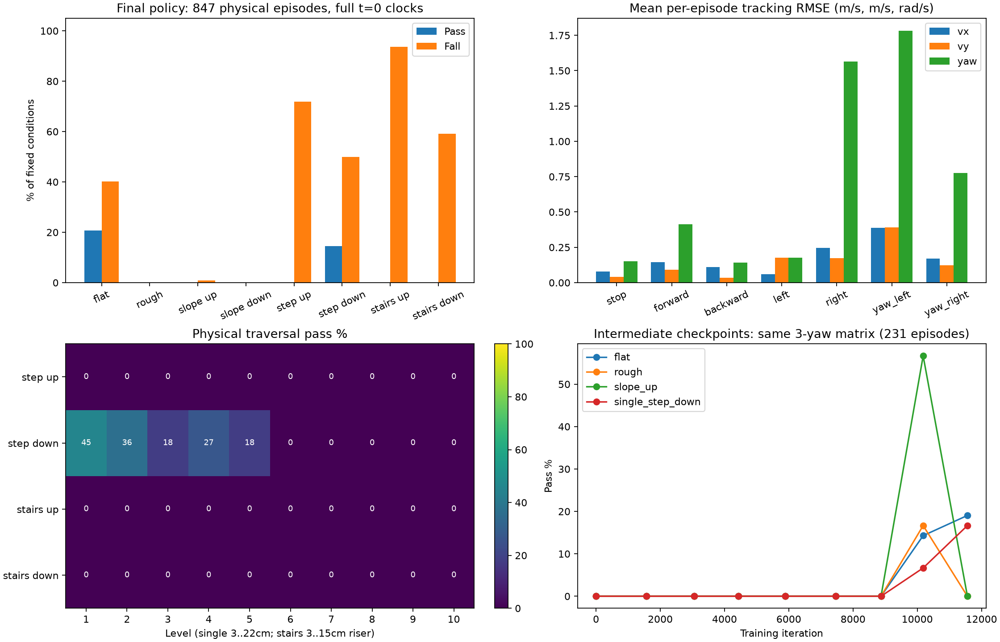

# Go2W H8 四小时训练：结果复核与修正物理评测

2026-11-17。结论：**四小时训练完成，但全向速度跟踪和上台阶/连续楼梯能力未达标。**
本次只修复评测和分析工具，未修改已训练参数、控制协议、奖励或训练配置；没有启动新的训练。

## 训练是否完成

北京时间 **2026-11-16 21:04:00 → 2026-11-17 01:07:59**，实际优化循环 **14400.849秒**；前后物理评测和检查点保存不计入该循环时长。
4096 env、1024 buffer、WM/Actor batch2048、WM window8、Actor horizon8，完整保留。
最终iteration=11561；真实转移（含warmup）=118,644,736；WM/Actor/Critic更新=115610/11561/231220。
显存峰值4062.09MiB，进程内存峰值2492.74MiB，无重启；原始WM文件保留。
`formal_budget_complete=true`；通用字段`completed=false`对应未达到哨兵iteration上限，不表示14400秒预算未完成。

## 纠正自动评测中的计时问题

旧评测调用reset后保留了环境初始化时随机错开的episode计时。例如flat_stop只评195步、backward只评102步就超时；旧代码却要求499步才能通过，导致通过率被低估；提前结束也低估了跌倒风险。此前报告的flat=0%、台阶等通过率属于这个旧协议，不能作为完整10秒评测。
本次通过公开API `set_episode_length_buf(zeros)` 同时清零环境和state计数。另明确读取`traversal_finished`事件、记录每个episode终止原因，并以命令方向的位移积分替代无方向的路径长度。保留旧JSON，不覆盖原证据。
最终checkpoint重新评测847个固定物理条件：每个任务使用 **11个初始yaw（-.025…+.025rad，约±1.43°）**，平地7类命令 + 7类地形×10级。Actor冻结，无探索噪声，不使用WM imagination评估运动能力。
这11个条件是确定性的朝向敏感性试验，并非11个独立随机实验或成功率置信区间。每个episode从t=0开始，最多500步/10秒；跌倒或物理越障成功则提前结束，不跨reset累计。
平地/rough/slope通过条件：未跌倒、完成至少499步、vx/vy/yaw各自RMSE<.15（单位m/s、m/s、rad/s），非零平移需沿命令方向累计>.3m，旋转需同向>.3rad。
单级/连续楼梯通过条件使用训练中的真实物理事件：四轮越过最后立面、支撑/高度/姿态/横向范围合格且保持10步；平滑奖励代理不计物理成功。
同一初始yaw在231/847两种batch大小下结果逐项一致（共享条件RMSE最大差0）；所有time_out均恰好500步，所有终止原因已明确。

## 最终物理结果

|任务|通过/总数|通过率|跌倒率|平均episode时长|
|---|---:|---:|---:|---:|
|平地全向（含停止）|16/77|20.8%|40.3%|6.82s|
|粗糙地形|0/110|0.0%|0.0%|10.00s|
|上坡|0/110|0.0%|0.9%|9.98s|
|下坡|0/110|0.0%|0.0%|10.00s|
|单级上台阶|0/110|0.0%|71.8%|6.14s|
|单级下台阶|16/110|14.5%|50.0%|6.57s|
|连续上楼|0/110|0.0%|93.6%|6.06s|
|连续下楼|0/110|0.0%|59.1%|7.24s|

rough/slope不跌倒不能等同于跟踪成功；最终版本在这些任务上速度或yaw误差未满足门槛。

### 平地分轴

|命令|目标(vx,vy,wz)|实际均值(vx,vy,wz)|通过/11|跌倒/11|
|---|---|---|---:|---:|
|stop|0.00, 0.00, 0.00|-0.063, 0.003, 0.083|6|0|
|forward|0.30, 0.00, 0.00|0.207, 0.036, 0.125|0|1|
|backward|-0.20, 0.00, 0.00|-0.286, -0.007, 0.080|10|0|
|left|0.00, 0.20, 0.00|-0.022, 0.032, 0.038|0|0|
|right|0.00, -0.20, 0.00|-0.171, -0.135, 0.755|0|11|
|yaw_left|0.00, 0.00, 0.35|-0.058, -0.204, 1.088|0|11|
|yaw_right|0.00, 0.00, -0.35|-0.094, 0.036, -0.306|0|8|

实际均值按每个episode的存活时段先取均值，再在11个条件间平均；包含提前跌倒前的瞬态，不能理解为稳态速度。
后退相对较好但超速：命令-.2m/s、实际约-.286m/s。左移命令+.2m/s仅得到+.032m/s；右移、左旋在全部11个条件下跌倒。停止仍有约-.063m/s前后漂移，6/11通过局部门槛并不代表高精度静止。

### 单级台阶按高度

|高度|上台阶通过/11|下台阶通过/11|
|---:|---:|---:|
|3cm|0|5|
|4cm|0|4|
|5cm|0|2|
|7cm|0|3|
|9cm|0|2|
|12cm|0|0|
|15cm|0|0|
|18cm|0|0|
|20cm|0|0|
|22cm|0|0|

连续楼梯四级、单级高度3–15cm：上/下全部0/110。**20cm和22cm单级上/下也均0/11，最终目标未达成。**

## 中途检查点与训练退化

初始模型和7个每30分钟保存的中途checkpoint均以修正的同一3-yaw/231条件矩阵复测。0–8872轮通过数均0；10183轮出现部分能力，最终轮11561仍不满足整体任务。
为避免小样本对照误导，10183轮进一步使用与最终模型完全相同的847条件复测：

|任务|10183轮|最终11561轮|
|---|---:|---:|
|平地全向（含停止）|14.3%|20.8%|
|粗糙地形|17.3%|0.0%|
|上坡|54.5%|0.0%|
|下坡|0.0%|0.0%|
|单级上台阶|0.0%|0.0%|
|单级下台阶|3.6%|14.5%|
|连续上楼|0.0%|0.0%|
|连续下楼|0.0%|0.0%|

最终模型并非各任务都优于中途模型：上坡54.5%→0%、rough17.3%→0%；平地及低单级下台阶改善。没有把最终checkpoint直接称为best，也未选出满足全向能力的best。

## 有证据支持的失败分析

1. **课程没有真正推进。** 最终14个技能全部Level1；只有停止出现2次晋级和2次降级，六个有符号运动技能无晋级。3584个skill环境持续停留在平地，512个coverage环境覆盖高等级，但不认证mastery。
2. **实际Actor想象起点高度偏向平地。** checkpoint累计统计为平地83.83%，rough/上坡/下坡分别约.191%/.188%/.186%，四个台阶分支分别约3.9%。所有非平地Actor起点仅Level1；高等级真实coverage并未转化为高等级Actor训练。不能把生成了十级地形等同于学完十级课程。
3. **训练loss改善没有转化为可靠运动能力。** 最近/历史WM loss最终约.286/.060；独立holdout H8线速度RMSE .7913→.4766m/s，但H16 .6916→.7896m/s，H1约.0211不变；H16有效样本仅43，有显著幸存者偏差。
4. 最终WM的独立fresh-policy物理探针仍有8个H8轴方向失败、8个H8探针因提前终止缺失。这是固定初始状态/fresh Actor动作的动力学诊断，并非最终策略的全轨迹归因；当前证据不能证明一个单独原因解释所有失败。
这些结果支持优先处理平地有符号侧移/旋转学习和课程实际采样，再判断奖励、WM导数或更新强度的影响；继续增加同一设置的训练时长缺少依据。建议下一项实验：固定±vy/±yaw命令、相同原始WM和单Actor，短时跟踪每次Actor更新前后的真实速度/跌倒变化，确认想象梯度是否改善物理行为。

## 证据、视频和复现



- 原始训练目录：`/home/yifeiy/ws_go2_unilab/runs/go2w_unified_h8_4h_20261116`。
- 完整可恢复checkpoint：`last.pt`；同一最终Actor的轻量评测checkpoint：`evaluation/final.pt`。
- 修正评测JSON：`reassessment/final_11yaw.json`；3-yaw对照：`final_physical.json`；每条episode包含实际速度、RMSE、时长和终止原因。
- 中途同条件对照：`reassessment/iteration_010183_11yaw.json`。
- 真实物理轨迹录像（零初始yaw代表条件）：[平地](../validation/go2w_unified_h8_reassessment/flat.mp4)、[台阶/楼梯](../validation/go2w_unified_h8_reassessment/stairs.mp4)。录像来自保存的物理qpos，不是WM想象。
- 原始训练和旧自动评测完整保留，本报告优先于旧协议的通过率表。

```bash
cd /home/yifeiy/ws_go2_unilab/Uni-SuperMimic-unified
export PYTHONPATH="$PWD/src"
TASK_PY=/home/yifeiy/miniconda3/envs/go2_unilab/bin/python
"$TASK_PY" tools/evaluate_go2w.py \
  --checkpoint /home/yifeiy/ws_go2_unilab/runs/go2w_unified_h8_4h_20261116/evaluation/final.pt \
  --seeds 2026 2027 2028 2029 2030 2031 2032 2033 2034 2035 2036 \
  --output /tmp/go2w_final_physical.json --traces /tmp/go2w_final_traces.pt
MUJOCO_GL=egl "$TASK_PY" tools/render_go2w_evaluation.py \
  --traces /tmp/go2w_final_traces.pt --output /tmp/go2w_videos
```

本次验证：10项课程/奖励/模式/Critic回归通过；Ruff通过；847条物理episode及共享yaw重现一致性通过。运动能力验收仍未通过，不能据此部署实机。
