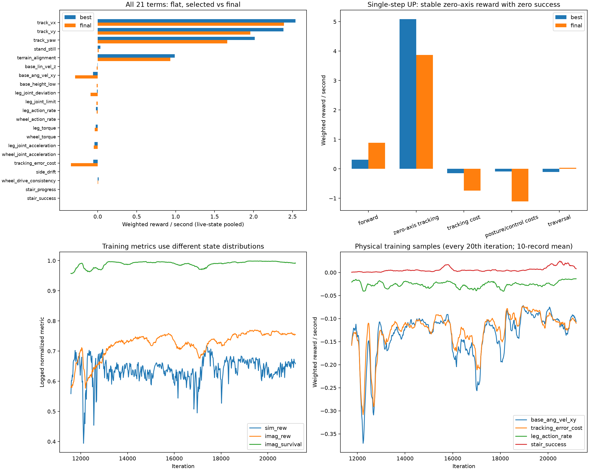

# Go2W H8：21项reward逐项分析与可复现播放

本报告配合[累计7.5小时物理能力报告](go2w_h8_7p5h_evaluation.md)，分析实际使用的配置、固定物理评测贡献及训练期间变化。当前结论是：中途模型学会部分全向和下台阶/下楼，最后约30分钟退化；上台阶/上楼仍未学会。

## 1. 数据和计算口径

四个模型（11561、18401、19796、21190轮）均重新跑相同847条物理条件，并逐步重算21项reward。每个episode只统计首次reset后的存活步，跌倒/成功后不再计入。新增观测逻辑不修改动作或物理状态：四份结果的847条原始episode字段与未插桩评测逐项完全相同。
逐步总reward与环境reward最大差均为0。下面的rate已经含各项权重，尚未乘dt=.02；每步reward=.02×Σrate。表格为每域所有存活转移加权平均（pooled）；回报为每episode积分，不可把短时跌倒episode的平均rate直接当作更好的完整任务。累计项重构与float32逐步累加的微小差见reward_validation.json。
所有配置从实际任务对象读取，而非使用dataclass默认值。真实与想象共享同一reward函数；统一协议真实侧也用饱和端点PD扭矩重算，测得关节扭矩不参与这两项奖励。函数/数值一致不代表WM预测及其导数准确。

## 2. 实际配置与逐项作用

高斯跟踪基础式：`w_i * [exp(-((v_i-c_i)/σ_i)^2) - exp(-(c_i/σ_i)^2)*(1-exp(-(c_i/.05)^2))]`。固定命令下扣除的基线不改变该项最优速度；c=0时恢复完整稳定奖励。

|reward|有效权重/参数|作用、门控和局限|
|---|---|---|
|`track_vx`|3.0；台阶×0.6→1.8|前向高斯跟踪，σx=.25；零速基线扣除。台阶cmd=.3时最大速率收益约1.374。|
|`track_vy`|3.0|侧向高斯跟踪，σy=.20；非侧移命令的vy=0仍有最高3.0稳定收益。|
|`track_yaw`|2.5|偏航高斯跟踪，σyaw=.35；直行时wz=0仍有最高2.5稳定收益。|
|`stand_still`|0.25|仅全命令近零（gate σ=.02）启用；速度σ=.15，角速度σ=.35，区别于逐轴基线恢复σ=.05。|
|`terrain_alignment`|1.0；台阶0|exp(-(1-body_z·terrain_normal)/.16)，目标地形倾角限制35°；避免台阶边沿强制贴合。|
|`base_lin_vel_z`|[-.50,-.35,-.15,-.15,-.08,-.08]|乘世界竖直速度平方；flat/rough/上坡/下坡/上台阶/下台阶，连续楼梯沿用对应台阶权重。|
|`base_ang_vel_xy`|-.15|惩罚机体坐标roll/pitch角速度平方和；最终台阶跌倒时此项明显恶化。|
|`base_height_low`|-40；安全高度.25m|-40·ReLU(.25-局部离地高度)^2；不是硬跌倒惩罚。h=.17时速率仅-.256，低高度阈值终止另算。|
|`leg_joint_deviation`|[-.020,-.015,-.010,-.010,-.003,-.003]|腿关节偏离默认姿态平方；侧移×.35，台阶×.4，放松侧移和越障姿态约束。|
|`leg_joint_limit`|-1.0|超出配置soft limits的平方惩罚；不惩罚连续轮角度。|
|`leg_action_rate`|-.003|使用实际腿目标位置差/.25的平方；侧移×.35，台阶×.4；全关节范围映射下不是原始归一化action差。|
|`wheel_action_rate`|-.003|轮子归一化执行动作差平方；没有侧移/台阶的额外缩放。|
|`leg_torque`|-2e-5|饱和腿PD端点扭矩平方和；统一协议中真实/想象均用同一重算值，不是测得能耗。|
|`wheel_torque`|-1e-5|饱和轮速度PD端点扭矩平方和；不是功率τ·qd，也不是轮滑移指标。|
|`leg_joint_acceleration`|-2.5e-7|(qd_new-qd_old)/.02的平方和，只有12个腿关节。|
|`wheel_joint_acceleration`|-2.5e-9|4个轮速度有限差分平方，权重比腿小100倍，允许轮速快速变化。|
|`tracking_error_cost`|[.25,.60,.30]|-Σc·(sqrt(1+((实际-命令)/σ)^2)-1)；高斯峰外仍提供梯度，侧向成本更高。|
|`side_drift`|0.10|纯侧移(abs(vy_cmd)>.05且abs(vx_cmd)<.08)时，-.1·(vx_body²+wz_body²)；普通前进/台阶关闭。|
|`wheel_drive_consistency`|0.05|仅平地非侧移，目标轮速(vx_cmd-wz_cmd*y_wheel)/.086；σ=3rad/s，另乘几何接地gate。不是实测接触/无滑移证明。|
|`stair_progress`|1.0；γ=.99|γΦ(next)-Φ(prev)，Φ=1-距目标/初始距离；除dt转rate，静止在spawn为零，靠近目标静止时为负。|
|`stair_success`|2.0/episode预算|可微成功proxy历史最大值的正增量；H8内用cummax避免重复收奖，peak=0时总和≤2。不是硬成功事件本身。|

真实越障通过另由物理事件定义：四轮均过最后立面、轮支撑几何/高度/姿态和横向位置合格，并保持10步。可微proxy正值或获得stair_success不等于物理成功。没有单独的固定“跌倒=-X”reward项：真实终止截断episode，想象用高度/倾斜soft termination门控后续收益和Critic bootstrap。
`sim_rew/imag_rew`日志使用分母`.02*(3+3+2.5+.25+1)=.195`。该值没有包括新增轮一致性及台阶潜势/成功项，因此不能把归一化值理解为严格[0,1]成功率或完整奖励上界。

## 3. 21项物理贡献：中途19796与最终21190

单位：加权reward/秒；负值为成本。平地按77条、上单级按110条条件的存活转移加权。完整其他地形、每条episode积分见四份`*_rewards.json`。

|reward|19796平地|21190平地|19796上单级|21190上单级|
|---|---:|---:|---:|---:|
|`track_vx`|2.53759|2.38943|0.311995|0.88413|
|`track_vy`|2.38511|1.9576|2.81948|2.23193|
|`track_yaw`|2.01634|1.66234|2.26567|1.63869|
|`stand_still`|0.0327279|0.0115079|0|0|
|`terrain_alignment`|0.990057|0.933354|0|0|
|`base_lin_vel_z`|-0.00287858|-0.0122313|-0.000347281|-0.00545877|
|`base_ang_vel_xy`|-0.0600236|-0.289067|-0.0372764|-0.910483|
|`base_height_low`|-5.43017e-06|-0.0122338|-0.000181186|-0.00905912|
|`leg_joint_deviation`|-0.00868208|-0.0909206|-0.000592314|-0.00624628|
|`leg_joint_limit`|-4.70258e-05|-0.0162611|-0.000137112|-0.0179613|
|`leg_action_rate`|-0.0237437|-0.0126086|-0.00981752|-0.010854|
|`wheel_action_rate`|-0.00174013|-0.00107161|-0.000712176|-0.001074|
|`leg_torque`|-0.0246215|-0.0369372|-0.0209414|-0.0433409|
|`wheel_torque`|-0.000692595|-0.00170883|-0.000669209|-0.00263095|
|`leg_joint_acceleration`|-0.0429671|-0.0505706|-0.0215507|-0.100642|
|`wheel_joint_acceleration`|-0.000327062|-0.000618047|-0.000225562|-0.000959595|
|`tracking_error_cost`|-0.0572869|-0.344089|-0.148431|-0.736461|
|`side_drift`|-0.00114999|-0.000720271|0|0|
|`wheel_drive_consistency`|0.0134751|0.0053009|0|0|
|`stair_progress`|0|0|-0.106185|0.0311487|
|`stair_success`|0|0|0.000445554|0.00141358|

### 为什么上台阶没成功，reward却仍为正

固定上台阶命令(.3,0,0)下，静止时前向baseline后的track_vx约为0，但vy=0和wz=0两项仍可贡献3+2.5=5.5 reward/秒。它们是稳定姿态/直行需要的目标，数值大并不能直接证明应删除。实际19796上单级的track_vy+track_yaw=5.085/秒，track_vx仅.312/秒，stair_progress=-.106/秒，stair_success=.000446/秒；上单级平均episode回报约49.78，但物理通过0/110。
该模型连续上楼的stair_success几乎为0，仍可从保持零侧移/零偏航得到正回报。越障成功的整个episode预算最多2，相对于10秒稳定轴潜在55分较小；前向跟踪也能提供额外收益，因此这是一种需要消融验证的竞争关系，不能仅凭比例断言reward设计是唯一原因。
最终上单级track_vx反而增至.884/秒，但100%跌倒、平均仅2.24秒；这是更激烈地朝目标动作的短时统计，不能等同于越障改进。其roll/pitch角速度成本-.037→-.910/秒，平滑跟踪成本-.148→-.736/秒，说明实际物理不稳定。
### 后期平地和下台阶退化对应了哪些项

平地19796→21190：track_vx 2.538→2.389、track_vy 2.385→1.958、track_yaw 2.016→1.662；roll/pitch成本-.060→-.289、平滑误差成本-.057→-.344、腿姿态成本-.0087→-.0909。腿action-rate成本却-.0237→-.0126，说明动作更平滑不等于行为更稳。
单级下台阶19796→21190：成功率80%→0%，roll/pitch成本-.168→-1.102/秒；每episode成功proxy奖励1.645→.147。连续下楼成功率73.6%→0%，成功proxy奖励1.203→.007。stair_progress最终仍可为正，只表示朝目标移动过，不能代替越过最后立面的硬事件。
wheel_drive_consistency贡献很小（平地.0135→.0053/秒），且在台阶关闭；本次数据不支持把上楼失败直接归因于“轮一致性奖励禁止抬腿”。台阶姿态/action-rate成本已放松且地形对齐关闭，但上楼仍失败。

## 4. 训练日志与独立评测为什么不同

训练诊断只在每20轮记录当前那一轮采集的数据；不是连续全量98,603,008转移的统计。每条记录的domain×level均值乘实际transitions后再聚合；0样本单元不计。采用以下窗口，完整21项均值、每域均值见training_reward_windows.json。

|窗口|iteration范围|记录数/采样转移|WM loss|Critic loss|sim_rew|imag_rew|想象存活|
|---|---|---:|---:|---:|---:|---:|
|续训开始|11580–12580|51 / 626688|0.11758|0.00612|0.62237|0.63557|97.25%|
|平地对照附近|18201–18401|10 / 122880|0.07485|0.00302|0.66139|0.73676|99.28%|
|19796附近|19597–19796|10 / 122880|0.05737|0.00288|0.63940|0.76130|99.83%|
|最终附近|20991–21190|10 / 122880|0.08336|0.00213|0.66093|0.75644|99.19%|

|reward|开始窗口|平地对照窗口|19796窗口|最终窗口|
|---|---:|---:|---:|---:|
|`track_vx`|2.18459|2.28741|2.22743|2.28949|
|`track_vy`|2.20373|2.12048|1.94134|2.09117|
|`track_yaw`|1.39017|1.44514|1.43906|1.44917|
|`stand_still`|0.0262017|0.0238137|0.0215757|0.0240666|
|`terrain_alignment`|0.870217|0.896034|0.899868|0.885367|
|`base_lin_vel_z`|-0.00872904|-0.00668021|-0.00435459|-0.00310003|
|`base_ang_vel_xy`|-0.212255|-0.102942|-0.104883|-0.106902|
|`base_height_low`|-0.00137671|-0.000602958|-0.000307866|-0.00120533|
|`leg_joint_deviation`|-0.0250917|-0.0100567|-0.00914845|-0.0169195|
|`leg_joint_limit`|-0.00280233|-0.00119399|-0.00109248|-0.00237951|
|`leg_action_rate`|-0.025381|-0.0267584|-0.0280736|-0.0136762|
|`wheel_action_rate`|-0.000967267|-0.0014878|-0.00163802|-0.0016286|
|`leg_torque`|-0.0241079|-0.0257912|-0.0277815|-0.0212451|
|`wheel_torque`|-0.000705293|-0.000735904|-0.000741022|-0.000813626|
|`leg_joint_acceleration`|-0.0470472|-0.0445559|-0.0432387|-0.0372927|
|`wheel_joint_acceleration`|-0.000250837|-0.000296411|-0.000314546|-0.000327885|
|`tracking_error_cost`|-0.192311|-0.0909134|-0.114196|-0.110037|
|`side_drift`|-0.00858201|-0.00275205|-0.00310201|-0.00110873|
|`wheel_drive_consistency`|0.0109478|0.0113177|0.00956792|0.00748243|
|`stair_progress`|-0.00274934|-0.00379176|-0.00331848|-0.00519171|
|`stair_success`|0.000910554|0.00349428|0.0059255|0.00807908|

训练后期sim_rew仍约.66、imag_rew约.76，不能抵消独立物理评测的退化结论。训练样本包含探索、频繁reset、混合命令、coverage和review；Actor imagination起点本次90.9%是平地。平均训练reward会掩盖固定命令某些方向的失败和楼梯退化。真实sim与想象reward不是相同状态/动作配对，二者差值不能直接称作WM乐观偏差。
当前日志没有逐项想象reward、逐项Actor梯度、梯度夹角或反事实消融，无法给出“哪个reward导致退化”的因果排序。独立H8 WM误差也变差（线速度RMSE .4766→.8830m/s），但19796的WM误差更大而策略综合能力更好，因此也不能单用WM标量误差解释最后退化。
建议下一项诊断对19796和21190的相同真实状态/命令计算逐项想象梯度，并做短时间、同预算的reward权重消融和真实评测；先区分稳定轴收益、前向/越障不足、WM导数和课程采样的影响。这里只提出需要验证的下一步，不冒充已完成的实验。



## 5. 可复现play：直接观看当前能力

推荐先看本轮自动选中的19796模型，随后切换最终21190对照。以下在本机桌面终端运行，MuJoCo交互窗口将依次展示7类平地命令、3/20cm上台阶、9/20cm下台阶、6cm连续上下楼。各场景最多10秒，遇跌倒或越障成功提前结束；终端打印真实速度、RMSE和终止原因，窗口标明checkpoint/场景/命令。`--episodes 2`可重复演示两轮。

```bash
cd /home/yifeiy/ws_go2_unilab/Uni-SuperMimic-unified
PYTHONPATH=src MUJOCO_GL=glfw /home/yifeiy/miniconda3/envs/go2_unilab/bin/python tools/play_go2w.py \
  --checkpoint /home/yifeiy/ws_go2_unilab/runs/go2w_unified_h8_resume_3p5h_20261117/best.pt \
  --demo
```

查看最后训练状态：把`--checkpoint`换成`/home/yifeiy/ws_go2_unilab/runs/go2w_unified_h8_resume_3p5h_20261117/evaluation/final.pt`。只看平地98.7%检查点：换成同run下`evaluation/iteration_018401.pt`。这些轻量文件都是冻结模型推理输入，不包含完整续训状态。

单独看20cm下台阶（`--level 9`，本工具等级从1开始）：

```bash
PYTHONPATH=src MUJOCO_GL=glfw /home/yifeiy/miniconda3/envs/go2_unilab/bin/python tools/play_go2w.py \
  --checkpoint /home/yifeiy/ws_go2_unilab/runs/go2w_unified_h8_resume_3p5h_20261117/best.pt \
  --terrain single_step_down --level 9 --vx 0.3 --vy 0 --wz 0 --yaw 0
```

地形名：`flat rough slope_up slope_down single_step_up single_step_down multi_stairs_up multi_stairs_down`。平地命令可直接改`--vx/--vy/--wz`；初始朝向用弧度`--yaw`。地形模式由任务环境提供给Actor，不能换成Go2非轮足的旧play脚本。完整检查点路径为last.pt，供续训使用；播放推荐47MB轻量模型避免加载2.6GB Replay。

本工具是batch=1的在线物理播放。13场景在两个独立进程中运行全部字段完全一致，具备本机命令级可复现性；与batch=847物理矩阵的数值轨迹不完全相同，接触敏感场景可能改变终止步或结果，不能拿一次窗口演示替代正式通过率。对照细节在reward_validation.json。这里仅确认了headless物理路径，未自动打开用户桌面GUI。
没有桌面显示时加`--headless --no-realtime --output /tmp/go2w_play_unique.json`输出同一物理过程的JSON（输出路径须尚不存在）；也可直接查看已上传的[19796平地视频](../validation/go2w_unified_h8_continuation/best_flat.mp4)、[19796台阶视频](../validation/go2w_unified_h8_continuation/best_stairs.mp4)。

严格复现报告的847条件和逐项reward：

```bash
PYTHONPATH=src MUJOCO_GL=egl /home/yifeiy/miniconda3/envs/go2_unilab/bin/python tools/evaluate_go2w.py \
  --checkpoint /home/yifeiy/ws_go2_unilab/runs/go2w_unified_h8_resume_3p5h_20261117/best.pt \
  --seeds 2026 2027 2028 2029 2030 2031 2032 2033 2034 2035 2036 \
  --rewards --output /tmp/go2w_19796_reward_matrix.json
```

模型SHA256：

- selected_19796: `e902cb76e4d6982ab2d78617040af9408cfea139a66ef5084c7becab1d893d62`
- flat_18401: `8d368eae8d1ca5859f73fb8e645d41271758c0cda228a10427c77d03235068dc`
- final_21190: `1bb4a04f4132065445c53c94760baac12e5f949ac932dee30aad3e96722a92af`

## 6. 文件与验证

- [固定物理reward原始数据：19796](../validation/go2w_unified_h8_continuation/best_rewards.json)、[最终](../validation/go2w_unified_h8_continuation/final_rewards.json)、[18401](../validation/go2w_unified_h8_continuation/iteration_018401_rewards.json)、[四小时起点](../validation/go2w_unified_h8_continuation/baseline_rewards.json)。
- [配置快照](../validation/go2w_unified_h8_continuation/reward_configuration.json)、[训练窗口](../validation/go2w_unified_h8_continuation/training_reward_windows.json)、[奖励与播放验证](../validation/go2w_unified_h8_continuation/reward_validation.json)。
- 新工具：`tools/play_go2w.py`；`tools/evaluate_go2w.py --rewards`为可选只读观测，不改训练代码/配置。四份物理结果与原评测完全一致；17项预算/课程/模式/Critic回归通过，Ruff通过。
- 原始WM文件及已训练checkpoint均未覆盖；源码、报告、JSON、图表与视频提交到`experiment/go2w-unified-curriculum`。47MB模型仍位于本机原run路径，上述命令针对同一工作站；未将2.6GB完整Replay提交Git。
