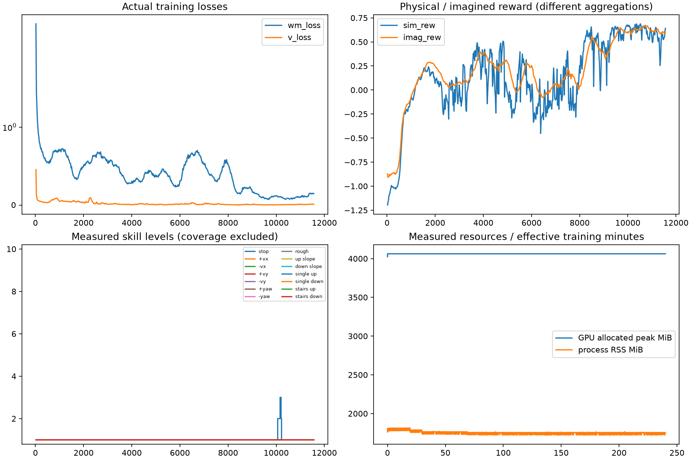

# Go2W 统一十级课程：H8 实现、验证与四小时实验

更新：2026-11-16。分支 `experiment/go2w-unified-curriculum`。工作区为
`/home/yifeiy/ws_go2_unilab/Uni-SuperMimic-unified`；原 dirty 工作区保持不动。
本报告将实现、已执行验证、正式训练及运动能力分开。此前 H16 阻塞报告保存在 Git `143a137`；
原 source_gate / calibration_gate / 200 次校准证据没有删除或覆盖。

## 决策与正式规格

用户先批准将 Actor imagination H16 降为 **H8**，WM window 保持 8。
随后明确要求“不要一味用 gate 阻挠，如果代码写好可以直接开始训练”。本次据此保留完整方向检查，
将其失败记录为已知诊断，不再单独否决训练；没有把失败改写为通过。
其他代码、来源、finite、资源和恢复检查仍须通过。

唯一正式配置为 `src/unisupermimic/conf/supermimic/task/go2w_velocity/train.yaml`：
4096 env、1024 buffer steps、2048 WM/Actor batch、每轮 10 次 WM 更新、H8、WM window8、
14400 秒实际训练循环。一个 Actor，SuperMimic；Actor/Critic fresh；新 Replay/课程/优化器。
正式 YAML 已展开为独立配置；旧版本配置保留供已有工具/历史实验复现，正式入口不再继承它们。
编译关闭；WM fresh Adam，基础 LR 4e-4 × .1 = **4e-5**；Actor LR scale .05/ramp1000；
normalizer 原计数保留并继续在线更新。降低 WM LR 是针对校准大更新的防护，不是已经证明的修复。

## WM 来源与初始化证据

严格只读加载 `/home/yifeiy/ws_go2_unilab/artifacts/world_models/go2w_conditioned.pt`：

- 文件 SHA256：`3c3c4d1c5e70bb12c8cc68274fda39003e465c6ec1fbe745c0729f9f7d028610`。
- 张量 SHA256：`ed04040096a0b0254fb58ef18ffa65ef7bf2c1f07e15fa7a2e6df36c7428c490`。
- 来源：旧 `go2w_omni_v3_2h_20261114/training/last.pt`，iteration4765，WM updates59470。
- input/output/increment normalizer count 均 61,677,568。严格键、shape、dtype、finite、动作/物理契约检查。
- 状态41D、动作16、WM input134/output40、2048×3、77D collision-aligned scan。
- 腿机械可达范围95%，默认中心非对称映射；PD40/1；轮速15rad/s、kd.5；sim/control .005/.02。
- Actor 5×50 proprio + 速度3 + mode4 =257D；Critic invariant41 + goal7 + scan77 =125D。

4096 短试的 WM 加载前后 Actor 哈希均为
`8f2700f369f8293e5e25b0708795c7ee3b76d60db1a39223b43300e4aacad87a`，Critic 均为
`3de046887a42b5b293f93888e7df2152eec41de1f04eaf49f22638d55a31ded7`。
三套 optimizer state 为空，iteration/sim_steps/updates/Replay size 均0。
原始 WM 预测 H1/H8 与独立加载副本逐位一致。正式 run 将独立重新构造并再次保存此证据。
`calibrated_candidate.pt` 仅作失败分析/独立评估，绝不作为正式初始化。

## 已实现

|模块|具体实现|
|---|---|
|课程|10级、14个技能（停止/六个有符号方向/七个地形分支）；64有效episode窗口、两窗口迟滞、晋级/降级、15%低级复习；覆盖角色不计mastery|
|地形|rough、上/下坡、单级上/下、连续上/下；10×7 atlas；单级3/4/5/7/9/12/15/18/20/22cm，连续3–15cm四级楼梯|
|垂直台阶|100个静态碰撞盒；单级一个明确立面与落脚平台，连续四个立面；WM/奖励扫描查询同一盒顶和碰撞高度场|
|目标与奖励|每episode不可变10D traversal metadata、target_id；Actor仅接mode；共同PD解析代价、低权重平地轮速辅助、侧移漂移、台阶势函数与有界首次代理成功增量|
|真实成功|所有轮中心越过最后立面、平台支撑/机身高度/姿态/横向范围、非跌倒，连续10步；真实成功用于终止及mastery，平滑代理不等同于物理成功|
|Replay|4096×1024 Recent Ring；CPU有界8192个连续H8历史窗口；按domain/level/mode/sign/几何阶段逆频率平衡；WM实际50/50，Actor起点仍独立|
|恢复|历史内容/桶/RNG、Replay、normalizer、optimizers、课程/采样器/command counter；CPU mmap加载避免第二份GPU Replay；新物理环境，非逐步等价恢复|
|Runner|严格WM-only入口、原子检查点、信号停止、monotonic累计实际训练循环、来源tar/完整diff/config快照；定期和最终物理评测及独立WM holdout；best仅由物理指标决定|
|评测|冻结单Actor，固定±vx/±vy/±yaw/stop及全部地形×等级，三种初始yaw；WM H1/H8/H16独立physical holdout，排除并计数episode截断|

真实和想象均使用同一 endpoint PD 力矩近似作为奖励代价，真实传感器力矩保留诊断。
轮辅助是几何接近接触的可微代理，台阶关闭，不将vy/r作为轮速目标。
台阶成功代理总预算受max增量限制，反复离开/返回不会重复支付；物理成功另行判定。
Actor不接scan、contact、target、level。mode需上层任务管理器指定，不能声称自主识别地形。

## 已执行验证

证据根目录：`/home/yifeiy/ws_go2_unilab/runs/go2w_unified_h8_20261116/`。

- `tests/rl tests/tasks`：**230 passed、2 skipped、3 deselected**；skip是MPS不可用，slow单列。
  G1测试所需的ignored mesh资产从原工作区只读复制；没有修改原资产。
- 7个新增语义测试：H8准入/H16告警、signed skill迟滞/覆盖隔离、旋转有效运动、不可手动reset晋级、进度与一次预算、共享reward/隐私、history跨episode/target拒绝和可恢复RNG、实际混采计数。
- `geometry_reward.json`：840条native向下射线，collision/scan最大差 **4.912e-6m**；
  十级单级水平射线确认垂直立面；轮FK最大差 **7.398e-7m**；半径约.086m、四轮正向一致；真实/想象reward差 **0**。
- `resume4096_verified.json`：4096 env完整恢复，再执行真实采集、WM/Actor/Critic更新并检查finite；
  恢复显存峰值约4050MiB；明确为environment resampled，非逐步等价。

4096实际压力测试 `smoke4096_verified/`：

|项目|实测|
|---|---:|
|环境/容量/batch|4096 / 1024 / 2048+2048，均未减少|
|训练循环|50轮，57.24秒（另一轮64.60秒）|
|采集|774144转移，含64步warmup；实际优化循环采集512000转移|
|更新|WM500 / Actor50 / Critic1000|
|Torch显存峰值|4062.33MiB|
|进程RSS峰值|2491.55MiB|
|Replay分配|2,499,805,184 bytes；已分配1024行，短试填189行|
|History|704窗口，WM actual Recent/Historical=512000/512000|
|最后近期/历史WM loss|1.83161 / .94188|

原1024容量没有OOM，因此未减环境或buffer；不干扰两项无关常驻视觉进程。
该短试验证有限更新可运行，不表示收敛、四小时稳定或运动能力通过。

## H8方向检查与失败校准分析

原静态中立动作检查：H1 18/18、H8 18/18，H8最低cosine .591；H16仅9/18。
新Gate按实际配置要求H1/H8，H16仅告警。保留eps .001/.002/.005、初始0/5/10控制步、
真实contact/无contact、实际collector动作和完整前置qpos/qvel（含轮角）、episode边界。
`gradient_gate/audit.json`：**23个方向失败、8个因提前终止而缺失的H8探针**；
H1已得到的probe均通过。中立动作H8仍通过，错误集中在实际fresh Actor动作/接触轨迹。
例如初始seed2026、eps.002，H8 vx/vy/yaw cosine约 -.615/-.797/-.557。
不能以中立静态检查的18/18代表所有fresh Actor采样。按用户最新决定，记录此问题后开训。
早期 `expanded_gate/unified_gate` 使用重复静态history产生动作；最终结论以真正调用collector的
`gradient_gate`为准。失败探针不跨reset做Jacobian。

原200次校准保存在 `go2w_unified_audit_20261116/calibration/`，候选张量SHA为
`fc0def8d2a5e00cdcd01b3cb41f82351a4e7a7a15723ca299c7f4d936fbd95f0`。
8192转移、32env、batch128、fresh Adam LR4e-4、WM200更新，无Actor/Critic更新。
静态H8最差cosine从+.591变为-.942；训练loss下降不能证明导数方向正确。
`calibration_analysis.json` 显示网络单张量相对L2变化最高8.35%；normalizer计数只增8192（约.0133%），
mean/var变化相对很小。因此“大幅随机重置统计”不符合证据；较高fresh Adam步长、窄分布重复拟合及
自回归误差/接触敏感性是更有依据的候选解释，尚非单因果证明。

新增固定独立holdout共240个domain×level×接近/立面/平台初始状态，绝不用于训练。
H1/H8/H16有效数239/217/43；截断不跨episode，H16幸存者偏差很大。
总体H8线速度RMSE原始.791、校准.618m/s，但H16 .692→.902m/s；
这同时说明不同分布上的预测误差与静态动作Jacobian不能互相替代，也不能笼统声称所有H8预测都变坏。
本次防护为WM LR×.1、Recent/History混采、独立分桶评测；效果仍需正式训练观察。

## 正式训练状态与物理结果

正式训练已实际启动，进程PID **1474520**。启动UTC：`2026-11-16T13:04:00Z`。
run：`/home/yifeiy/ws_go2_unilab/runs/go2w_unified_h8_4h_20261116`；源码commit `52ce824`，完整source/config快照与WM-only初始化证据已落盘。
初始独立物理评测和WM holdout已执行，随后进入正式优化循环；方向诊断告警由用户最新决定明确接受。
本次检查时 iteration=222，有效循环=252.17/14400秒，
更新WM/Actor/Critic=2220/222/4440。
**训练已结束，最终计时与物理结果见本文末“正式训练最终实测”。**

仅用于验证评测链路的50轮短试：231物理episode中通过0。
平地全向21/21跌倒、通过0；single up/down各30条，成功0；continuous up/down各30条，成功0。
flat合并RMSE(vx,vy,yaw)=(.333,.528,1.214)，**不是正式训练结果**。
20cm单级目标未达成；没有best checkpoint或可部署能力声明。

## 可复现入口

```bash
cd /home/yifeiy/ws_go2_unilab/Uni-SuperMimic-unified
export PYTHONPATH="$PWD/src"
TASK_PY=/home/yifeiy/miniconda3/envs/go2_unilab/bin/python
"$TASK_PY" tools/train_go2w.py --mode smoke --envs 4096 --iterations 50 --output /tmp/go2w_smoke
"$TASK_PY" tools/train_go2w.py --mode formal --accept-direction-diagnostic \
  --admission /path/to/admission.json --output /path/to/new_formal_run
# 正式恢复要求相同源码和有效配置，新建输出目录；新环境重采样，不是逐步等价。
"$TASK_PY" tools/train_go2w.py --mode formal --accept-direction-diagnostic \
  --admission /path/to/admission.json --resume /path/to/last.pt --output /path/to/recovery_run
"$TASK_PY" tools/evaluate_go2w.py --checkpoint /path/to/last.pt --output /path/to/physical.json
"$TASK_PY" tools/evaluate_go2w_wm.py --model /path/to/last.pt \
  --holdout /path/to/holdout.pt --output /path/to/wm_holdout.json
```

下一项单一消融：在相同数据/更新预算/低WM LR下比较Recent-only与50/50 History，
用固定独立holdout和实际动作H8方向一起判断，不能只凭训练loss选择。

## 正式训练最终实测（自动生成）

完成状态：**已跑满14400秒有效循环**。
启动UTC `2026-11-16T13:04:00Z`；结束UTC `2026-11-16T17:07:59Z`（包含前后评测，计时另列）。
实际训练循环 **14400.849秒**，iteration=11561。
真实转移（含warmup）=118644736；WM/Actor/Critic更新={'wm': 115610, 'actor': 11561, 'critic': 231220}；重启0。
GPU峰值=4062.09MiB；进程内存峰值=2492.74MiB。
源码训练快照commit `52ce824`；原始WM文件SHA再次核验不变。
输出：`/home/yifeiy/ws_go2_unilab/runs/go2w_unified_h8_4h_20261116`；最终checkpoint：`last.pt`；新WM仅另存 `world_model_candidate.pt`，未发布覆盖原资产。

以下全部来自最终冻结Actor的真实MuJoCo评测，不是想象奖励。

|物理任务|episode|通过率|跌倒率|RMSE vx/vy/yaw|
|---|---:|---:|---:|---|
|flat|21|0.0%|33.3%|0.172, 0.148, 0.640|
|rough|30|0.0%|0.0%|0.213, 0.066, 0.200|
|slope_up|30|0.0%|0.0%|0.174, 0.062, 0.180|
|slope_down|30|0.0%|0.0%|0.181, 0.061, 0.183|
|single_step_up|30|0.0%|43.3%|0.191, 0.120, 0.518|
|single_step_down|30|13.3%|23.3%|0.203, 0.112, 0.430|
|multi_stairs_up|30|0.0%|30.0%|0.182, 0.106, 0.389|
|multi_stairs_down|30|0.0%|26.7%|0.169, 0.103, 0.415|

全向分轴：

|任务|通过/总数|RMSE vx/vy/yaw|
|---|---:|---|
|flat_backward|0/3|0.112, 0.041, 0.165|
|flat_forward|0/3|0.160, 0.143, 0.568|
|flat_left|0/3|0.056, 0.165, 0.164|
|flat_right|0/3|0.240, 0.201, 1.190|
|flat_stop|0/3|0.075, 0.047, 0.157|
|flat_yaw_left|0/3|0.409, 0.373, 1.922|
|flat_yaw_right|0/3|0.151, 0.065, 0.314|

单级20/22cm：

|分支/高度|通过/总数|
|---|---:|
|上 20cm|0/3|
|上 22cm|0/3|
|下 20cm|0/3|
|下 22cm|0/3|

独立WM留出对照（同一物理数据文件；截断样本排除，非全分布无遗忘证明）：

|H|有效样本|初始/最终线速度RMSE m/s|
|---:|---:|---:|
|1|239|0.0211 / 0.0211|
|8|217|0.7913 / 0.4766|
|16|43|0.6916 / 0.7896|

最终WM独立H8动作方向诊断：失败8项，缺失必要探针8项；完整JSON保留。没有把预测误差下降等同于导数方向全部正确。

最终14技能Level：[1, 1, 1, 1, 1, 1, 1, 1, 1, 1, 1, 1, 1, 1]；晋级[2, 0, 0, 0, 0, 0, 0, 0, 0, 0, 0, 0, 0, 0]，降级[2, 0, 0, 0, 0, 0, 0, 0, 0, 0, 0, 0, 0, 0]。覆盖角色仍为512，未计mastery。

WM实际Recent/Historical抽样：[118384640, 118384640]；最后各自loss：0.2856777310371399 / 0.06019705906510353。



训练跑满与运动能力是两件独立结果；mode由上层指定，未完成实机闭环验证。
