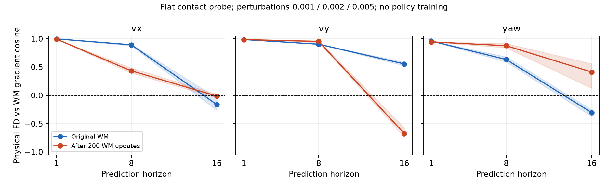

# Go2W 统一课程四小时任务：门禁阻塞报告

日期：2026-11-16。**任务未完成，正式训练没有启动，有效正式训练时间为 0 秒。**

已完成来源审计、严格 WM-only 初始化、可选 Actor 模式条件及 Critic 扫描基础实现。
真实物理 H16 动作方向检查未通过；短 WM 校准也未修复。依据任务文档第 12 节第 9 项，
停止在门禁，不以旧策略续训、随机 WM、减少正式环境数或缩短时长替代要求。

## 1. 代码与资产来源

原仓库 `/home/yifeiy/ws_go2_unilab/Uni-SuperMimic` 的 HEAD 为
`bc4d172d5c93239b0e50e32e3481cd83601dff76`。已 fetch 两个远端；
`user/experiment/go2-velocity-unilab` 与该 HEAD 一致，`origin` 实际指向 Motphys 上游，
不存在文档所写的 `origin/experiment/go2-velocity-unilab`。

原工作区有大量未提交实验改动，完整保存至
`/home/yifeiy/ws_go2_unilab/runs/go2w_unified_audit_20261116/`：

- `original_status.txt`、`original_tracked.patch`、`original_working_files.tar.gz`；
- `isolation.json`：原始 HEAD、恢复分支及备份哈希；
- 隔离 worktree `/home/yifeiy/ws_go2_unilab/Uni-SuperMimic-unified`；
- 分支 `experiment/go2w-unified-curriculum`；
- 现有本地改动保存提交 `6784ac8ed6f0f6f377063fa6b32633529b5f678f`；
- 本次实现与验证提交 `cc12b154c9ebf57ccf0d978c723eb9b4205b44e8`。

交付时验证原工作区 porcelain 状态与开工备份完全一致。未删除旧配置、报告、二进制或源码快照。
当前实现没有声称消除所有旧实验配置，也没有修改 Go2/G1 的默认 Actor 或奖励接口。

WM 源文件：`/home/yifeiy/ws_go2_unilab/artifacts/world_models/go2w_conditioned.pt`。

|身份|SHA256|
|---|---|
|原始文件字节|`3c3c4d1c5e70bb12c8cc68274fda39003e465c6ec1fbe745c0729f9f7d028610`|
|模型张量及全部归一化缓冲区|`ed04040096a0b0254fb58ef18ffa65ef7bf2c1f07e15fa7a2e6df36c7428c490`|

报告引用的 ed0404 是**张量哈希**，并非文件字节哈希。实测张量与旧两小时实验
`runs/go2w_omni_v3_2h_20261114/training/last.pt` 完全一致，源 iteration 4765、
源 WM 累计更新 59470。更早 continual 实验的 publish manifest 指向较早模型，不能替代最新来源。
原文件结束时哈希不变；校准候选只写入本次独立目录。

详细初始审计见 [go2w_training_design.md](go2w_training_design.md) 和
[initial_audit.json](../validation/go2w_unified_curriculum/initial_audit.json)。

## 2. 物理协议与初始化证据

实际 WM 对应的 omni 源快照中，Go2W `contract.py`、`manager_terms.py`、`mdp.py`、
`env.py` 和共享 `networks.py` 与保存的本地基线逐字节一致。
继承的 Go2 env 差异涉及配置契约、采集标签及 Go2 工厂；Go2W 使用自己的工厂和控制器。
公开 HEAD 缺少的 full-range 实现在本地已存在，已纳入可恢复基线。

|项目|本次严格核对的有效协议|
|---|---|
|状态|41D，world p / wxyz quaternion / world v,w / leg q12 / qd16，无轮角|
|动作|16D：FL/FR/RL/RR 的 hip/thigh/calf 后接四轮，按名字映射物理顺序|
|腿目标|机械范围 95%，a=-1/0/+1 对应软下限/默认姿态/软上限|
|默认姿态|`(.1,.8,-1.5,-.1,.8,-1.5,.1,1,-1.5,-.1,1,-1.5)`|
|腿 PD / 轮速 PD|40/1；轮 kp=0、kd=.5、缩放 15 rad/s|
|力矩限幅|`(23.7,23.7,45.43)*4 + (15,)*4`|
|sim / control dt|.005 / .02 秒|
|WM|structured，134D 输入、40D 输出，2048×3 隐藏层，77D 碰撞高程扫描|
|归一化|input/output/increment 全部保留，初始 count 均为 61,677,568，所有张量有限|

模型 XML 与 wheel STL 哈希、传感器/状态/动作契约严格相等；H1/H8 加载前后预测逐位一致。
旧日志与本次都存在 MJCF attach 对 cone/impratio 的选项冲突警告，不能把 XML 声明直接当作
编译后的全部物理参数；本次没有据此修改接触求解协议。轮子有效半径与滚动方向的完整物理校准
仍未完成，因此未引入任何轮速奖励。上述核对不替代完整 Gate A。

新增 `checkpoint.initialize_wm_only` 在写入前检查文件/张量指纹、所有键、shape、dtype、
finite、非负方差/count、网络架构和动力学契约；使用 strict=True，不触发 legacy normalizer 迁移。
不读取旧 Actor/Critic 参数到新网络，不恢复源优化器或更新计数。WM 保持可训练。

新 7D 模式诊断中，WM 加载前后 Actor/Critic 哈希分别保持：

- Actor：`8f2700f369f8293e5e25b0708795c7ee3b76d60db1a39223b43300e4aacad87a`；
- Critic：`3de046887a42b5b293f93888e7df2152eec41de1f04eaf49f22638d55a31ded7`。

三套优化器 state 为空，run 更新计数均 0，iteration=0，Replay size=0，无旧 Replay。
该证据来自全新 learner 构造，并非把旧权重加载后仅把计数清零。
原始记录：[source_gate_initialization.json](../validation/go2w_unified_curriculum/source_gate_initialization.json)。

## 3. 本次实现范围与未完成项

|文件/模块|已完成内容|
|---|---|
|Go2W checkpoint|严格同构 WM-only 初始化，fresh Adam 与初始权重证据|
|Go2W MDP/command/env|可选 `terrain_mode_conditioning`，速度3 + 模式4，Actor 257D 输入、16D 输出，原 MLP 宽度不变|
|共享 learner|真正实现 privileged 77D terrain Critic，125D 输入，每个 imagined pose 重查扫描，保留 bootstrap 梯度|
|新增测试|WM-only 精确预测/拒绝损坏资产、模式 reset/隐私、Replay/imagined goal 一致、Critic 扫描和 Actor bootstrap 梯度|
|新增工具|只读动作方向审计与独立短 WM 校准，均不会启动正式长训|

旧任务默认模式开关关闭，维度仍为 3D goal / 253D Actor；WM 输入维度始终不受模式条件影响。
真实模式来自任务 domain 的固定映射 flat/rough/slope/stair，并非 Actor 自主识别。

**尚未完成**：十级统一课程及分技能窗口、单级台阶几何与 traversal target 契约、
轮式/单级目标奖励重构、完整真实/想象 reward 对拍、Historical Window Bank、
4096×1024 实际压力测试、完整固定物理评测矩阵、正式 14400 秒 runner、7D 模式的播放/导出适配。
现有 Replay 仍使用八级相关实现；只做了容量预算，没有伪称十级或历史池已经接通。
现有旧实验脚本不应被当作本任务的正式启动入口。

## 4. Gate 结果和真实阻塞

扩展回归：**116 passed、2 skipped**；单独真实 MuJoCo 测试：**1 passed**。
新测试包含 11 项 warm-start 检查、3 项模式/Critic 检查。Ruff 与 git diff --check 通过。
两项 skip 为 Linux 主机不具备 MPS 后端的既有测试；
它们不计入通过项。这些数量不是任务文档十个完整 Gate 的通过数量。

|Gate|结果|
|---|---|
|A：来源/物理/初始化|来源、严格加载和已有物理测试通过；4096 构建、十级地形、轮子完整校准未完成|
|B：代码/奖励/梯度|基础单测通过；**H16 物理动作方向失败**；新奖励/历史库等未实现|
|C：短训与性能|32-env 诊断完成；完整 learner smoke 和 4096×50–100 iterations 未执行|

物理诊断使用 32 个相同 flat 仿真实例：16 个正方向/16 个负方向，逐动作 central difference；
起点为 reset 后或执行 5 个零动作之后。动作在 H 个控制步保持相同扰动。
扰动 .001/.002/.005，评估 H1/H8/H16 的 body vx、vy、yaw。
每步检查 episode 边界，遇到终止则停止该探针，绝不跨 reset 取 Jacobian。
有效 probe 的全部 32 个起点状态均经过一致性断言。

明确的本地方向门槛为：physical FD 向量范数 >1e-3 时，与 WM autograd 余弦必须 >0。
这是对本次启动前审计采用的保守判据；接触响应不光滑，finite difference 随尺度变化，
故不将该实验解释为严格平滑导数定理，也不外推为所有运动状态都存在错误梯度。
但多个小尺度重复反向，不能按“finite 梯度存在”直接批准 H16 长训。

5 个初始零动作后的 H16 结果：

|扰动|旧 WM vx 方向余弦|旧 WM yaw 方向余弦|校准后 vy 方向余弦|
|---:|---:|---:|---:|
|.001|-.044|-.254|-.715|
|.002|-.183|-.289|-.731|
|.005|-.261|-.368|-.575|

WM 自身的 central difference 与 autograd 方向余弦约 .999–1.000（最小扰动），
因此当前证据指向长时物理预测/动作敏感度问题，不能归因于简单的 autograd 断路。
默认零动作持续执行还会在约 27 个控制步后倾倒；这一现象只表明该中立控制不是稳定策略，
没有将其单独作为“随机 Actor 必须已会站立”的验收条件。



尝试的防护是独立短校准：32 env、fresh Actor 采集 8192 条转移、Replay 256、WM batch 128、
H8、fresh Adam、200 次 WM 更新，保持 Actor/Critic 不更新。优化及保存阶段记录约 **5.43 秒**，
不含前期采集和环境构建，不属于正式四小时预算。
训练 loss 有下降，仍不能放行：54 个方向检查中，旧候选有 9 个非正，校准候选有 17 个非正。
没有用旧 Actor bootstrap 来规避该结果。

完整数据：[source_gate.json](../validation/go2w_unified_curriculum/source_gate.json)、
[calibration_gate.json](../validation/go2w_unified_curriculum/calibration_gate.json)、
[calibration_summary.json](../validation/go2w_unified_curriculum/calibration_summary.json)。

## 5. WM 预测、遗忘和资源的可用结论

以下只是 flat 初始接触 probe，32 副本，初始执行 5 个零动作、扰动 .002 的分量 RMSE；
不是完整新旧分布 holdout，也没有覆盖单级/斜坡/连续楼梯。

|模型/H|位置 m|姿态 rad|线速度 m/s|角速度 rad/s|腿位置 rad|腿速 rad/s|轮速 rad/s|
|---|---:|---:|---:|---:|---:|---:|---:|
|原 WM H1|.000238|.00247|.00782|.0519|.00885|.458|.966|
|原 WM H8|.00603|.0207|.0289|.235|.0526|.695|5.53|
|原 WM H16|.0174|.0738|.282|1.60|.107|2.24|4.21|
|校准后 H16|.102|.910|.841|6.99|1.85|3.57|79.9|

校准在这一独立探针分布上恶化，不应发布。原因可能涉及分布覆盖、学习率、接触动力学或
长时滚动敏感度；当前不能确认单一原因，也不能宣称已解决长期遗忘。
旧两小时报告 .04934→.43713 m/s 的留出退化仍是历史结果，未冒充本次训练结果。

开工时 GPU 12,282 MiB 中已用约 2,265 MiB，两个无关常驻视觉进程保留。
RAM 可用约 6.5 GiB，swap 已用约 12 GiB；磁盘可用约 151 GiB。
本次短校准 Torch allocated peak 为 **281,617,408 bytes（268.57 MiB）**。
该值不是整个系统占用，也不是 4096 env 峰值。没有采集完整 CPU/RAM 峰值曲线。

4096×1024、7D goal、仅现有元数据的 Replay 预算为 **2,281,701,376 bytes（2.125 GiB）**，
未含目标字段、历史库、采样副本、训练 activation 或 checkpoint 暂存。
**没有实际分配/运行该规格，不能据此声称显存通过或 OOM。** 没有采用 512 降级。

## 6. 正式训练与运动验收

正式训练开始/结束时间：均不适用；实际训练循环时间 **0/14400 秒**。
正式转移数及 WM/Actor/Critic 更新数均 **0**，正式重启次数 **0**。
8192 条转移和 WM 200 更新仅属于上述诊断。没有把实现、测试、诊断或等待时间算入四小时。

|正式物理指标|结果|
|---|---|
|flat 前后、左右横移、正负旋转|未训练/未评测，无本次成功率|
|rough / slope up/down|未评测|
|single step 3/6/9/12/15/18/20/22 cm|未实现完整几何与评测，无成功率|
|multi stairs 3/6/9/12/15 cm，上/下楼|未评测|
|20 cm 以上单级平台到达|**未达成验收**|

没有 best.pt，没有新运动能力声明，也没有失败视频；保留了逐项物理探针 JSON 和方向图。
诊断 last.pt 的 Actor/Critic 仍为随机参数，不能当作训练完成的运动控制 checkpoint。

## 7. 复现与恢复资料

在隔离工作区执行，务必设置 PYTHONPATH，避免 editable install 指向原 dirty 源码：

```bash
cd /home/yifeiy/ws_go2_unilab/Uni-SuperMimic-unified
export PYTHONPATH="$PWD/src"
TASK_PY=/home/yifeiy/miniconda3/envs/go2_unilab/bin/python

# 输出目录必须尚不存在。方向失败时预期退出码为 2，完整 audit.json 仍会落盘。
"$TASK_PY" tools/audit_go2w_warmstart.py \
  --wm /home/yifeiy/ws_go2_unilab/artifacts/world_models/go2w_conditioned.pt \
  --file-sha256 3c3c4d1c5e70bb12c8cc68274fda39003e465c6ec1fbe745c0729f9f7d028610 \
  --tensor-sha256 ed04040096a0b0254fb58ef18ffa65ef7bf2c1f07e15fa7a2e6df36c7428c490 \
  --mode-conditioning --epsilons 0.001 0.002 0.005 \
  --output /tmp/go2w_source_gate_reproduction

"$TASK_PY" tools/calibrate_go2w_wm.py \
  --wm /home/yifeiy/ws_go2_unilab/artifacts/world_models/go2w_conditioned.pt \
  --file-sha256 3c3c4d1c5e70bb12c8cc68274fda39003e465c6ec1fbe745c0729f9f7d028610 \
  --tensor-sha256 ed04040096a0b0254fb58ef18ffa65ef7bf2c1f07e15fa7a2e6df36c7428c490 \
  --updates 200 --output /tmp/go2w_calibration_reproduction

"$TASK_PY" -m pytest tests/tasks/test_go2w_warmstart.py tests/tasks/test_go2w_mode_critic.py -q
"$TASK_PY" -m pytest tests/tasks/test_go2w_physics.py -m slow -q
```

校准候选可用同一个 audit 工具独立评估：`--wm` 改为独立候选文件，
`--file-sha256` 使用实际文件 SHA，`--tensor-sha256` 使用该 calibration summary 的 candidate 张量哈希。
它会再构造 fresh Actor/Critic，丢弃候选中的优化器，避免误当作整套 resume。

本机诊断目录：`/home/yifeiy/ws_go2_unilab/runs/go2w_unified_audit_20261116/`。
关键文件：`source_gate/audit.json`、`calibration_gate/audit.json`、
`calibration/last.pt`、`calibration/calibrated_candidate.pt`、完整失败日志与原工作备份。
校准候选张量 SHA：`fc0def8d2a5e00cdcd01b3cb41f82351a4e7a7a15723ca299c7f4d936fbd95f0`。
last.pt 保存 WM、Actor/Critic、优化器和 Replay；原始 WM 文件仍独立保留。

正式训练、正式恢复和 7D 播放命令尚不具备完整实现，因此不提供会违反 Gate 的启动命令。
待修复梯度门禁并完成表中未完成项后，正式 run 仍须重新随机初始化 Actor/Critic，
从原始已核验 WM 开始，执行真正的 4096-env smoke 和 14400 秒预算。

下一项最值得做的单一消融：在相同 fresh Actor 数据、相同更新预算和学习率下，比较
WM **Recent-only 与 Recent/Historical 50/50 混采**，使用固定独立 H16 物理预测及动作方向门禁。
历史窗口必须先实现有界存储并核对物理协议，不能把旧不兼容 Replay 直接混入。

所有结果均不能直接视作实机可部署。模式条件需要上层任务管理器显式指定，
控制器、默认姿态及实机闭环验证仍未完成；本次随机 Actor 更不具备部署资格。
