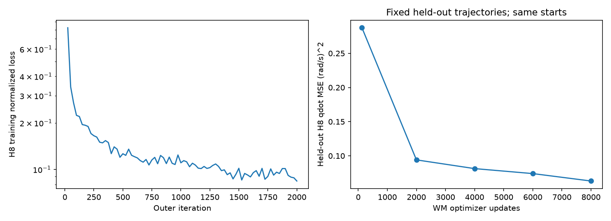
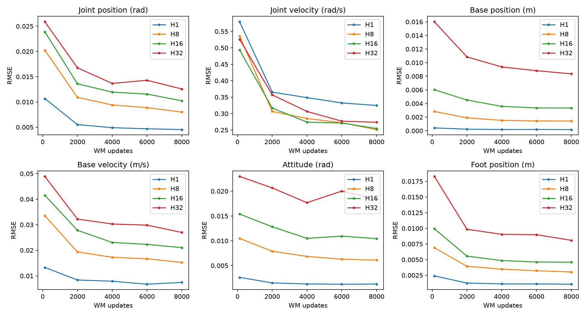
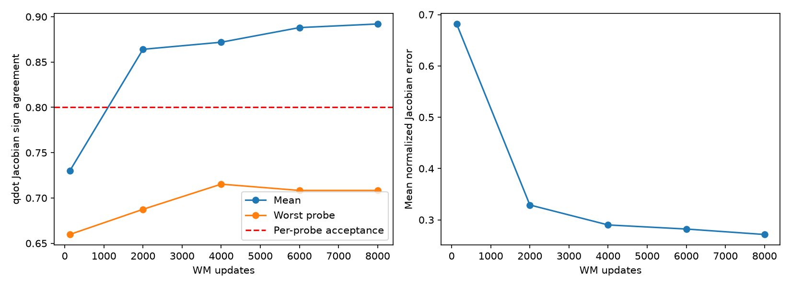
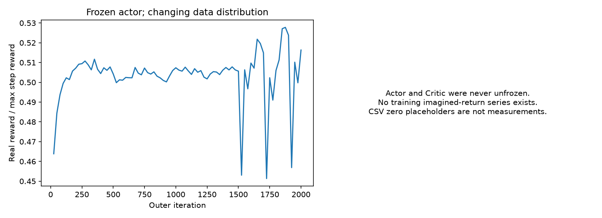
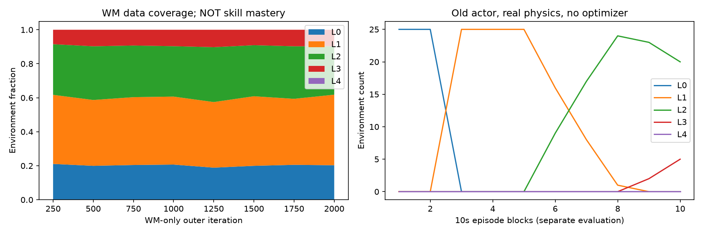
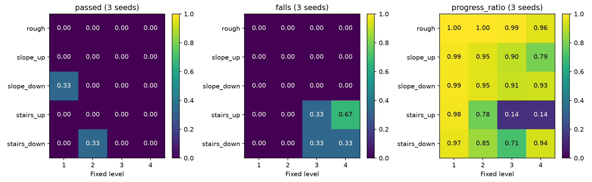
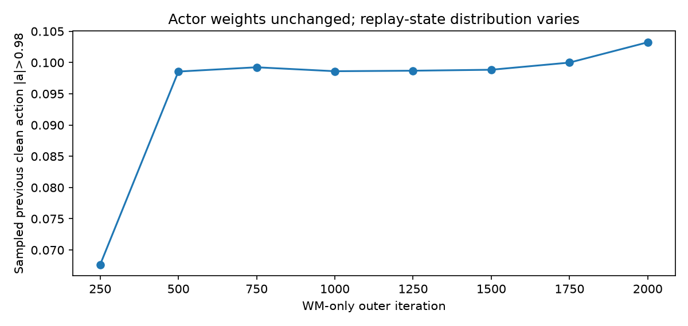

# Go2 Blind Terrain 实验 B：多环境预热与长训门禁结论

本轮实际完成 **2048 环境、累计 2000 outer iterations、8000 次 WM optimizer 更新、10,371,072 条真实训练转移**。Actor 完全冻结，Critic 未开始正式训练。WM 留出预测明显改善，但 Level2 上楼接触处的动作 Jacobian 仍未通过预先设置的验收条件，故**停止于 Stage I，没有执行 Actor 解冻、300–500 轮 Actor 探索或 6000–12000 轮长训**。这是数值验收决定，不是资源不足或把短测当作长训完成。

## 1. 版本、保护边界与初始化

- 工作区：`/home/yifeiy/ws_go2_unilab/Uni-SuperMimic`；分支：`experiment/go2-velocity-unilab`。
- 审计起点：`b3f9aa8798d9faa0ba91973a840706162a3ea841`；正式训练核心代码：`eb5a299`。本报告、后续诊断工具和推送版本随本次交付 commit 保存。
- UniLab：`794c0bbd67771ac48407e084c0164c0e841bfd97`，工作树仍干净；参考项目：`d9eee9b3f248e5300e636c433255db2c1c3e086a`。
- 旧 Actor：`/home/yifeiy/ws_supermimic/logs/phase3_training/go2_velocity_diagonal_slip_3072_2p5h_20261103/ckpt_0034000.pt`。
- 旧文件 SHA256：`0b3d8e4bb26173d13a6ce0b99d5eecf43005927a8ab2e01947c4d0311009487a`；本轮再次核对，79 个冻结源文件无变化，原工作树状态与迁移快照一致。
- Actor 按现有协议加载，10 个张量、逐层前向误差 **0**；obs 转换最大误差 `4.77e-7`。FL/FR/RL/RR 顺序、KP40/KD1、scale0.25、动作裁剪、默认姿态、0.02s 控制周期/0.005s 仿真周期不变。
- **WM from scratch**。没有把以前的 8/100 次更新模型作为可靠预训练；Critic 新初始化。没有 Teacher、PPO、BC、Motion Reference、Actor 高度编码器或 Reward 调参。
- RTX4070 SUPER 12GB、Ubuntu20.04、i5-14600KF、约15.4GiB RAM；沿用 conda `go2_unilab`。Torch2.11.0+cu126、驱动535.230.02、MuJoCo3.11.0、Warp1.16.0、UniSim2.7.1、UniLab1.5.9。原 Python 环境和 UniLab 源码未修改。完整版本见 `results/longrun_B/provenance.json`。

首次全测试发现独立工作区缺 G1 STL，已从本机已有 UniLab 副本复制到被忽略的 G1 assets 目录；没有修改 G1 XML、算法或上游。

## 2. 审计复现与代码差异

旧报告的 100 次 WM-only 更新、B 的接触动作梯度不足、6 次早期 Actor 更新的大漂移、32 环境课程未证明晋级，以及 mjwarp 地形限制，均仍适用于审计起点，不能当作本轮通过证据。

| 项目 | 原问题 / 参考设计 | 本轮处理 |
|---|---|---|
| WM 数据课程 | 从 Level0 技能课程采集会缺乏真实地形 | 新 `wm` 阶段按0/1/2/3/4约20/40/30/10/0%采样，25% episode 使用入口前移0.8–2.2m的受控 drop/contact 探针 |
| 技能课程 | 固定3.5m与0.25m/s×10s不相容 | `skill` 阶段使用实际/指令推进比≥0.7、实际进入目标区域≥1.2m、全程横向偏移≤0.6m、XY RMSE<0.35m/s、yaw RMSE<0.4rad/s、无跌倒 |
| 可晋级 episode | 站立、转向和一般命令不应认证穿越 | ≥90%步满足前进命令/朝向要求；完整10秒或跌倒才结算；探针和中途手动 Reset 不认证成功 |
| 晋级/降级 | 单次 episode 容易震荡 | 同一环境当前掌握等级连续3次成功晋级；连续2次失败降级；较低难度回采不能认证更高等级 |
| 低级/平地保留 | 易遗忘 | 15%低级回采，另15%平地保留；WM 覆盖不改变 mastery；固定评估禁用适应 |
| 学习率 | Learner 对3个 optimizer 统一赋值 | Actor 独立倍率及 ramp；WM/Critic LR 不受其影响；支持只训练 Critic、不 step Actor optimizer |
| Resume | 只有权重/optimizer，Replay、课程、value norm不全 | opt-in 保存 Replay、课程、统计、value norm、Torch RNG、累计更新计数及采样余数；绝对 iteration 接续 |
| 预算与保护 | 单报 iteration 无法比较 | JSONL 逐段记录真实转移、各 optimizer 更新、wall、CPU/GPU；Actor 指纹/optimizer空状态检查、有限值和资源门禁 |
| 返回摘要 | 非整 log interval 时旧 metrics 覆盖最终 iteration | 修正返回顺序；正式结果使用真实终点计数 |
| 后端 | UniSim2.7.1 generated terrain 的 mjwarp 不支持 | 保留明确拒绝；本轮全部真实物理使用 MuJoCo |

统计按 terrain type×level 保存 episodes、success/fall/timeout、XY/yaw平方误差、实际/指令进度、晋级/降级、探针数。mastery 仍按环境独立维护，不是不同类型共享技能。

参考项目的 WM warmup、独立 Actor LR ramp/Critic warmup、保留 WM 的崩溃回退提供了设计依据；本轮没有复制其训练循环。其 rare-event archive 与 Actor 退化回滚尚未完整移植，后者是进入 Stage II 前的明确待办。

主要修改：

| 文件 | 用途 |
|---|---|
| `tasks/velocity/go2/curriculum.py` | 数据覆盖/技能/固定评估、指令归一化判定、稳定晋级、统计和序列化 |
| `tasks/velocity/go2/manager_terms.py` | Hydra 配置、受控探针出生；不改变观测/动作 |
| `tasks/velocity/go2/env.py` | 向 Replay 快照真实 type/level/probe，保留旧 flat contract |
| `rl/algos/supermimic/learner.py` | 独立 LR、Critic-only 更新、计数、回调、可选完整 Replay checkpoint、恢复说明、有限值保护 |
| `rl/algos/supermimic/replay.py` | 可选地形元数据及严格布局恢复 |
| `conf/supermimic/task/go2_velocity/longrun_B.yaml` | 独立实验配置，不修改 flat/G1 默认参数 |
| `tools/run_go2_terrain_b.py` | 1024倍数性能基准与冻结 Actor 正式预热，调用唯一共享 `train()` |
| `tools/evaluate_go2_terrain_b.py` | 独立固定留出、H1/8/16/32及 MuJoCo 有限差分 |
| `tools/evaluate_go2_terrain_policy.py` | 固定难度、真实课程物理测试及视频 |
| `tools/audit_go2_terrain_replay.py` / `plot_go2_terrain_b.py` | Replay 碰撞抽样与结果曲线 |
| `tests/tasks/test_go2_longrun_curriculum.py` 等 | 完整10秒模拟 episode、LR隔离、Actor冻结、Replay/计数/value norm恢复 |

上述源码前缀为 `src/unisupermimic/`。

## 3. 最终协议与完整配置

| 模块 | 输入 / 输出 |
|---|---|
| Blind Actor | **5×42+Goal3=213 → 12**；2048/1024/512/256，原 fixed scale、SiLU、tanh |
| Terrain WM B | phi37+executed action12+Context16+scan77=**142 → 36**局部动力学增量；2048³ |
| Critic | 原 phi37+Context16+Goal3=**56 → 1**；256/128 |
| State / Replay | 世界 p3、quat4、v3、w3、q12、qd12=37；真实s/s1、执行动作、clean previous action、Context、Goal、done及独立元数据 |

Actor 不读取线速度、世界位置、高度、terrain type/level、完整 Context 或地图。42D 历史仍只包含 q偏差、qd、body角速度、projected gravity、previous clean action。新元数据只在 Replay 审计和课程中使用。

地形仍取 UniLab 已编译碰撞 heightfield，静态 Torch 缓存、MuJoCo 三角插值；11×7扫描定义 `base_z-ground(scan_xy)`，随 yaw 转动。H8 和 H32 每一步 `_wm_step()` 都按预测世界位姿重新查询，`terrain_sensor_grad=True`，不冻结初始扫描、不每步 CPU raycast。地形相对 root/四足 Reward、Termination 沿用已验收实现，系数不变。

完整实际配置：`results/longrun_B/warmstart/config.yaml` 和 `config_resume.yaml`。关键值：2048环境、WM batch256×4、pi batch256、H8、H32、Replay1024向量步、warmup64步、utd0.4（每outer交替2/3真实向量步）、Adam、FP32/原TF32设置、compile=False、OMP_NUM_THREADS=4、WM LR2e-4。将来 Actor 倍率0.3、ramp500、Critic warmup300，但本轮均未进入 Actor 阶段。

`flat` 原 owner 不启用上述开关；65D flat WM、encoded goal 和 G1 默认行为保持。

## 4. 性能基准与规模选择

根据用户最新要求，正式环境数使用1024的整数倍；本轮测1024/2048，没有以128/256/512替代正式规模。两者相同正式网络、batch256、H8；64轮各128次WM更新，并独立进行4次H32 backward+Critic更新，Actor optimizer冻结。

| 环境 | simulation vector steps/s | simulation transitions/s | WM updates/s | H32 BPTT中位ms | Critic中位ms | 进程GPU峰值MiB |
|---|---:|---:|---:|---:|---:|---:|
|1024|30.94|31,678|29.77|163.88|18.29|约1162|
|2048|20.28|41,537|30.64|177.69|24.94|1228|

原始 `benchmark_*_sustained/summary.json` 记录 count/mean/median/p90。2048的物理转移吞吐约高31%，内存充足，故选2048；没有继续增加到4096。simulation范围只含真实 `env.step`，不能与含学习/采集桥接的总吞吐混淆。

正式阶段：前1500轮 simulation均值50.42ms、WM fit均值35.54ms；恢复后500轮分别42.20/30.04ms。资源竞争和缓存状态不同，后段更快不代表算法加速。H32/Critic时间来自独立基准，正式预热没有这些更新。存在少量独立诊断与第一段末尾重叠，正式 profile 是实测wall，不宣称完全独占机器。

正式峰值：Torch allocated **1334.3MiB**、reserved **2230MiB**，nvidia-smi进程采样峰值 **2458MiB**；进程RSS峰值约 **2229.5MiB**。nvidia-smi为100ms采样下界。CPU日志约4–6个核的等效利用率；没有OOM或NaN/Inf，没有处理其他应用进程。MuJoCo物理消耗与WM fit同量级；目前不是显存容量阻塞。

## 5. 实际训练预算、覆盖与恢复

| 阶段终点 | outer | 真实训练转移 | WM更新 | Actor更新 | Critic更新 |
|---|---:|---:|---:|---:|---:|
|第一次预热|1500|7,811,072|6000|0|0|
|恢复后累计|2000|**10,371,072**|**8000**|**0**|**0**|

累计 learner wall约 **580.3s**；两段进程wall约 **590.1s**（含构建/加载等），不包括独立评测、基准、制图及人工/代码分析。第二段不是重新训练2000轮，而是从1500接续500轮。最终训练loss从最初25轮均值0.825降到末段0.0842；最后H8端点归一化误差0.155。不同阶段normalizer持续更新，不能仅凭这些loss宣称梯度正确。

| Level | 实际训练转移 | 占比 |
|---|---:|---:|
|0|2,103,178|20.28%|
|1|4,175,341|40.26%|
|2|3,128,933|30.17%|
|3|963,620|9.29%|
|4|0|0%|

五类地形各等级完整计数见 `coverage.json`。累计记录23,962个episode start、19,871个done，2,351个提前终止近似计数；这不是23,962个统计独立seed。主日志 `term_frac` 是局部时间段的终止/done比，也不是整程跌倒率。

几何代理累计足端接触切换3,157,028次；7,193,305条转移存在足部在非入口高度的接触代理，占69.36%。这些是clearance/FK代理，**不是真实接触力日志**。

进一步对最终真实Replay按type×level各抽128帧，用保存的公共MuJoCo模型重建接触：2560帧中2519帧有地面碰撞；1920个非平地样本中1671帧确实接触tile内部（87.03%）。上楼Level3还发现较多非足部碰撞。这个抽样证明数据不再集中在平地入口，但仍不是全程live contact-force遥测。

最终Replay含2,097,152条转移，随机窗口有效H8约98.73%、H32约93.99%。执行动作范围[-1,1]，含Gaussian0.1及原OU配置；执行动作饱和比例12.73%，不能等同于clean Actor饱和。

恢复实际验证了 WM/Actor/Critic及optimizer、Replay、课程统计、value norm、Torch RNG、累计计数和采样余数。**不是逐步等价恢复**：MuJoCo内部积分状态、环境状态和UniLab command RNG未恢复；重新出生，清除课程未完成episode，并关闭旧Replay末尾全部轨迹。恢复日志明确标注 `environment_resampled; not_exact`。mastery/累计统计未悄悄清零。`wm_only_iters`从绝对1500明确延长到绝对2000，没有按resume重新计时。

## 6. 独立留出预测与动作梯度

固定留出24,500条真实转移，独立采集seed2326、相同真实geometry seed2026，Actor+0.05探索；覆盖五类型×Level0–4及0/0.8/1.3/2.0m出生探针。探针不算成功穿越。该数据没有送入训练Replay，地形几何仍来自训练atlas，因此不是未见地形地图泛化测试。

每个Checkpoint、每个horizon使用同一组H32-valid起点和记录动作，避免不同horizon幸存样本造成假改善。下表为Level1/2分组按有效样本加权的H32 RMSE。短预热128次更新来自独立2048基准，网络/batch一致，但采样预算和Replay长度不同；不能称严格只改一个因素的消融，也不是上轮100更新模型的同轨迹重测。

| WM更新 | q rad | qd rad/s | base p m | base v m/s | 姿态rad | feet m |
|---:|---:|---:|---:|---:|---:|---:|
|128|0.02587|0.52606|0.01600|0.04892|0.02298|0.01829|
|2000|0.01676|0.35708|0.01085|0.03224|0.02066|0.00986|
|4000|0.01367|0.30643|0.00937|0.03028|0.01768|0.00904|
|6000|0.01430|0.27703|0.00882|0.02986|0.02003|0.00899|
|8000|**0.01258**|**0.27361**|**0.00836**|**0.02699**|**0.01835**|**0.00809**|

H1/8/16/32全部状态量、各type/level、有效样本数见 `validation_*/prediction.json`。有效H32筛选仍排除跨跌倒Reset的窗口，存在幸存偏差；不据此评价跌倒前全长H32预测。

动作诊断：44个固定物理状态，覆盖flat及所有类型Level1/2、四种入口/接触位置；每个状态所有12动作维，epsilon0.01/0.03/0.1。用公共模型、相同qpos/qvel独立模拟4子步，与WM autograd逐分量比较。Oracle复现记录真实下一状态的最大误差：位置1.51e-6m、速度4.80e-7m/s、q4.34e-7rad、qd3.99e-5rad/s。

| WM更新 | qd Jacobian平均方向一致率 | 最弱探针 | 平均归一化幅值误差 |
|---:|---:|---:|---:|
|128|72.99%|65.97%|0.682|
|2000|86.41%|68.75%|0.329|
|4000|87.19%|71.53%|0.290|
|6000|88.80%|70.83%|0.282|
|8000|**89.20%**|**70.83%**|**0.271**|

这里是Level1/2、epsilon0.03的qd响应，排除近零分量；不同epsilon和p/v/q响应全部保留。不能与上轮不同数据上约50–70%的结果直接做严格增益比较。

最弱案例稳定出现在 **stairs_up、Level2（4cm台阶）、入口前移0.8m、有4个真实地面contact**。6000更新时归一化误差约0.451，不能简单归因于不存在接触或oracle错误。所有类型最终平均一致率约85.1–90.8%，上楼尾部仍明显较差；不是所有动作都反向，但不足以支持无保护的大量H32 Actor更新。

预设门槛：Level1/2各组H32有效样本≥8，q<0.12rad、v<0.25m/s、p<0.15m、姿态<0.15rad；**每个**局部接触探针qd Jacobian一致率≥80%且归一化误差<0.6。最终预测通过、梯度未通过，`actor_unfreeze_allowed=false`。没有事后放宽最弱探针标准，也没有用低训练loss解冻Actor。

## 7. 真实课程晋级与固定难度评测

另用25个独立评测环境、固定旧Actor、无optimizer更新，实际运行5000向量步（125,000条转移）、10个完整10秒episode区块，命令0.25m/s：

| 物理向量步 | mastery Level0/1/2/3/4 |
|---:|---|
|500|25/0/0/0/0|
|1500|0/25/0/0/0|
|3000|0/16/9/0/0|
|4000|0/1/24/0/0|
|5000|0/0/20/5/0|

累计55次真实晋级、0跌倒、231次符合入口区域条件的episode成功。**已实测Level0→1→2，未卡Level0**。这些是原平地Actor的能力和新课程判定的验证，不是WM预热训练出的新Actor能力；1.2m入口区域通过也不等于完整8m tile穿越。

固定难度：25个场景并行（五类型×Level0–4），seed2426/2427/2428，按seed生成0.35–0.45m/s前进命令、零侧向/转向、独立20秒预算；原训练episode仍为10秒。报告完整75个episode，flat合并15个Level0；其余每格3个seed，样本量不足以给出稳定成功概率。

| 场景 | Level1/2/3/4 XY RMSE m/s | Level1/2/3/4 跌倒数（各3次） |
|---|---|---|
|Rough|0.041/0.051/0.061/0.079|0/0/0/0|
|Slope up|0.053/0.088/0.124/0.163|0/0/0/0|
|Slope down|0.056/0.089/0.127/0.144|0/0/0/0|
|Stairs up|0.066/0.145/0.375/0.377|0/0/1/2|
|Stairs down|0.069/0.161/0.282/0.295|0/0/1/1|

Flat XY RMSE0.0377m/s、yaw RMSE0.0326rad/s，实际body vx约0.4034m/s，平均相对高度0.3336m，无跌倒；旧策略运动和数值等价保持。高台阶上行出现停滞及非足部碰撞/跌倒；下台阶高等级也有失败，具体因果仍需逐接触分析，不能仅凭reward推断。

评估同时保留两个边界：75次中54次达到入口方向6.8m出口距离，但只有2次满足额外的**全程±0.6m世界中心走廊**严格条件。Flat也会因20秒累积朝向/侧向漂移（平均最大侧偏约1.16m）被该严格条件判失败。故该严格走廊指标不是纯body-frame速度跟踪成功率；不能把距离达标54次直接称完整无绕行穿越，也不能把严格判失败直接称速度策略崩溃。原始max_lateral、progress ratio、实际/指令进度、body速度、timeout等均在JSON中。

Actor所有参数/固定归一化状态SHA在训练前后相同；相同输入的动作RMSE=0。固定评测clean输出饱和约9–13%，高台阶略升，没有发生本轮Actor参数漂移或崩溃。尚未验证解冻后能保持这些指标。

## 8. 回归、可视化与真实性能记录

完整自动化：**189 passed、2 skipped、9 deselected**（slow标记未纳入；2项MPS适用），Ruff与`git diff --check`通过。CPU课程测试实际模拟500步episode，覆盖低速、零命令/转向、停滞、失败降级、低级回采、类型统计、固定评估隔离、序列化；另覆盖LR隔离、Critic-only不step Actor、Replay与value norm/绝对阶段恢复。

再次执行flat回归：对`1cfffb6`，完整宽度Actor输出、65D WM H32、Reward各项最大误差均0，hard/soft termination一致。G1/encoded入口和协议自动化通过；没有运行G1长训。

真实和想象仍共享地形相对Reward/Termination数学定义；真实torque测量与想象PD proxy的历史差异保留。控制周期有限差分加速度与原源环境瞬时子步加速度不等价，不能宣称所有真实/想象奖励测量逐位相同。本轮没有改Reward参数，也没有再次放开早期不可靠Actor更新。



右图采用明确物理单位的qd验证损失，不与左图归一化全状态loss混为同量纲。







WM-only没有训练imagined-return序列，CSV中的0是旧logger占位值，**不是测得的想象回报**；Critic Loss/Actor gradnorm的0同理。没有为补图而编造这些指标。







播放：[真实Level1上楼MP4](../results/longrun_B/fixed_evaluation/stairs_up_level1.mp4)。视频是旧Actor在真实MuJoCo上的播放，不是WM想象或训练成功证明。

后端能力：

| 能力 | MuJoCo物理 | mjwarp/UniSim2.7.1 | Torch WM采样 |
|---|---|---|---|
|原plane flat|已验证|既有迁移验证|支持|
|generated rough/slope/stairs/mixed|本轮实际采样训练|保持明确拒绝|读取同一compiled地图|
|任意预测p/R的可微77点查询|物理本身不提供autograd|未声称支持|支持，H8/H32每步更新|

## 9. 已实际运行的命令与产物

以下均从本仓库运行；新运行需更换输出末级目录，工具拒绝覆盖已有实验。统一前缀：

```bash
export OMP_NUM_THREADS=4
PY=/home/yifeiy/miniconda3/envs/go2_unilab/bin/python
```

```bash
$PY -m pytest -q
$PY tools/check_go2_actor.py --output results/longrun_B/actor_equivalence.json
$PY tools/check_go2_flat_regression.py --output results/longrun_B/flat_regression.json
$PY tools/run_go2_terrain_b.py --mode benchmark --envs 1024 --output results/longrun_B/benchmark_1024_sustained
$PY tools/run_go2_terrain_b.py --mode benchmark --envs 2048 --output results/longrun_B/benchmark_2048_sustained
$PY tools/run_go2_terrain_b.py --mode warmstart --envs 2048 --output results/longrun_B/warmstart
$PY tools/run_go2_terrain_b.py --mode warmstart --envs 2048 --output results/longrun_B/warmstart --resume results/longrun_B/warmstart/last.pt algo.iterations=2000 algo.wm_only_iters=2000
$PY tools/evaluate_go2_terrain_b.py --mode collect --output results/longrun_B/holdout
$PY tools/evaluate_go2_terrain_b.py --mode evaluate --dataset results/longrun_B/holdout --checkpoint results/longrun_B/warmstart/ckpt_002000.pt --output results/longrun_B/validation_002000_oracle
$PY tools/audit_go2_terrain_replay.py --checkpoint results/longrun_B/warmstart/ckpt_002000.pt --model results/longrun_B/holdout/terrain.mjb --output results/longrun_B/replay_collision_audit
$PY tools/evaluate_go2_terrain_policy.py --mode curriculum --checkpoint results/longrun_B/warmstart/ckpt_002000.pt --output results/longrun_B/skill_curriculum_physics
$PY tools/evaluate_go2_terrain_policy.py --mode fixed --checkpoint results/longrun_B/warmstart/ckpt_002000.pt --output results/longrun_B/fixed_evaluation_verified
MUJOCO_GL=egl $PY tools/evaluate_go2_terrain_policy.py --mode fixed --checkpoint results/longrun_B/warmstart/ckpt_002000.pt --output results/longrun_B/fixed_evaluation --video
$PY tools/plot_go2_terrain_b.py --run results/longrun_B
```

前置工具首次遇到重复typed config override、留出metadata的numpy序列化错误，均已修复；失败日志保留，报告只使用后续verified结果。H8/H32 smoke能力已由完整网络基准和真实预热替代复验；没有虚构已通过的Actor解冻命令。

关键本地路径：

- 最终完整Checkpoint：`/home/yifeiy/ws_go2_unilab/Uni-SuperMimic/results/longrun_B/warmstart/ckpt_002000.pt`；同目录`last.pt`。
- 每250轮完整编号Checkpoint，含optimizer、Replay、课程及计数；初始模型`initial.pt`独立保留。文件索引/SHA见`checkpoint_index.json`。
- 配置、预算、日志：`warmstart/config*.yaml`、`warmstart/budget.jsonl`、`warmstart/train_log.csv`、`warmstart.log`、`warmstart_resume.log`。
- 第一段独立资源/预算快照：`summary_stageI_1500.json`、`resources_stageI_1500.json`，恢复段summary/profile另存于`warmstart/`。
- 留出物理状态/模型：`holdout/heldout.pt`、`holdout/terrain.mjb`；正式Checkpoint、Replay和大型物理资产只留本机，不推送。
- 固定评测：`fixed_evaluation_verified/fixed_evaluation.json`、`fixed_evaluation_aggregate.json`；课程：`skill_curriculum_physics/`；所有图：`figures/`。

## 10. 结论与下一步

1. **正式规模2048**，满足1024倍数要求；实测优于1024，资源充足。
2. **充分预热已有实际结果**：2000轮/8000更新/1037万真实训练转移，预测与多数动作导数明显改善，不再是8轮smoke。
3. **仍未通过Actor解冻**：上楼Level2接触耦合导数尾部不可靠，最弱70.8%；需优先改接触数据/采样和模型导数诊断，而不是直接扩大Actor学习率或长训预算。
4. **旧Actor保持**：213D盲输入、原动作物理协议、相同输入前向和所有参数保持；没有高度泄漏。
5. **课程真的能晋级**：独立真实物理观察Level0→1→2，部分到3；正式WM阶段mastery0是设计要求，不是技能课程卡死。
6. **复杂地形链路已跑通到WM预热**；较低地形上的旧Actor速度跟踪尚可，高台阶存在停滞/跌倒；没有训练出新的复杂地形策略，也未证明完整航线穿越能力。
7. 下一处优先修改 `replay.py:sample_windows()` / `learner.py:wm_update()` 的接触事件分层或稀有样本采样，保持数据预算可审计，针对Level2上楼接触、非足部碰撞和动作扰动增加独立数据；不得悄悄引入Teacher。
8. 进入Stage II前，还要实现并实际验证定期物理评测驱动的Actor退化保护：停止/回滚稳定Actor，保留已改善WM与真实Replay；补足Critic warmup及H32价值/动作梯度验收。当前有限值保护不能代替策略退化回滚。
9. 自动化恢复已经超出仅权重续训，但尚非环境/RNG逐步等价恢复；全程live contact-switch遥测、未见地图/更多seed泛化和正式想象回报曲线也仍待完成。

**当前不应直接启动实验B的6000–12000轮Actor长训。已有10M转移和可恢复Checkpoint，下一预算应针对上楼接触模型与稀有事件覆盖，而不是重复无门禁扩大训练。**
