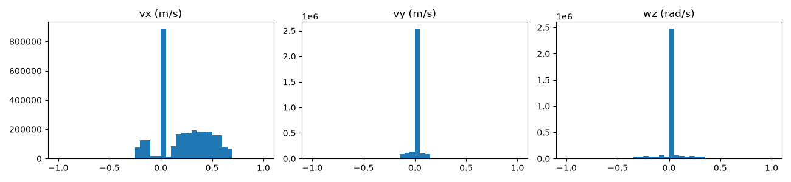
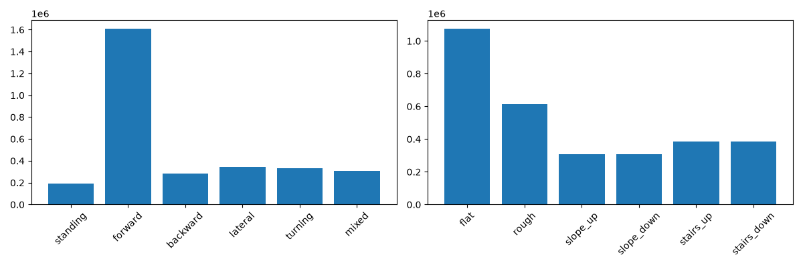
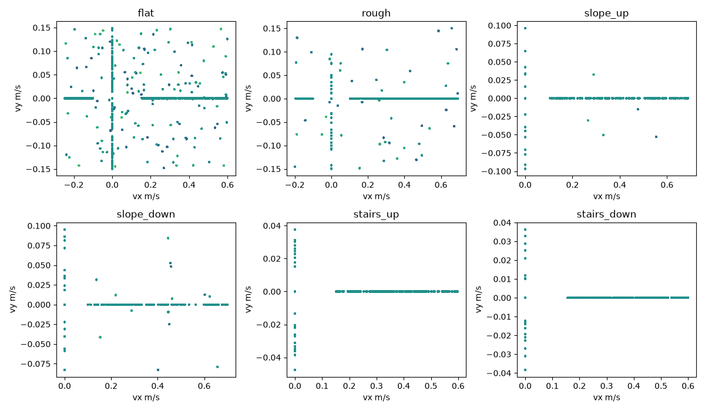
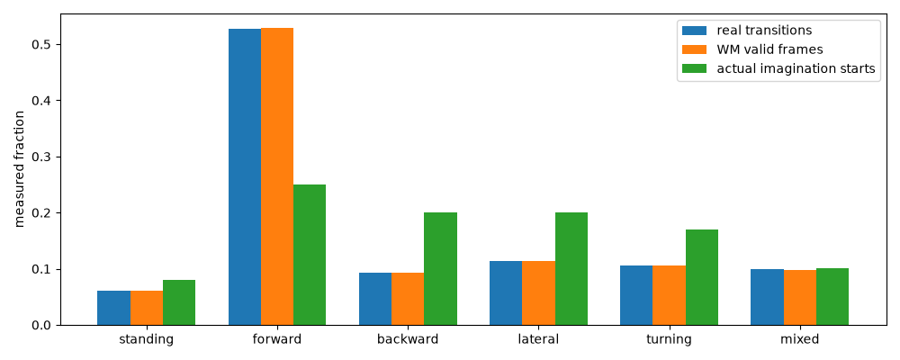
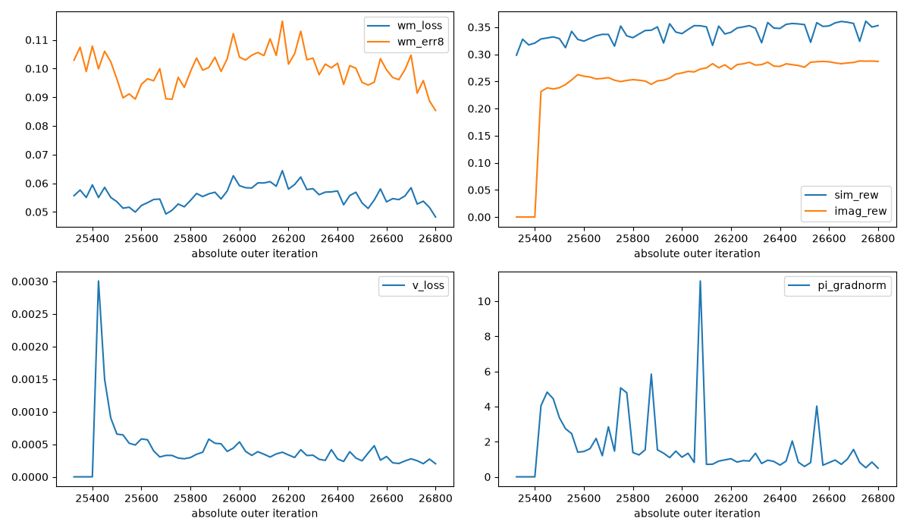
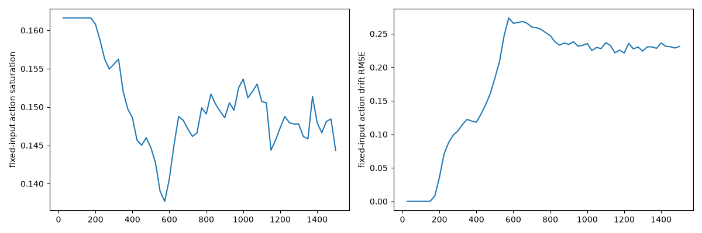
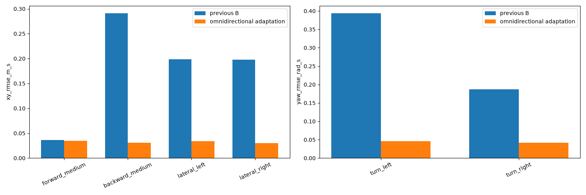
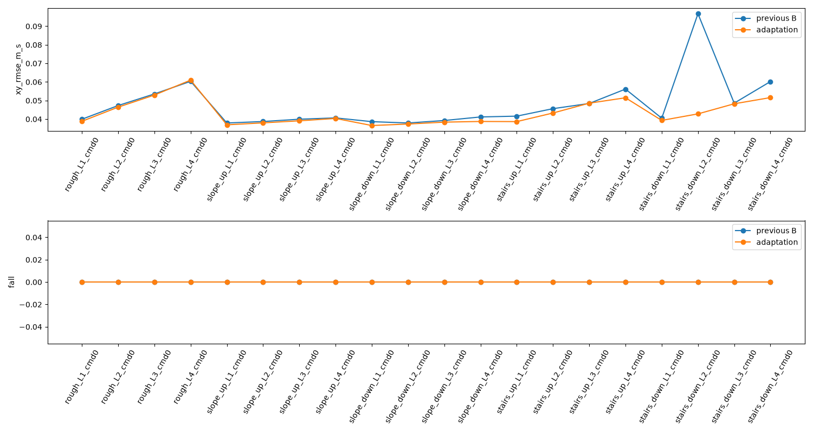
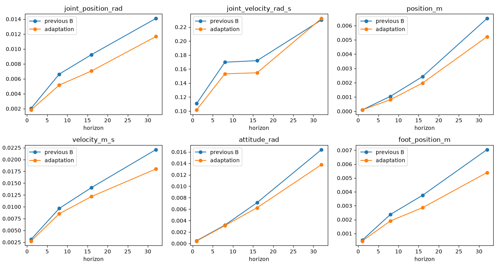
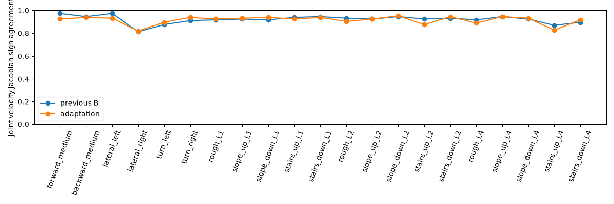

# Go2 地形分级速度采样与全向能力恢复

本轮已实际完成2048环境采样、1500轮适应训练和独立A/B物理评测。**14类核心速度命令通过本轮验收，全向能力明显恢复，Level4楼梯纯前进能力保留。未启动下一轮2–3小时长训**：极限侧移仍跌倒，原接触探针的WM梯度尾部未达80%门槛。

## 1. 版本、初始化及事实审计

工作目录 `/home/yifeiy/ws_go2_unilab/Uni-SuperMimic`，分支 `experiment/go2-velocity-unilab`，审计起点 `a3a29a8e4cc3d42861795473de02df36c883593d`。原仓库、原checkpoint和UniLab上游源码未改。使用既有 `go2_unilab` Conda、RTX4070SUPER和MuJoCo；保留mjwarp生成地形能力门禁。

源checkpoint `results/actor_training_B/last.pt`，SHA256 `9f0f8f71377114f789d88e92e9f73a0f7037030145687ed1ebb6df1146a52e7d`。Actor、Terrain WM、Critic、三个optimizer、value normalization、Replay、课程mastery及累计计数全部继承，没有随机重初始化。Stage A前后Actor全部状态张量最大差异为0。

|审计项|事实与本轮处理|
|---|---|
|旧命令分布|原三小时配置固定Stage0，vx=0.25–0.60、vy=wz=0，另有5%站立；代码和保存配置一致|
|命令生成|`VelocityCommand._resample_command()`，由Manager计时器/Reset选择生效环境；旧保持5秒|
|Goal对齐|执行动作前snapshot Goal，Reward、Replay使用该Goal；Reset和重采样后的Goal不能替代它|
|想象条件|从Replay的g开始，整个H32保持同一body-frame Goal3；不在想象中重新采命令|
|原地形课程|决定tile和level，原本不改变Stage0速度范围；统一episode中途换命令不适合穿越判定|
|奖励方向|XY误差、指令方向投影与yaw误差没有只奖励正vx的规则；步态门控用速度范数。机器人几何/步态偏置仍可能影响学习难度|
|旧恢复|保留Replay/课程，但物理环境重新采样；非逐步等价恢复；以前未保存独立命令采样器|

Actor保持 **5×42+3=213→12**，隐藏层2048/1024/512/256；WM输入 **65+77=142**，隐藏层2048/2048/2048；Critic输入 **56**，隐藏层256/128。Context16、动作顺序、0.25缩放、PD40/1、20ms控制、5ms物理、H8/H32均不变。Actor没有域、level、地图、世界位置或真实线速度输入。

Reward系数未改：对角步态-0.15、滑足-0.20、clearance项0。地形相对几何接触代理不是接触力；真实torque测量/想象PD proxy和原报告中的加速度测量边界仍保留。

## 2. 代码与配置

- `command_sampler.py`：`legacy_stage`之外新增`terrain_adaptive`，独立seed/RNG、六类命令、三个平地速度范围、五类地形保守范围和高等级楼梯修正幅度。批量Torch采样，无逐环境Python循环。
- `manager_terms.py`：每环境域/模式/穿越标记；平地2–5秒换指令，地形10.02秒保持完整episode；可选初态扰动供独立评测使用。
- `env.py`：保留现有mixed atlas，固定域分配；平地从Level0 tile中央出生，在离中心3.2m处截断Reset，避免进入相邻非平地；边界属于timeout，不是跌倒。新增标签仅进Replay。
- `curriculum.py`：普通运动不晋降穿越mastery、不打断穿越成功证据；真正穿越episode早跌倒也可降级。固定平地与地形分离，保留15%较低难度回采；新增crossing专用统计。
- `replay.py`：保留Goal3，新增命令元数据及真实term；可选固定分组想象起点采样。WM仍uniform；缺失桶在候选池中排除，默认uniform路径保留。
- `learner.py`：沿用唯一训练循环；保存采样器状态；显式分布迁移只允许命令设置和已知flat boundary truncation变化，其他物理/奖励/网络检查仍严格。
- 独立配置 `src/unisupermimic/conf/supermimic/task/go2_velocity/omnidirectional_terrain.yaml`，未覆盖`longrun_B.yaml`或G1配置。
- 工具：`audit_go2_command_coverage.py`、`train_go2_omnidirectional.py`、`evaluate_go2_omnidirectional.py`、`diagnose_go2_omni_wm.py`、`check_go2_omnidirectional_acceptance.py`、`plot_go2_omnidirectional.py`，共享配置在`go2_omni_common.py`。

2048个环境按旧atlas type在组内分配：Flat717、Rough409、Slope up205、Slope down205、Stairs up256、Stairs down256。保留地形环境原来的type与mastery，域不会在轨迹中途切换。当前固定分组要求各非平地域quota不超过原type容量（约20%），超过时明确报错。

平地模式概率为8/20/18/18/16/20%（站立/前进/后退/侧移/旋转/混合）。本轮只用**独立速度Level0**：vx[-.25,.60]、vy±.15、wz±.35；这与旧Stage0不是一回事。纯侧移非零幅度从.01开始、纯旋转从.02开始，刻意包含低速；正负方向等概率。Level1/2配置已提供，但未自动晋级或宣称极限范围已学会。

Rough模式5/55/15/7.5/7.5/10%；Slope为5/75/0/7.5/7.5/5%；Stairs为5/80/0/7.5/7.5/0%。纯前进地形episode参与穿越晋级，其余一般运动不参与。高等级楼梯横向/yaw范围乘0.65。当前楼梯一般运动模式仍以纯侧移/纯旋转为主，前进叠加修正的覆盖需要继续改进。

想象起点固定模式比例8/25/20/20/17/10%，通过随机候选池分组抽样实现，不改变所存Goal。未启用低表现自适应权重、Teacher、BC、PPO、WM结构或Loss消融。

## 3. 真实命令覆盖

Stage A无optimizer更新，1500向量步，共 **3,072,000** 条新真实转移、约88.8秒；Actor完整状态不变。实际域转移比例：**35.0098/19.9707/10.0098/10.0098/12.5/12.5%**，不是只读配置所得。

|平地命令|Stage A转移|Stage A+B累计转移|
|---|---:|---:|
|Standing|82,482|300,313|
|Forward|220,460|746,660|
|Backward|192,890|676,179|
|Lateral|194,147|693,332|
|Turning|167,388|592,811|
|Mixed|218,133|754,955|

固定Flat Domain与Terrain Domain抽到Level0的物理平坦tile区分记录。Stage A末Replay物理Level0占37.47%，Stage B末占37.37%；这两个数字是**末尾Replay窗口**比例，不是全程物理平地比例。固定Flat Domain全程精确为35.0098%。后续代码增加全程物理Level0计数，不为既有运行补造历史值。

|模式|WM有效监督帧|实际policy-update想象起点|
|---|---:|---:|
|Standing|740,101|28,521|
|Forward|6,445,699|89,532|
|Backward|1,133,821|71,792|
|Lateral|1,388,029|71,577|
|Turning|1,295,332|61,028|
|Mixed|1,197,980|35,950|

右列358,400个起点包含50轮Critic-only预热（3.57%），不是全部都更新Actor；最终代码另加严格Actor-only计数，并在2048环境恢复验收中实测。真实分布、速度直方图、正负方向数量、逐模式误差/Reward/终止事件见[Stage A统计](validation/go2_omnidirectional/stageA_coverage.json)、[累计统计](validation/go2_omnidirectional/stageB_coverage.json)。训练遥测记录fall事件数量，逐episode跌倒率使用下面独立固定评测。






## 4. 1500轮适应训练与资源

从Stage A保存模型继续：前100轮WM-only、50轮Critic-only、随后1350轮Actor更新。Actor倍率0.1、500轮ramp，WM/Critic学习率不随Actor倍率下降。WM每轮4×256、H8；Actor batch256、H32；UTD0.4，Replay1024×2048，Gaussian/OU探索保持原设置。网络没有缩小。

|预算|本轮Stage B新增|checkpoint累计|
|---|---:|---:|
|真实转移|7,680,000|140,453,888|
|WM optimizer更新|6,000|107,228|
|Actor optimizer更新|1,350|24,357|
|Critic optimizer更新|28,000|494,140|

Stage A+B新增真实交互 **10,752,000**，训练/采样进程wall合计 **1090.0秒（约18.2分钟）**；独立评测另计，未把原三小时累计wall当成本轮新增训练时间。

Stage B进程1001.2秒，含三次同步物理评测及保存；simulation平均49.00ms/vector step（约20.41 vector steps/s、41,798 transitions/s）；WM fit36.39ms/update；H32 BPTT152.14ms；Critic更新20.25ms/policy批次。端到端约7,671新转移/s。是真实完整网络同步profile，采集/独立诊断可能竞争CPU，不能当纯仿真硬件峰值。

Torch峰值allocated2268.6MiB、reserved2458MiB；整训练进程GPU采样峰值2690MiB；host RSS峰值约2292MiB。没有NaN/Inf、OOM或输出崩溃。固定输入动作饱和约16.16%→14.44%，末动作漂移RMSE0.231。

500/1000/1500轮的11场景物理guard均未触发。最终代码把未来guard扩至完整方向/地形网格，检查XY、yaw、相对跌倒和楼梯穿越退化，连续两次严重退化停止并回滚Actor，保留WM/Replay。该扩展有自动化测试，完整网格物理结果见下一节；没有把它说成已在本次1500轮每次guard中运行。




## 5. 独立A/B固定物理评测

两个checkpoint各 **590个episode**：18个平地命令+5地形×4等级×5种命令，每格5 seed（2426–2430），最多20秒。无探索；每个seed实际扰动XY±2cm、yaw±.03rad、关节±.01rad，避免名义确定性重复。使用相同物理/动作协议；平地采用原plane模型。

|命令(vx,vy,wz)|旧→新 XY RMSE m/s|新yaw RMSE rad/s|
|---|---:|---:|
|(0,0,0)|.0046→.0088|.0098|
|(.2,0,0)|.0336→.0247|.0137|
|(.4,0,0)|.0363→.0345|.0092|
|(.8,0,0)|.0724→.0745|.0255|
|(-.15,0,0)|.1464→.0183|.0169|
|(-.3,0,0)|.2913→.0307|.0244|
|(0,.2,0)|.1989→.0338|.0249|
|(0,-.2,0)|.1980→.0304|.0220|
|(0,0,.5)|.0693→.0211|**.3943→.0458**|
|(0,0,-.5)|.0833→.0159|**.1869→.0419**|
|(.4,0,.3)|.0380→.0422|.0398|
|(.3,.2,0)|.0830→.0377|.0289|
|(.3,.15,.3)|.0645→.0370|.0482|
|(-.2,0,-.3)|.1974→.0353|.0402|

以上14类新策略均无跌倒，均通过本轮XY<.10（.8m/s前进<.12）、yaw<.15阈值；这些是本轮工程验收阈值，不是官方标准。

额外测试：vy=.05的XY RMSE .0493→.0144；wz=-.12的yaw RMSE .0162；vx=-.48的XY .4709→.0455，无跌倒。**vy=-.38旧新均5/5跌倒**；新平均存活仅.952秒，不能用截短episode的RMSE下降声称恢复极限侧移。

完整平均实际body vx/vy/wz、世界位移、角位移、存活、机身相对高度、足滑代理和每条命令指标见[逐场景A/B CSV](validation/go2_omnidirectional/fixed_evaluation.csv)。原始逐episode JSON在 `results/omnidirectional_terrain/{baseline_verified,stageB_evaluation}/evaluation.json`；旋转没有被用前进距离评价。

纯前进(.4,0,0)的新策略结果：

|地形|Level1/2/3/4 XY RMSE m/s|Level4严格穿越|
|---|---|---:|
|Rough|.0388/.0465/.0530/.0610|5/5|
|Slope up|.0369/.0380/.0391/.0404|5/5|
|Slope down|.0366/.0374/.0384/.0387|5/5|
|Stairs up|.0387/.0433/.0486/.0515|3/5（旧2/5）|
|Stairs down|.0393/.0428/.0483/.0516|5/5（旧3/5）|

以上纯前进均无跌倒。严格穿越要求x推进≥6.8m、全程横偏≤.6m；走廊失败不等于跌倒。Level4楼梯高8cm、宽40cm。

包含横向±.05与yaw±.1扰动的全部复杂地形500 episode中，新策略2次跌倒，旧策略7次。新两次均为Level4上楼(.4,0,-.1)，seed2429/2430，15.68/16.12秒跌倒。不能声称高楼梯带转向已可靠掌握；5 seed同地图也不是跨地图泛化证明。




## 6. WM留出预测与动作梯度

独立采集9900条、seed3526的多命令/多地形轨迹，未进入训练Replay。全部horizon使用同一组H32有效起点，报告各场景RMSE的平均值：

|H|q rad旧→新|qd rad/s旧→新|base p m旧→新|v m/s旧→新|姿态rad旧→新|foot m旧→新|
|---:|---|---|---|---|---|---|
|1|.00204→.00183|.11071→.10163|.00010→.00010|.00310→.00275|.00049→.00043|.00051→.00045|
|8|.00663→.00515|.16975→.15316|.00105→.00081|.00965→.00852|.00320→.00312|.00237→.00190|
|16|.00924→.00705|.17194→.15463|.00243→.00198|.01405→.01216|.00713→.00624|.00375→.00286|
|32|.01408→.01166|.23009→.23218|.00650→.00522|.02209→.01799|.01640→.01377|.00705→.00539|

多数状态误差下降，H32 qd略增，不能笼统说全部改善。留出策略是旧策略，弱方向部分轨迹本身接近站立；不代表已验证新策略所有移动状态。

21个新留出探针、12动作轴、epsilon .01/.03/.07；公共物理snapshot oracle最大误差6.34e-5，通过1e-3校准要求。epsilon .03的qd梯度平均符号一致率92.02%→91.43%，最弱81.25%→81.94%；**平均并未改善**。不能据loss下降宣称导数改善。

另复用之前完整44个接触探针与同一物理轨迹：预测门槛通过，qd梯度平均88.47%、最弱 **75.69%**，原≥80%逐探针标准未通过。最弱仍是stairs_up Level2、入口前移.8m、4个真实contact，归一化梯度误差.441。新留出探针通过不能代替原尾部验收。




## 7. 自动化、恢复与实现边界

最终完整测试 **208 passed、2 skipped、9 deselected**，Ruff和`git diff --check`通过。涵盖Legacy Stage0/1/2逐随机流一致性、分组比例/正负号/纯轴/范围、seed/RNG、域quota/类型、课程独立、普通命令不晋降、早跌倒、物理Goal snapshot、Replay分层与历史、H32 Goal不变和213D/77D接口、恢复与全向guard；G1/encoded入口既有测试通过。slow长训测试未运行。

最终代码另做2048环境完整恢复+一轮更新，保留绝对阶段阈值、课程和计数，新增6144真实转移、WM4/Actor1/Critic20更新；产物在`resume_validation/`，仅用于恢复验收，不替代已评测的Stage B策略。主推荐checkpoint仍是Stage B第26807轮。

恢复保存网络、optimizer、Replay、课程、value norm、采样器配置/独立RNG/当前速度level及累计计数；物理状态和在途命令episode重新采样，先关闭Replay旧边界、清空历史，**不是逐步等价恢复**。旧Replay迁移时从实际Goal和tile推断标签，标明推断来源；随后自然覆盖，未把旧标签当原始采样模式。

主1500轮完成后补齐了早跌倒降级、crossing专用统计、Actor-only/物理flat计数和扩展guard，均重新通过自动化及2048环境一轮恢复验收；未把这些新增遥测伪称为主运行的完整历史。单独Stage A wall没有写入其历史累计wall字段，本报告使用独立进程wall相加，避免累计字段误读。

官方参考固定SHA `5efbf114e11f725c31d83e217be987c13c0e4ce2`，六文件均已阅读，[文件hash](validation/go2_omnidirectional/official_reference.json)。借鉴body-frame Goal3严格定义、因果Replay边界、低表现桶保留预算/分开监测采集与训练起点。未复制Motion RSI、参考速度标签噪声、多编码器Actor、Acceleration WM、Bryson Loss或Bootstrap；未启用compile/CUDA Graph，避免本轮混入网络/数值优化。

## 8. 实际运行命令与产物

以下命令均已实际执行；输出目录保护为不覆盖已有结果，重跑需另取末级目录。统一从工作仓库执行：

```bash
export OMP_NUM_THREADS=4
PY=/home/yifeiy/miniconda3/envs/go2_unilab/bin/python
$PY -m pytest -q
$PY tools/audit_go2_command_coverage.py --output results/omnidirectional_terrain/stageA
$PY tools/evaluate_go2_omnidirectional.py --checkpoint results/actor_training_B/last.pt --output results/omnidirectional_terrain/baseline_verified
$PY tools/train_go2_omnidirectional.py --checkpoint results/omnidirectional_terrain/stageA/last.pt --output results/omnidirectional_terrain/stageB --baseline results/omnidirectional_terrain/baseline_verified/evaluation.json --iterations 1500 --seconds 1800
$PY tools/evaluate_go2_omnidirectional.py --checkpoint results/omnidirectional_terrain/stageB/last.pt --output results/omnidirectional_terrain/stageB_evaluation
$PY tools/diagnose_go2_omni_wm.py --mode collect --checkpoint results/actor_training_B/last.pt --output results/omnidirectional_terrain/holdout
$PY tools/diagnose_go2_omni_wm.py --mode evaluate --checkpoint results/actor_training_B/last.pt --dataset results/omnidirectional_terrain/holdout --output results/omnidirectional_terrain/wm_baseline
$PY tools/diagnose_go2_omni_wm.py --mode evaluate --checkpoint results/omnidirectional_terrain/stageB/last.pt --dataset results/omnidirectional_terrain/holdout --output results/omnidirectional_terrain/wm_stageB
$PY tools/evaluate_go2_terrain_b.py --mode evaluate --dataset results/longrun_B/holdout --checkpoint results/omnidirectional_terrain/stageB/last.pt --output results/omnidirectional_terrain/original_probes_stageB
$PY tools/check_go2_omnidirectional_acceptance.py --run results/omnidirectional_terrain
$PY tools/plot_go2_omnidirectional.py --run results/omnidirectional_terrain
$PY tools/train_go2_omnidirectional.py --checkpoint results/omnidirectional_terrain/stageB/last.pt --output results/omnidirectional_terrain/resume_validation --iterations 1 --seconds 120 --resume --baseline results/omnidirectional_terrain/stageB_evaluation/evaluation.json
```

独立初态扰动首次尝试在Reset事务外写状态被UniLab拒绝，失败结果未使用；后改为Reset内公开写接口。早跌倒测试最初意外回采低级tile，已固定回采概率为0以独立验证降级；保留Legacy课程行为的回归也已修复。未绕过后端/事务门禁。

已实际额外执行新checkpoint平地vy=.2的headless播放，图形播放使用同一工具和此前验证过的viewer入口；不导出视频。桌面命令：

```bash
cd /home/yifeiy/ws_go2_unilab/Uni-SuperMimic
OMP_NUM_THREADS=4 /home/yifeiy/miniconda3/envs/go2_unilab/bin/python tools/play_go2_terrain.py --checkpoint results/omnidirectional_terrain/stageB/last.pt --terrain flat --vx 0 --vy 0.2 --seconds 20
```

替换`--terrain stairs --level 4 --vx .4 --vy 0`可检查8cm楼梯。不要用默认checkpoint误播上一轮策略。

推荐Checkpoint：`results/omnidirectional_terrain/stageB/last.pt`，SHA256 **52ebc6fdf1e3d575733756939645e4baec1e26c3be4f010892655275ffbdf8d9**。配置、CSV、逐轮JSON、physics guard、独立评测、diagnostics均在`results/omnidirectional_terrain/`。完整模型与Replay只保留本机；轻量CSV/图表/验收快照随代码提交在`docs/validation/go2_omnidirectional/`。

## 9. 是否继续扩大预算

核心全向能力已恢复，且旧前进和低楼梯能力保留；当前策略可用于受控播放与后续实验基线。**不宣称全范围训练成功，也不启动后续2–3小时长训**，[自动验收](validation/go2_omnidirectional/acceptance.json)明确`stageC_longrun_allowed=false`。

下一步应保持当前checkpoint，优先处理Level2上楼接触梯度尾部、Level4前进叠加负yaw的覆盖，以及逐级扩大侧移范围时的真实跌倒。修改位置分别为Replay的WM窗口覆盖/独立接触探针、`command_sampler.py`的楼梯修正分布和速度Level1配置。先固定分组补充数据/短训，再做相同seed与原探针验证；现阶段不同时启用自适应桶权重、Teacher或WM结构改动。
