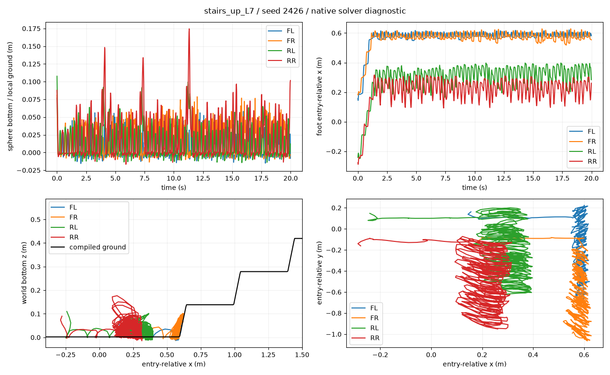
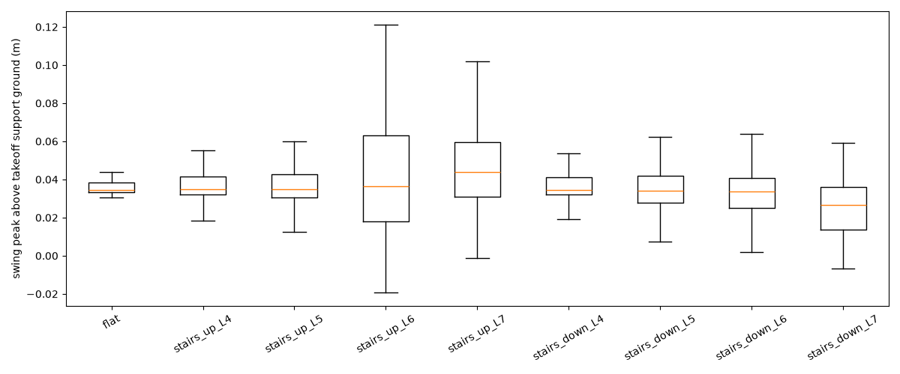
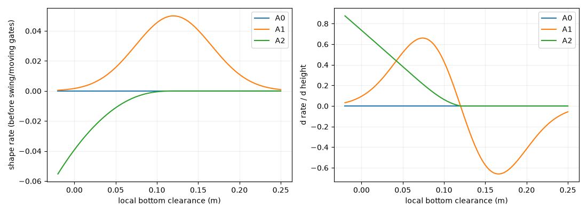
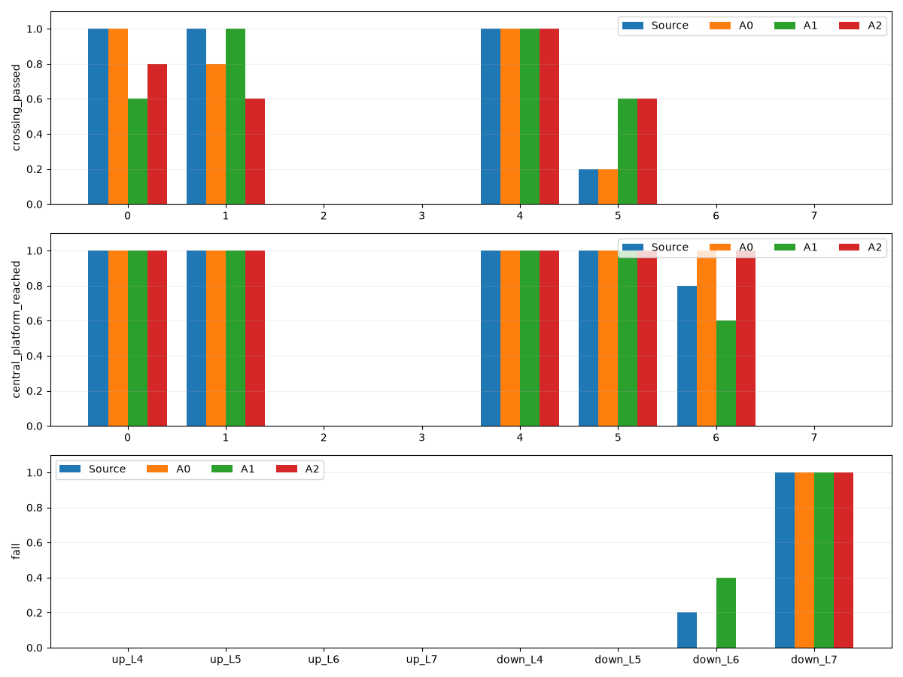
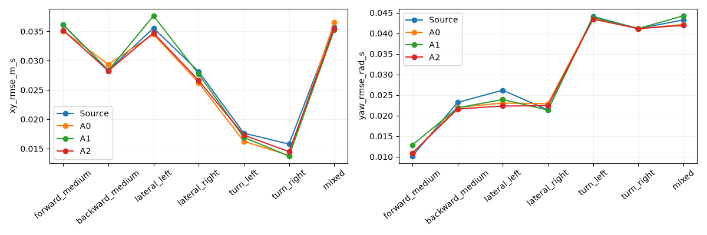
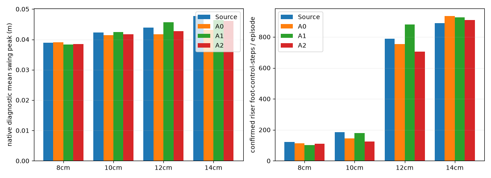
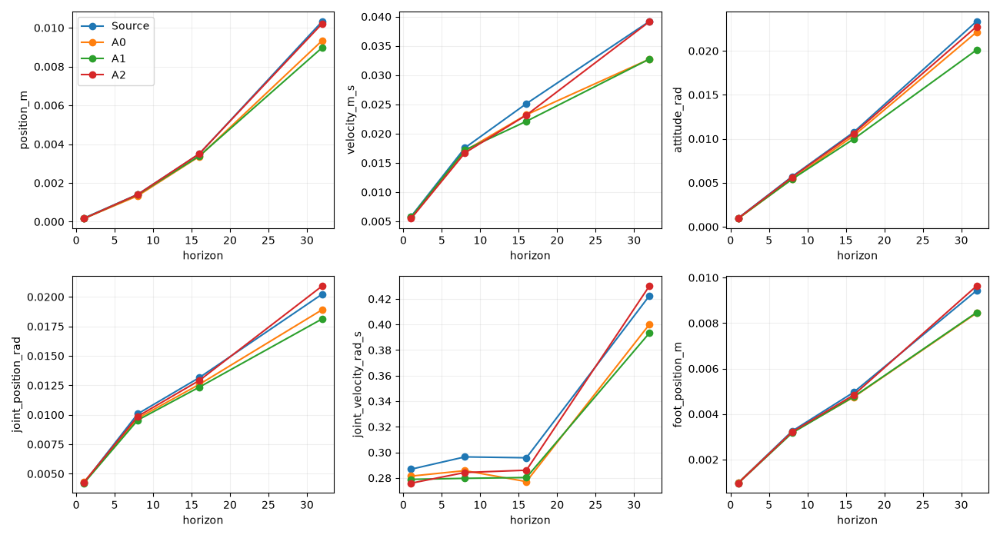
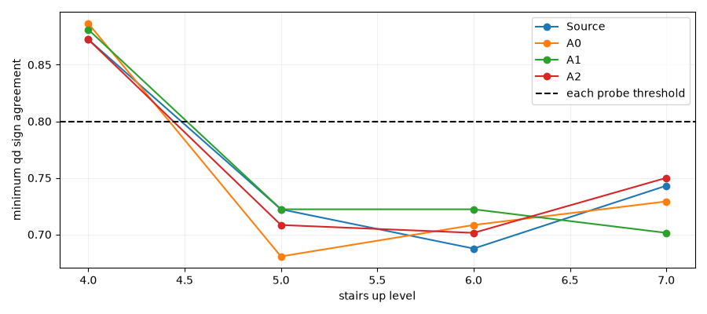
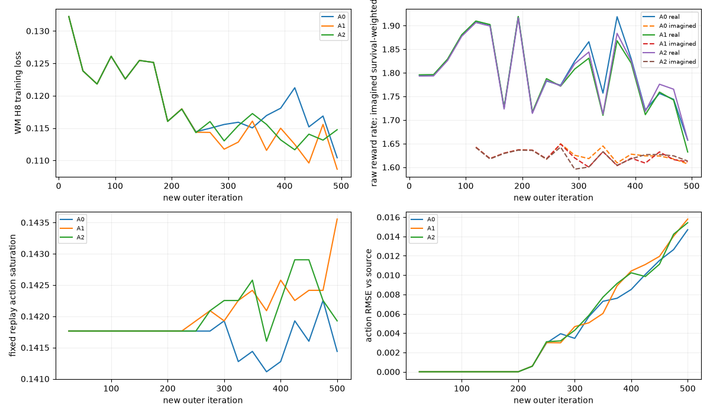

# Go2 14cm 楼梯 Swing Clearance 审计与 A0/A1/A2 消融

日期：2026-11-11。仓库分支 `experiment/go2-velocity-unilab`，开始审计 HEAD `3c9aea1ea6b2d8ee41d668f6b46b5db905e9892d`。本报告对应旧 2cm/级、最高 Level7 的受控消融；随后用户另行授权了 4cm/级、最高 Level5 的 90 分钟探索续训，见 [新任务运行记录](go2_stairs_20cm_A2_90min.md)。两轮地形几何和预算独立记录。

## 结论

本轮没有证明增加 Clearance 能突破 14cm。A0/A1/A2 各完成真实 2048 环境、500 outer iterations：每组新增 3,149,824 真实转移、2000 次 WM、300 次 Actor、8000 次 Critic optimizer 更新；三组累计 9,449,472 转移、6000/900/24000 次更新，训练进程 wall time 合计 640.73s。均不是 8 轮 Smoke。

A2 的局部奖励梯度比 A1 更有力，也不会在达到目标后继续鼓励抬高，但两者都未提高 12/14cm 上楼完整穿越。Level5–7 Actor 有效想象起点仍为 0；WM 数据覆盖改善不等于 Actor 已训练高楼梯。原 `results/stairs_omni_continuation_v2/best.pt` 保持不变，SHA256 `008ef06e29a78a288879a1b6d9138ef74d505975c67526e8fbee2fa9d3775e3e`，仍是保留的稳定基线。新三组模型没有被标记为优于该基线。

## 1. 失败模式的真实证据

在 Flat、上下楼 8/10/12/14cm，固定 `(0.4,0,0)`、2426–2430 五种子、每次20s，采集了四足位置、速度、球底局部高度、实际求解器接触几何/力、力矩、动作、姿态和推进。旧策略的 14cm 上楼平均推进 0.529m，停滞约12.07s；接近第一立面时，前足底部最高位置仍比上方踏面低 **1.93–3.65cm**（五种子）。摆腿峰值均值4.775cm，P50/P90逐场景数据在验证 JSON 中；每 episode 平均888.8个“足×控制步”发生已确认立面接触。没有实际 base/head 地形接触；关节软限越限比例0，力矩触限约0.755%，动作饱和33.55%。

因此有直接的足部越障高度/时序不足证据，而非仅根据原配置5cm猜测；同时动作饱和和 WM 局部接触梯度也构成瓶颈，不能认定抬腿奖励是唯一原因。12cm 上楼同样在入口停滞。下楼失败与落脚/接触稳定性有关，不能用上楼解释统一替代。

诊断用公开导出的同一 compiled MuJoCo 模型，自持完整原生 MjData 连续 `mj_step`，接触力来自实际求解器；独立 scratch MjData 只验证运动学。与 UniLab 第一控制步最大差1.19e-6，足端FK位置误差1.95e-6m、速度误差1.09e-6m/s；球碰撞几何半径确认0.022m。**长期原生轨迹与 UniLab 不逐步等价**，例如原生10cm上楼只有2/5，因此其轨迹只用于接触/足端对照，正式通过率始终采用 UniLab 独立评测，二者不混报。

立面接触要求力>2N、侧向法向且接触点靠近真实截面高度跳变；平地确认立面接触为0。腿部接触和 base/head 接触分开。摆腿按实际接触分段，排除前0.5s的初始下落，只统计完整离地—落地段。下文“接触步数”不是独立碰撞事件次数。




## 2. 源码与外部实现审计

- `go2_feet_world()` 与真实碰撞球中心对齐；高度是 `foot_z - compiled_collision_height(foot_xy) - .022`。地面查询使用 MuJoCo 编译三角面，边缘是分段可微插值；跨三角形导数不连续，球底垂直净空也不是球体至立面的完整有符号距离。原有 ray/有限差分边缘测试保留。
- 真实和 H32 想象共用 `velocity_reward_terms()`/`go2_gait_reward_terms()`，reward rate 最后统一乘 dt=.02。实际 torque 使用传感器，想象使用既有PD proxy，未借奖励迁移修改其他项。
- `swing_speed=tanh(vxy/.5)` 是连续运动学代理，支撑脚滑动也可能触发，不能称为真实接触摆动分类；保留原足滑和对角步态项。Standing 命令门控严格为0。
- 原窄高斯 target=.05/sigma=.025 在低脚及远离目标处梯度衰减，但原权重为0，原策略根本未接受该项训练。
- 修复 `Go2VelocityMdp.to()` 丢失自定义奖励配置的问题，并保留区域盒。A1 正奖励的理论 max_step_reward 从 .104 调整为 .105；A2仍为.104。该值仅用于日志归一化，Actor objective、Critic targets和 value-normalization 都使用原始奖励。

宇树参考固定在 commit `1425b15f73bd4095f0df53709d7c389c3eb9e790`：[rewards.py](https://github.com/unitreerobotics/unitree_rl_mjlab/blob/1425b15f73bd4095f0df53709d7c389c3eb9e790/src/tasks/velocity/mdp/rewards.py)、[velocity_env_cfg.py](https://github.com/unitreerobotics/unitree_rl_mjlab/blob/1425b15f73bd4095f0df53709d7c389c3eb9e790/src/tasks/velocity/velocity_env_cfg.py)。其 feet_clearance 为 `sum(abs(world_site_z-target)*foot_xy_speed)`，配置 weight=-1、target=.10；借鉴速度加权和命令门控思想，**没有把该世界高度、绝对误差公式或权重称为本任务等价配方**。接触事件式 feet_swing_height 不直接复制到 BPTT。

第三方 gpai 仓库 commit `0b50f5afd09a53455d4edd54af239a6d66f20095` 中的 adaptive_swing_recovery/停滞恢复未引入主实验。Lite3 部署仓库树 `1c4a8f14c9c531903fa5a26783e3f9b99d1039d9` 没有 reward 配方文件，不存在可引用的“官方验证14cm抬腿参数”。下载内容保存在本地 `results/stairs_clearance_B4/reference/`。

## 3. 三组控制变量与梯度

| 实验 | 权重 | 模式 | target / sigma | 范围 |
|---|---:|---|---|---|
| A0 | 0 | 原高斯、关闭 | .05 / .025 | 原配置 |
| A1 | .05 | 宽高斯 | .12 / .065 | 楼梯tile |
| A2 | .05 | 单侧软不足高度惩罚 | .12 / .065，tau=.02 | 楼梯tile |

A2 使用 `d=max(tau*softplus((target-h)/tau)-tau*log(2),0)`，shape=`-(d/target)^2`。正部平方使目标处函数及一阶导数连续，达到目标后值/导数为0；速度门控独立于高度，避免低脚因门控上升而产生反向高度梯度。均保留 moving 和 foot_xy_speed 门控。

区域权重按**每一步预测足端世界XY**查询真实楼梯 tile AABB，边界10cm smoothstep过渡，非楼梯tile为0；不是使用Reset域标签。真实与H32调用同一查询，无区域/高度特征进入213D Actor。离线同时比较全地形和楼梯区域方式：全局方式会改变平地奖励，故训练采用楼梯区域方式。地形仍只进入77D WM。

在相同210个32步真实窗口和同一来源WM上，A1/A2梯度均有限。14cm上楼的 A1 clearance动作梯度范数0.001317、与tracking梯度余弦-0.057；A2为0.002101、+0.102；tracking梯度范数约0.353。新增真实奖励绝对占比分别约0.28%、1.01%，未出现异常大单项梯度。A2局部梯度更合理，但不等于已经获得物理技能。



## 4. Checkpoint与高等级数据

命名迁移 `go2_stairs_clearance_reward_v1` 只允许 clearance权重、target、sigma、mode、tau、region及相应 manager 参数；任何其他 reward/action/state/PD/termination/terrain变化仍拒绝。旧 Actor/WM/Critic及全部optimizer、value normalization、Replay、课程、累计计数保留。旧Replay.r是缓存统计，Critic targets从想象轨迹重新算奖励；仍只重标旧r里的clearance增量，不用想象PD proxy重算实测torque项。两组均处理2,097,152个旧转移。Critic继承后经过100次critic-only outer iterations校准，没有随机重置全网络。

每组100轮WM-only、100轮Critic-only、300轮Actor；H8、H32、wm_batches4、batch256、UTD=.4、action_noise=.1，Actor倍率.03并渐增。三组来源、seed、真实交互预算与数据探针机制一致；并行独立评测与部分训练重叠，因此 wall吞吐不作性能对比。

采集前及第200/400轮，对楼梯环境均匀物理Reset到Level5/6/7，各采96控制步，沿用同一Actor、采样器、.1探索噪声。探针不计成功，不改变mastery；显式标注episode边界。WM窗口35%来自高等级候选，Actor仍独立执行原scope mask。新Replay在动作前记录speed level；历史旧标签记为unknown，不伪造原标签。

以A0尾部Replay快照为例，上楼L5/L6/L7分别有135477/16320/16320真实转移，下楼104918/20344/16320；H8有效比例约91–98%，H32约62–89%。全部三组真实采集到三维非零楼梯命令，分别341852/344746/347052个转移。WM实际窗口起点中A0的L5/L6/L7为179791/21235/19639，说明采样仍明显被L5主导；后续90分钟任务因此单独启用按高等级均衡的WM采样开关，不追溯改变本消融。

**三组的Level5、6、7 Actor有效想象起点均为0。** 精确 `Domain × Terrain Level × Speed Level × Starts`、unknown标签及Replay窗口统计随验证包提交。训练Replay未存真实求解器接触力，不能把接触代理统计说成实测接触切换覆盖；实测接触证据来自独立原生诊断。这也是下一轮数据记录需要补强的位置。

## 5. 独立物理结果

统一UniLab MuJoCo、同一旧8行地图、五个固定seed、前进20s；完整穿越仍要求无跌倒、推进≥6.8m、最大横偏≤.6m。到平台单独记录，不能替代完整穿越。每组全向/地形/楼梯机动评测684场景×5seed=3420 episodes；平地及穿越20s、楼梯机动4s。来源评测复用已有通过SHA校验的同条件结果。

| 场景 | 原best | A0 | A1 | A2 |
|---|---:|---:|---:|---:|
| 上楼8cm完整穿越 | 5/5 | 5/5 | 3/5 | 4/5 |
| 上楼10cm完整穿越 | 5/5 | 4/5 | 5/5 | 3/5 |
| 上楼12cm完整穿越 | 0/5 | 0/5 | 0/5 | 0/5 |
| 上楼14cm完整穿越 | 0/5 | 0/5 | 0/5 | 0/5 |
| 下楼8cm完整穿越 | 5/5 | 5/5 | 5/5 | 5/5 |
| 下楼10cm完整穿越 | 1/5 | 1/5 | 3/5 | 3/5 |
| 下楼12cm完整穿越 | 0/5 | 0/5 | 0/5 | 0/5 |
| 下楼14cm完整穿越 | 0/5 | 0/5 | 0/5 | 0/5 |

14cm上楼三组均无完整穿越、无到中央平台、无跌倒；14cm下楼三组均5/5跌倒。A1的8cm上楼降为3/5，A2的10cm上楼降为3/5，均没有达到“保留8–10cm且突破高楼梯”的验收。五种子样本小，不把10cm下楼1/5→3/5单独宣称为可靠改进。

| 平地指标 | 原best | A0 | A1 | A2 |
|---|---:|---:|---:|---:|
| 前进0.4 XY RMSE | 0.0361 | 0.0351 | 0.0361 | 0.0352 |
| 后退-0.3 XY RMSE | 0.0284 | 0.0294 | 0.0283 | 0.0283 |
| 左移0.2 XY RMSE | 0.0355 | 0.0345 | 0.0376 | 0.0347 |
| 右移-0.2 XY RMSE | 0.0282 | 0.0262 | 0.0277 | 0.0266 |
| 左转0.5 Yaw RMSE | 0.0441 | 0.0438 | 0.0439 | 0.0434 |
| 右转-0.5 Yaw RMSE | 0.0412 | 0.0411 | 0.0412 | 0.0411 |
| 混合 XY RMSE | 0.0358 | 0.0365 | 0.0352 | 0.0354 |

平地全向运动基本保持；完整18类平地、Rough/Slope Level1–4、上下楼Level1–7与各机动命令实际均速、RMSE、跌倒、存活、滑足代理等全部保存在 `summary.json`/本地evaluation.json中。未开展新的随机地形几何种子泛化实验，不能声称已证明泛化。




原生足端对照：14cm上楼摆腿峰值均值 Source/A0/A1/A2=4.775/4.323/4.639/4.611cm；立面接触步数888.8/935.6/926.8/909.4。A1/A2相比A0仅增加约3mm，且低于来源best，没有有效越障高度提高证据。关节软限越限仍0；A1/A2饱和约33.66%/33.55%，source33.55%。四脚同时无接触比例约0.4%，机身竖直速度RMS约.12m/s，关节加速度RMS约143–144rad/s²，未发现靠大幅跳跃刷奖励，但停滞问题未改善。接触足水平速度约.47m/s，包含撞壁时的运动，不等同于单纯踏面滑动速度；固定评测另有几何足滑代理统计。

A1/A2在训练后14cm原生轨迹上的新奖励均值分别+.00418/-.01563 rate，约占总奖励绝对值.34%/1.27%；来源同状态WM离线想象均值+.00486/-.01730 rate。最大值、落脚速度、峰值分布、关节限制等见 `reward_hacking.json`、`offline_reward_gradients.json` 和足端分析，不以其奖励高低判断穿越成功。



## 6. WM门禁与剩余瓶颈

相同保留真实轨迹、同一批H32有效窗口评价H1/H8/H16/H32。来源→A1的H32平均base位置.01033→.00898m、线速度.03919→.03274m/s、关节位置.02023→.01813rad、关节速度.4224→.3933rad/s、足位置.00943→.00847m；A2整体没有相似改善。预测误差下降仍不能替代动作Jacobian验证。

| 上楼terrain level | 来源最差qd方向一致率 | A0 | A1 | A2 |
|---|---:|---:|---:|---:|
| L5 (10cm) | 72.22% | 68.06% | 72.22% | 70.83% |
| L6 (12cm) | 68.75% | 70.83% | 72.22% | 70.14% |
| L7 (14cm) | 74.31% | 72.92% | 70.14% | 75.00% |

阈值保持逐组≥80%、normalized_error<1、七探针齐全、H32全部误差门槛；缺失或oracle校准失败不放行。L5/6部分normalized_error还略大于1。当前不能开放12/14cm上楼Actor优化，也不能声称高等级训练已充分。

下一步优先在 `ReplayBuffer.sample_windows()` 均衡高等级及立面/触地稀有窗口，在 `high_stair_probe()` 延伸成功踏面附近与动作扰动数据，在 `diagnose_go2_omni_wm.py` 保留完整接触oracle校验并增加接触探针；通过后由 `imagination_scope_admission()` 开放对应起点。没有修改WM结构、loss、Actor encoder或门槛；没有外部Teacher、BC、PPO/AMP。





## 7. 测试、模型与复现

完整自动化测试最终结果见验证日志；另通过了新地图4cm级差、rough/slope独立上限、WM均衡采样与Actor门禁独立性测试。Ruff和 `git diff --check` 通过。包括零权重旧奖励精确等价、Standing门控、目标高度上下导数/有限差分、位置区域切换、真实MuJoCo/想象相同数学、MDP.to保存配置、77D WM/213D Actor、严格奖励迁移、旧Replay未知速度标签、恢复与边界测试。

三个候选均保存在本地，无覆盖原best：

- A0: `results/stairs_clearance_B4/baseline/trial/last.pt`，SHA256 `0f0e64f392c8e78ef54f419974129fd77300155a8d40af0c050dbe1ff61b7d91`。
- A1: `results/stairs_clearance_B4/gaussian/trial/last.pt`，SHA256 `f2e2560f3b9ff5edb3fb177aebb71630ee461ddf771c954317e8a70a0e201bc9`。
- A2: `results/stairs_clearance_B4/soft_deficit/trial/last.pt`，SHA256 `aba2ebf8ee68556fa6c4cf81cefdb7e511a54d3cb813f642d005a98a564cc7c9`。

首次A0启动曾因诊断日志父目录缺失在100轮WM-only后中断，已修复并从相同来源重跑；其400次WM更新、708608真实转移、0 Actor更新不混入配对三组预算，日志与interrupted.pt保留。包含该启动失败的训练开销为10,158,080转移、6400次WM、900次Actor、24000次Critic；独立物理评测/接触诊断另计。早期配置物化检查失败没有执行optimizer更新。

```bash
cd /home/yifeiy/ws_go2_unilab/Uni-SuperMimic
PY=/home/yifeiy/miniconda3/envs/go2_unilab/bin/python
OMP_NUM_THREADS=4 "$PY" -m pytest -q
# 奖励梯度复现，输出必须用新目录
OMP_NUM_THREADS=4 "$PY" tools/diagnose_go2_clearance_gradients.py --checkpoint results/stairs_omni_continuation_v2/best.pt --trajectories results/stairs_clearance_B4/diagnostics/baseline_feet/trajectories.pt --output results/stairs_clearance_B4/diagnostics/offline_rewards_rerun
# A2物理复评，输出必须用新目录
OMP_NUM_THREADS=4 "$PY" tools/evaluate_go2_omnidirectional.py --checkpoint results/stairs_clearance_B4/soft_deficit/trial/last.pt --output results/stairs_clearance_B4/evaluation/A2_rerun --stairs-omni --max-level 7 --seconds 20
```

完整实际配置、调用参数、CSV、迁移清单、Replay/Actor覆盖、梯度数据和曲线见 [验证目录](validation/go2_stairs_clearance/)，大模型、原生接触逐步日志及轨迹只保存在本机results。旧地图消融本身 `longrun_allowed=false` 保持不变；用户追加的新地图90分钟是明确授权的受保护探索续训，不把该授权表述为奖励消融已经成功。
