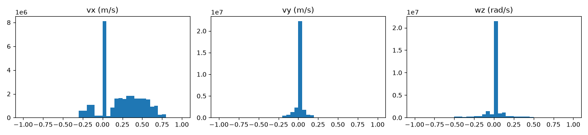
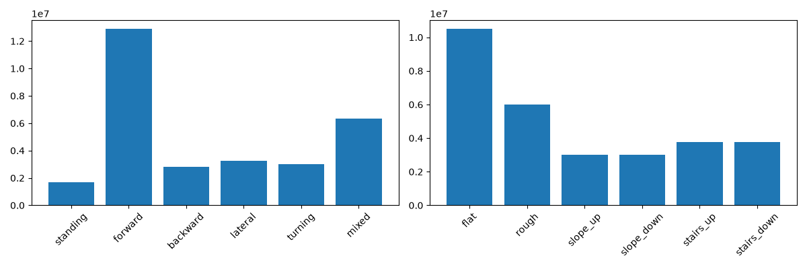
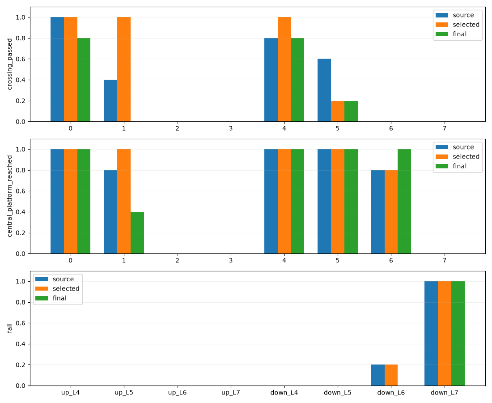
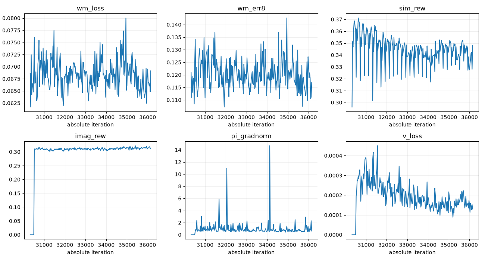
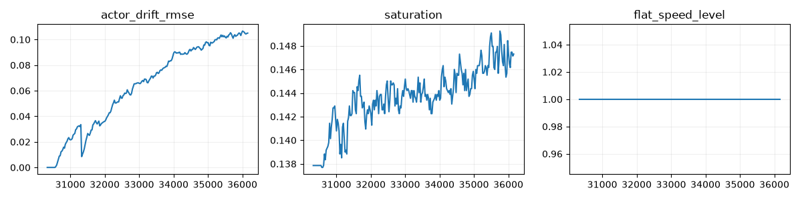
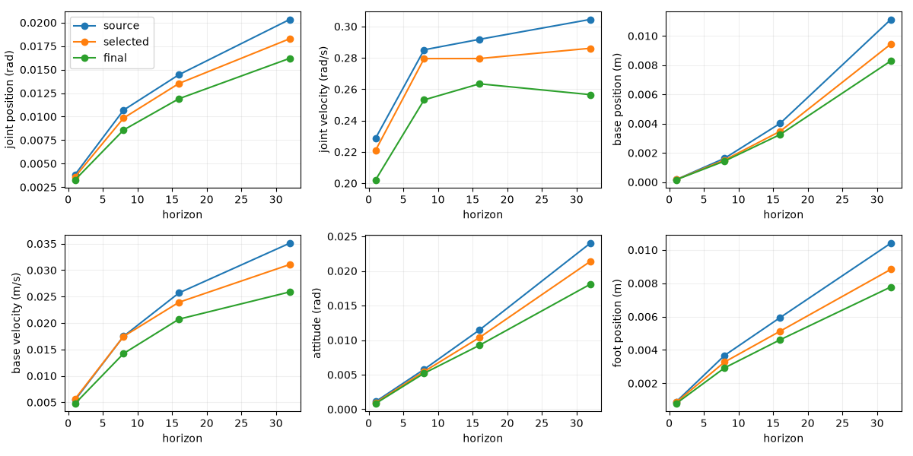
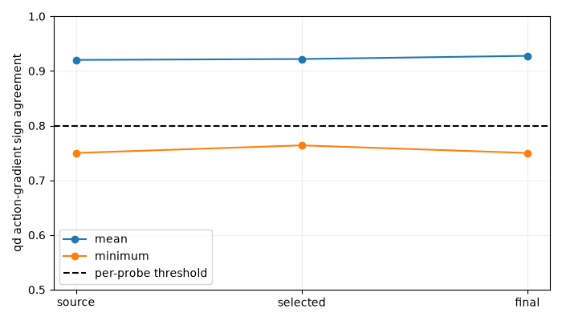

# Go2 楼梯全向续训及Level7能力验证

## 最终结论与保留模型

**按用户最终要求，仅保留本轮综合楼梯表现更好的完整Checkpoint：`results/stairs_omni_continuation_v2/best.pt`。不是最后迭代模型。**

- 迭代30807，SHA256 `008ef06e29a78a288879a1b6d9138ef74d505975c67526e8fbee2fa9d3775e3e`，大小1,235,008,329 bytes。
- 已重新加载该文件完成3420个固定物理episode，结果与原30807评测逐项一致。
- 保留Actor/WM/Critic、三个优化器、Replay、Value Normalization、地形课程、速度采样器/RNG和累计计数，可继续训练；恢复会重新Reset物理环境并封闭Replay边界，不声称逐物理步等价。
- 保留Actor实际来源：正式StageB策略 + 原地图450次受控Actor更新 + 本段前250次Actor更新；累计计数还包括后来回退的750次尝试，不能混为有效保留更新。
- 按用户授权清理本轮目录其余26个Checkpoint，释放25.48GiB。逐文件哈希/计数见[清理清单](validation/go2_stairs_omni/checkpoint_cleanup.json)。`heldout.pt`是物理诊断数据，保留；日志、CSV和曲线保留。目录外的正式来源策略不在此次清理范围。
- **8cm上下楼5/5、10cm上楼5/5；10cm下楼只有1/5完整穿越。12/14cm上楼仍未掌握，14cm下楼5/5跌倒。** “当前候选较好”不是全地形训练成功，更不是全局最优或泛化证明。

## 契约与代码修改

审计起点`26015c1768d9addaea7449d0b32af25bd0d989a3`，分支`experiment/go2-velocity-unilab`。实现提交`ff31189`、`4e3f38e`、`20a863c`、`efb25df`，最后的报告提交另由Git历史标识。

正式来源为`results/omnidirectional_terrain/stageB/last.pt`，SHA256 `52ebc6fdf1e3d575733756939645e4baec1e26c3be4f010892655275ffbdf8d9`，没有使用规模benchmark临时权重。

|范围|本轮行为|
|---|---|
|Actor/WM/Critic|Actor盲213→12；WM仍77D特权高度/H8；H32动态可微查询；Critic结构不变|
|控制|dt .02s、Action Scale .25、关节顺序、PD、动作限制不变|
|Reward|全部公式/系数不变；clearance=0、target=.05、sigma=.025、diagonal=-.15、slip=-.20|
|Termination|数学定义不变；Reward和Termination文件/函数哈希锁通过|
|采样|新增opt-in楼梯六模式和按上下楼×地形等级独立的S0–S3；默认旧路径不变|
|地形|用户追加批准stairs最高L7/14cm；rough/slope生成幅度与mastery上限仍L4|
|安全|分区WM梯度/H32准入、独立Actor倍率、数值/动作/资源保护、保存与回退；旧stageC历史false未改|

`command_sampler.py`实现楼梯前进30%、前进修正25%、Mixed20%、纯侧移10%、纯转向10%、站立5%；S0–S3对应vy=.08/.15/.22/.30、wz=.15/.30/.45/.60。vx范围[-.30,.80]。穿越命令10.02s，机动2–4s。机动中途重采前进也不能变成穿越episode。Terrain标签仅作采集/准入元数据，不进入Actor历史、Goal3或Context。

`manager_terms.py`让机动出生前移1.6m，使侧移/转向真正接触台阶。发现高等级下楼后脚初始穿地约3.5cm，新增`reset_geometry.py`：默认关闭、仅新Level7配置显式开启`stairs_safe_spawn`，在最终XY/yaw/joints上查询四足碰撞高度，仅补最小向上位移至5mm余量。Level5–7上下楼×5 seeds共30次Reset全部通过。此出生变化显式进入sampler contract并进行Command-only迁移；不暗改Reward、PD或终止。

`terrain.py`/`curriculum.py`支持8行atlas和各类上限[4,4,4,7,7]。5→8行世界坐标改变，因此显式清空旧Replay，网络/优化器/累计计数保留。PNG编译导致原等级台阶踏面最大差2.824mm、边缘插值带最大差25.572mm，不声称新旧地图逐点一致；重新运行同图基线。高度场始终来自当前compiled collision，旧扫描缓存未复用。8行地图内后续恢复保留Replay并关闭跨Reset窗口。

`speed_curriculum.py`、Replay的scope mask和Learner统计只限制想象起点，不筛WM真实训练窗口。每个楼梯pair需要七种probe全部qd符号≥80%、归一化误差<1及H32误差合格；速度晋级还需实际物理证据。没有放宽失败全域门禁。`diagnose_go2_omni_wm.py`对公开time/qpos/qvel快照不能准确重放的接触探针明确拒绝，缺失probe不准入，未放宽.001校准阈值。

## 实际训练预算

起点iteration26807，累计140,453,888 transitions。本轮所有阶段最后到36170、累计188,524,544 transitions。

|阶段|Outer iterations|新增真实转移|WM更新|Actor尝试更新|Critic更新|
|---|---:|---:|---:|---:|---:|
|原地图WM适应|2000|10,240,000|8000|0|0|
|原地图受控Actor|500|2,560,000|2000|450|10000|
|Level7首段，含64步Replay重填|1000|5,251,072|4000|750|16000|
|用户追加约40分钟|5863|30,019,584|23452|5613|113260|
|本轮总计|9363|48,070,656|37452|6813|139260|

独立2048×1500步采样审计另有3,072,000 transitions、无优化器更新，没有混入以上训练计数。诊断/评测转移同样不混入训练交互量。

追加段先200轮WM-only、50轮Critic-only，Actor倍率.03，H8/H32及正式网络宽度不变。开始500轮评测一次，用户要求先训练一大段后，保存中断点并继续1800秒，`eval_period=100000`，不再中途完整评测。后半连续段实际1790.79秒、4863次Actor更新，按wall预算结束而非异常终止。整个追加段Learner记账2239.71秒（37.33分钟），连同初始化/阶段评测约40分钟；本轮Learner累计增量3499.19秒。进程wall、外部评测和Learner计时不同，**没有声称跑满两小时**。

连续段正式profiler：simulation45.46ms/vector step、WM25.16ms/update、H32 Actor111.02ms/update、Critic一批14.86ms；进程GPU采样峰值2690MiB，RSS约2.36GiB。无NaN/Inf/OOM或输出崩溃保护触发。GPU结论仅为实测占用，未声称MuJoCo物理GPU加速。

## 真实采样和准入覆盖

追加段六域transitions比例35.0098/19.9707/10.0098/10.0098/12.5/12.5%；物理平地（含terrain level0）11,177,457，非平地18,842,127，不能把35%Flat Domain直接等同全部物理平地。

Flat Standing/Forward/Backward/Lateral/Turning/Mixed实际分别854,278 / 2,080,560 / 1,900,489 / 1,910,192 / 1,696,098 / 2,068,169条转移。楼梯7,504,896条，其中三维Goal同时非零3,367,262条。各楼梯地形等级0–7实际转移：245,817 / 234,404 / 237,432 / 275,794 / 2,309,980 / 3,953,557 / 245,699 / 2,213。

Actor实际六类起点：114,980 / 359,115 / 287,167 / 286,374 / 245,110 / 144,182，共5613×256。WM有效采样状态数量见[增量诊断](validation/go2_stairs_omni/extra40_results_phase_details.json)。**Level5–7实际Actor想象起点为0：虽然WM获得这些真实数据，严格梯度准入未放行这些pair。** 不能把数百万高台阶数据或mastery分配当成高台阶Actor训练成功。

仅上楼Terrain L1从S0升到S1，其余楼梯仍S0，Flat速度等级1；S2/S3没有开放。楼梯本段实际命令最大|vx/vy/wz|=.79986/.14852/.29961。用户高范围八个命令附近计数0/0/0/0/806/215/0/0，绝大多数目标仍未充分覆盖，不能称已训练到vy±.30/wz±.60。




## 同条件固定物理评测

Source为本追加段开始的模型，Selected为唯一保留模型，Final为最后长段模型（已按用户要求删除）。每模型3420个episode，5固定seed2426–2430，Flat/穿越20秒、机动4秒，无探索噪声；初始XY±2cm、yaw±.03rad、关节±.01rad。评测不使用WM。固定seed曾用于保护，是重复验证集，不冒充未见泛化测试。

原完整穿越保持：纯前进(.4,0,0)、无跌倒、x推进≥6.8m、最大横偏≤.6m。另记录到中央平台：入口相对x∈[3.0,3.8]m、横偏≤.6m、实际地面距中心高度≤2.5cm且当时未终止；到平台不等于完成整段。

|场景|Source完整穿越|Selected完整穿越|Final完整穿越|Selected到平台|Selected跌倒|
|---|---:|---:|---:|---:|---:|
|上楼 L4/8cm|5/5|5/5|4/5|5/5|0/5|
|上楼 L5/10cm|2/5|5/5|0/5|5/5|0/5|
|上楼 L6/12cm|0/5|0/5|0/5|0/5|0/5|
|上楼 L7/14cm|0/5|0/5|0/5|0/5|0/5|
|下楼 L4/8cm|4/5|5/5|4/5|5/5|0/5|
|下楼 L5/10cm|3/5|1/5|1/5|5/5|0/5|
|下楼 L6/12cm|0/5|0/5|0/5|4/5|1/5|
|下楼 L7/14cm|0/5|0/5|0/5|0/5|5/5|

Selected相比Source，8cm上下楼与10cm上楼更好，但10cm下楼整段率3/5降到1/5；不存在全面支配所有场景的候选。按用户“楼梯上限、稳定通过优先”保留Selected。Final的平地更好、12cm下楼无跌倒且5/5到平台，但10cm上楼0/5，故不作为主模型。14cm下楼即使平均速度接近命令，也因5/5跌倒不能算成功。



|平地命令(vx,vy,wz)|Selected XY RMSE m/s|Selected Yaw RMSE rad/s|Final XY RMSE m/s|Final Yaw RMSE rad/s|Selected跌倒|
|---|---:|---:|---:|---:|---:|
|(.4,0,0)|0.0361|0.0101|0.0358|0.0107|0/5|
|(-.3,0,0)|0.0284|0.0232|0.0266|0.0193|0/5|
|(0,.2,0)|0.0355|0.0262|0.0242|0.0158|0/5|
|(0,-.2,0)|0.0282|0.0214|0.0237|0.0174|0/5|
|(0,0,.5)|0.0176|0.0441|0.0137|0.0383|0/5|
|(0,0,-.5)|0.0158|0.0412|0.0125|0.0419|0/5|

完整逐模式、逐地形CSV保留于[Selected对比](validation/go2_stairs_omni/selected_results_paired_evaluation.csv)和[Final对比](validation/go2_stairs_omni/extra40_results_paired_evaluation.csv)，包括实际vx/vy/wz、跌倒、存活、足滑代理、饱和及越界。平地前进/后退/侧移/转向仍可用，楼梯机动不能用统一世界x距离判定。

其余地形保持Level1–4，Selected纯前进(.4,0,0)固定物理结果如下；这里仍用原整段穿越定义：

|场景|实际vx m/s|XY RMSE m/s|Yaw RMSE rad/s|跌倒|完整穿越|
|---|---:|---:|---:|---:|---:|
|rough L1|0.404|0.0404|0.0149|0/5|5/5|
|rough L2|0.410|0.0480|0.0208|0/5|4/5|
|rough L3|0.405|0.0529|0.0290|0/5|4/5|
|rough L4|0.408|0.0609|0.0385|0/5|5/5|
|slope_up L1|0.405|0.0370|0.0131|0/5|5/5|
|slope_up L2|0.407|0.0389|0.0163|0/5|5/5|
|slope_up L3|0.408|0.0408|0.0182|0/5|3/5|
|slope_up L4|0.408|0.0413|0.0182|0/5|4/5|
|slope_down L1|0.407|0.0381|0.0132|0/5|5/5|
|slope_down L2|0.408|0.0391|0.0166|0/5|5/5|
|slope_down L3|0.409|0.0408|0.0190|0/5|5/5|
|slope_down L4|0.407|0.0403|0.0187|0/5|5/5|

## 模型误差、梯度与退化诊断

在最终策略新采的相同真实保留轨迹上，三版WM使用完全相同的有效H32窗口评价H1/H8/H16/H32。以下为各场景RMSE的平均，非混合无单位MSE：

|H32量|Source WM|Selected WM|Final WM|
|---|---:|---:|---:|
|关节位置 rad|0.02034|0.01829|0.01620|
|关节速度 rad/s|0.30447|0.28607|0.25651|
|机身位置 m|0.01112|0.00944|0.00829|
|机身线速度 m/s|0.03511|0.03107|0.02588|
|姿态 rad|0.02402|0.02138|0.01808|
|足位置 m|0.01041|0.00883|0.00778|

qd动作Jacobian符号一致率平均92.02%→92.18%→92.76%，最弱75.00%→76.39%→75.00%；平均改善而尾部仍不合格。该批物理oracle最大误差.000167，低于.001门槛。诊断保留epsilon .01/.03/.07，接触不连续使有限差分敏感，不能用训练Loss小证明动作梯度正确。

**Final WM预测更准，并没有带来更好的10cm上楼穿越。** 高等级想象起点未放行，Actor主要在较低等级和其他域更新；这解释了为什么单纯追加相同预算不保证突破高楼梯。它是观测到的准入/覆盖限制，尚不能排除H32后续状态离开可靠分布、value估计或接触梯度误差。最终模型没有明显饱和崩溃（固定起点饱和约14.7%，漂移约.105），但有真实地形技能退化，不能称全局收敛。






## 测试、命令与下一步

完整自动测试226 passed、2 skipped、9 deselected，Ruff和diff检查通过，Reward/Termination哈希锁不变。覆盖旧legacy、概率/左右平衡、S0–S3、三维混合、Reset、独立课程、Replay Goal/H32固定命令、213/77契约、scope恢复和Command-only迁移。真实数据中的关节加速度有限差分与想象估计、真实力矩传感与想象PD代理差异继续保留，几何足滑不称真实接触力。

下列命令已实际执行。后端为`go2_unilab` Conda环境的MuJoCo；mjwarp高度场限制未绕过：

```bash
conda activate go2_unilab
cd /home/yifeiy/ws_go2_unilab/Uni-SuperMimic
OMP_NUM_THREADS=4 python -m pytest -q
OMP_NUM_THREADS=4 python tools/evaluate_go2_omnidirectional.py \
  --checkpoint results/stairs_omni_continuation_v2/best.pt \
  --output results/stairs_omni_continuation_v2/selected_evaluation --stairs-omni --max-level 7
OMP_NUM_THREADS=4 python tools/plot_go2_stairs_selection.py \
  --output results/stairs_omni_continuation_v2/selection_figures
OMP_NUM_THREADS=4 python tools/play_go2_terrain.py \
  --checkpoint results/stairs_omni_continuation_v2/best.pt \
  --terrain stairs --level 5 --vx 0.4 --seconds 2 --headless
```

评测输出目录已存在，工具拒绝覆盖，重跑时换新的输出目录。最后一条已通过无界面同物理路径；实际交互播放移除`--headless`，把`--seconds 2`改为`--seconds 20`，无需视频导出。

历史训练完整argv/config/invocation、阶段JSON和Checkpoint删除清单均保留。旧训练命令引用的中间权重已经按本次授权删除，不伪装成仍可原样恢复；当前只有`best.pt`可用于继续训练。1.2GB权重保留在本机，不把Replay/二进制模型直接塞入Git。

下一轮优先补Level5–7有效接触与动作响应诊断，明确解决准入尾部和Actor起点覆盖，再测试更高台阶；保留当前稳定模型作对照。S2/S3、12/14cm上楼尚未达标，不建议继续不加诊断地堆同一分布预算。本轮没有更改Reward，后续抬腿或WM结构试验应另开独立消融。
