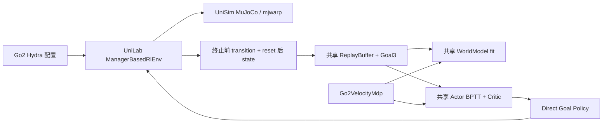

# Go2 → Uni-SuperMimic / UniLab 迁移技术报告

迁移工作区：`/home/yifeiy/ws_go2_unilab`。实验分支：`experiment/go2-velocity-unilab`。本报告的数值表由 `tools/build_go2_report.py` 从原始 JSON 填充。

## 交付状态与验收边界

已实现独立 `Go2VelocitySuperMimic` 任务、Direct Goal Actor、Go2 Manager 协议、Replay 命令存储、共享 WM/Actor/Critic 训练接入、可选择的 Context16 随机化，以及五种地形 profile。CPU 协议、16/64 环境平地物理测试、完整网络短训和地形接触短测均有落盘证据。

**平地基线尚未验收，禁止启动复杂地形长训。** 短训证明训练链能运行；尚未证明 WM 预测质量、长期稳定性或原训练轨迹等价。真实 Reward 的关节加速度测量、自动课程及 B/C 混合回采仍有明确差异。复杂地形 Reward 仍含原平地高度假设，不能直接用于地形训练。

所有实验在独立 clone 和 conda 环境进行。原 79 个冻结源文件哈希、原仓库 dirty 状态和旧 Checkpoint 哈希复核一致；UniLab clone 保持 clean；没有覆盖旧 Checkpoint。验证后按用户要求将代码发布至独立实验分支，发布不代表平地基线验收。新任务默认只有 32 环境、8 次迭代，原 G1 默认配置保持原样。

## 版本、硬件与依赖

| 对象 | 固定版本 / 说明 |
|---|---|
| 本地 enffft/supermimic | HEAD `5d59b4e0a7b2cacb3810bdc2782e806ee121e934`，含会话前已有修改；不能仅凭 commit 重建，须结合冻结源码与 patch |
| Uni-SuperMimic | 上游 `d78a5e2bc26ee26c3a94ae10418b7fb9018836ee` + 本实验未提交修改 |
| UniLab | `794c0bbd67771ac48407e084c0164c0e841bfd97`，1.5.9，未修改源码 |
| OS / CPU / RAM | Ubuntu 20.04.6，Linux 5.15，i5-14600KF，约 15.4 GB |
| GPU / 驱动 | RTX 4070 SUPER，12282 MiB，535.230.02，驱动报告 CUDA 12.2 |
| 新 conda | `go2_unilab`，Python 3.12.15，由原 `supermimic` clone |
| Torch | 2.11.0+cu126，CUDA 实测可用；编译 CUDA 12.6 与驱动显示版本分别记录 |
| MuJoCo / mujoco-warp / Warp | 3.11.0 / 3.11.0 / 1.16.0；Warp 报 Toolkit 12.9、Driver 12.2 |
| UniSim / mjbatch | unisim-core 2.7.1 / mjbatch-uni 0.2.5 |
| pip 依赖检查 | `No broken requirements found.` |

原 `.venv` 的 Torch 2.14.1+cu130 在本机驱动下 CUDA 初始化失败；没有修改该环境。原 conda `supermimic` 保留 Torch 2.11.0+cu126、MuJoCo 3.16、Warp 1.18。仅在新环境中卸载旧 `supermimic` / `mjlab` 包，解决其 MuJoCo 3.16 依赖与新框架 3.11 的冲突。

**当前 mjwarp 自动禁用 CUDA graphs，以 eager 执行。** 原因是驱动 CUDA 12.2 低于框架要求的 12.4。另有 MULTICCD 对部分 cylinder/box 配对仅生成一个接触的警告。没有升级驱动或隐瞒回退。

完整记录见 `migration/environment/{runtime.json,conda-explicit.txt,pip-freeze.txt,pip-check.txt,nvidia-smi.txt,original-conda-explicit.txt,go2-files-sha256.json}`。最小运行版本清单为 `migration/requirements-go2-runtime.txt`。

Git提交只包含代码、模型资产、冻结参考源码、报告和精选验证结果。上述完整本机环境快照、Checkpoint、TensorBoard事件、profiler大trace及失败运行日志保留本地；提交的 `migration/versions.json` 记录关键依赖和基准commit，`results/README.md` 说明远端证据范围。

## 架构审计与职责

在所核对的版本中，`SuperMimicLearner`、`Policy`、`WorldModel`、`ReplayBuffer` **由 Uni-SuperMimic 拥有**；UniLab 提供 Manager-Based 环境、协议、配置、场景、后端和训练基础设施。UniLab 中没有另一套同名 SuperMimic WM 训练器可供迁移。



原本地训练由 `training/loop.py`、独立 WM/Policy trainer、recorder/replay 和任务适配器协作。迁移端全部更新调用上游 `SuperMimicLearner.train()`；验证脚本只编排任务、采样和 profiler，没有复制第二套训练循环。G1 的 encoded mode 保持默认路径，新 direct mode 才启用 Go2 分支。

| 审计项 | 原 Go2 | 新 Go2 / 处理结果 |
|---|---|---|
| State37 | `[p3,quat_wxyz4,q12,v_world3,w_body3,qd12]` | `[p3,quat4,v_world3,w_world3,q12,qd12]`；显式转换布局及角速度坐标，禁止直接 flat tensor 互换 |
| Goal3 | 机身坐标 `[vx,vy,wz]` | 原值存 Replay；想象全过程持有起始命令，不从 motion frame 合成 |
| Actor 单帧42 | `q+bias-q0, qd, omega_body, gravity_body, previous_clean_action` | 12+12+3+3+12，完全相同；无绝对位置、真实接触、地形或特权 Context 输入 |
| Actor 历史 | 5 帧、term-major | 输入接口 `(N,5,42)`，按 term-major 展平210，再拼接 Goal3；不能 time-major flatten |
| Actor 网络 | SiLU 2048/1024/512/256 → tanh12 | 同宽、同激活；固定观测除数 `[1,5,2,1,1]`，Goal 除数1，无 Goal Encoder |
| 关节顺序 | FL、FR、RL、RR；每腿 hip/thigh/calf | 12 个命名关节严格核对，动作经 Entity 公共 joint→actuator 映射 |
| 默认关节角 | `.1,.8,-1.5; -.1,.8,-1.5; .1,1,-1.5; -.1,1,-1.5` | 固定同值；keyframe 与物理模型检查通过 |
| PD / effort | Kp40，Kd1；hip/thigh23.7，calf35.55 | 从原场景导出保留；不套用 UniLab 标准 Go2 的 Kp35/Kd.5/effort45.43 |
| Action12 | `q0+.25*clip(a,-1,1)`，再限 soft joint bounds | 同式；soft factor .9；Actor 输出与执行扰动分开 |
| timestep / solver | `.005×4=.02s`；iterations10，ls20 | flat 保持；奖励 dt 只乘一次，拒绝额外 scale_rewards_by_dt |
| Reset | root z.42、默认 q、零速度、清动作历史 | selected reset；Replay 留终止前 s1，current-state 发布 reset 后状态；Actor 五帧在 fresh episode 重复填初始观测 |
| Termination | z<.17 或 tilt>70°；10s timeout | 同硬阈值，timeout 单独截断；想象使用显式平滑生存概率，无 G1 motion 结束判断 |
| Context16 / DR | friction1、encoder bias12、base COM3；DR 开启 | nominal 默认关闭；`enable_randomization` 显式开启足摩擦[.3,1.2]、bias±.01/reset、COM±.025/startup，两后端公共写能力已联调 |
| 速度课程 | A/B/C 自动晋级；B/C 保留 A/B 样本 | 当前显式 fixed stage0/1/2；A 边界/5%静止相符，B/C 只有范围，自动晋级与混合回采未迁移 |
| 探索 | clean 历史；执行动作加 Gaussian / OU | v2 保留 clean/executed 分离；训练时 Gaussian来自 action_noise=.1，25%环境使用 OU(.3,theta2,dt.02)，reset 清所选 OU 状态 |
| WM / Critic | 本地实现及归一化、critic 特征、term head | 复用上游实现；布局、归一化、特征和优化器格式不相同，禁止旧 WM/Critic/optimizer 直接载入 |

命令默认每5秒重采样；采集在 pre-action 快照固定本次 goal，Reward 和 Replay 使用同一个 goal。Reset 后新命令只属于新 episode。Replay 按 `(time,environment)` 保存 `s,s1,a(executed),a_prev(clean),xi,r,f,ep_step,done,g`，采样历史跨 reset 时边界填充，WM 窗口在 done 后屏蔽。想象命令固定是一项明确建模约定，并非复刻真实5秒计时器。

`task_contract` v2 以纯 JSON 保存模型 SHA、布局、Reward、commands/actions/events、termination、dt、episode 长度、terrain；resume 另外检查网络宽度、hist、goal mode、action_noise 等，变更拒绝静默加载。与原上游一样，resume 不是保存整个物理/Replay/OU/RNG 状态的逐步确定性恢复；没有把它宣称为训练轨迹续接等价。

## Reward 对照

共享源数学见 `reward_core.py`、`gait.py`、`feet.py`。加权 rate 合计后统一乘 `.02`，真实与想象使用相同 tracking / upright / regularization / gait 数学。

| 参数 | 值 |
|---|---:|
| linear / yaw / command_direction | 3 / 1.2 / .5 |
| tracking_sigma_sq / zero_speed_baseline | .09 / true |
| upright / upright_sigma_sq | .5 / .16 |
| base_lin_vel_z / base_ang_vel_xy | -1 / -.05 |
| action_rate / joint_torque / joint_acceleration | -.03 / -1e-5 / -2.5e-7 |
| joint_deviation / joint_limit / base_height_low | -.02 / -1 / -5 |
| min_safe_height | .22 m |
| feet_clearance / diagonal_gait / feet_slip | 0 / -.15 / -.20 |
| clearance_target / sigma | .05 / .025 m |

真实 Reward 通过12个 `jointactuatorfrc` sensor读取测得扭矩；想象采用含 effort/soft-limit 的 PD torque proxy。**原真实 Reward 使用瞬时 joint acceleration，新真实 Reward 使用控制周期 qd 有限差分**；MuJoCo 3.11 没有对应 jointacc sensor，当前公开接口不提供 qacc，因此未通过私有后端字段伪装一致。该项阻塞严格 Reward 等价验收。想象本来就使用有限差分。

足部 gait shaping 用状态计算平地接触代理，不读取真实接触且没有 gait phase。几何代理假设地面 z=0；用于 slope/stairs 的训练前必须重审 Reward。短程地形接触测试不会据此认定地形训练语义成立。

## 旧 Actor 与物理模型等价性

参考文件只读：`/home/yifeiy/ws_supermimic/logs/phase3_training/go2_velocity_diagonal_slip_3072_2p5h_20261103/ckpt_0034000.pt`。

- Checkpoint SHA256：`0b3d8e4bb26173d13a6ce0b99d5eecf43005927a8ab2e01947c4d0311009487a`。
- 原 URDF SHA256：`4f306754e9b3d73930ac8362aa456eb8912f2e886665618e7eced9627c1704a4`。
- mapper 检查 robot/task、模型指纹、关节顺序、actuator version、编码、尺度、网络键/shape 和有限值；仅映射10个 Actor 参数张量。新任务训练默认仍为新初始化，旧 Actor 只在显式验证开关时载入。
- `results/actor_equivalence.json`：batch64，9个 Linear/SiLU 层逐层误差0，最终输出误差0；独立观测数学检查最大浮点差 `4.76837158203125e-7`。
- `results/physics_equivalence.json`：原3.16编译参数与新3.11模型的29项物理数组、12个关节/执行器映射、12个正负动作响应检查通过。有效碰撞 geom 用 atol1e-6/rtol1e-5；视觉 foot mesh 的编译 quaternion 存在约1.69e-4差异，不参与碰撞一致性判定。

模型由原 mjlab 场景完整导出，复制原 mesh；`flat.xml` 保留原地面，`terrain_robot.xml` 去除该地面防止重复接触。mesh 路径固定指向本实验目录，换机器或移动目录须重新导出/修复路径再复核 SHA。跨 MuJoCo 版本只确认上述参数和局部响应，不保证轨迹逐步相等。

## 协议和物理测试

最终 CPU 检查：**69 passed, 1 skipped**；skip 属现有共享测试。覆盖状态坐标、Reward/梯度、Replay ring wrap/command、1/8/32步 WM 有限性、真实 Manager reset、命令重采样边界、clean/executed、DR partial reset、resume 契约、地形训练硬门禁、编译solver/去除重复plane、地形平地往返与16种 profile/方向组合。小网络只用于 CPU 协议测试；下述训练与性能数据使用完整宽度。

以下固定指令每项250个 control step（5秒），MuJoCo16环境、mjwarp64环境，显式加载旧 Actor，包含起步瞬态。零指令、反向、正负侧移、正负 yaw 均实际执行。速度 RMSE 对两个 xy 分量均值开方，不能等同于纯前向标量误差。

<!-- GENERATED_PHYSICS -->

| 后端 | 指令vx/vy/wz | 环境 | 实测vx | 实测vy | 实测wz | xy RMSE | done | 饱和 | Reward proxy最大差 |
| --- | --- | --- | --- | --- | --- | --- | --- | --- | --- |
| mujoco | [0.5, 0, 0] | 16 | 0.48884 | -0.01039 | 0.01917 | 0.05807 | 0 | 10.57% | 3.21e-05 |
| mujoco | [-0.3, 0, 0] | 16 | -0.26201 | -0.00017 | 0.01341 | 0.04330 | 0 | 5.23% | 2.23e-05 |
| mujoco | [0, 0.25, 0] | 16 | 0.01300 | 0.24855 | 0.00666 | 0.03094 | 0 | 7.83% | 3.42e-05 |
| mujoco | [0, -0.25, 0] | 16 | 0.00729 | -0.24900 | 0.02104 | 0.03394 | 0 | 9.20% | 3.65e-05 |
| mujoco | [0, 0, 0.5] | 16 | 0.00157 | -0.00219 | 0.49764 | 0.01306 | 0 | 6.13% | 1.26e-05 |
| mujoco | [0, 0, -0.5] | 16 | -0.01074 | 0.00207 | -0.46671 | 0.01503 | 0 | 2.73% | 2.03e-05 |
| mujoco | [0, 0, 0] | 16 | -0.01128 | -0.00046 | -0.01815 | 0.01394 | 0 | 0.83% | 1.78e-05 |
| mjwarp | [0.5, 0, 0] | 64 | 0.48884 | -0.01039 | 0.01917 | 0.05807 | 0 | 10.57% | 3.21e-05 |
| mjwarp | [-0.3, 0, 0] | 64 | -0.26201 | -0.00017 | 0.01341 | 0.04330 | 0 | 5.23% | 2.23e-05 |
| mjwarp | [0, 0.25, 0] | 64 | 0.01300 | 0.24855 | 0.00666 | 0.03094 | 0 | 7.83% | 3.42e-05 |
| mjwarp | [0, -0.25, 0] | 64 | 0.00729 | -0.24900 | 0.02104 | 0.03394 | 0 | 9.20% | 3.65e-05 |
| mjwarp | [0, 0, 0.5] | 64 | 0.00157 | -0.00219 | 0.49764 | 0.01306 | 0 | 6.13% | 1.26e-05 |
| mjwarp | [0, 0, -0.5] | 64 | -0.01074 | 0.00207 | -0.46671 | 0.01503 | 0 | 2.73% | 2.03e-05 |
| mjwarp | [0, 0, 0] | 64 | -0.01128 | -0.00046 | -0.01815 | 0.01394 | 0 | 0.83% | 1.78e-05 |

<!-- /GENERATED_PHYSICS -->

物理循环逐步核对 pre-state、command、重算真实 Reward、终止前 s1 和 reset 后动作历史。proxy 与 measured-torque Reward 差值仅是本次状态分布中的扭矩项差异，不能抵消真实瞬时加速度缺失。旧 Actor 前进 case 存在约10.57% 的 |a|>.98 饱和；这是旧策略的测量结果，不能称“无饱和”。本次短训的新 Actor 未出现严重饱和。5秒物理测试不足以验证长期无摔倒。

## 完整网络短训、预测与 profiler

最终采用 **串行** `profile_serial_mujoco`、`profile_serial_mjwarp`，避开其他物理测试。两者训练设备均为 cuda:0、环境32、WM/Actor logical batch1024、WM window8、horizon32、8 iterations、2次 WM-only、每轮1个 WM batch；Actor 6次 BPTT，Critic每次5 epochs×4 minibatches。FP32、Adam、无 AMP、无 torch.compile，warmup64、Replay128、seed2026、nominal DR关闭，执行探索使用修复后的 v2 clean/executed 链。

网络一致：WM 2048/2048/2048（8,613,924 参数），Actor 2048/1024/512/256（3,195,660 参数），Critic256/128（47,617 参数）。原参考长训为3072环境、WM/Actor batch1024，且原训练器存在 microbatch 配置；本实验没有声称3072规模适配或旧新训练器加速比。

<!-- GENERATED_TRAINING -->

| 后端 | 完成 | WM loss | Actor loss | Critic loss | Actor grad norm | Actor \|a\|max | 饱和比例 |
| --- | --- | --- | --- | --- | --- | --- | --- |
| mujoco | 是 | 1.34636 | -0.34071 | 0.02538 | 0.84408 | 0.02880 | 0.0 |
| mjwarp | 是 | 1.39424 | -0.27531 | 0.01905 | 0.32010 | 0.00958 | 0.0 |

| 后端 | WM horizon | 有效样本 | mixed-state RMSE |
| --- | --- | --- | --- |
| mujoco | 1 | 1024 | 0.490715 |
| mujoco | 8 | 1003 | 0.422576 |
| mujoco | 32 | 930 | 0.324706 |
| mjwarp | 1 | 1024 | 0.399865 |
| mjwarp | 8 | 998 | 0.442475 |
| mjwarp | 32 | 919 | 0.424023 |

WM单关节±.1扰动，64个Replay起点，正向 q 响应占比（不足100%即仍有反向样本）：

| 关节index（上述命名顺序） | MuJoCo数据拟合WM | mjwarp数据拟合WM |
| --- | --- | --- |
| 0 | 92.19% | 100.00% |
| 1 | 89.06% | 82.81% |
| 2 | 92.19% | 79.69% |
| 3 | 100.00% | 100.00% |
| 4 | 96.88% | 78.12% |
| 5 | 96.88% | 95.31% |
| 6 | 100.00% | 100.00% |
| 7 | 100.00% | 100.00% |
| 8 | 92.19% | 98.44% |
| 9 | 100.00% | 100.00% |
| 10 | 100.00% | 100.00% |
| 11 | 96.88% | 100.00% |

<!-- /GENERATED_TRAINING -->

上表 RMSE 混合不同物理量，仅用作 smoke 诊断，不能作为可接受预测误差阈值；32步统计与1步不是同一组有效片段，不能因32步更小推断误差收缩。所有预测检查要求至少一个有效窗口，拒绝无数据时输出零误差。

<!-- GENERATED_TIMINGS -->

| 阶段 | 后端 | 样本数 | 均值ms | 中位ms | 最小ms | 最大ms |
| --- | --- | --- | --- | --- | --- | --- |
| simulation | mujoco | 84 | 6.674 | 5.832 | 5.221 | 16.158 |
| simulation | mjwarp | 84 | 42.033 | 30.803 | 26.884 | 286.167 |
| wm_fit | mujoco | 8 | 67.372 | 34.794 | 32.465 | 277.180 |
| wm_fit | mjwarp | 8 | 44.867 | 33.965 | 31.772 | 124.752 |
| actor_bptt | mujoco | 6 | 201.050 | 203.073 | 143.918 | 268.744 |
| actor_bptt | mjwarp | 6 | 245.563 | 176.412 | 141.410 | 467.857 |
| critic_update | mujoco | 6 | 34.587 | 36.233 | 19.914 | 45.425 |
| critic_update | mjwarp | 6 | 28.715 | 28.301 | 18.003 | 48.528 |

<!-- /GENERATED_TIMINGS -->

耗时由实际训练路径 `torch.profiler` range 与前后 CUDA synchronize 测得，保存每个样本、均值和中位数。`simulation` 是完整 env.step，含 Manager、reset/观测及必要传输，**不是纯物理 kernel**；包含 warmup，首次调用/冷缓存成本保留。Torch profiler 本身、100ms资源采样和同步会带来开销，8次短训数据不是稳态长训吞吐。原始 operator 表、Chrome trace 保留在对应目录；trace 另做 gzip 归档。learner wall time 不包含全部 warmup/trace导出，不能当进程总耗时。

当前 mjwarp eager 和小环境数下，env.step 比 CPU MuJoCo 更慢；没有改变网络或 batch 隐藏差异。两后端的 Actor/WM 耗时波动还受 CPU 调度、数据分布与 profiler 开销影响，不能归因成纯仿真后端的训练器速度差异。

<!-- GENERATED_RESOURCES -->

| 后端 | Torch allocated峰 | Torch reserved峰 | 整进程GPU采样峰 | 采样数 | host RSS峰 |
| --- | --- | --- | --- | --- | --- |
| mujoco | 2.773 GiB | 2.926 GiB | 3236 MiB | 264 | 7.830 GiB |
| mjwarp | 2.773 GiB | 2.926 GiB | 3278 MiB | 325 | 8.966 GiB |

<!-- /GENERATED_RESOURCES -->

PyTorch allocated/reserved 与 nvidia-smi 整进程占用分别报告；后者包括 Warp/CUDA context，但100ms采样峰值是下界。host RSS 包含 profiler 事件与 trace 导出。早期 `train_mujoco` / `train_mjwarp` / `train_reference_batch` 是修复前诊断，`train_final_mjwarp` 曾与地形短测重叠，均不用于最终性能表。

## 地形能力与准备

基于 `UniLab/src/unilab/terrains/config.py` 的 `ROUGH_TERRAINS_CFG`、`STAIRS_TERRAINS_CFG` 与公开 `TerrainGeneratorCfg`，deepcopy 后在下游构造 `ApproachTerrainCfg`。没有修改上游 preset。

| 功能 | MuJoCo 3.11 / UniSim2.7.1 | mjwarp3.11 / UniSim2.7.1 |
|---|---|---|
| exact flat XML / Go2 | 已测16环境物理、32环境短训 | 已测64环境物理、32环境短训 |
| 生成 rough/slope/stairs/mixed hfield | 已生成并完成短物理 | 公开 scene materialization 不支持，明确 NotImplementedError |
| height scanner | `bind_height_scanner`，offsets[N,2]，yaw/world alignment；返回绝对世界z | 当前公开路径不支持，明确报错 |
| scanner clearance / ray mesh 通用兼容 | 当前只确认 output=height；不宣称 clearance | 不支持上述路径 |
| Blind 接口 | proprioception + Goal3，原 Actor 不变 | 同左，flat 可用 |
| Perceptive 扩展接口 | 独立字典加 height_world，必须显式绑定 scanner；未接入 Actor | 拒绝不支持的 scanner |
| 地形长训 | learner 和验证入口均硬性拒绝 | 同样拒绝 |

这里的 mjwarp 结论限定于**当前 UniLab/UniSim 公开集成路径**，不推断底层 MuJoCo-Warp 引擎永远不支持高度场。

flat profile 返回 None，恢复 `flat.xml`，round-trip 测试防止 rough→flat 留下无地面的模型。其余 tile为8×8m、水平分辨率.05m、垂直.005m；rough噪声.01–.03m，slope .05–.20，stairs高度.02–.05m/宽.4m；本次生成 difficulty .0–.3，mixed按 rough/slope/stairs拼接。

原 pyramid 默认 origin 在顶台，不能当坡脚。新 wrapper 选1.2m低边界，检查整个.8×.5m足迹平坦且不高于最小地面+.005m；失败直接报错，禁止 flat-patch finder 的静默中心 fallback。当前 world spawn x≈-3.4m，mixed y=-8/0/8m；高度相对于该低边界设置 root+.42。`quarter_turns=0/1/2/3` 旋转真实高度矩阵，robot heading为独立弧度参数；pyramid四向对称，旋转其外观可能相同，不应夸大方向差异。

每个非平地 profile 用16环境、100步边界物理、部分Reset、scanner，再加50步受控抬高区 drop probe。正常 Reset 仍在低边界，drop仅用于接触检查，没有策略训练或导航通过性结论。

<!-- GENERATED_TERRAIN -->

| profile | 环境/步数 | terrain接触累计 | z>.005接触累计 | 最大力范数N | heading/quarter_turns | 训练 |
| --- | --- | --- | --- | --- | --- | --- |
| rough | 16 / 100+50 | 2253 | 960 | 324.757 | 0.0 / 0 | 否 |
| slope | 16 / 100+50 | 2406 | 1152 | 323.321 | 0.2 / 1 | 否 |
| stairs | 16 / 100+50 | 2685 | 1392 | 321.157 | 0.0 / 0 | 否 |
| mixed | 16 / 100+50 | 2438 | 1251 | 323.290 | 0.0 / 0 | 否 |

<!-- /GENERATED_TERRAIN -->

接触数据来自**公开 get_playback_model + get_physics_state_snapshot**，拆分公共layout后在独立 MjData 中 `mj_forward` / `mj_contactForce` 重建。未读取 backend 私有 contact buffer；它验证快照对应的几何接触/力，不是对实时 contact buffer 的逐值等价测试。该 oracle 不含运行期 DR，故地形接触入口明确拒绝 DR 同时开启。地形 attach 曾打印默认 solver冲突警告；UniSim随后 `_merge_robot_option` 恢复原 robot option，正式检查按实际编译模型为准。

## 修改文件与可追溯产物

| 文件/目录 | 职责 |
|---|---|
| `rl/algos/supermimic/{networks,learner,replay}.py` | direct Actor、显式 Goal3、想象 Reward 参数、探索hook、profile、resume guard |
| `rl/contracts/supermimic.py` | DirectGoalMdpProtocol |
| `tasks/velocity/go2/{contract,mdp,manager_terms,env,config,registry}.py` | Go2 状态/动作/Reward/command/reset/DR 与 Manager 环境 |
| `tasks/velocity/go2/{reward_core,gait,feet}.py` | 冻结来源的可微 Reward 数学；保留 MIT 归属 |
| `tasks/velocity/go2/{checkpoint,terrain}.py` | actor-only mapper；独立地形、出生点与感知接口 |
| `conf/supermimic/task/go2_velocity/{base,mujoco,mjwarp}.yaml` | 新任务独立默认配置 |
| `assets/robots/go2_velocity/{flat.xml,terrain_robot.xml,meshes/}` | 源场景导出模型和原mesh；SHA清单记录 |
| `scripts/train_supermimic.py` / `tasks/__init__.py` | G1 gamma校验限定于G1；注册新任务 |
| `tests/tasks/test_go2_{velocity,terrain}.py`、`tests/envs/test_go2_velocity_env.py` | 协议、历史、DR、resume、地形支持边界 |
| `tools/{snapshot_go2_source,check_go2_actor,check_go2_physics,check_go2_randomization,validate_go2_migration,capture_go2_provenance,build_go2_report}.py` | 只读源快照、检查及可复现验证编排 |
| `migration/source_reference/` | 冻结源码、dirty patch、模型物理数组、Checkpoint配置与指纹；未复制旧权重 |
| `migration/environment/`、`results/`、工作区根目录 `*.log` | 依赖、配置、原始JSON、trace、成功和失败日志 |
| `.gitignore`、`NOTICE` | 忽略生成日志/大trace/权重，补充来源声明 |

路径表中 `rl/`、`tasks/`、`conf/`、`assets/`、`scripts/` 均相对于 `src/unisupermimic/`。完整 git status、环境版本和模型/任务 SHA 清单见本地 provenance。上游 base commit 不能单独代表本实验实现；代码版本以独立实验分支的提交为准。

`migration/validation_runs.json` 标记交付使用的 `physics_final_*`、`profile_serial_*`、`terrain_*_force` 与早期诊断目录。最终 `ruff check` 和 `git diff --check` 均通过。最终测试日志为工作区根目录 `tests_final.log`，CLI复测为 `cli_delivery.log`。

| 联调中出现的失败/限制 | 处理及证据 |
|---|---|
| 旧 `.venv` CUDA驱动不足 | 保留原环境；从可工作 conda clone新环境，不改驱动 |
| mjlab要求MuJoCo3.16，与UniSim3.11冲突 | 只从新环境移除旧mjlab/supermimic，最终pip check通过；`install.log` / `migration/environment/pip-check.txt` |
| 导出XML含3.16空nested default、terrain attach找不到相对mesh | exporter去空default并复制mesh、绑定实验绝对路径；早期 `terrain_stairs.log`，最终 `terrain_stairs_force.log` 通过 |
| DR未声明Entity geom namespace | 明确声明4足碰撞geom后绑定公共写能力；两后端COM物理读回与partial reset通过，`dr_fields.log` / `domain_randomization_fields.json` |
| 受控drop在reset事务外进行mask写 | 改为显式临时spawn_offset后走正常Reset；保留 `terrain_stairs_final.log` 失败证据，最终四类 `_force.log` 通过 |
| 审查发现含噪动作污染历史、flat切回模型缺地面、resume漏配置、终止统计伪零 | 已修复并添加协议/真实环境/门禁测试；旧训练结果不进入最终profiler表 |
| mjwarp生成地形/height scanner不支持 | 当前路径明确报错；未绕过限制或将底层引擎能力猜测当成已验证支持 |

## 可复现命令

当前环境已安装成功；直接使用绝对 Python 路径，避免误用旧 `.venv`。输出目录已存在时验证工具报错，重跑请选择新的无日期名称，不覆盖已有证据。

```bash
cd /home/yifeiy/ws_go2_unilab/Uni-SuperMimic
conda activate go2_unilab
export OMP_NUM_THREADS=4
python -m pip check
python -m pytest tests/tasks/test_go2_velocity.py tests/tasks/test_go2_terrain.py tests/envs/test_go2_velocity_env.py tests/rl/algos -q
python tools/check_go2_actor.py
python tools/check_go2_physics.py
python tools/check_go2_randomization.py
python tools/validate_go2_migration.py physics --backend mujoco --envs 16 --steps 250 --reference-actor --output results/recheck_physics_mujoco
python tools/validate_go2_migration.py physics --backend mjwarp --device cuda:0 --envs 64 --steps 250 --reference-actor --output results/recheck_physics_mjwarp
# 串行执行这两项，保持两者网络、batch及环境数一致。
python tools/validate_go2_migration.py train --backend mujoco --device cuda:0 --envs 32 --iterations 8 --batch 1024 --output results/recheck_profile_mujoco
python tools/validate_go2_migration.py train --backend mjwarp --device cuda:0 --envs 32 --iterations 8 --batch 1024 --output results/recheck_profile_mjwarp
python tools/validate_go2_migration.py terrain --terrain rough --envs 16 --steps 100 --output results/recheck_rough
python tools/validate_go2_migration.py terrain --terrain slope --envs 16 --steps 100 --heading .2 --quarter-turns 1 --output results/recheck_slope
python tools/validate_go2_migration.py terrain --terrain stairs --envs 16 --steps 100 --output results/recheck_stairs
python tools/validate_go2_migration.py terrain --terrain mixed --envs 16 --steps 100 --output results/recheck_mixed
python tools/capture_go2_provenance.py
python tools/build_go2_report.py
```

Hydra公共训练入口也已完成3迭代 smoke：

```bash
python -m unisupermimic.scripts.train_supermimic task=go2_velocity/mujoco \
  algo.iterations=3 algo.num_envs=16 algo.wm_batch=16 algo.pi_batch=16 \
  algo.wm_batches=1 algo.wm_only_iters=1 algo.warmup_steps=40 algo.buffer_steps=64 \
  algo.log_every=1 training.log_dir=/home/yifeiy/ws_go2_unilab/Uni-SuperMimic/results/recheck_cli
```

小 batch CLI 只验证入口，与上文 batch1024 性能表分开。平地物理/短训开启DR可另加 `--domain-randomization`；地形接触oracle不接受运行期DR。也可在Python中 `cfg=enable_randomization(load_config(...))` 后构造环境。`check_go2_randomization.py` 已在两后端各4环境、3次部分Reset后用公共 `get_body_ipos(env_ids=...)` 读取有效物理COM，与Context最大差分别约5.70e-10和0；见 `results/domain_randomization_fields.json`。新环境安装过程使用 conda clone；重建时仅在新的实验环境执行：

```bash
conda create -n go2_unilab_rebuild --clone supermimic
conda activate go2_unilab_rebuild
python -m pip uninstall -y supermimic mjlab
python -m pip install -r migration/requirements-go2-runtime.txt
python -m pip install -e ../UniLab -e .
python -m pip check
```

该重建命令假设原 conda 仍对应已记录的原环境；完整 conda explicit 与 pip freeze 才是版本审计依据。不要在原环境执行卸载。模型 exporter 需要原 conda 的 mjlab3.16，仅向实验目录写入；已有导出可直接使用，不需要再次导出。

## 未解决项与后续验收要求

1. **真实瞬时关节加速度缺失**：当前FD不是原 measured acceleration，必须取得公开测量能力或正式接受差异后才能称严格 Reward 对齐。
2. **课程未完整迁移**：自动晋级、覆盖/误差/摔倒率窗口和B/C的混合回采未实现；固定A阶段可做基线，不能冒充原长训课程。
3. **WM精度未验收**：1/8/32步仅完成有限值与误差记录；动作扰动并非所有关节/样本都正响应。需在平地进行明确预算的收敛实验、分状态量误差与保留集评估。
4. **策略和轨迹等价边界**：旧 Actor数学前向通过；WM/Critic/optimizer、归一化、随机数序列、完整resume及跨引擎轨迹不等价。新初始化短训也未达到旧Actor的行走能力。
5. **DR验证规模有限**：CPU partial reset与两个后端公共写联调通过，但尚无原3072环境规模、长时分布与逐物理字段对照验收；nominal performance不代表DR吞吐。
6. **驱动限制与容量**：mjwarp当前eager；未升级驱动、未测试graphs，也未在12GB卡上验证3072环境或长BPTT的总显存上限。完整网络batch1024短训峰值不能外推到原长训规模。
7. **地形训练语义未准备完成**：当前 gait/low-height/fall 依赖平地参考；需要地形相对高度、可靠感知和策略输入设计后重新验收。Perceptive只是可扩展接口，没有擅自改变Actor5×42。
8. **地形测试范围**：已测生成、边界出生、朝向、scanner、部分reset、受控抬高区接触与有限值；未证明机器人能自主爬坡/楼梯、无穿透全覆盖或长期导航。接触oracle不支持运行期DR参数还原。
9. **依赖与资产迁移**：模型mesh绝对路径绑定当前工作区，迁机需重新导出；没有运行未审查的上游新版本兼容升级。已有失败目录及改名前日志保留，不能当通过结果，也未重写历史路径。

本交付可用于代码审阅、平地差异决策和下一轮受控验证。复杂地形训练在代码中保持硬性阻止；本阶段没有运行复杂地形长程训练，也没有对旧长训权重做任何写操作。
