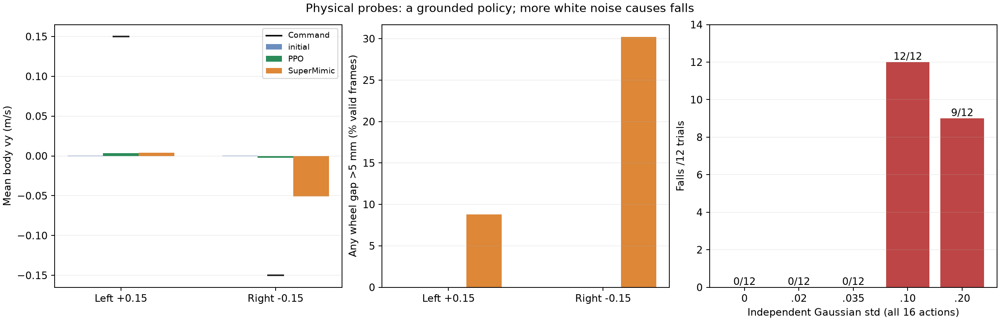
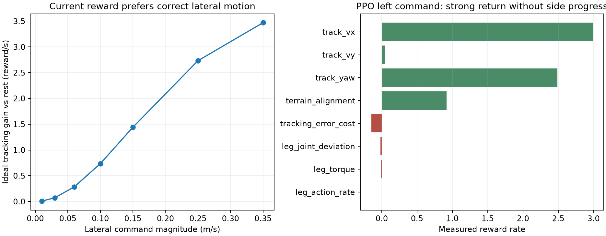
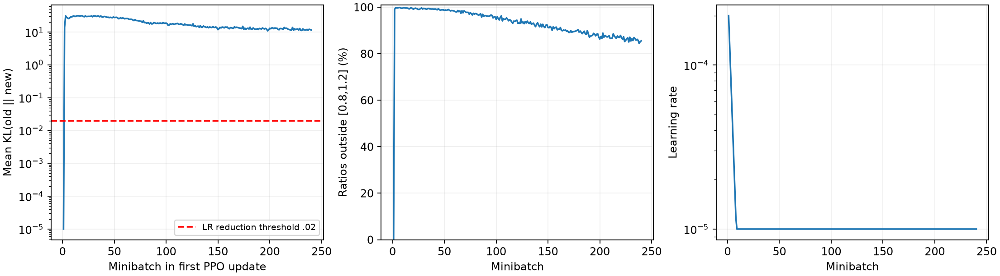
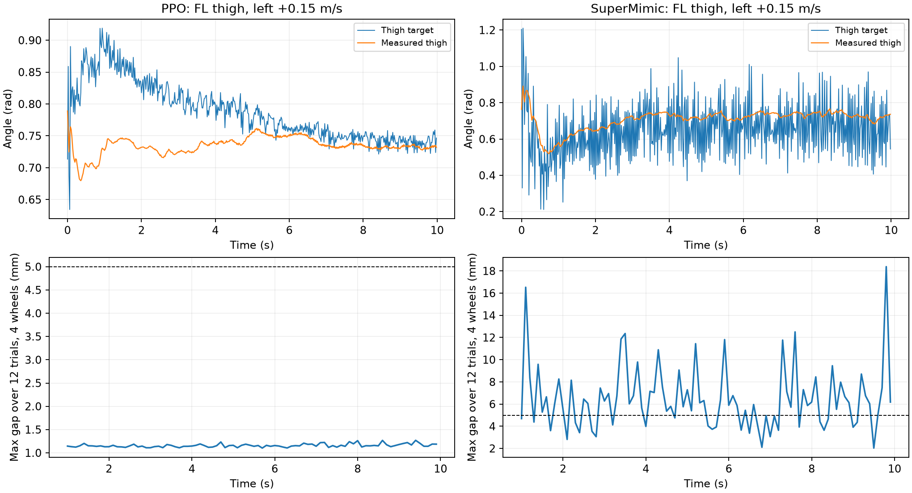

# Go2W 横移训练困难：物理、奖励、探索与优化诊断

日期：2026-11-15。基于已完成的 SuperMimic/PPO 两小时实验、训练源码快照、公开固定版本配置，并新增短程物理诊断。当前证据最支持：**策略停留在四轮持续接地的滚动/站立行为附近，没有探索出可重复的侧向换支撑动作；小噪声、初始化和优化尺度失配使这种行为持续存在。** 横移命令幅度和奖励可以进一步改进，但不能解释为“没给命令、没有横移奖励”。

本报告的结论针对当前模型和训练流程，不是 Go2W 天生不能横移的结论，也没有用加大摩擦、修改轮胎或缩窄关节范围来改变任务。

## 1. 先区分已验证事实与机制推断

|因素|本次判断|依据与边界|
|---|---|---|
|没有足够横移命令|作为主要解释不成立|配置及 819,200 次采样检查：约 10.44% 为平地纯横移，幅度均值 0.130 m/s，正负均衡；这是采样器验证，不是补造整个历史训练的分桶计数|
|横移奖励没有方向性|不成立|0.15 m/s 命令处，理想横移相对静止增加 1.441 reward/s，静止处奖励对正确侧向速度的导数约 +14.62|
|腿关节范围过小|当前版本不支持此解释|保留部署机械范围 95%；FK 显示默认姿态附近 ±0.15 rad 的关节组合已经有约 5 cm 的轮心抬升空间；FK 不等于动态可行性证明|
|四轮接地，缺少侧步|强直接证据|新物理诊断中，PPO 的 ±0.15 m/s 横移指令下，采样时刻没有轮胎几何间隙超过 5 mm；实际 vy 约 ±0.003 m/s|
|当前探索不能产生稳定侧步|强局部证据|小噪声保持近乎不动；全动作独立噪声放大到 0.10 后，PPO 12/12 跌倒；不能据此推断合理的结构化探索也无效|
|奖励中的稳定存活回报抑制尝试|合理机制，尚未做训练消融|不横移仍可获得约 6.26 reward/s；尝试侧步会冒丢失姿态、零 vx/yaw 跟踪和回合余下回报的风险|
|PPO 更新尺度与探索分布失配|强首轮证据，需后续消融|初始 std=0.02，首轮 KL 严重超标，随后学习率降至下限；不能将这套固定配置 PPO 当作已充分调优的 PPO|
|WM 是唯一根因|不成立|没有 WM 的 PPO 也横移失败；但 SuperMimic 的模型误差和动作高频抖动可能放大问题|
|纯本体感知本身做不到|没有证据|历史观测和可学习估计器可以支持本体感知运动；当前短历史与缺少速度估计可能增加难度，尚未验证为主因|

## 2. 为什么 Go2W 的横移和前进不是同一种难度

### 2.1 轮速对前后方向有直接作用，对横向没有同样的直接作用

当前模型的四个轮关节轴均为局部 Y 轴，没有独立的轮子转向自由度。默认平直姿态下，前左轮的世界轴约为 `(0, 0.9950, 0.0998)`。绕该轴旋转，在地面接触点产生的单位滚动速度方向约为 `(-0.9950, 0, 0)`：Y 分量为零。符号随接触向量及转速约定改变，这里关键是没有侧向分量。

因此，机器人可以在腿相对静止时调轮速完成前进；左右轮差速也能提供偏航力矩，虽然转弯会涉及滑动摩擦。**增加轮速不能直接变成保持身体朝向的横移。** 四轮持续接地时，改变髋关节可以产生一次性的侧向身体挪动，但要重复产生净位移，需要卸载/换支撑，或依赖持续侧滑等其他接触机制。

这不意味着所有有效横移都必须采用某种固定步态。当前关键是要学会接触状态和腿部运动的协调，而非只学一个更大的 vy 输出。

### 2.2 当前策略实际没有进入这种协调运动

新增物理诊断采用同一 `omni_v3` task contract，36 组设置 ×12 副本，共 432 次首回合，最长 10 s。包含三份策略的确定性命令和初始/PPO 策略的噪声探测。出生扰动使用同一随机种子的一组合法 xy/yaw 偏移；这是新的局部诊断，不替代原先三个 reset seed 的 660 次标准评测。

轮胎间隙通过编译后的碰撞网格和当前仿真 qpos 重建，计算网格最低点与平地的距离；1 s 后每 0.1 s 采样。它是几何代理，不是接触力传感器，不能判断支撑力分配。

|策略|命令 vy|实际 vy/m/s|任一轮胎间隙 >5 mm 的有效采样比例|跌倒/12|
|---|---:|---:|---:|---:|
|初始策略|+0.15|+0.0004|0%|0|
|初始策略|−0.15|+0.0002|0%|0|
|PPO|+0.15|+0.0033|0%|0|
|PPO|−0.15|−0.0023|0%|0|
|SuperMimic|+0.15|+0.0040|8.80%|0|
|SuperMimic|−0.15|−0.0508|30.19%|1|

SuperMimic 的右移有有限响应，但伴随约 +0.0457 m/s 的前向漂移、+0.0717 rad/s 的偏航，并有一次跌倒；这不是可靠的纯横移。间隙 >2 cm 的比例仅约 1.49%，与稳定、清晰的换支撑行为仍有差距。

PPO 横移时的实际膝关节时间标准差约 0.026–0.030 rad，股关节约 0.029–0.052 rad。它并非完全不输出腿动作，但这些动作没有形成有效抬轮和持续侧移。

### 2.3 关节能到达，不等于探索能到达

当前腿部目标保留机械位置区间的 95%，没有重新收窄。固定基座 FK 中，单腿三个关节在默认位置周围 ±0.15 rad 的组合，轮心 Y 方向跨度约 9.8–9.9 cm，最大抬升约 5.0–5.1 cm。±0.30 rad 时，最大抬升约 10.4–12.0 cm。

这是运动学工作空间，忽略了自碰撞筛选、平衡、驱动力和接触动力学。因此能排除“位置目标根本不允许抬脚”这一简单解释，但不能证明这些姿态都能动态执行。当前失败更像是没有找到通往可行步态的动作序列。

## 3. 奖励确实鼓励横移，但稳定不动已经有很高的回报

### 3.1 当前横移奖励有明确的正确方向

v3 使用 y 跟踪权重 3.0、sigma_y=0.20，并增加平滑误差成本，y 权重 0.60。考虑其他状态和动作相同的理想化比较：

|vy 命令/m/s|静止→理想跟踪的奖励率增益|
|---:|---:|
|0.03|0.072|
|0.06|0.285|
|0.10|0.734|
|0.15|1.441|
|0.25|2.732|

实际单步奖励还要乘 0.02。0.15 m/s 命令下，单步理想增益约 0.0288。静止处的奖励对 vy 的导数约 +14.62 reward/(m/s)，导数方向正确。

zero-speed baseline 在固定命令下主要减去状态无关量，不能凭它的存在就断言静止是即时奖励的最优解。当前 stop gate 的宽度已收窄到 0.02；0.15 m/s 命令下的显式站立奖励几乎为零，之前的小命令 stop gate 渗漏已不是这里的主要解释。

**但奖励对速度有导数，不等于对可执行动作序列有一条容易发现的改进路径。** PPO 需要探索轨迹中“某些动作导致侧向进展”的统计关联；SuperMimic 还需要 WM 在换接触附近提供可信的动作到运动导数。

### 3.2 不横移时，零前进和零旋转仍能拿到大量奖励

纯横移命令 `(0, 0.15, 0)` 中，x 和 yaw 的目标都是零。当前 PPO 几乎不动时，新增诊断的平均奖励率分解为：

|项|平均奖励率|
|---|---:|
|x 跟踪|+2.987|
|y 跟踪|+0.043|
|yaw 跟踪|+2.486|
|姿态/地形对齐|+0.921|
|平滑速度误差成本|−0.146|
|腿偏离默认姿态|−0.0167|
|腿力矩|−0.0130|
|腿动作变化|−0.00019|
|合计，包含其他小项|**约 +6.259**|

这说明两件事：

1. 当前行为的主要回报来自“没有前后漂移、没有旋转、保持直立”；横向成功是需要冒险争取的额外收益。
2. 在已经不横移的状态中，腿偏差和动作变化惩罚很小。没有证据支持把它们直接判为唯一主因，更不能认为删掉动作惩罚就一定能学会侧步。

开始侧步时，机器人可能先发生身体倾斜、前后漂移、偏航和短暂速度误差，甚至终止回合。最终正确横移的稳态奖励更高，但中间尝试的回报可能更低；未完成步态探索的策略容易继续留在安全接地区域。

这是对训练路径的机制解释，**不是已证明的全局或局部数学最优解**。奖励消融尚未进行，不能仅用这一张分解表判定是哪一项压制了成功步态。

## 4. 探索与初始化是更优先的排查对象

### 4.1 训练从已有滚动策略开始，初始横移接近零

两个两小时实验共享同一初始 Actor。这份 Actor 来自旧 Go2W 策略的物理目标映射初始化，作用是保留站立和滚动稳定性，而不是导入四足 Go2 的侧向步态。它初始的纯横移实际速度基本为零，新增诊断也没有测到超过 5 mm 的轮胎离地。

因此初始化降低了早期跌倒风险，同时也把策略放在了一个没有侧步的行为区域。从这里靠独立、短时的小扰动发现多关节协调换支撑，难度明显高于继续改进轮速控制。

### 4.2 本轮 PPO 的初始探索幅度偏小，且不能只比较归一化 std

本轮为了与 SuperMimic 的真实采集幅度对齐，将 PPO Gaussian 初始 std 设为 0.02，之后可学习，最终各维约 0.027–0.040。完整机械范围仍然可达，但典型探索只在策略均值附近。

由于动作映射是非对称的默认姿态到机械端点，std=0.02 在默认动作附近对应约：

- hip 目标标准差 0.020 rad；
- thigh 目标标准差 0.049 rad；
- calf 目标标准差 0.018 rad；
- wheel 速度目标标准差 0.30 rad/s。

这些是目标值的统计量，实际关节运动还受到 PD、惯性和接触限制。**目标范围很宽，与探索经常覆盖宽范围，是两件不同的事。**

### 4.3 简单加大独立噪声不能解决协调问题

在最终 PPO Actor 上施加独立 Gaussian 噪声，作用于全部 16 个归一化动作，每 20 ms 更新：

|噪声 std|跌倒/12|观察|
|---:|---:|---|
|0|0|近乎不横移|
|0.02|0|仍近乎不横移|
|0.035|0|仍近乎不横移|
|0.10|12|大量失稳，不能把跌倒前的侧向速度视为跟踪成功|
|0.20|9|仍大量失稳；单个种子的结果不要求随噪声单调|

把 std=0.10 的噪声保持 5 或 10 个控制步，也分别跌倒 11/12 和 10/12。初始策略上同类实验同样没有产生可靠侧步。

这里不能得出“更强探索没用”。它说明**全关节独立噪声不是好用的侧步探索器**。更值得试的是按物理单位分配腿/轮探索、低频平滑扰动、低维协调动作，或者短暂的侧步示范初始化。

### 4.4 对照公开 Go2W PPO：当前设置不是一套充分调优的 PPO

固定版本的 [LocoWheeledLegged PPO](https://github.com/zhaozijie2022/LocoWheeledLegged/blob/015b8230b1a21331ab6d2b054a2ef8f1e435db84/locowheeledlegged/config/go2w/agents/rsl_rl_ppo_cfg.py) 和 [robot_lab Go2W PPO](https://github.com/fan-ziqi/robot_lab/blob/26acb225aad129e222da7a34ba11f39e29b73e39/source/robot_lab/robot_lab/tasks/manager_based/locomotion/velocity/config/wheeled/unitree_go2w/agents/rsl_rl_ppo_cfg.py) 都使用初始 std=1.0、学习率 1e-3、24 步 rollout、5 epochs、4 minibatches、gamma=0.99、lambda=0.95。

但不能把 1.0 直接复制到我们的全范围动作上。Loco 的[动作配置](https://github.com/zhaozijie2022/LocoWheeledLegged/blob/015b8230b1a21331ab6d2b054a2ef8f1e435db84/locowheeledlegged/config/go2w/locomotion_env_cfg.py)是腿位置 scale=0.25、5 Hz 低通，轮速 scale=5、15 Hz 低通；robot_lab 的[任务配置](https://github.com/fan-ziqi/robot_lab/blob/26acb225aad129e222da7a34ba11f39e29b73e39/source/robot_lab/robot_lab/tasks/manager_based/locomotion/velocity/config/wheeled/unitree_go2w/rough_env_cfg.py)则把 hip scale 设为 0.125、其他腿关节 0.25、轮速 5。公开实现的典型物理探索和滤波方式与我们差别很大。

本轮固定配置对照保留了物理和奖励公平性，但把 SuperMimic 的小采集噪声作为 PPO 初始噪声，是一个需要承认的方法限制；不能由这一次失败判定 PPO 无法学习横移。

## 5. PPO 的 KL 调度与更新颗粒度

原训练日志显示：初始学习率配置为 2e-4，第一轮结束已为 1e-5，此后所有已记录迭代保持这个下限。最终 std 缓慢增加到平均约 0.035。

原生 RSL-RL 对每个 minibatch 测量旧/新策略 KL：高于 0.02 则学习率除以 1.5，低于 0.005 则尝试提高学习率。小 std 下，相同均值变化产生更大的 KL。以 16 个轴 std 都为 0.02、各轴均值发生相同变化的简化 Gaussian 估算，要保持总 KL≈0.01，每轴均值变化约只有 0.00071。真实更新不要求每轴相同，也不能将这个数当作硬动作限幅。

本轮 rollout 是 `4096×24=98,304` 条转移，minibatch=2048，因此每个 epoch 有 48 次 optimizer step，5 epochs 共 **240 次**。参考配置是每个 epoch 4 次，共 20 次。两者每条样本都训练 5 遍，但 Adam 更新次数、梯度噪声和 KL 调度频率不同。

实际补充诊断得到更强的证据：在同配置、同初始 Actor 的第一轮更新中，第 2 个 minibatch 的平均 KL 已达 **13.88**，而调度降低学习率的阈值仅为 0.02；峰值约 31.59，第 9 个 minibatch 就降到了 1e-5。240 个 minibatch 中有 239 个超过 0.02，末尾 KL 仍约 11.56。第 2 个 minibatch 有 99.12% 的 likelihood ratio 落在 `[0.8,1.2]` 之外；除首个 minibatch 外，平均越界比例约 93.55%。这不是“全部越界样本都没有梯度”的意思。两次诊断的 value/surrogate/entropy 平均损失与原长训第一轮逐值相同。

因此这里的问题不只是“学习率低，进步慢”。**开始的均值更新相对狭窄的动作分布过大，造成旧 rollout 与当前策略迅速失配；随后降低学习率又没有把这一轮旧/新分布拉回设定 KL 范围。** 原生 PPO 的 clipping 不等于把 KL 硬限制在 0.01，也不等于每次越界都会停止更新。不能用损失有限、训练没崩溃来代替这一项优化质量检查。

这是当前 PPO 配置的实质性局限，应先修复更新尺度和探索分布的匹配，而不是直接提高学习率。它对横移这种尚未建立的技能尤其不利，但本次没有训练消融证明它是唯一根因。

本次共做两次相同首轮更新的内存诊断，第二次补充记录 likelihood ratio；均不保存新策略或修改已有资产。详见附件 `ppo_first_update_kl.json` 与 `ppo_first_update_kl_clip.json`。这些是首轮诊断，不是对整个两小时所有 minibatch 的回溯测量。

## 6. 为什么之前四足 Go2 横移较好，不能直接推断 Go2W 也应同样容易

此前 [Go2 全向训练报告](go2_omnidirectional_terrain_training.md)中，±0.20 m/s 纯横移的 XY RMSE 约为 0.034/0.030 m/s，确实比当前 Go2W 好很多。但它们有几个重要差异：

- Go2 没有靠轮速滚动的低成本解，前进学习本身已经需要摆腿和换支撑；横移可以复用已有运动协调。Go2W 的滚动初始化没有提供这一先验。
- 本地 Go2 模型总质量约 15.21 kg，Go2W 约 19.13 kg，增加约 25.8%；每个 Go2W 轮体质量为 0.98 kg。腿末端负载和接触几何改变，不能把旧步态当成相同动力学。
- 已训练 Go2 的报告明确包含对角支撑和滑足项，而 Go2W 当前没有这些项；Go2 也有不同的方向奖励和训练历史。因此不是只增加四个动作维度的同任务对照。

为核查复用思路，本次额外做了一个严格受限的零样本移植：把 Go2 的腿关节目标映射到 Go2W 全范围动作，去掉轮速观测、恢复旧 previous-action 坐标，四轮目标速度置零，不做任何拟合或训练。8 类命令 ×12 副本，96 次均跌倒，多数未存活到 1 s。

这只说明**直接拷贝旧策略不足以适配轮足模型**。它不否定用户提出的“借旧 Go2 动作做短暂示范/适配”思路，也不能判断带轮速适配、动力学约束和逐步训练的模仿方法是否有效。更合理的复用对象是抬脚、换支撑和侧向落脚的运动结构，而不是无适配的旧 action 序列。

## 7. SuperMimic 还有两个额外困难

### 7.1 WM 学到了常见的小运动，不代表学到了换支撑

PPO 不使用 WM 仍然失败，所以 WM 不是共同失败的必要原因。对 SuperMimic 而言，当前数据主要来自接地静止、小摆动和滚动；即使这些轨迹预测逐渐准确，也不能保证较大摆腿、轮子卸载和重新接触时的动作导数准确。

已有最终评测中，左移 0.15 场景 H16 的线速度向量 RMSE 约 0.045 m/s，右移约 0.058 m/s；这些来自每场景 36 个新窗口，真实行为本身大多仍接近静止。它们既不是逐轴 vy 误差，也不是成功侧步状态的模型验证。

因此不能用“训练次数更多、总体 loss 更低”替代有效侧步区域的数据覆盖和导数诊断。共享 WM 仍应持续更新；这次没有冻结、重启或改写该资产。

### 7.2 动作目标抖动并不等于腿真的摆起来

本次左移诊断中，SuperMimic 腿目标的时间波动明显大于实际关节波动。对 1–10 s、12 副本和全部腿目标的频谱汇总，8 Hz 以上的目标波动功率约占 82%；PPO 同场景约 3.5%。图中给出一个副本的前左 thigh 目标与实际角度。

这支持进一步排查高频动作与执行响应的脱节。它还不能证明 WM 导致抖动，也不能仅凭这一个阈值判定全部高频成分都无效；需要匹配真实控制响应和模型导数的消融。

## 8. 观测和时间尺度：次要但值得验证

当前 Actor 的 5 帧、50 Hz 历史跨越 80 ms，没有真实线速度、线加速度、接触力或长期隐状态；轮速主要帮助前后向运动，对侧向速度缺少同样直接的线索。侧步的状态估计与支撑相位恢复因此更难。

但这不是物理上的不可实现性。关节、角速度、重力、动作历史与接触假设可以提供运动线索。[DreamWaQ 原论文](https://arxiv.org/html/2301.10602)使用本体观测历史估计身体速度和隐状态，但原论文是四足，不能把它当成 Go2W 成功证据；[Loco Go2W 配置](https://github.com/zhaozijie2022/LocoWheeledLegged/blob/015b8230b1a21331ab6d2b054a2ef8f1e435db84/locowheeledlegged/config/go2w/locomotion_env_cfg.py)的 Actor 也移除了真实 base linear velocity，并保留历史。因此“必须给 Actor 加高程或真值速度”不是目前证据要求的结论。

PPO 的 rollout 长 0.48 s，gamma 对应约 2 s 的折扣时间尺度，gamma×lambda 的 GAE 权重衰减时间常数约 0.326 s；SuperMimic v3 的显式想象 H16 长 0.32 s。开始侧步需要连续的卸载、摆动、落地和恢复，短时反馈可能较难给启动动作分配收益。Critic 的 bootstrap 能传递更远回报，这些时长不等于学习的绝对视野上限。时间尺度应排在探索/初始化之后做消融，不宜同时更改所有模块。

公开轮足研究也表明滚动与步行的代价、策略行为不同。[Lee 等的轮足工作](https://arxiv.org/html/2405.01792v1)报告：平地主要滚动，遇到不平地面时学习切换步态，而非预设 CPG；但其低层使用外感地形与循环网络，不能作为当前纯本体配置的直接复现。它说明滚动/步行是需要学习协调的行为切换，也说明固定手工步态并非普遍必要条件。

## 9. 下一轮建议：先验证“能不能学到侧步”，再做复杂多任务优化

### 先做 PPO 首轮校准，再建立平地侧移专项

先用几轮更新确认 PPO 的 KL 与 ratio 越界得到控制，不要直接再启动两小时长训。随后建议单独建立短程诊断配置，保持关节范围、模型、力矩、纯本体 Actor 的原则不变，先固定平地，以 ±0.12–0.20 m/s 纯横移为主，保留少量停止、前后向和旋转 guard。目的是让成功侧步不再被复杂楼梯与大量其他行为稀释；不是因为现有横移命令完全没覆盖。

腿/轮分别设置探索，以物理目标 rad 或 rad/s 进行审计。优先比较平滑的低频扰动、少数协调动作基元、短暂的四足侧步运动结构初始化。不要直接把归一化 Gaussian std 放大到开源的 1.0；也不要把本次独立噪声失败推广为所有探索都失败。

如果借用 Go2，限制成一个小型适配实验：保留轮足动力学和力矩，先验证数秒内的侧向换支撑，再决定是否值得做动作模仿。没有必要先收集庞大的网上数据集或长期投入 SuperMimic 模仿阶段。

### PPO 优化设置与探索方式分别消融

在同一侧移任务上，单独比较当前 48 minibatches 与更少、更大的 minibatches；记录每轮 KL、clip fraction、Actor/Critic 梯度、逐维 std、实际关节目标变化。重新选择与物理动作映射相适应的探索和单次均值更新尺度，必要时区分 Actor/Critic 学习率，确保 KL 尖峰和 likelihood-ratio 大面积越界确实消失，再检查学习率是否仍在开始阶段贴住下限。

这一步与奖励改动分开，否则无法区分“探索发现动作”和“奖励更喜欢动作”。当前 716 轮和 7039 万条转移不等于经历了大量成功侧步。

### 奖励和课程随后做最小消融

如果已经出现可重复侧步，但学习仍主动退回站立，再比较移动命令下的正则门控、横向误差权重或进度项，检查是否在真正的侧步轨迹中被姿态、漂移或动作成本压制。先比较实际成功/失败步态的奖励分解，再决定删减哪个项。

零 vx/yaw 跟踪本来就需要保留，以避免用斜行或转身掩盖横移失败。也不应直接删除全部姿态/力矩成本，或用奖励侧向速度绝对值来奖励反向运动和跌倒。

### 后续：回到统一速度跟踪与楼梯任务

平地侧移达到稳定门槛后，再混回滚动、旋转和楼梯，持续检查技能保持。对 SuperMimic，将真实成功侧步窗口纳入同一 WM 资产的训练，评估换接触窗口及动作导数；不能只增加原有静止窗口的 WM 拟合次数。

建议专项验收同时要求：左右两向、命令 0.10/0.15/0.20/0.25 m/s；完整 10 s、跌倒率、vy RMSE、vx 漂移、yaw 误差、侧向实际位移，以及换支撑证据。可以先以 `|vx|<0.05 m/s`、`|yaw|<0.1 rad/s`、`vy RMSE<0.05 m/s` 为候选目标，但这些阈值是建议，不是本轮已经达到的结果。

## 10. 证据与复现边界

[便携证据目录](validation/go2w_lateral_20261115/README.md)包含物理诊断汇总、奖励/FK/命令采样解析、模型质量审计、PPO KL/likelihood-ratio 诊断、频谱结果、图表和脚本。完整轨迹 NPZ、外部源码缓存及所有模型权重保留在本地 `research/go2w_lateral_20261115` 与既有训练目录，不复制进报告附件。

诊断使用 `runs/go2w_ppo_2h_20261115/source_snapshot/src`，严格比对三份 Go2W Actor 的 task contract；Go2 零样本移植是明确标注的跨机器人探测。奖励逐步重构并与实际环境单步 reward 对齐，容差 `atol=2e-5, rtol=1e-4`。

本次完成短程物理推理、解析检查和两次相同首轮的内存 PPO 更新诊断；没有启动新增长训，没有覆盖原训练策略、优化器或共享 WM，没有修改生产任务奖励、动作范围、传感输入或物理模型。未做跨训练种子、跨地形图、实机或系统性奖励/探索消融，机制排序仍需后续实验确认。
