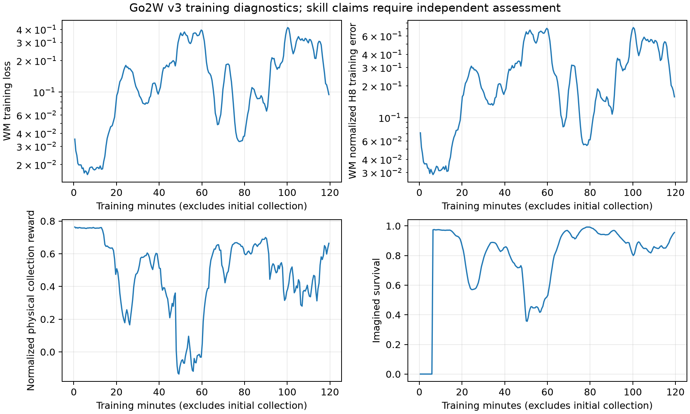
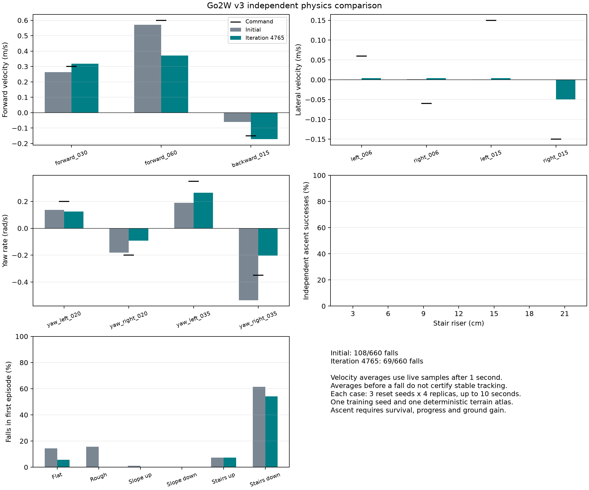

# Go2W 全向跟踪与楼梯：v3 两小时实验

日期：2026-11-14。用户目标：纯本体感知下改善 Go2W 速度跟踪，尤其横移/旋转，并学习上楼梯；保留宽关节可达范围，继续积累同一份 WM。本报告记录一版优化与固定两小时训练，不能把初始化或训练 loss 当作达标证据。

## 实验状态与来源

正式训练北京时间 16:10:25 启动，18:10:29 保存结束，自动标准评测于 18:11:06 完成。训练记录用时 7202.79 秒，运行目录为 `runs/go2w_omni_v3_2h_20261114`，状态见 [supervisor_status.json](../../runs/go2w_omni_v3_2h_20261114/supervisor_status.json)。**本版改善了部分速度场景与低台阶尝试，但没有达到可靠全向跟踪和超过 20 cm 上台阶的目标。**

使用前轮独立源代码快照，叠加本次 Go2W 任务、配置和工具，保留源码清单。工作区其他 Go2、共享 learner/replay 的已有未提交修改未混入训练。

## 设计依据

复核前期 [轮足奖励与课程调研](go2w_reward_curriculum_research_20261113.md) 与缓存开源源码：

- [LocoWheeledLegged](https://github.com/zhaozijie2022/LocoWheeledLegged/tree/015b8230b1a21331ab6d2b054a2ef8f1e435db84)：按轴速度奖励与课程、腿轮分别正则化。
- [robot_lab Go2W](https://github.com/fan-ziqi/robot_lab/blob/26acb225aad129e222da7a34ba11f39e29b73e39/source/robot_lab/robot_lab/tasks/manager_based/locomotion/velocity/config/wheeled/unitree_go2w/rough_env_cfg.py)：较简洁的速度跟踪、动作变化与腿轮加速度项；不引入额外步态要求。
- [盲爬楼梯研究](https://arxiv.org/html/2402.06143v1)：从较低障碍逐步推进，区分接近入口与实际爬升。论文 Actor 输入与本任务不同，不能照搬其能力结论。

继续使用 SuperMimic 的真实数据采集、WM 多步拟合、可微想象 Actor 更新与 Critic 训练。本次新增的平滑误差成本与动作初始化是针对本仓库的工程选择，未声称是上述开源项目的原算法。

## 本次改动

配置 owner：[omni_v3.yaml](../src/unisupermimic/conf/supermimic/task/go2w_velocity/omni_v3.yaml)。

|项目|上一版宽范围实验|v3|
|---|---|---|
|关节目标范围|机械区间 95%|保持同一映射、物理与力矩约束|
|WM|持续更新资产|加载同一网络、归一化统计、Adam 与计数，仍在线更新|
|Actor 初始化|从随机 Actor 开始，已失稳|从旧 Go2W 策略短暂拟合相同物理关节目标|
|采集动作噪声标准差|0.10|0.02|
|前向/侧向/yaw 高斯跟踪权重|2.5 / 1.5 / 2.0|3.0 / 3.0 / 2.5|
|侧向/yaw sigma|0.15 / 0.30|0.20 / 0.35|
|大误差跟踪梯度|高斯项远处趋零|附加平滑绝对误差成本，轴权重 0.25 / 0.60 / 0.30|
|腿动作变化成本|按归一化动作差|按实际关节目标差，参考单位 0.25 rad|
|最低高度软成本|-5，阈值 0.22 m|-40，阈值 0.25 m|
|地形对齐正奖励|0.4|1.0|
|平地/楼梯关节偏离权重|-0.030 / -0.008|-0.020 / -0.003|
|横移/旋转起点采样权重|0.15 / 0.12|0.26 / 0.20|
|平地命令范围 vy/yaw|±0.15 m/s / ±0.35 rad/s|±0.25 m/s / ±0.60 rad/s|
|Actor 地形起点准入|截至已测 mastery|最多高于已测 mastery 一个等级|

平滑成本为 `-Σ w_i (sqrt(1 + ((v_i-c_i)/sigma_i)^2) - 1)`：目标处为零，远离目标时仍有指向目标的梯度。真实转移与想象使用同一实现。Actor 输入仍是 5 帧本体历史与速度命令；高程只供 WM/训练任务使用。

保持 512/4096 环境的分级 WM 覆盖；其身份不认证 Actor mastery。其余环境从 skill 课程开始，WM 补充训练阶段也不把全部环境移到高等级。楼梯前向命令缩至 0.20–0.45 m/s，并降低横移/yaw 干扰，让楼梯尝试更集中。每个领域最多提前一个等级的 Actor 起点使用真实采集窗口，不把所有高等级一次放开。

## 短暂动作初始化与训练前评测

教师为既有 `go2w_curriculum_4096_b2048_H16_20261112_183910/training/last.pt`，没有使用新网上动作数据集或长时间模仿学习。采集 256 环境 × 256 步 = 65,536 条样本，将原 `default + 0.25a` 转为宽范围下相同物理目标，并同步转换历史中的执行动作。拟合 Actor 800 次，总用时约 10.9 秒；随后该监督阶段结束。

随机留出转移上的腿目标 RMSE 0.01343 rad、轮动作 RMSE 0.02835；这不是独立物理性能保证。独立 660 次首回合物理评测：108 次跌倒；停止、0.3/0.6 m/s 前进、低速横移场景均 0/12 跌倒；0.3 m/s 命令实际 vx=0.2627 m/s。侧向命令 ±0.15 m/s 时实际 vy 仍接近零；3 cm 楼梯入口仍有跌倒，更高楼梯主要停滞。

证据：[动作初始化记录](../../runs/go2w_omni_v3_2h_20261114/bootstrap/actor.json)、[训练前评测](../../runs/go2w_omni_v3_2h_20261114/evaluation/bootstrap.json)。

此前快速稳定性诊断使用不同出生/命令配置，只作为排查，不作为本轮横向比较基线；正式比较使用上述统一 660 次评测。

## 两小时训练与验证协议

4096 环境、batch 2048、WM window 8、Actor horizon 16、每轮 10 次 WM 更新。开始前完成同配置 4096 环境冒烟训练 3 轮，WM 累计更新 11,790 → 11,820；正式训练从 11,820 继续。Actor/Critic 重新初始化优化器；前 250 轮仅补充 WM，随后 50 轮 Critic 预热，再以 0.05 倍 Actor 学习率、1000 轮渐增训练。统一 WM 位于 `artifacts/world_models/go2w_conditioned.pt`。

后台监督进程会在训练预算结束后执行 55 场景 × 3 reset seed × 4 副本的 660 次独立策略评测、保存新物理窗口，并在共同留出数据和本轮初始化留出数据上评估 WM 的 H1/H8/H16 误差。3 个 reset seed 只改变出生扰动，不是 3 次独立训练。

楼梯入口通过要求 10 秒存活、前进至少 2.1 m、侧移不超过 0.6 m、速度/yaw 误差达标；上楼梯成功额外要求实际地面高程爬升。台阶等级 1–7 为 3–21 cm。没有有效后段样本时记录 null，提前跌倒不计为零误差。

实现回归：89 passed、1 skipped；Ruff 与 `git diff --check` 通过。新增测试覆盖大误差跟踪梯度与不同动作坐标下物理变化成本的一致性。后台训练与后评测入口为 [run_go2w_2h.py](../tools/run_go2w_2h.py)，源快照和进程独立于交互窗口存在。

实际训练源快照另行通过 35 项 Go2W 回归，日志位于运行目录 `snapshot_tests.log`。

## 中途核对：横移命令是否太小

用户提出低横移速度可能不足以驱动动作。按实际采样器生成 100,000 个平地命令：上一版纯横移占 18.25%，纯横移幅度平均 0.0801 m/s，其中 35.26% 小于 0.06 m/s；v3 纯横移占 26.10%，幅度平均 0.1301 m/s，20.74% 小于 0.06 m/s。

只比较同一状态下从静止到准确侧向跟踪的跟踪项收益差，v3 的 0.06/0.15/0.25 m/s 命令分别可增加每步 0.00569/0.02881/0.05463 奖励；其余动作成本未计入。因此小命令可能削弱收益，但 v3 并非没有跟踪驱动。

中途物理检查点显示：

|检查点|跌倒次数/660|主要观察|
|---|---:|---|
|初始化|108|前向稳定、横移近零|
|500 轮|195|0.3 m/s 前向实际 0.3006，倒退 -0.15 实际 -0.1318；横移仍近零|
|1000 轮|486|左移 0.15 命令实际 vy 约 0.267，但 12/12 跌倒；右移仍弱|
|1500 轮|232|前向 0.3 实际约 0.198；横移回到近零，楼梯入口停滞|
|2000 轮|646|多数场景失稳，尚未形成可靠侧移或楼梯能力|
|3000 轮|76|右移 -0.15 命令实际约 -0.0531，0/12 跌倒；左移仍近零，前向偏慢，楼梯未通过|
|4000 轮|325|速度与稳定性再次波动，楼梯仍未通过|
|最终 4765 轮|69|低速前后向改善，右移部分响应，左移仍近零；高前向速度退化，楼梯统一标准未通过|

额外增加 21 个平地场景 × 12 次 = 252 次的大命令评测，包含 ±0.25/±0.35 m/s 横移、±0.6 rad/s 转向。原 660 次标准评测保持一致。**±0.35 m/s 超出 v3 的横移训练范围**，仅作泛化诊断。2000 轮时 +0.25/-0.25 m/s 横移分别 12/12、11/12 跌倒，部分实际方向不符命令，说明单纯增大命令还不足以解决当前控制稳定性问题。

额外评测工具单独归档在运行目录 `evaluation_tools/` 并记录摘要；训练源快照未改变。结果见 `evaluation/bootstrap_extended.json` 与 `evaluation/iteration_002000_extended.json`。

同一旧基线物理留出数据上，500 轮 WM 的平地 H16 位置 RMSE 为 0.00738 m、线速度 0.04934 m/s、腿位置 0.02220 rad，明显小于前轮候选的 0.1539 m、0.6475 m/s、1.4861 rad。这验证稳定运动数据能继续改善同一 WM，但不能以该稳定分布上的预测精度证明新侧移动作的梯度可靠。

2000 轮时，上述共同留出 H16 误差又增至位置 0.04619 m、线速度 0.34784 m/s、腿位置 0.53749 rad。WM 的更新始终在进行：3000 轮 checkpoint 中全部 Adam step 为 41,820，三项归一化 count 为 43,606,016。统一资产在本轮结束回写；训练途中每 500 轮 checkpoint 包含最新 WM。

同步更新不意味着所有分布的误差单调下降。Replay 每环境只保留 256 × 0.02 = 5.12 秒模拟数据，策略改变会逐渐覆盖早期稳定运动；固定地形覆盖也不等于覆盖所有运动方式。当前事实是共同留出精度出现了退化，可能涉及分布漂移、旧数据遗忘、归一化变化和优化噪声，需要用保留数据与独立指标定位，而非推断 WM 被冻结。

## 最终结果

### 训练量与资源

完成 4765 轮、49,053,696 条本轮物理转移，WM 新增 47,650 次更新；累计 WM/Actor/Critic 更新为 59,470 / 4,465 / 90,300。停止原因为 `wall_clock_budget`，训练及标准评测均正常退出。

进程 RSS 峰值 1986.86 MiB，Torch GPU 分配峰值 3631.92 MiB，没有 OOM 或非有限数值。后段每 30 秒采样 167 次：GPU 利用率均值 42.7%、峰值 89%，GPU 总占用峰值 5192 MiB（含桌面/并发评测等）；训练进程平均约 6.97 个 CPU 核心。显存和计算利用率仍有提速空间，不能把瞬时峰值当作全程满载。见 [资源汇总](../../runs/go2w_omni_v3_2h_20261114/resource_summary.json)。

### 独立物理表现

最终共 69/660 跌倒，初始化为 108/660。总体跌倒减少不代表所有任务变好：部分场景变保守，高速前进退化明显。下表为同一批 12 次首回合评测的有效后段样本平均值，发生跌倒时均值不能代表持续稳定跟踪。

|命令|初始化实际值|最终实际值|最终跌倒/12|
|---|---:|---:|---:|
|前向 +0.30 m/s|+0.2627|+0.3185|0|
|前向 +0.60 m/s|+0.5707|+0.3708|10|
|倒退 -0.15 m/s|-0.0606|-0.1725|0|
|左移 +0.15 m/s|+0.0006|+0.0039|0|
|右移 -0.15 m/s|+0.0002|-0.0496|0|
|左转 +0.20 rad/s|+0.1375|+0.1241|0|
|右转 -0.20 rad/s|-0.1818|-0.0915|0|
|左转 +0.35 rad/s|+0.1893|+0.2639|0|
|右转 -0.35 rad/s|-0.5352|-0.2042|0|

右移还伴随约 +0.0440 m/s 前向漂移和 +0.0696 rad/s yaw，不能把单个 vy 改善称为合格全向跟踪。

大命令补测最终结果：+0.25/-0.25 m/s 横移实际 vy 为 +0.0064/-0.0248，均 0/12 跌倒；+0.35/-0.35 时为 +0.0114/-0.1307，后者 10/12 跌倒且存在大幅前向/转向漂移。较大命令没有自动带来可靠横移。见 [最终大命令评测](../../runs/go2w_omni_v3_2h_20261114/evaluation/final_extended.json)。

楼梯统一通过标准：等级 1–7 均 0/12。仍有部分真实进展：

- 3 cm 连续台阶，12 次均存活，前进 1.39–1.96 m，机器人中心下方地面高程最大增加约 8.6–11.9 cm，说明已经进入低台阶爬升区域；未达到 2.1 m 入口通过距离和完整跟踪标准。
- 6 cm 台阶，前进约 0.64–0.80 m，地面高程增加约 5.9 cm，主要越过首级附近，未持续通过。
- 21 cm 台阶，前进仅约 0.39–0.43 m，地面高程增加为零，仍停留入口。超过 20 cm 的目标未实现。

原始证据：[最终评测](../../runs/go2w_omni_v3_2h_20261114/evaluation/final.json)、[初始化/最终对照 CSV](../../runs/go2w_omni_v3_2h_20261114/evaluation/comparison.csv)、[中途检查点汇总](../../runs/go2w_omni_v3_2h_20261114/evaluation/intermediate_summary.json)。本轮保留各 500 轮检查点。3000 轮总跌倒为 76 次，500 轮部分速度更好，但没有任何已评估检查点达到完整目标；未按训练奖励宣称某个检查点最优。

### 同一 WM 的连续性与精度

统一资产已写回 `/home/yifeiy/ws_go2_unilab/artifacts/world_models/go2w_conditioned.pt`。Adam step 11,820 → 59,470；输入/输出/增量归一化 count 均从 12,623,872 → 61,677,568。发布资产与最终 checkpoint 的 WM 张量摘要完全一致，上一版保存在 history；详见 [连续性核对](../../runs/go2w_omni_v3_2h_20261114/continuity_verification.json)。

同一旧基线物理留出集，平地 H16 RMSE：

|WM 版本|位置/m|线速度/(m/s)|腿位置/rad|
|---|---:|---:|---:|
|本轮之前候选|0.15391|0.64750|1.4861|
|本轮 500 轮|0.00738|0.04934|0.02220|
|本轮 2000 轮|0.04619|0.34784|0.53749|
|本轮最终|0.06126|0.43713|0.64962|

在本轮初始化策略另采集的留出集上，最终平地 H16 位置/线速度/腿位置误差为 0.06027 m / 0.44212 m/s / 0.64592 rad，也显示出类似退化。

对最终策略**新采集的前向 0.3 m/s 轨迹**，WM H16 误差却为位置 0.00351 m、线速度 0.02124 m/s、腿位置 0.01719 rad；左移/右移命令轨迹 H16 线速度误差为 0.04496/0.05828 m/s，但左移轨迹本身几乎没有侧移，不能据此宣称模型学会预测侧向步行。21 cm 台阶入口的良好短期预测同样不等于拥有爬升数据。

这组差异支持关注数据分布变化和旧运动覆盖流失：WM 没有冻结或重新创建，但持续更新当前 Replay 不能保证旧轨迹精度单调改善。事实和原因仍需区分，不能只凭当前证据把所有误差归因于遗忘，也不能用低 on-policy loss 覆盖独立留出集退化。

原始 WM 评估：[共同留出集](../../runs/go2w_omni_v3_2h_20261114/evaluation/wm_common.json)、[初始化留出集](../../runs/go2w_omni_v3_2h_20261114/evaluation/wm_bootstrap.json)。

### 后续优先方向

本轮到此结束，不自动追加训练。下一版应优先在继续更新同一 WM 的前提下，长期保留并混合代表性的稳定运动、侧移尝试及地形真实窗口，监测共同留出精度；再验证 Actor 在新动作附近使用的控制梯度和稳定性。奖励与命令幅度仍值得优化，但本轮大命令评测表明，单独提高横移速度范围不足以解决问题。较长想象窗口、Actor 更新幅度和左右动作覆盖应分开验证，避免多项同时变化后无法定位改进来源。
