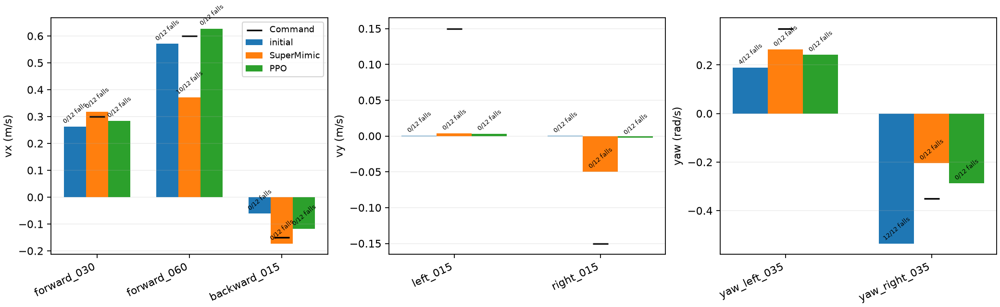
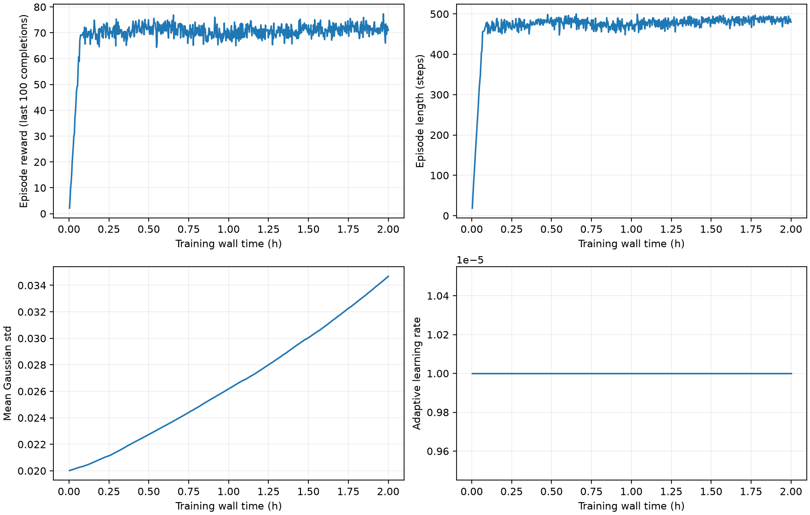

# Go2W PPO 两小时训练与 SuperMimic 对照

本轮使用仓库已接入的上游 RSL-RL PPO，沿用上一轮 `omni_v3` Go2W 任务与同一份初始 Actor。目标是纯本体感知速度跟踪、横移与超过 20 cm 的楼梯运动。

**总体目标尚未达标：3 cm 台阶通过率改善，但纯横移和 6–21 cm 台阶仍是主要短板。**

完成 7200.4 秒训练、716 轮、70,385,664 条真实仿真转移。最终评测跌倒 53/660，SuperMimic 为 69/660。楼梯完整通过 12/84 次。具体结果见下表，单个训练 seed 不能支持算法优劣的普遍结论。

## 配置与可比性

4096 个 MuJoCo 环境，物理步长 0.005 s、控制周期 0.02 s、每回合 10 s。Actor 接收 5×50 维本体历史与 3 维速度命令，网络为 2048/1024/512/256、SiLU、tanh，保留按观测项组织的历史和固定缩放；不接收高程、真实线速度或地形标签。Critic 使用 41 维状态特征与命令，网络 256/128。

奖励、速度命令、地形图、课程与终止条件严格比对上一轮任务 contract。腿关节目标覆盖部署机械区间的 95%，action=-1/0/+1 对应下限/默认姿态/上限；轮速与物理力矩约束保持原配置。平地侧向命令 ±0.25 m/s、yaw ±0.60 rad/s。

PPO 使用 24 步 rollout、2048 minibatch、5 epochs、gamma=0.99、lambda=0.95、clip=0.2、entropy=0.01、起始学习率 2e-4 与上游自适应 KL 调度。Gaussian 初始标准差 0.02，与前轮采集噪声相同，之后可学习。环境额外噪声关闭，避免重复加噪。

算法差异：PPO 在真实 on-policy 转移上更新，没有 WM、可微想象或 Replay 起点 lookahead；固定的高等级覆盖环境也参与 PPO 梯度。Critic 从头训练，使用原生 RSL-RL 输入归一化。PPO 不能按 SuperMimic 的 WM/Actor 更新次数直接对齐，本轮以两小时墙钟预算对照。

共享 WM 未被本次 PPO 调用或写入，训练前后文件 SHA256 一致：True。这不改变此前对 WM 持续更新的要求。

初始 Actor 重跑 660 次物理评测，与上轮初始策略的速度、跌倒、位移及高程指标逐值相同：True。

## 速度跟踪

每个场景 12 次首回合评测，最长 10 秒。速度取首回合存活期间第 1 秒后的样本均值；跌倒前的均值不能证明稳定跟踪。0.6 m/s 等高速前向场景可能提前到达平地边界并截断，未跌倒不代表完成 10 s。下表同时列出完整 10 s 存活数；实际值对应所列命令轴，其他轴误差见 JSON。

|命令|SuperMimic 实际值|PPO 实际值|SM 跌倒/12|PPO 跌倒/12|PPO 存活10s/12|
|---|---:|---:|---:|---:|---:|
|前向 +0.30 m/s|+0.3185|+0.2846|0|0|12|
|前向 +0.60 m/s|+0.3708|+0.6275|10|0|0|
|倒退 -0.15 m/s|-0.1725|-0.1176|0|0|12|
|左移 +0.15 m/s|+0.0039|+0.0032|0|0|12|
|右移 -0.15 m/s|-0.0496|-0.0024|0|0|12|
|左转 +0.35 rad/s|+0.2639|+0.2418|0|0|12|
|右转 -0.35 rad/s|-0.2042|-0.2866|0|0|12|

## 上楼梯

完整通过要求：10 s 存活、前进 ≥2.1 m、侧向偏移 ≤0.6 m、平面 RMSE <0.35 m/s、yaw RMSE <0.4 rad/s，且实际中心下方地面增长 ≥台阶高度−5 mm。只到入口或保持站立不算上楼梯。

|台阶|PPO 跌倒/12|PPO 平均前进/m|PPO 平均高程增长/m|SM 完整通过/12|PPO 完整通过/12|
|---|---:|---:|---:|---:|---:|
|3 cm|0|2.276|0.119|0|12|
|6 cm|0|0.426|0.000|0|0|
|9 cm|0|0.448|0.000|0|0|
|12 cm|0|0.441|0.000|0|0|
|15 cm|0|0.437|0.000|0|0|
|18 cm|0|0.427|0.000|0|0|
|21 cm|0|0.437|0.000|0|0|

## 扩展全向评测

额外 21 个平地场景 ×12 次，包含侧移 ±0.25/±0.35 m/s 和 yaw ±0.60 rad/s。±0.35 m/s 侧移超出训练命令范围。

|命令|PPO 实际值|PPO 跌倒/12|
|---|---:|---:|
|left_025|+0.0031|0|
|right_025|-0.0017|0|
|left_035|+0.0028|0|
|right_035|-0.0178|0|
|yaw_left_060|+0.5165|0|
|yaw_right_060|-0.5687|0|

## 验证与复现

6 项针对性测试通过，覆盖历史重置、Actor 与原策略均值一致、特权信息隔离、超时掩码及上游 PPO 参数更新；4096 环境试跑 8 轮通过，评测支持不加载 WM。正式训练使用上一轮独立源码快照，只叠加 PPO 接口、入口、评测兼容改动和测试，保留工作区其他未提交修改。

[完整证据与复现协议](validation/go2w_ppo_2h_20261115/README.md)、[55 场景对照 CSV](validation/go2w_ppo_2h_20261115/comparison.csv)、[训练汇总](validation/go2w_ppo_2h_20261115/training/summary.json)。三个 reset seed 仅改变同一固定地形图的出生扰动；不是跨训练 seed 或新地形泛化评估。

本地运行目录：`/home/yifeiy/ws_go2_unilab/runs/go2w_ppo_2h_20261115`；策略权重：`training/last.pt`；优化器快照：`training/ppo_resume.pt`。权重仅保留本地，未纳入报告附件。

## 结果解释与后续方向

本轮只验证同一任务配置下的 PPO 基线，没有改变奖励来针对 PPO 调参。扩展侧移命令 ±0.25 m/s 也几乎没有实际响应，横移失败不能仅用评测命令幅度小来解释。训练 Gaussian 标准差由 0.02 增至约 0.035；自适应学习率首轮降至 1e-5，此后保持该值。这些是后续探索幅度和策略更新消融的线索，尚未验证为失败原因。

下一步宜单独比较较强的腿部探索或横移动作初始化，再判断是否需要改奖励或课程。本轮固定配置结果应保留为对照。
