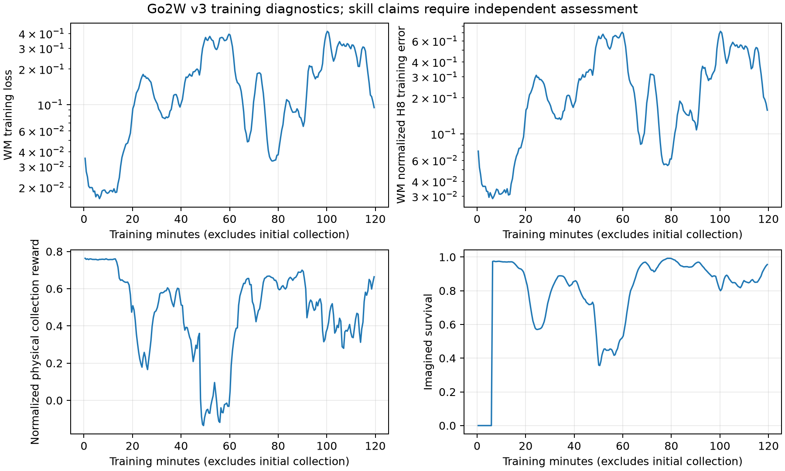
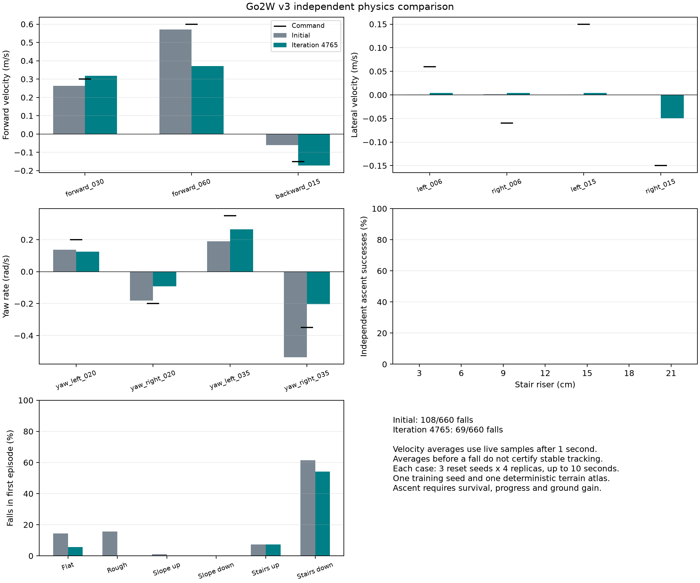

# Go2W 训练阶段报告：速度跟踪、楼梯与持续更新 World Model

整理日期：2026-11-15。实验日期：2026-11-14。训练任务为 Go2W 的纯本体感知速度跟踪与楼梯运动，重点是可靠横移、旋转和超过 20 cm 的上台阶。

**当前尚未达标。** 最新两小时实验改善了低速前后向跟踪和部分低台阶运动，右移出现有限响应；左移基本不跟踪，21 cm 台阶仍停在入口。WM 确实持续更新，但旧运动留出集的预测精度在训练后期退化。

本报告附带可在 GitHub 直接读取的[评测数据、配置与图表](validation/go2w_omni_v3_2h/README.md)。权重、Replay 和物理轨迹二进制保留在本地；附件中的绝对路径用于定位原始实验，不是 GitHub 下载链接。本次发布范围是报告与实验依据，运行实现以记录的源码快照为准，不代表分支当前代码已经包含全部实验改动。

## 1. 任务与方法

Actor 只接收 5 帧本体历史和 3 维速度命令，输入 253 维、输出 16 维，控制 12 个腿关节位置目标和 4 个轮速目标。Actor 不接收高程、真实线速度、接触标签或地形领域标签。WM 使用 41 维紧凑状态和 77 点高程扫描，每一步预测都在预测位姿重新查询高程；高程用于训练中的动力学条件输入。

训练沿用 SuperMimic 的真实数据采集、WM 多步拟合、可微想象 Actor 更新与 Critic 训练。本轮参考已归档的[轮足奖励和课程调研](go2w_reward_curriculum_research_20261113.md)，主要借鉴按轴跟踪、腿轮分开正则和逐级课程。开源研究采用的观测与算法存在差异，不能将其能力直接归于本任务。

实验基于此前训练快照叠加 Go2W 任务改动，排除了工作区其他 Go2 和共享 learner/replay 的未提交修改。见[来源记录](validation/go2w_omni_v3_2h/provenance.json)与[源码摘要清单](validation/go2w_omni_v3_2h/source_manifest.json)。摘要清单提供版本追溯，不替代完整源码或模型文件。

## 2. 关节范围与前期实验

用户确认实机使用本地 `rl_sar/policy/go2w/base.yaml` 和 `robot_lab/config.yaml`。审计同时核对部署 URDF、FSM 和动作输出换算；这是部署文件与模型核对，未做硬件极限测量。

|关节|部署 URDF 位置范围/rad|原训练目标范围/rad|新训练目标范围/rad|
|---|---|---|---|
|Hip|[-1.0472, 1.0472]|左 [-0.15, 0.35]；右 [-0.35, 0.15]|[-0.99484, 0.99484]|
|前 Thigh|[-1.5708, 3.4907]|[0.55, 1.05]|[-1.44426, 3.36416]|
|后 Thigh|[-0.5236, 4.5379]|[0.75, 1.25]|[-0.39706, 4.41136]|
|Calf|[-2.7227, -0.83776]|[-1.75, -1.25]|[-2.67558, -0.88488]|

新映射覆盖机械区间 95%，两端各保留 2.5% 余量，action=-1/0/+1 对应下限/原默认站姿/上限。部署 FSM 折叠目标 `(0, 1.36, -2.65)` 已包含在内，轮速和物理力矩约束未放大。raw action clip ±100 不等于机械可达位置；部署和训练的 PD、默认姿态、顺序及部分力矩参数仍有差异，不能将当前策略视为已部署验证。见[关节审计](validation/go2w_omni_v3_2h/earlier/deployment_joint_range_audit.json)。

此前持续地形覆盖实验为 4096 环境中的 512 个保留各等级数据，Replay 不再只剩最低等级。各等级保留量由 `[1047150,1426,0,0,0,0,0,0]` 变为 `[917504,24576,24576,24576,20480,16384,12288,8192]`。高等级窗口仍主要来自入口尝试，不能当作爬升数据。见[基线审计](validation/go2w_omni_v3_2h/earlier/baseline_replay_audit.json)、[覆盖审计](validation/go2w_omni_v3_2h/earlier/coverage_replay_audit.json)。

|前期实验|结果与限制|
|---|---|
|持续地形覆盖，600 秒|3 cm 场景跌倒由 12/12 降为 0/12，前进约 1.42 m，未达 2.1 m 标准；横移仍近零|
|收窄 stop gate，600 秒|前向实际约 0.152 m/s，横移未改善；没有证明该改动有效|
|宽关节范围，约 20 分钟|随机初始化 Actor 后，660/660 次评测提前跌倒|
|继续同一宽范围 WM/策略，约 136 秒|验证了优化器和统计续接，但仍 660/660 次跌倒|

相关原始结果保存在[前期评测附件](validation/go2w_omni_v3_2h/earlier/)。这些短实验不能证明单个奖励项的因果作用。

## 3. v3 优化与两小时训练

宽范围下直接随机探索失稳，因此先用旧 Go2W 策略做一次短暂的物理目标映射初始化，再进入 SuperMimic。采集 65,536 条转移，拟合 Actor 800 次，总用时约 10.9 秒；腿目标随机留出 RMSE 0.01343 rad。该留出来自同一短采集分布，独立物理表现另行评估。没有使用新的网上动作数据集，也没有持续执行模仿阶段。见[初始化记录](validation/go2w_omni_v3_2h/bootstrap/actor.json)。

|项目|上一版宽范围实验|v3|
|---|---|---|
|动作映射|机械区间 95%|保持不变|
|采集动作噪声标准差|0.10|0.02|
|vx/vy/yaw 高斯奖励权重|2.5 / 1.5 / 2.0|3.0 / 3.0 / 2.5|
|vy/yaw sigma|0.15 / 0.30|0.20 / 0.35|
|大误差成本|无|平滑绝对误差，轴权重 0.25 / 0.60 / 0.30|
|腿动作变化成本|归一化动作差|实际关节目标差，以 0.25 rad 为参考单位|
|最低高度成本|权重 -5、阈值 0.22 m|权重 -40、阈值 0.25 m|
|地形对齐奖励|0.4|1.0|
|纯横移/旋转起点权重|0.15 / 0.12|0.26 / 0.20|
|平地 vy/yaw 命令范围|±0.15 m/s / ±0.35 rad/s|±0.25 m/s / ±0.60 rad/s|
|Actor 地形起点|截至已测 mastery|最多提前一个等级|

平滑成本为 `-Σ w_i (sqrt(1 + ((v_i-c_i)/sigma_i)^2) - 1)`，目标处为零，误差较大时仍提供梯度；真实和想象使用同一奖励实现。持续保留 512 个地形覆盖环境，其采集身份不认证 Actor mastery。楼梯命令集中到前向 0.20–0.45 m/s，并减少侧向和转向干扰。

训练于北京时间 2026-11-14 16:10:25 启动，18:10:29 保存结束，记录用时 **7202.79 秒**；标准自动评测于 18:11:06 完成。4096 环境、batch 2048、WM window 8、Actor horizon 16，每轮 10 次 WM 优化。开始 250 轮补充 WM，随后 50 轮 Critic 预热，Actor 学习率为基准的 0.05 倍并渐增 1000 轮。

完成 **4765 轮、49,053,696 条物理转移**。WM 新增 47,650 次更新，Actor/Critic 本轮更新 4,465 / 90,300 次。停止原因为时间预算。见[训练汇总](validation/go2w_omni_v3_2h/training/summary.json)、[训练参数](validation/go2w_omni_v3_2h/training/args.json)、[配置快照](validation/go2w_omni_v3_2h/config/omni_v3.yaml)。本次同时更改多项设置，无法将结果归因于单个奖励项。

## 4. 独立策略评测

每个检查点采用 55 场景 × 3 个 reset seed × 4 副本，共 660 次首回合物理评测，最长 10 秒。场景涵盖停止、前后向、横移、旋转、混合/时变命令和六类领域的各等级地形。3 个 seed 只改变出生扰动，仍是一个训练 seed 和固定地形图；不能解释成跨训练种子的泛化结论。

速度统计使用首回合存活期间 1 秒之后的样本，无有效样本则为 null。发生跌倒时，跌倒前的平均速度不能证明稳定跟踪。楼梯入口通过要求存活 10 秒、前进至少 2.1 m、侧移不超过 0.6 m、平面/yaw RMSE 达标；上楼梯还要求实际中心下方地面高程增长不少于一个台阶高度减 5 mm。具体计算见[标准评测脚本快照](validation/go2w_omni_v3_2h/protocol/evaluate_go2w_experiment.py)。

### 速度与稳定性

最终跌倒 **69/660**，初始化为 **108/660**。总体跌倒减少，但高速前进退化，部分场景更保守。

|命令|初始化实际值|最终实际值|初始化跌倒/12|最终跌倒/12|
|---|---:|---:|---:|---:|
|前向 +0.30 m/s|+0.2627|+0.3185|0|0|
|前向 +0.60 m/s|+0.5707|+0.3708|0|10|
|倒退 -0.15 m/s|-0.0606|-0.1725|0|0|
|左移 +0.15 m/s|+0.0006|+0.0039|0|0|
|右移 -0.15 m/s|+0.0002|-0.0496|0|0|
|左转 +0.20 rad/s|+0.1375|+0.1241|0|0|
|右转 -0.20 rad/s|-0.1818|-0.0915|0|0|
|左转 +0.35 rad/s|+0.1893|+0.2639|4|0|
|右转 -0.35 rad/s|-0.5352|-0.2042|12|0|

右移同时存在约 +0.0440 m/s 前向漂移和 +0.0696 rad/s yaw，尚不是合格全向跟踪。原始证据：[初始化](validation/go2w_omni_v3_2h/evaluation/bootstrap.json)、[最终](validation/go2w_omni_v3_2h/evaluation/final.json)、[完整对照 CSV](validation/go2w_omni_v3_2h/evaluation/comparison.csv)。

### 横移命令是否太小

按实际采样器生成 100,000 个平地命令，上一版纯横移平均幅度约 0.0801 m/s，35.26% 小于 0.06 m/s；v3 平均约 0.1301 m/s，20.74% 小于 0.06 m/s。v3 的纯横移采样占比约 26.1%。小命令可能削弱驱动，但不能单独解释当前结果。

v3 中，从静止到准确横移的跟踪项收益差，在命令 0.06/0.15/0.25 m/s 下分别为每步约 0.00569/0.02881/0.05463；未计入动作和姿态成本。1000 轮时左移命令 +0.15 m/s 曾产生约 +0.267 m/s，但 12/12 跌倒，说明奖励能驱动运动，稳定性仍不足。

额外 252 次平地评测包含 ±0.25/±0.35 m/s 横移和 ±0.60 rad/s 转向，其中 ±0.35 m/s 超出本轮横移训练范围。最终在 +0.25/-0.25 m/s 命令下实际 vy 约 +0.0064/-0.0248，均未跌倒；-0.35 m/s 时实际约 -0.1307，但 10/12 跌倒并伴随明显漂移。单纯提高命令没有自动带来可靠横移。见[大命令补测](validation/go2w_omni_v3_2h/evaluation/final_extended.json)。

### 楼梯与中途波动

台阶等级 1–7 对应 3–21 cm。最终所有非零楼梯等级均 **0/12 达到完整通过标准**，但存在低台阶的真实进展：

- **3 cm**：12 次均存活，前进 1.39–1.96 m，中心下方地面最大高程增加约 8.6–11.9 cm；进入连续低台阶区域，但未满足 2.1 m 和完整跟踪标准。
- **6 cm**：前进约 0.64–0.80 m，高程增加约 5.9 cm，未持续通过。
- **21 cm**：前进约 0.39–0.43 m，高程增加为零，仍停在入口。

中途总跌倒次数为：500 轮 195、1000 轮 486、1500 轮 232、2000 轮 646、3000 轮 76、4000 轮 325、最终 69。3000 轮右移曾稳定达到约 -0.053 m/s，之后仍有波动。没有任何已评估检查点达到完整目标；不能按训练奖励挑选后声称任务完成。详见[检查点汇总](validation/go2w_omni_v3_2h/evaluation/intermediate_summary.json)及同目录原始评测。

## 5. WM 持续更新及精度变化

同一份 WM 作为持续积累资产，每次恢复网络、输入/输出/增量归一化统计、Adam 状态和累计更新数，然后按 SuperMimic 在线优化。没有冻结 WM；奖励或课程变化不要求重新创建 WM。改变物理或动作坐标则必须校验兼容性，不能把同一归一化 action 解释成不同物理目标。

本轮开始前完成 3 轮冒烟，WM 累计更新从 11,790 增至 11,820。正式训练中 Adam step 从 **11,820 → 59,470**，三项归一化 count 均从 **12,623,872 → 61,677,568**。训练期间每 500 轮保存最新 checkpoint，结束后回写统一资产，上一版保留 history。

本地统一资产为 `/home/yifeiy/ws_go2_unilab/artifacts/world_models/go2w_conditioned.pt`，最终张量 SHA256 为 `ed04040096a0b0254fb58ef18ffa65ef7bf2c1f07e15fa7a2e6df36c7428c490`，与最终训练 checkpoint 一致。资产仍为候选，能力未达标。见[连续性核对](validation/go2w_omni_v3_2h/continuity_verification.json)、[发布记录](validation/go2w_omni_v3_2h/training/world_model_publish.json)。

在同一份旧基线物理留出集上，平地 H16 RMSE 为：

|WM 版本|位置/m|线速度/(m/s)|腿关节位置/rad|
|---|---:|---:|---:|
|本轮之前候选|0.15391|0.64750|1.4861|
|本轮 500 轮|0.00738|0.04934|0.02220|
|本轮 2000 轮|0.04619|0.34784|0.53749|
|本轮最终|0.06126|0.43713|0.64962|

留出物理窗口未进入训练 Replay。跨动作映射比较时重映射到相同物理 PD 目标，并验证重建一致；每个预测步使用相应位姿高程。最终有效平地 H16 窗口为 472 个。详见[共同留出结果](validation/go2w_omni_v3_2h/evaluation/wm_common.json)与[评测脚本快照](validation/go2w_omni_v3_2h/protocol/evaluate_go2w_wm_holdout.py)。本轮初始化策略另采集的留出集上，最终 H16 线速度误差为 0.44212 m/s，结论相似。

但在最终策略新采集的前向 0.3 m/s 轨迹上，H16 位置/线速度/腿位置误差仅为 **0.00351 m / 0.02124 m/s / 0.01719 rad**。这说明精度依赖数据分布。左移命令轨迹上误差较低，也不能说明 WM 能预测侧向步行，因为实际轨迹几乎未侧移。

持续更新不保证所有分布上的误差单调下降。当前 Replay 每环境仅保留 256 × 0.02 = **5.12 秒模拟数据**，Actor 变化会覆盖早期运动。固定地形覆盖不等于覆盖所有运动方式。独立留出集退化是已测事实；旧数据遗忘、分布漂移、归一化变化和优化噪声是待区分的原因，不能仅凭本轮结果确定单一原因。

## 6. 验证、资源与下一步

本轮使用 i5-14600KF、RTX 4070 SUPER 12 GB、16 GB RAM。进程 RSS 峰值约 1.94 GiB、Torch 显存分配峰值约 3.55 GiB，没有 OOM 或非有限数值。后段 167 次资源采样显示 GPU 利用率均值约 42.7%、峰值 89%，训练进程平均约 6.97 个 CPU 核心，仍有性能优化空间；不能将瞬时峰值描述成全程满载。见[资源汇总](validation/go2w_omni_v3_2h/resource_summary.json)。

实验实现阶段工作区回归为 **89 passed、1 skipped**；实际源快照 Go2W 回归为 **35 passed**；Ruff 和 `git diff --check` 通过。该记录不等于运动能力验收。见[核对摘要](validation/go2w_omni_v3_2h/final_verification.json)与[快照测试日志](validation/go2w_omni_v3_2h/snapshot_tests.log)。本次报告发布只核对附件一致性、摘要和链接，不重跑两小时训练。

下一版优先处理以下问题，尚未实现或验证：

1. 在持续训练同一 WM 的同时，长期保留并混合稳定运动、左右侧移尝试及各地形的代表性真实窗口，独立监测旧/新分布精度。
2. 分开验证 Actor 更新幅度、想象长度、动作探索与左右覆盖，减少“运动但失稳”和“稳定但停滞”之间的波动。
3. 保留宽关节可达范围，围绕单级障碍到连续楼梯推进，用真实进度和高程增长验收；20 cm 以上能力仍需从头建立证据。
4. 继续调整横移命令分布与奖励成本的相对尺度，但不将增大速度命令视为已经证实的解决方案。

本轮训练与评测均已结束。当前策略可作为后续研究起点，不能作为可靠全向运动或实机楼梯部署的合格策略。
