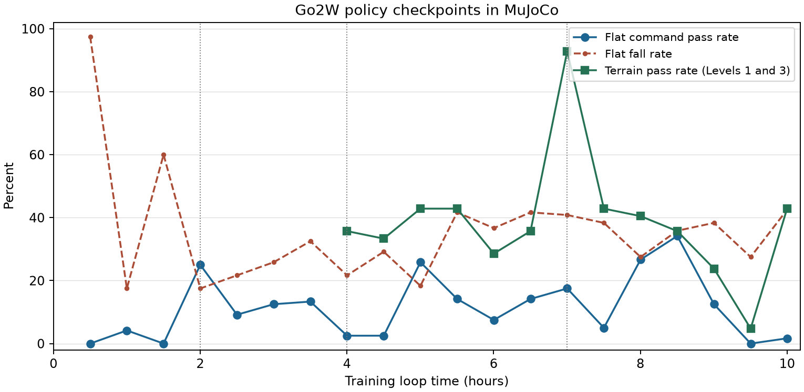
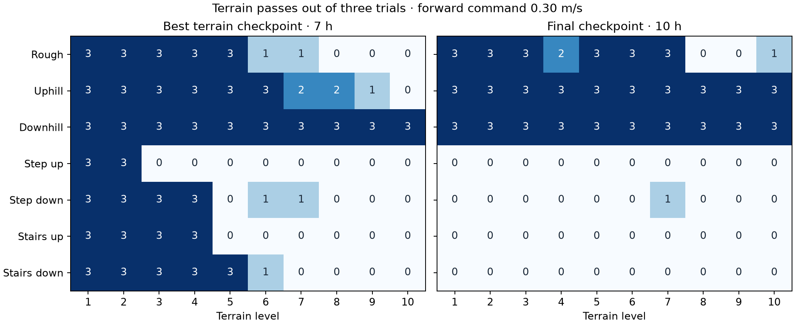

# Go2W Motion Prior 十小时训练与侧移诊断

先验阶段的策略学会了低速侧移。第 7 小时的地形最佳模型能通过低等级台阶及连续楼梯。到第 10 小时，最终模型的上坡能力提高，楼梯与平地速度跟踪通过率下降。 [评测曲线](evaluation_curve.png) · [诊断摘要](diagnostic_summary.json)

## 训练过程

训练从提交 7aeec87edfe945f80ea40b70ce681cd160be04c1 零初始化开始。4096 个 MuJoCo 环境累计运行 **36,000.79 秒有效训练时间**、**29,089 次迭代**，采集 **298,131,456 条真实物理 transition**。总墙钟时间约 10 小时 11 分钟，含初始化、评测和写盘。峰值 CUDA 分配约 4,180 MiB。 [训练来源](provenance.json) · [运行配置](resolved_config.yaml) · [训练汇总](training_summary.json)

| 有效训练时间 | 阶段事件 | 评测与配额 |
|---|---|---|
| 约 2 小时，第 5,876 次迭代 | 基础评测触发 flat_prior → flat_autonomous | 基础平地 18/39，完整平地 30/120 |
| 约 4 小时，第 11,486 次迭代 | 时间上限触发 flat_autonomous → terrain | 60% 平地，40% 分配到七种非平地场景 |
| 约 7 小时，第 20,179 次迭代 | 地形评测触发常规配额 | 40% 平地，原协议地形通过 33/42 |
| 约 8.5 小时，第 24,628 次迭代 | 完整平地评测峰值 | 41/120（34.2%） |
| 10 小时，第 29,089 次迭代 | 达到训练预算 | 完整平地 2/120（1.7%） |

best.pt 由地形阶段的综合评分选出，对应第 20,179 次迭代的 best_terrain.pt。第 24,628 次迭代的平地峰值来自周期评测记录。 [最佳 checkpoint 选择记录](best_selection.json) · [逐次评测计数](evaluation_history.csv)

## 平地通过率

完整平地使用 40 个固定命令，每个命令在三个固定初始朝向各运行一次，共 120 次。命令包括站立、前后移动、左右侧移、正反旋转和三类耦合。纯侧移每侧测试 0.10、0.175、0.20、0.30 m/s 四档，共 12 次。命令切换单独计分。基础平地协议使用 13 个命令，共 39 次。 [评测实现](../../../../tools/evaluate_go2w_motion_prior.py)

每次从普通站姿启动，由 Actor 独立控制。固定命令试验须同时满足三项才通过。

1. 跑满 4 秒（200 个控制步）且无跌倒。提前越过平地边界的样本标为无效，仍计入试验总数。
2. 从起步第一帧计算机身系三轴 RMSE。各轴上限取绝对容差和目标幅值 35% 中的较大值。纵向和横向的绝对容差均为 0.05 m/s，偏航角速度为 0.10 rad/s。
3. 每个非零命令轴在目标方向上的平均速度须达到命令幅值的 40%。

例如左移 0.20 m/s，要求横向 RMSE ≤ 0.07 m/s，纵向漂移 RMSE ≤ 0.05 m/s，偏航角速度 RMSE ≤ 0.10 rad/s，平均左移速度 ≥ 0.08 m/s。 [最佳逐次结果](best_fixed_review.json) · [最终逐次结果](last_fixed_review.json)

## 最佳与最终模型

| 独立 MuJoCo 评测 | best.pt，约 7 小时 | last.pt，10 小时 |
|---|---:|---:|
| 完整平地 | 21/120（17.5%） | 2/120（1.7%） |
| 平地跌倒 | 49/120（40.8%） | 51/120（42.5%） |
| 前进 | 12/15 | 0/15 |
| 后退 | 0/12 | 0/12 |
| 左移 / 右移 | 0/12 / 0/12 | 0/12 / 0/12 |
| 命令切换 | 6/18 | 7/18 |
| 地形 Level 1 和 Level 3，重算 | 39/42（92.9%） | 18/42（42.9%） |
| 地形 Level 1–10，重算 | 118/210（56.2%） | 82/210（39.0%） |

原崎岖地评测按 18 秒判完成，环境实际在 10 秒截断。重算沿用原速度误差上限，将跑满 10 秒、无跌倒且三轴 RMSE 均低于 0.15 的崎岖地样本计为通过。低等级协议原始地形通过数是 33/42 和 12/42，修正后两份模型各增加 6 次通过。 [最佳逐等级数据](best_levels_1_to_10.json) · [最终逐等级数据](last_levels_1_to_10.json)

best.pt 的连续上楼 Level 1–4 每级均通过 3/3，连续下楼 Level 1–5 每级均通过 3/3。最终模型连续上楼和下楼均为 0/30，上坡和下坡均为 30/30。这轮数据无法单独识别第 7 小时配额调整对后续退化的影响。

## 侧移诊断

### 两个方向都曾学出低速侧移

补测保持原判据，增加 ±0.05、±0.075、±0.10、±0.15、±0.20 m/s，每档三次。先验阶段最佳模型在前两档左右各通过 3/3，在 ±0.10 m/s 左右均为 0/3。第 3.5 小时的自主阶段最佳模型在完整协议中左移通过 2/12。地形最佳和最终模型在补测中均只有 −0.05 m/s 通过 3/3，其余档位全失败。 [先验补测](best_flat_prior_lateral_low_speed.json) · [自主补测](best_flat_autonomous_lateral_low_speed.json) · [地形最佳补测](best_terrain_lateral_low_speed.json) · [最终补测](last_lateral_low_speed.json)

完整协议的 24 次侧移试验中，地形最佳模型跌倒 21 次，最终模型跌倒 17 次。保持 4 秒存活与运动方向要求，将三轴 RMSE 容差放宽 50% 后，两份模型仍为 0/24。 [最佳逐次结果](best_fixed_review.json) · [最终逐次结果](last_fixed_review.json)

### 课程速度覆盖

先验阶段左右纯侧移的课程最高均为 Level 1，整轮日志中最高分别为左 Level 2、右 Level 1。最终近期 Replay 有 173,774 条纯左移和 182,134 条纯右移 transition，命令幅值均低于 0.10 m/s。完整评测的最低侧移速度是 0.10 m/s，中高档主要测试外推。 [课程等级与 Replay 统计](diagnostic_summary.json)

### 先验系数与实测梯度

名义系数从 0.60 降至 0.21，侧移 Candidate 质量权重为 0.5，匹配误差还会进一步衰减。因此侧移初始系数上限为 0.30，约第 1 小时起为 0.105，约第 2.5 小时归零。28 个独立全批次诊断中，先验梯度范数与任务合成梯度范数之比的中位数为 **7.2%**，这一比例包含其他命令。 [梯度统计](diagnostic_summary.json)

本轮模仿项约束腿关节位置、速度和有效轮速，机身速度和稳定性由任务奖励与学习到的动力学驱动。此前直接用 PD 执行动力学审计的纯侧移参考，普通站姿和 RSI 连续执行各为 0/6。SuperMimic 的全参考跟踪模式还在奖励中直接纳入机身与各刚体的位置、姿态和速度。 [参考运动物理审计](../reference_collection_audit.json) · [SuperMimic 论文与附录](https://arxiv.org/abs/2610.28480)

### World Model 多步侧向动作响应

从同一 MuJoCo 状态出发，对 16 个归一化动作维度分别施加 ±0.01 和 ±0.03 的扰动，比较真实物理与 World Model 在第 1、8 步的速度有限差分。测试覆盖普通站姿和若干早期 Actor 状态，保持扰动动作恒定，剔除在比较时刻前已终止的动作对。

| checkpoint | 单步左 / 右方向余弦中位数 | 第 8 步左 / 右方向余弦中位数 | 第 8 步预测与实际响应范数比中位数 |
|---|---:|---:|---:|
| 先验最佳 | 0.980 / 0.985 | 0.777 / 0.343 | 左 5%，右 6% |
| 自主最佳 | 0.982 / 0.975 | 0.395 / 0.228 | 左 9%，右 6% |
| 地形最佳 | 0.980 / 0.980 | 0.685 / 0.316 | 左 18%，右 17% |
| 最终模型 | 0.980 / 0.987 | 0.176 / −0.170 | 左 9%，右 15% |

最终模型有 6 个可比较的第 8 步右移扰动样本，其中 5 个方向余弦为负。最终策略留出轨迹的 69 个左移窗口和 70 个右移窗口中，最终 WM 的横向速度 RMSE 分别从单步 0.056、0.058 m/s 增至第 8 步 0.233、0.233 m/s。前进样本也有多步响应偏差。恒定扰动测试反映局部响应，训练中的 Actor 则以闭环方式更新动作。现有单次训练和有限扰动样本无法量化课程、先验及 WM 偏差的独立贡献。 [留出集与动作响应数据](lateral_world_model_diagnostics.json)
